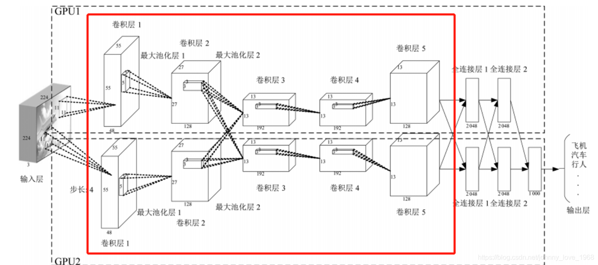
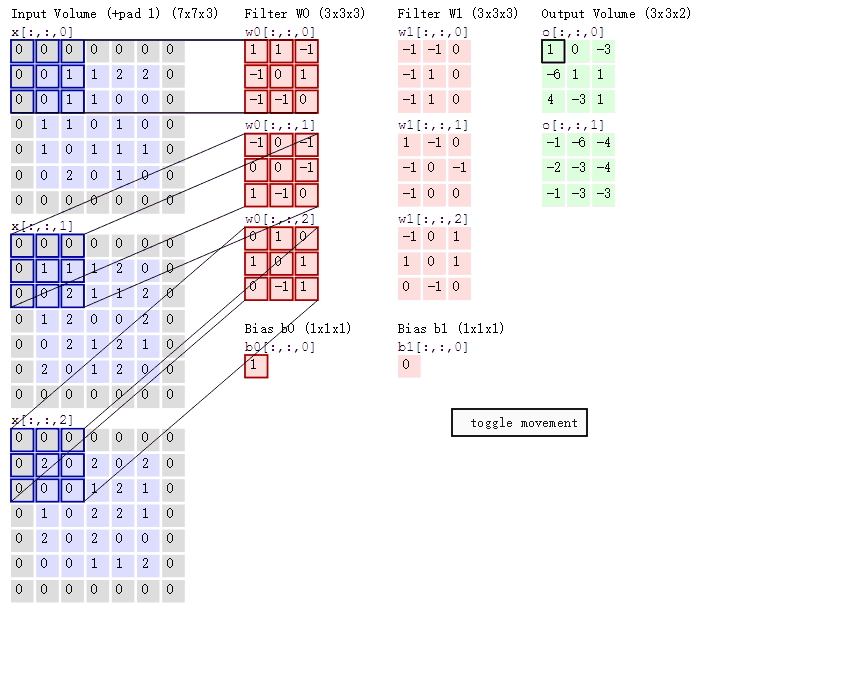
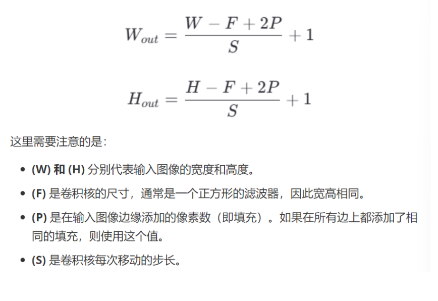
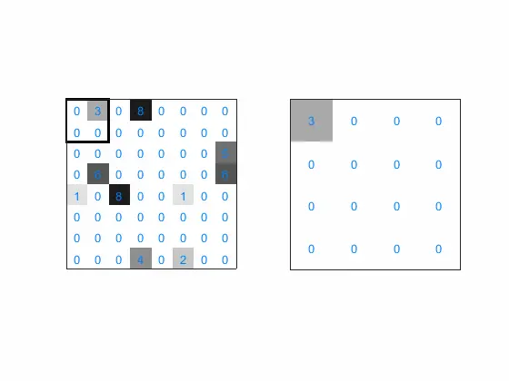
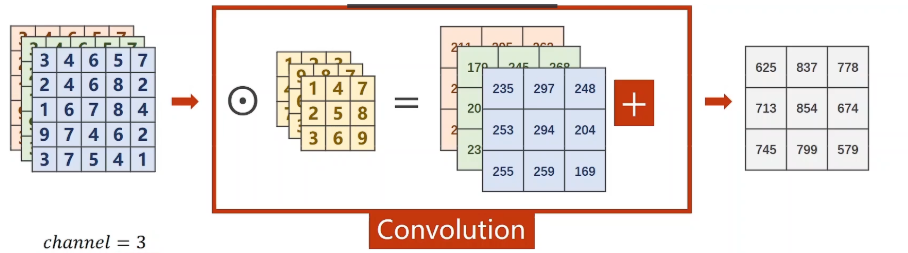
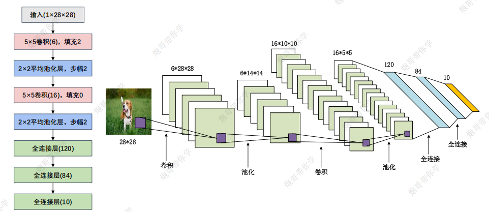

# 前言：何为卷积神经网络

卷积神经网络是一种深度学习模型，包括了**卷积层，激活函数，池化层以及全连接层**等等，他的设计灵感来自于生物学中的视觉系统，旨在模拟人类视觉处理的方式。

**CNN的三大特性：局部连接，权重共享，池化**



# 一、卷积层

## 1.1 卷积过程

卷积层的主要作用是**提取输入数据中的局部特征**

这张动画中蓝色的框就是指一个数据窗口，红色框为卷积核（滤波器），最后得到的绿色方形就是卷积的结果（**卷积操作是通过滑动卷积核，在每个局部区域上进行“先乘再和”的运算，最终生成一个特征图，每个输出值是一个标量。**）



## 1.2 卷积层的作用以及涉及的超参数详解

**卷积层主要用来提取局部特征**。

在实际使用中涉及到的参数有：

卷积核大小：**决定了卷积核覆盖的局部区域大小，影响特征提取的粒度**。**较小**的卷积核可以捕捉更细粒度的特征，**适合提取边缘和纹理**；**较大**的卷积核可以**捕捉更广泛的特征**，但计算量更大。

卷积核形状参数一定要是**奇数**，因为奇数大小的卷积核具有**唯一的中心像素**，便于在卷积操作中**均匀取样并保持对称性，同时有助于处理图像边缘，避免模糊和信息损失**。

步长：每次滑动的位置，控制卷积核每次移动的像素数，影响**输出特征图的尺寸**

填充：在输入数据的边缘添加额外的像素（**通常为零**），以控制**输出特征图的尺寸。**

## 1.3 特征图尺寸计算公式（重要）



# 二、池化层

池化层的主要作用是**对非线性激活后的结果进行下采样**，**以减少参数的数量，避免过拟合，并提高模型的处理速度，提高计算速度，同时提高所提取特征的鲁棒性**。

**分为最大池化和平均池化**



# 三、多通道卷积

对于彩色图片有RGB三个[通道](https://so.csdn.net/so/search?q=通道&spm=1001.2101.3001.7020)，需要处理多输入通道的场景。输出特征图往往也会具有多个通道，而且在神经网络的计算中常常是把一个批次的样本放在一起计算，最后将每个通道特征图对应位置进行相加得到一张新的特征图，所以卷积算子需要具有批量处理多输入和多输出通道数据的功能。



# 四、构建一个简单的卷积神经网络

下面我们将以最经典的LetNet为案例来构建一个简单的CNN网络骨架

首先我们先贴出LetNet的网络结构图如下



```python
from sympy import Sum
import torch
import torch.nn as nn
from torchsummary import summary
class LeNet(nn.Module):
    """
    下面是比较详细的参数名，具体参数值详见结构图
    """
    def __init__(self):
        super(LeNet,self).__init__()
        self.model = nn.Sequential(
            # 最初输入卷积核的维度in_channels设置为1，代表输入灰度图的通道数
            nn.Conv2d(in_channels=1, out_channels=6, kernel_size=5, padding=2),# outchannel即为卷积核维度
            nn.Sigmoid(),# 引入非线性特性
            nn.AvgPool2d(kernel_size=2, stride=2),
            nn.Conv2d(in_channels=6, out_channels=16, kernel_size=5, padding=0),
            nn.AvgPool2d(kernel_size=2),
            nn.Flatten(),# 不要忘记展平操作
            nn.Linear(in_features=16*5*5, out_features=120),# 这里需要根据前面的池化层的输出尺寸来计算in_features
            nn.Linear(in_features=120, out_features=84),
            nn.Linear(in_features=84, out_features=10)
        )

    def forward(self,input):
        output = self.model(input)
        return output

letnet = LeNet()
print(summary(letnet,input_size=(1,28,28),batch_size=8))

```

最终运行结果：

```
----------------------------------------------------------------
        Layer (type)               Output Shape         Param #
================================================================
            Conv2d-1             [8, 6, 28, 28]             156
           Sigmoid-2             [8, 6, 28, 28]               0
         AvgPool2d-3             [8, 6, 14, 14]               0
            Conv2d-4            [8, 16, 10, 10]           2,416
         AvgPool2d-5              [8, 16, 5, 5]               0
           Flatten-6                   [8, 400]               0
            Linear-7                   [8, 120]          48,120
            Linear-8                    [8, 84]          10,164
            Linear-9                    [8, 10]             850
================================================================
Total params: 61,706
Trainable params: 61,706
Non-trainable params: 0
----------------------------------------------------------------
Input size (MB): 0.02
Forward/backward pass size (MB): 0.81
Params size (MB): 0.24
Estimated Total Size (MB): 1.06
----------------------------------------------------------------
None
```

