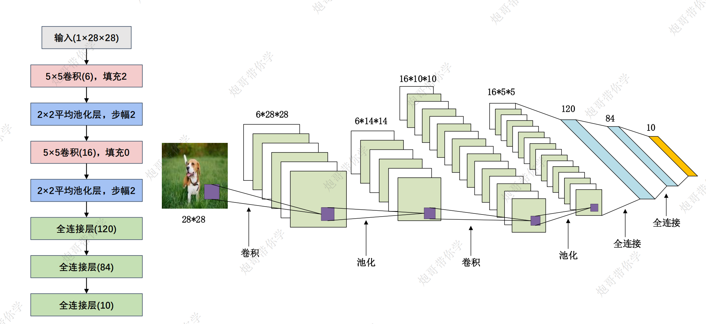
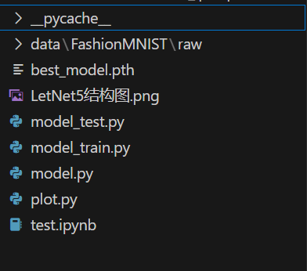
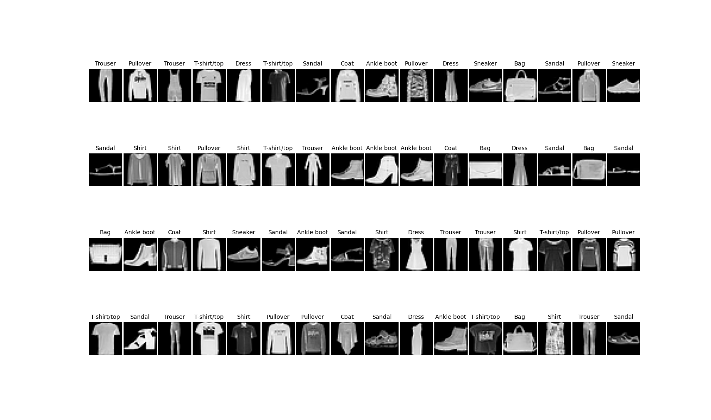

# 前言：卷积层的输入要求

卷积层对图像的输入顺序有要求，**[batch, channel, height, width]**，当图片为灰度图是，第一层卷积的in_channels=1，后续out_channels=卷积核数量

图片原本的顺序是(height, width, channels)，需要用permute来处理,并且将数值转换为浮点型

卷积、矩阵乘法等可能无法正确处理非浮点类型的数据。

# 一、网络结构解读



模型在手写数字识别上具有良好的效果，但是结构较为简单，只涉及卷积，池化，全连接的线性排列，这里不做过多介绍，毕竟神经网络这些参数可解释性都很差，学习他的搭建结构就好

输出特征图的参数计算比较简单，主要是在第一层全连接层的输入那里需要填。


# 1.1 线性层的最后输出

​	值得一提的是在 LeNet 模型中，最后一个线性层的输出是一个大小为 10 的向量，这些输出值被称为 **logits**。这些 logits 是模型对输入图像属于每个类别的原始预测值，还没有经过 Softmax 函数处理。

**真正传入softmax，将预测值转变为概率是在训练阶段的交叉熵函数中**
$$
\text{Softmax}(z_i) = \frac{e^{z_i}}{\sum_{j=1}^{C} e^{z_j}}
$$

$$
\text{Cross-Entropy Loss} = - \sum_{i=1}^{C} y_i \log(p_i)
$$

## 二、使用LetNet对FashionMNIST数据集进行识别

## 2.1 项目结构总览



## 2.2 plot.py 查看数据集

```python

import torch
from torchvision.datasets import FashionMNIST
import numpy as np
from torch.utils.data import DataLoader
from torchvision import transforms
import matplotlib.pyplot as plt

transform= transforms.Compose([transforms.ToTensor(),
                           transforms.Resize((28,28)),
                        #    单通道图像，归一化只有一个参数
                           transforms.Normalize([0.286],[0.353])])

train_data = FashionMNIST(root="LetNet5\data",
                          train=True,
                          transform=transform,
                          download=True)

train_loader = DataLoader(dataset=train_data,batch_size=64,shuffle=True)

# 获得一个Batch的数据
for step, (b_x, b_y) in enumerate(train_loader):
    if step > 0:
        break
print(b_x.shape,b_y.shape)
batch_x = b_x.squeeze().numpy()  # 将四维张量移除第1维，并转换成Numpy数组
batch_y = b_y.numpy()  # 将张量转换成Numpy数组
class_label = train_data.classes  # 训练集的标签
print(class_label)
print("The size of batch in train data:", batch_x.shape)  # 每个mini-batch的维度是64*224*224


# 可视化一个Batch的图像
plt.figure(figsize=(20, 15))
for ii in np.arange(len(batch_y)):
    plt.subplot(4, 16, ii + 1)
    plt.imshow(batch_x[ii, :, :], cmap=plt.cm.gray)
    plt.title(class_label[batch_y[ii]], size=10)
    plt.axis("off")
    plt.subplots_adjust(wspace=0.05)
plt.show()

```



## 2.3 model.py 构建模型结构

```python
import torch
from torch import nn
from torchsummary import summary

class LeNet(nn.Module):
    """
    下面是比较详细的参数名，具体参数值详见结构图
    """
    def __init__(self):
        super(LeNet,self).__init__()
        self.model = nn.Sequential(
            # 最初输入卷积核的维度in_channels设置为1，代表输入灰度图的通道数
            nn.Conv2d(in_channels=1, out_channels=6, kernel_size=5, padding=2),# outchannel即为卷积核维度
            nn.Sigmoid(),# 引入非线性特性
            nn.AvgPool2d(kernel_size=2, stride=2),
            nn.Conv2d(in_channels=6, out_channels=16, kernel_size=5, padding=0),
            nn.AvgPool2d(kernel_size=2),
            nn.Flatten(),# 不要忘记展平操作
            nn.Linear(in_features=16*5*5, out_features=120),# 这里需要根据前面的池化层的输出尺寸来计算in_features
            nn.Linear(in_features=120, out_features=84),
            nn.Linear(in_features=84, out_features=10)
        )

    def forward(self,input):
        output = self.model(input)
        return output


if __name__ =="__main__":
    device_choose = torch.device("cuda" if torch.cuda.is_available() else "cpu")

    model = LeNet().to(device=device_choose)

    # 控制台打印模型详细参数
    print(summary(model,input_size=(1,28,28),batch_size=64))

    torch.manual_seed(42)
    input = torch.randn((64,1,28,28))
    # print(input)
    output = model(input)
    print(output.shape)
```

## 2.4 model_train 

```python
import copy
import time
import torch
import torch.optim
from torchvision.datasets import FashionMNIST
from torchvision import transforms
from torch.utils.data import DataLoader, random_split
import matplotlib.pyplot as plt
import pandas as pd
from model import LeNet


# 加载数据集
def train_val_data_process():
    transform= transforms.Compose([transforms.ToTensor(),
                            transforms.Resize((28,28)),
                            #    单通道图像，归一化只有一个参数
                            transforms.Normalize([0.286],[0.353])])

    train_data = FashionMNIST(root="LetNet5\data",
                            train=True,
                            transform=transform,
                            download=True)
    
    train_data,val_data = random_split(train_data,[round(0.8*len(train_data)),round(0.2*len(train_data))])
    
    # 在多核 CPU 上，设置一个合适的 num_workers 值可以显著提高数据加载效率
    train_loader = DataLoader(dataset=train_data,batch_size=32,shuffle=True,num_workers=8)
    val_loader = DataLoader(dataset=val_data,batch_size=32,shuffle=True,num_workers=8)

    return train_loader,val_loader

train_loader,val_loader = train_val_data_process()

# 模型训练函数
def train_model_process(model,train_loader,val_loader,num_epochs):

    device_choose = torch.device("cuda" if torch.cuda.is_available() else "cpu")

    # 交叉熵损失函数
    criterion = torch.nn.CrossEntropyLoss()

    # 优化器
    optimizer = torch.optim.Adam(model.parameters(),lr=0.001)

    # 调用模型
    model = model.to(device_choose)

    # 复制当前模型参数
    best_model_wts = copy.deepcopy(model.state_dict())

    # 初始化参数
    best_acc = 0.0

    # 训练损失值,准确度列表
    train_loss_all,train_acc_all = [],[]

    # 验证损失值,准确度列表
    val_loss_all,val_acc_all = [],[]

    # 每轮训练时间
    since = time.time()

    # 训练循环
    for epoch in range(num_epochs):

        time_start = time.time()
        print("Epoch {}/{}".format(epoch, num_epochs-1))
        print("-"*10)

        # 当前训练损失值,准确度
        train_loss,train_corrects = 0.0,0.0

        # 当前验证损失值,准确度
        val_loss,val_corrects = 0.0,0.0

        # 训练集和验证集样本数量
        train_num,val_num = 0,0

        # 加载批次数据,下面训练输入为一批次数据，输出位一批次数据的预测
        for train_data in train_loader:

            # 解包数据，img 是输入图像，target 是对应的标签
            img_tensor, target = train_data

            # 将数据移动到指定的设备（CPU 或 GPU）
            img_tensor = img_tensor.to(device_choose)
            target = target.to(device_choose)

            # 打开模型的训练模式
            model.train()

            # 前向传播
            output = model(img_tensor)

            # dim=1表示查找最大值对应行标
            pre_lab = torch.argmax(output,dim=1)

            # 计算每一个batch的交叉熵
            loss = criterion(output,target)

            # 梯度初始化为0
            optimizer.zero_grad()

            # 反向传播
            loss.backward()

            # 更新参数
            optimizer.step()

            # 计算损失值和精确度
            # 这里loss是每个样本的平均值，乘以img_tensor.size(0)表示累加值，train_loss表示参与训练全体数据的损失值累加
            train_loss += loss.item() * img_tensor.size(0)
            # 如果预测正确，则准确度train_corrects加1
            train_corrects += torch.sum(pre_lab == target.data)

            # 当前用于训练的样本数量，train_num表示参与训练全体数据
            train_num += img_tensor.size(0)
        
        # 加载验证集,验证集不参与模型训练，没有反向传播和梯度更新过程，其他和训练集步骤一致
        for val_data in val_loader:

            # 解包数据，img 是输入图像，target 是对应的标签
            img_tensor, target = val_data

            # 将数据移动到指定的设备（CPU 或 GPU）
            img_tensor = img_tensor.to(device_choose)
            target = target.to(device_choose)

            # 开启模型评估模式
            model.eval()

            output = model(img_tensor)

            pre_lab = torch.argmax(output,dim=1)

            loss = criterion(output,target)

            val_loss += loss.item() * img_tensor.size(0)

            val_corrects += torch.sum(pre_lab == target.data)

            val_num += img_tensor.size(0)
        
        # 计算并保存随着epoch增加，参与训练（和验证）的数据的平均损失值和准确率
        # 训练集
        train_loss_all.append(train_loss / train_num)
        train_acc_all.append(train_corrects / train_num)

        # 验证集
        val_loss_all.append(val_loss / val_num)
        val_acc_all.append(val_corrects / val_num)

        print(f"{epoch + 1}轮训练 损失值Train loss:{train_loss_all[-1]:.2f}, 精确值Acc:{train_acc_all[-1]:.2f}")
        print(f"{epoch + 1}轮测试 损失值val loss:{val_loss_all[-1]:.2f}, 精确值Acc:{val_acc_all[-1]:.2f}")

        if val_acc_all[-1] > best_acc:
            # 保存当前最高准确度
            best_acc = val_acc_all[-1]
            # 保存当前最高准确度的模型参数
            best_model_wts = copy.deepcopy(model.state_dict())

        # 计算一个epoch训练时间
        time_end = time.time()-time_start
        print(f"当前轮次训练耗费的时间：{time_end // 60}m{time_end % 60:.2f}s")
    # 计算总的训练时间
    time_use = time.time() - since
    print(f"训练耗费的时间：{time_use // 60}m{time_use % 60:.2f}s")
    # 选择最优参数，保存最高准确率下的模型参数
    model.state_dict(best_model_wts)
    torch.save(model.state_dict(best_model_wts),"LetNet5/best_model.pth")

    # 保存训练过程每一个epoch的计算数据作为训练返回
    train_process = pd.DataFrame(data={"epoch":range(num_epochs),
                                    "train_loss_all":train_loss_all,
                                    "val_loss_all":val_loss_all,
                                    "train_acc_all":train_acc_all,
                                    "val_acc_all":val_acc_all,})
    
    return train_process


def matplot_acc_loss(train_process):
    # 显示每一次迭代后的训练集和验证集的损失函数和准确率
    plt.figure(figsize=(12, 4))
    plt.subplot(1, 2, 1)
    plt.plot(train_process['epoch'], train_process.train_loss_all, "ro-", label="Train loss")
    plt.plot(train_process['epoch'], train_process.val_loss_all, "bs-", label="Val loss")
    plt.legend()
    plt.xlabel("epoch")
    plt.ylabel("Loss")
    plt.subplot(1, 2, 2)
    plt.plot(train_process['epoch'], train_process.train_acc_all, "ro-", label="Train acc")
    plt.plot(train_process['epoch'], train_process.val_acc_all, "bs-", label="Val acc")
    plt.xlabel("epoch")
    plt.ylabel("acc")
    plt.legend()
    plt.show()


if __name__ == '__main__':
    # 加载需要的模型
    LeNet = LeNet()
    print("-"*50)
    print("模型加载成功")
    print("-"*50)
    # 加载数据集
    train_data, val_data = train_val_data_process()
    print("-"*50)
    print("数据集加载完成")
    print("-"*50)
    # 利用现有的模型进行模型的训练
    print("模型开始训练")
    train_process = train_model_process(LeNet, train_data, val_data, num_epochs=3)
    print("-"*50)
    print("模型训练完成")
    print("-"*50)
    matplot_acc_loss(train_process)


```

## 2.5 model_test

```python
import torch
from torchvision.datasets import FashionMNIST
from torchvision import transforms
from torch.utils.data import DataLoader, random_split
import matplotlib.pyplot as plt
from model import LeNet

# 加载测试数据集
def test_data_process():
    transform= transforms.Compose([transforms.ToTensor(),
                            transforms.Resize((28,28)),
                            #    单通道图像，归一化只有一个参数
                            transforms.Normalize([0.286],[0.353])])

    test_data = FashionMNIST(root=r"LetNet5\data",
                            train=False,
                            transform=transform,
                            download=True)
    
    test_loader = DataLoader(dataset=test_data,
                             batch_size=1,# 每次使用一条数据来测试
                             shuffle=True,
                             num_workers=8)
    return test_loader

# 模型测试函数
def test_model_process(model,test_loader):

    device_choose = torch.device("cuda" if torch.cuda.is_available() else "cpu")

    # 调用模型
    model = model.to(device_choose)

    # 初始化参数
    test_corrects = 0.0
    test_num = 0

    # 只进行前向传播，不计算梯度
    with torch.no_grad():
               # 加载验证集,验证集不参与模型训练，没有反向传播和梯度更新过程，其他和训练集步骤一致
        for test_data in test_loader:

            img_tensor, target = test_data

            # 将数据移动到指定的设备（CPU 或 GPU）
            img_tensor = img_tensor.to(device_choose)
            target = target.to(device_choose)

            # 进行模型推理
            model.eval()

            # 前向传播过程，输入为测试数据集，输出为对每个样本的预测值
            output= model(img_tensor)
            # 查找每一行中最大值对应的行标
            pre_lab = torch.argmax(output, dim=1)

            # 展示推理过程
            class_names = ['T-shirt/top', 'Trouser', 'Pullover', 'Dress', 'Coat', 'Sandal', 'Shirt', 'Sneaker', 'Bag', 'Ankle boot']
            result = pre_lab.item()
            label = target.item()
            if result==label:
                print(f"预测值:{class_names[result]}-----真实值:{class_names[label]}-----正确")
            else:
                print(f"预测值:{class_names[result]}-----真实值:{class_names[label]}-----错误")
                
            # 如果预测正确，则准确度test_corrects加1
            test_corrects += torch.sum(pre_lab == target.data)
            # 将所有的测试样本进行累加
            test_num += img_tensor.size(0)

        # 计算测试准确率
        test_acc = test_corrects.double().item() / test_num
        print("测试的准确率为：", test_acc)

if __name__=="__main__":
    # 加载模型
    model = LeNet()
    model.load_state_dict(torch.load(r'LetNet5\best_model.pth', map_location=torch.device('cpu')))
    # 加载测试数据
    test_loader = test_data_process()
    # 加载模型测试的函数
    test_model_process(model, test_loader)

```

