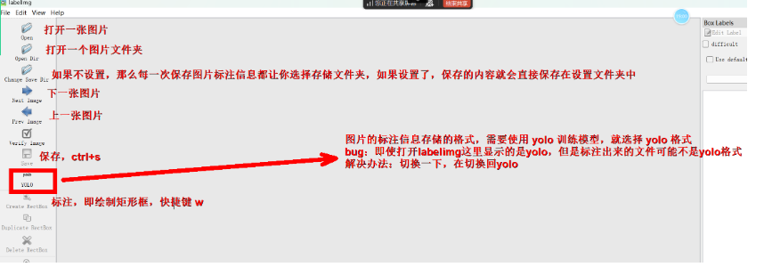
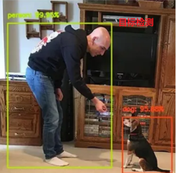
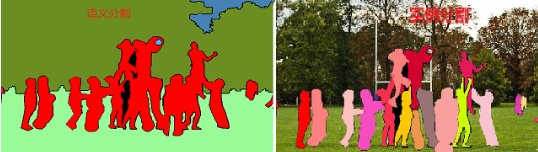
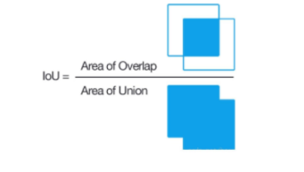
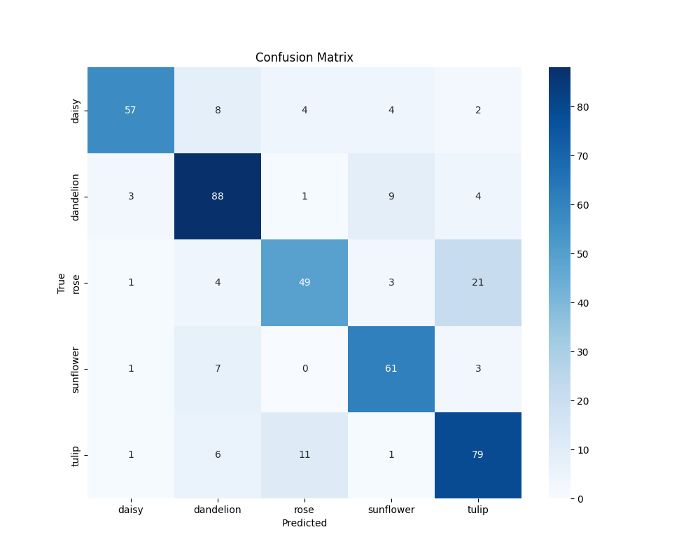
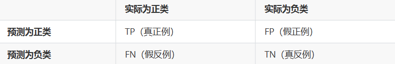
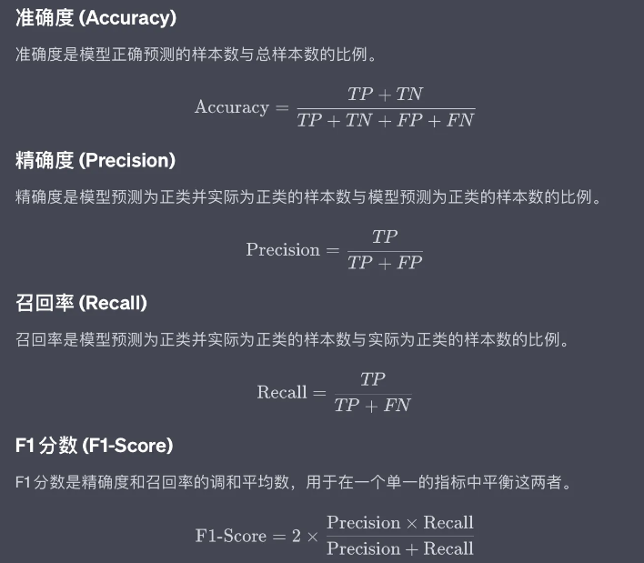
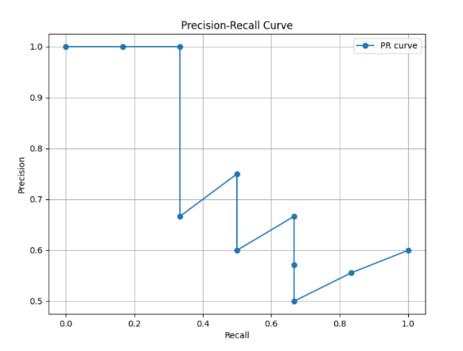
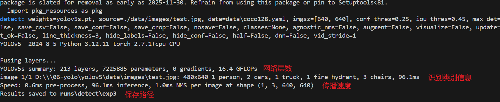
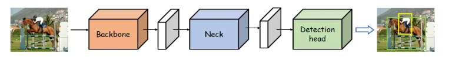

# 一、概念

**目标检测**需要识别图片或视频帧中的物体是什么类别，并确定他们的位置**（where and what）**，通常用于多个物体的识别，并为每个示例提供一个边界框和类别标签。

- 目标检测的本质：使用边界框将物体在图中圈出，边界框上会存在两个指标：类别信息，置信度

**yolo(you only look once)**：是一个单阶段的目标检测算法，能够用于实时监测

人工智能领域的上游任务和下游任务

- 上游任务通常是指为后续任务提供基础支持的任务，主要关注数据的收集、处理、模型的预训练等基础性工作。这些任务的输出通常是一个通用的模型或者数据集，可以被多个下游任务复用

- 下游任务是指在上游任务的基础上，针对具体的业务场景或应用需求进行的模型微调和应用开发。这些任务通常具有明确的目标和应用场景，需要在预训练模型的基础上进行进一步的优化和调整，以满足特定任务的需求

# 二、数据标注

数据标注是在图片中框选标注出我们需要模型训练用来检测的实例，用作监督模型训练的标签

步骤：

1. 创建一个专门用于数据标注的虚拟环境

   ```
   conda create -n yololabel python=3.12
   ```

2. 激活虚拟环境，下载labelimg工具

   ```python
   conda activate yololabel
   pip install labelimg -i https://pypi.tuna.tsinghua.edu.cn/simpl
   ```

3. 输入命令激活程序

   ```python
   labelimg
   ```

   

# 三、目标检测，图像分类，图像分割的区别

**目标检测**需要识别图片或视频帧中的物体是什么类别，并确定他们的位置**（where and what）**，通常用于多个物体的识别，并为每个示例提供一个边界框和类别标签。



**图像分类**是指识别图像中主要物体的类别，而不关心物体的具体位置**（what）**


**图像分割**指在图像中识别特定类别的物体，并用像素级别的标签来表示这些物体的位置。它**不仅需要识别物体是什么，还需要精确地描绘物体的轮廓**

- **语义分割**：将图像中的每个像素分类为不同的语义类别（如“天空”“道路”“汽车”），不区分同一类别中的不同个体。
- **实例分割**：不仅将图像中的像素分类到语义类别，还能区分同一类别中的不同个体（如区分不同的汽车），并为每个个体生成独立的分割掩膜。



# 四、one-stage和two-stage的简要区别

- **One-stage（单阶段）检测器**：直接在输入图像上预测目标的类别和位置，无需先生成候选区域，**速度快但精度可能稍低**。**(yolo)**
- **Two-stage（两阶段）检测器**：先生成候选区域，再对这些区域进行分类和精确定位，**精度高但速度较慢。****(R-CNN、Fast R-CNN、Faster R-CNN)**

# 五、评测指标

## 5.1 边界框

边界框包含以下三个信息：

- 类别标签：表示物体类别
- 置信度分数：0到1之间的值
- 边界框坐标：表示矩形框的位置和大小（x,y和w,h）

## 5.2 交并比（IoU）

交并比用于评估预测框与真实框的重合程度，交集除以并集



## 5.3 置信度

表示模型对**预测结果的可靠性或正确性的信心程度**。数值越高，表示模型越有信心认为预测结果是正确的

## 5.4 混淆矩阵

混淆矩阵依赖于IoU值，在混淆矩阵中：

- 列（Columns）：表示真实类别（True Labels）
- 行（Rows）：表示预测类别（Predicted Labels）
- 单元格中的数值：表示在该真实类别与预测类别组合下的样本数量



混淆矩阵结合以下四个统计指标，我们有精确度，召回率，准确率和F1分数来评判分类模型好坏



### 5.4.1 精确度和召回率

- 精确度：所有预测为正类的样本中预测正确的比例
- 召回率：所有实际为正类的样本中，预测正确的比例（可以反映模型优化的可行性）
- F1分数：精确度和召回率的调和平均数，用于平衡这两个指标



# 六、 mAP

## 6.1 PR曲线

**横轴为召回率，纵轴为精确率**，主要用于衡量模型在**不同阈值下对正样本的识别能力**

PR曲线通过改变分类阈值（例如，模型输出的概率阈值）来生成一系列点，**每个点对应一个特定的召回率和精确率**，绘制在二维平面上。随着阈值的变化，模型的预测结果会改变，从而影响召回率和精确率

**越靠近右上角，模型性能越好**



## 6.2 AP

通俗来讲，AP（平均精确率）是通过计算**PR曲线下的面积**，表示模型在不同召回率水平下的平均精确率。它是一个**介于0到1之间的数值，值越高，表示模型的性能越好**

## 6.3 mAP

mAP（平均平均精度）衡量模型整体性能的综合指标，值越高表示模型在所有类别上的平均表现越好，计算步骤：

- 计算每个类别的 AP：对于数据集中包含的每个类别，分别计算 AP
- 计算 mAP：将所有类别的 AP 取平均值，得到 mAP

# 七、 NMS非极大值抑制

在目标检测任务中，一个物体可能被多个检测框覆盖，每个检测框都对应一个置信度，NMS用于根据置信度的大小**保留置信度最高的检测框**，同时**抑制（即去除）与之重叠度较高的其他检测框**，保留最准确的检测结果。

NMS步骤：

**①计算IoU ---->②按照置信度（分类概率 × 目标存在概率）对检测框进行排序---->③选择置信度最高的检测框---->④计算其他框与当前框的 IoU---->⑤移除超过IoU阈值的框---->⑥重复到②---->⑦输出**

**每个目标最终只会有一个检测框，如果NMS输出了多个结果框，可能检测目标不止一个**

# 八、处理速度

yolo进行目标检测时会返回三个阶段的时间

- 前处理阶段耗时：数据预处理
- 网络前向传播耗时：从输入图像经过网络各层计算得到输出结果的时间
- 后处理阶段耗时：NMS，置信度过滤，类别筛选等



# 九、FPS和FLOPS

- FPS（每秒帧数）：是指模型每秒钟可以处理的图像帧数，是衡量实时性的重要指标
- FLOPS：每秒浮点数运算次数，衡量计算设备性能

# 十、yolo的三层整体结构

- Backbone network（**主干网络**）：由卷积网络构成，特征提取
- Neck network（**颈部网络**）：整合主干网络输出的特征，全连接层或池化层
- Detection head（**检测头**）：进行目标检测时，输出物体类别和位置


