# 一、yolov1

## 导航

YOLOv1YOLOV1 论文地址：【https://www.cv-foundation.org/openaccess/content_cvpr_2016/papers/Redmon_You_Only_Look_CVPR_2016_paper.pdf?spm=5176.28103460.0.0.359a5d27d0cimU&file=Redmon_You_Only_Look_CVPR_2016_paper.pdf】

YOLOV1 论文中文翻译地址：【https://blog.csdn.net/muye_IT/article/details/124612829】

## 1.1、网络结构

yolov1是在GoogLeNet 的基础上进行改编的一种**单阶段目标检测网络**，**把目标检测转变成一个回归问题**，实现端到端的检测

**包含24个卷积层，4个池化层，2个全连接层**

缺陷：**yolov1使用的仍然是全连接层，这就导致主干结构的输入要求必须是448x448的固定尺寸**

问：那为什么在预训练阶段可以输入224x224的图像呢？

- 在预训练阶段，YOLOv1 使用 224×224 的图像，是因为 ImageNet 数据集的标准输入尺寸是 224×224，而不是因为加入了平均池化层。
- 平均池化层的作用是减少特征图的尺寸，以便连接到全连接层，但它不能解决输入图像尺寸不固定的问题。

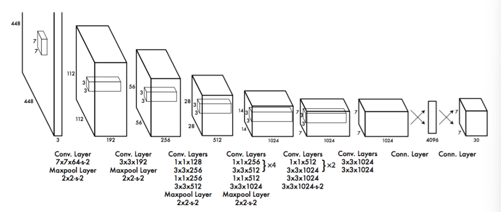

### 1.1.1 核心思想

将图片划分为**7×7**形状，共49 个大小相同的格子（cell）的网络结构，**每个格子负责预测中心点落在该网络类的目标**（这里说的是模型训练阶段，中心点来源于人工标注的边界框（Bounding Box））

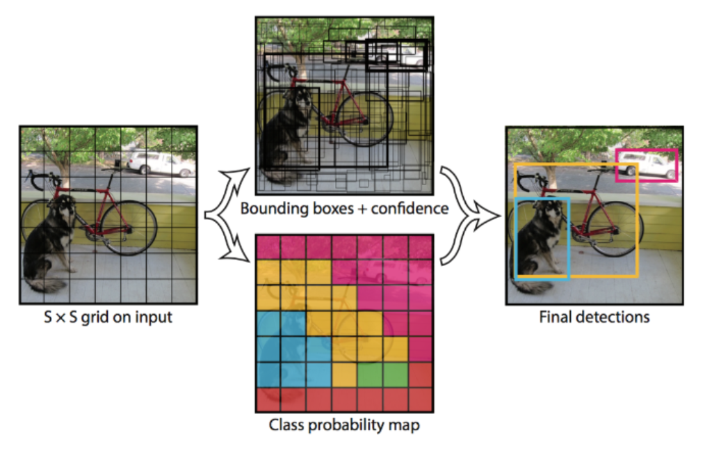

然后每个cell都将会预测出2个预测框，即7 x 7 x 2，每个边框又要预测（x,y,w,h）+ confidence（**即使某个网格不包含目标的中心点，它仍然会预测边界框，这样可以确保模型对整个图片的布局有一个全局的感知能力，同时减少漏检的风险**）

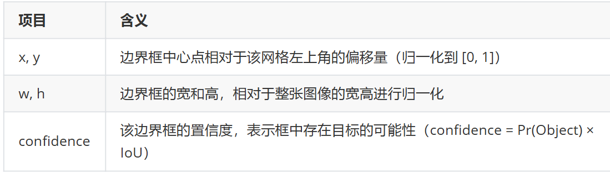

### 1.1.2 网络的输出

上面说到49×2=98个边界框承担着预测（x,y,w,h）+ confidence的任务，还需要预测出类别的概率，具体数目由检测任务决定，以VOC数据集为例（20个类别），网络最后输出就是 7 x 7 x (5 x 2 + 20)，既7 x 7 x 30

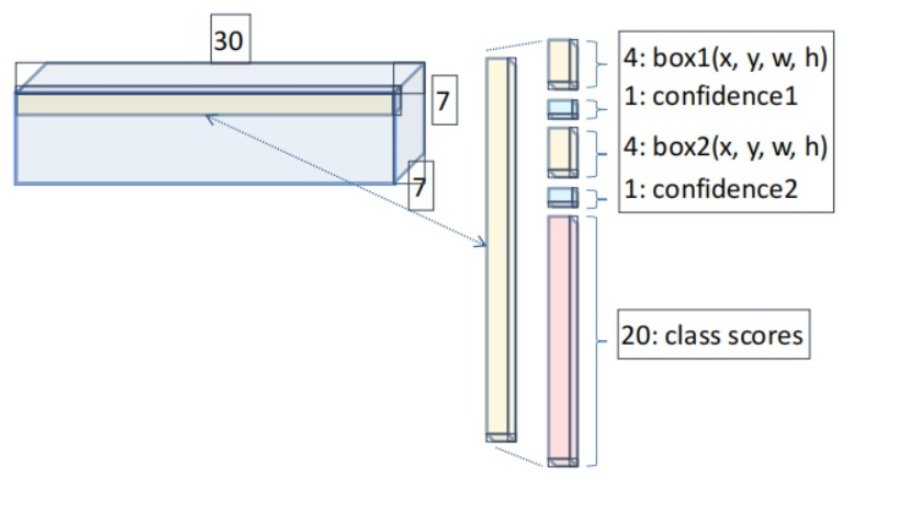

但是也由此产生了一个问题：因为每一个 grid cell只能有一个分类，也就是他只能预测一个物体，**如果所给图片极其密集，导致 grid cell里可能有多个物体，但是YOLO模型只能预测出来一个，那这样就会忽略在本grid cell内的其他物体。**

### 1.1.3 损失函数

yolov1的损失函数=边框定位损失（中心点和宽高误差）+ 置信度损失（有无物体的置信度） + 分类损失

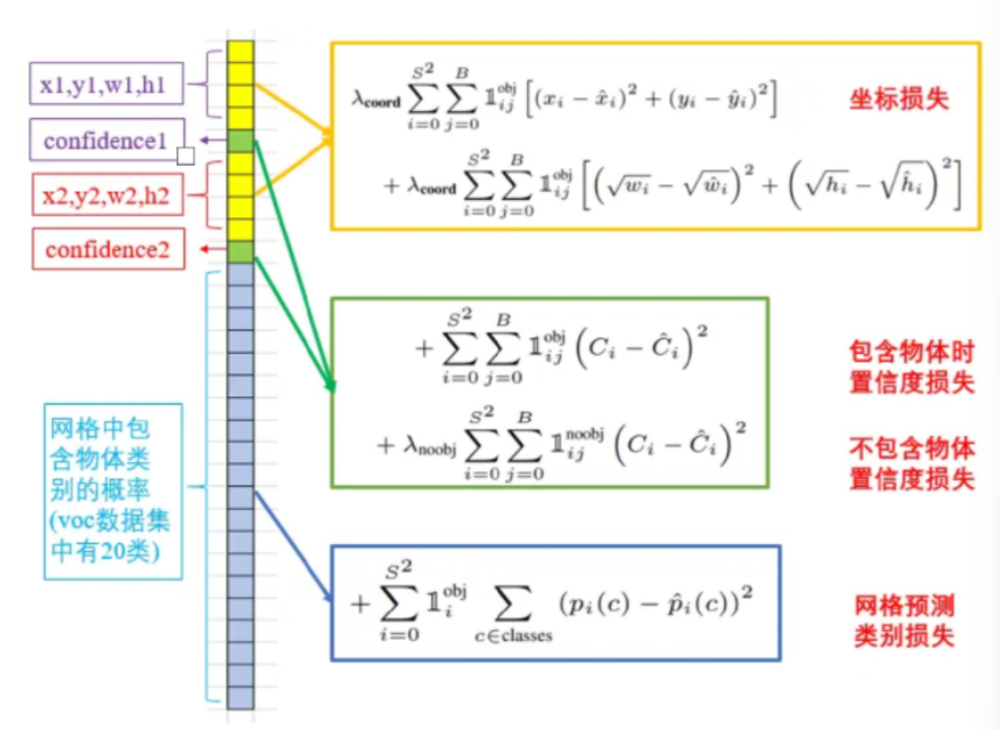

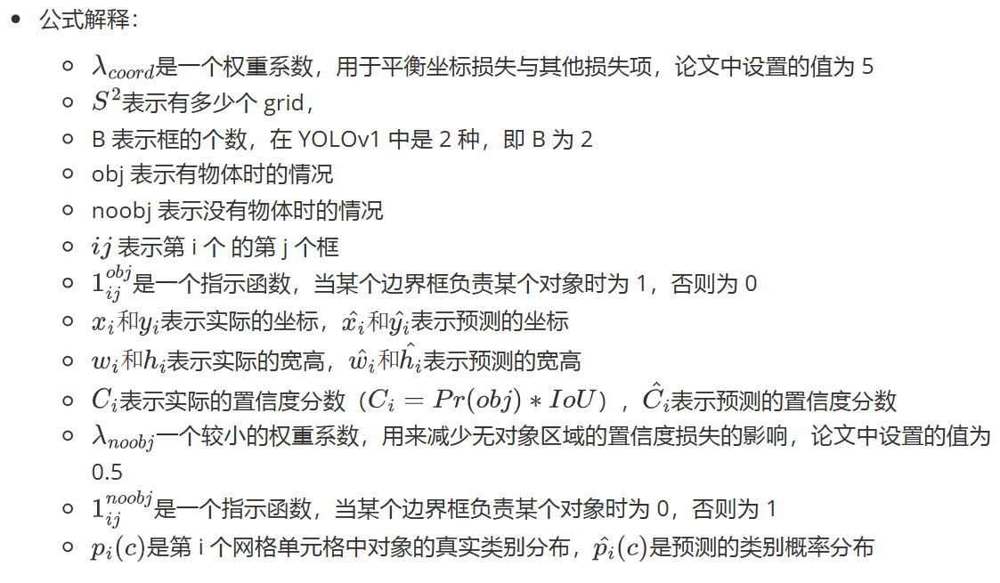

问：为什么宽高损失要加根号？

- 大框（大目标）差的这一点也许没啥事儿，而小框（小目标）差的这一点可能就会导致bounding box的方框和目标差了很远。而如果还是使用第一项那样直接算平方和误差，就相当于**把大框和小框一视同仁**了，这样显然不合理。而如果使用开根号处理，就会一定程度上改善这一问题

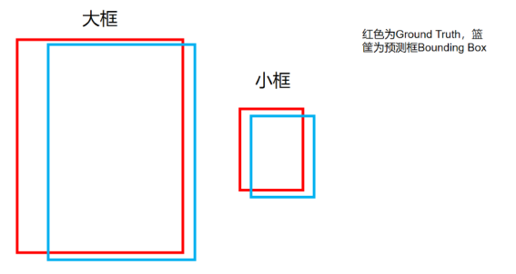

这样一来，同样是差一点，小框产生的误差会更大，**即对小框惩罚的更严重。**

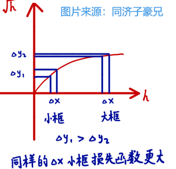

## 1.2 优缺点

- **优点**：YOLOv1 **实时性强**，可达到 45 fps，适合视频目标检测；对整张图输入，利用上下文信息充分，背景误判少。
- **缺点**：定位精度低，**小物体和密集物体检测效果差**，召回率低。

# 二、yolov2（yolov9000）

## 导航

YOLOv2 论文地址：【https://arxiv.org/pdf/1612.08242#page=4.24】

YOLOv2 论文中文对照地址：【https://blog.csdn.net/qq_42755230/article/details/125820723】

## 2.1 主干网络

YOLOv2 用 **DarkNet-19** 作为骨干网络架构：**包含 19 个 conv 层、5 个 max pooling 层**，每个conv 层后**接入 BN 层，没有 FC 层**，用了一个**全局平均池化层来替换全连接层**

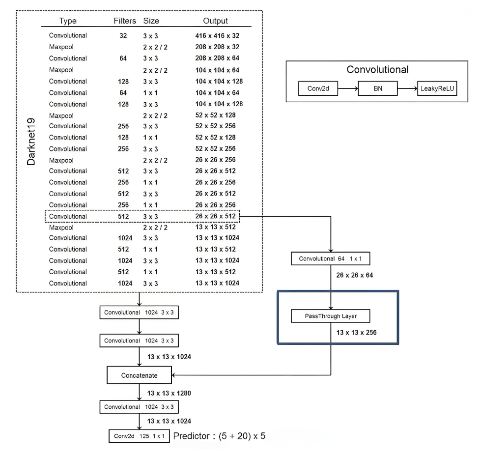

**优势**：无论输入图像的尺寸如何变化，全局平均池化层的输出维度始终是固定的。这使得模型在处理不同尺寸的输入时不需要固定输入尺寸

## 2.2 优化策略

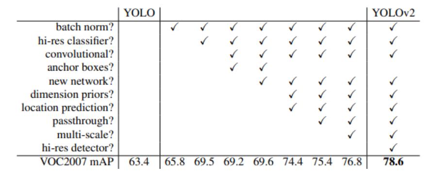

### 2.2.1 批量归一化

加速模型收敛，可以在舍弃dropout优化后依然不会过拟合

### 2.2.2 多尺度训练

由于网络不再对输入尺寸有要求，因此模型每10个批次都会选择一个新的尺寸（必须是32的倍数）

### 2.2.3 高分辨率分类器

使用更大尺寸图片输入网络

### 2.2.4 使用锚框（★）

#### 问题一：使用锚框的意义？

由于yolov1对小目标，密集目标识别精度较差，我们预定义一些（yolov2中设置的数目是5个，既每个中心点对应5个锚框）可能的边界框用于覆盖图像可能存在的区域，然后再去调整边界框的长宽，从而使模型可以更高效地定位目标，不需要从零开始预测边界框的坐标

引入锚框虽然降低了一部分mAP，但是召回率大大提升

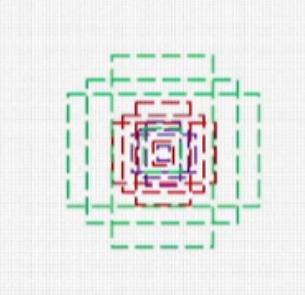

#### 问题二：yolov2中的锚框是如何绘制的？

**策略：Dimension Clusters（维度聚类），既k-means算法**

如果是作为超参数通过人为的来设置这5个框的尺寸，可能无法较好适应不同目标的大小差异，因此我们基于**整个数据集中所有标注的边界框**，将这些边界框分为5类（以VOC和CoCo数据集为例）。这样做的目的是为了生成一组能够覆盖整个数据集中所有目标形状和大小的通用锚框，**模型预测出来的边界框是相对与锚框进行调整来接近真实的边界框**

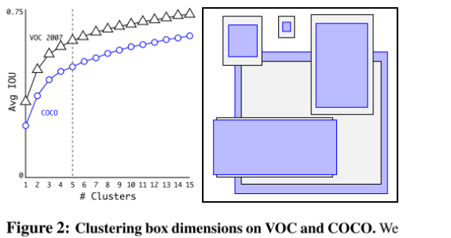

**特别需要注意的是**：对于边界框的聚类，YOLOv2采用了一种不同的距离度量方法——IoU距离，IoU度量了两个边界框之间的重叠程度

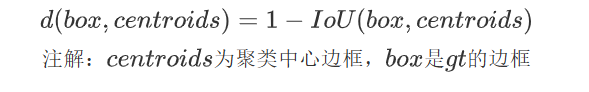

### 2.2.5 **Direct Location Prediction**（直接位置预测）

YOLOv2不是直接预测目标的边界框坐标，而是预测相对于Anchor Boxes的位置偏移量。这意味着**每个Anchor Box会预测一个小的偏移量，用以调整其位置和大小，使之更接近真实的目标框**

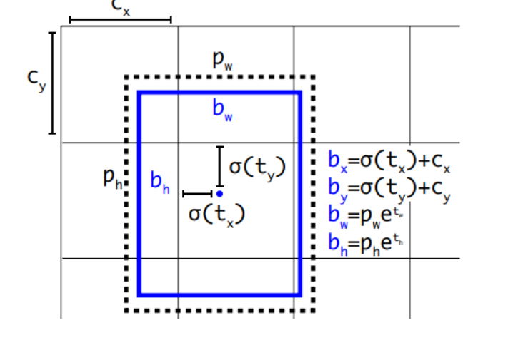

偏移量参数：

- **中心坐标偏移量**： 

  t_x和 *t_y* 分别表示预测边界框中心相对于Anchor Box中心在x轴和y轴上的偏移量。
- **尺寸调整**：*t_w* 和 *t_h* 分别表示预测边界框宽度和高度相对于Anchor Box宽度和高度的对数偏移量。

具体中心点坐标的计算以及宽度高度计算公式如下：

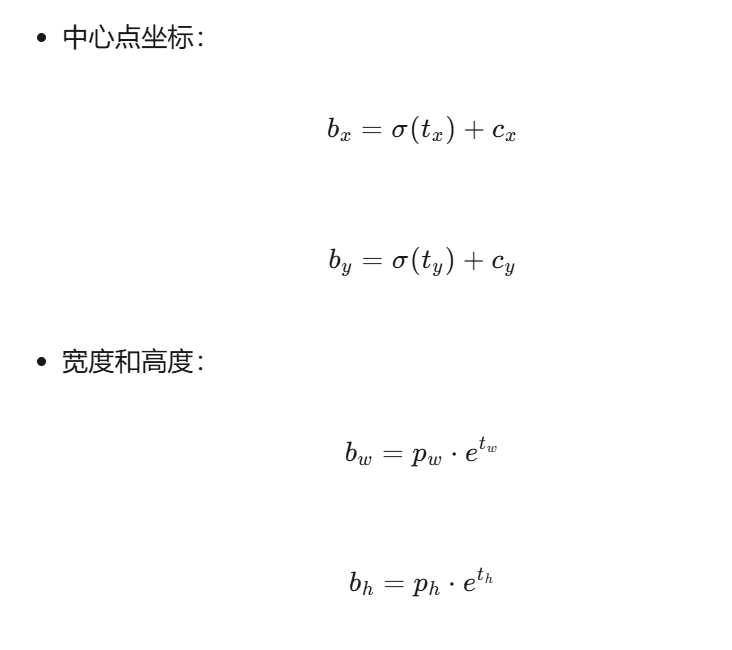

**上面四个公式计算出的值是在归一化过后的值，还需要乘以32（因为416×416的图片被划分为13×13的网格，每个网格大小为32×32）才能得到对应的真实坐标**

#### **问：计算边界框的中心坐标和宽度、高度时，为什么要使用激活函数和指数变换**

答：边界框的中心坐标通过Sigmoid激活函数计算，以**确保预测值被限制在[0,1]范围内**，从而使得中心点坐标落在对应的网格单元内，这有助于模型训练的数值稳定性。对于边界框的宽度和高度，采用指数变换来**确保输出为正值**，并允许模型在对数空间中更稳定地学习尺度变化，这有助于模型适应不同大小的目标并提高预测精度。

### 2.2.6 使用passthrough策略（★）

首先需要搞清楚两个问题，在网络不断卷积的过程中，感受野会如何变化？特征图的空间信息和语义信息会如何变化？

首先要知道**感受野是指神经网络中一个神经元所覆盖的输入图像区域的大小。**

以CNN为例，假设卷积核大小为 k×k，步长为1。第一层卷积后，每个输出神经元的感受野为 k×k。**第二层卷积核覆盖第一层的多个神经元，其感受野会进一步扩大**。例如，两层卷积网络，每层卷积核为3×3，无池化操作，第二层的感受野为5×5。随着卷积层数增加，感受野持续扩大，网络能捕捉更大范围的图像信息。

因此，**随着卷积层数增加，神经元覆盖的输入图像区域范围扩大，能够捕捉到更大范围的图像信息**

把卷积看做人眼从近到远看一张图片的过程

**空间信息是指图像中像素之间的关系，包括物体形状，大小，边缘等**

**语义信息是指图像中物体的类别，属性等更高层次的信息**

**随着卷积层深入，浅层卷积提取的空间信息被深层卷积组合成整体结构，空间特征逐渐抽象，语义信息逐渐丰富**

因此也就面临一个问题，随着卷积的执行，感受野越来越大，特征图的像素数量减少，可能会造成小目标的丢失，因此yolov2引入passthrough层，将高分辨率特征和低分辨率特征串联起来

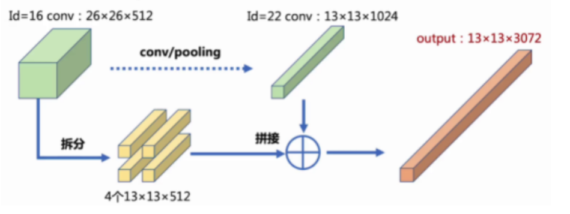

铺垫这么多，其实Passthrough 的操作非常简单，通过**隔点采样（隔行隔列采样）**将一个较大的特征图（**1个** **26×26×512**）分解为多个较小的特征图（**4个13×13×512**），然后将这些特征图按通道串联起来，形成一个通道数更多的特征图（**1个13×13×3072**）。这种操作可以**有效融合不同尺度的特征信息**，增强特征的表达能力。

### 2.2.7 输出特征维度

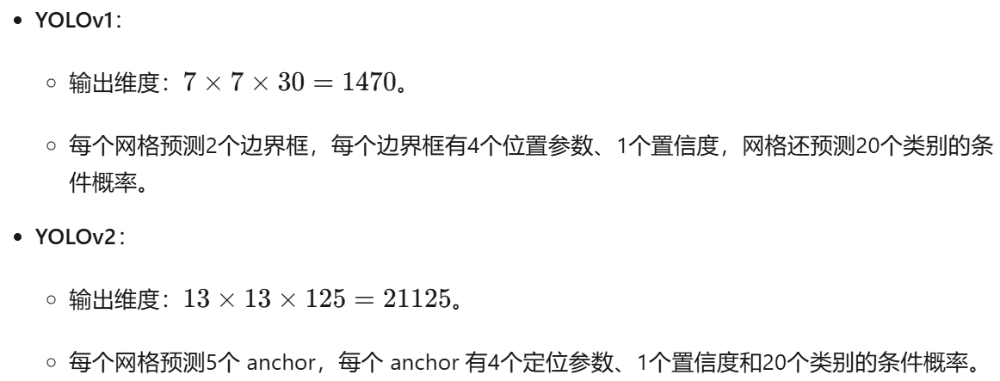

# 三、yolov3

## 导航

YOLOV3 论文地址：：【https://arxiv.org/pdf/1804.02767】YOLOV3 论文中文翻译地址：：【https://blog.csdn.net/yegeli/article/details/109751358】

## 3.1 网络组件（知道基本组成就行）

### **CBL（Convolutional + Batch Normalization + Leaky ReLU）**

- **组成**：
  1. **卷积层（Convolutional Layer）**：用于提取特征。
  2. **批量归一化层（Batch Normalization Layer）**：用于稳定训练过程，减少内部协变量偏移。
  3. **激活函数（Leaky ReLU）**：引入非线性，同时避免ReLU在负值区域的梯度消失问题。

### **ResUnit（残差单元）**
- **组成**：
  - 输入特征通过**两个 CBL 模块处理后，与原输入进行逐元素相加（add）操作**。
  - 这种结构允许网络学习到更深层的特征，同时避免梯度消失或梯度爆炸问题。

### **ResN（残差块）**
- **组成**：
  - 一个 **padding** 层（可选，用于保持特征图大小）。
  - 一个 **CBL** 模块。
  - **N 个残差单元（ResUnit）**。
- **结构**：
  - 输入特征首先通过一个 CBL 模块进行处理。
  - 然后，特征通过 N 个残差单元，每个残差单元包含两个 CBL 模块和一个残差连接。

## 3.2 重要操作（区分上下采样）

### **Concat（拼接）**

- 将不同分辨率的特征图**沿着通道维度拼接**，扩充张量维度。

### **Add（相加）**

- 将两个张量**逐元素相加**，不改变张量维度。

### **上采样（插值）**

- 是将低分辨率的特征图放大到高分辨率，用于多尺度特征融合，**捕捉更多细节信息，尤其有助于检测小目标**；

### **下采样（卷积）**

- 则是将高分辨率的特征图缩小到低分辨率，**减少计算量，同时通常增加通道数以保留重要信息，主要用于提取更抽象的高层特征。**

注意：这里的“上”和“下”指的是空间分辨率的上升或下降

## 3.3 主干网络

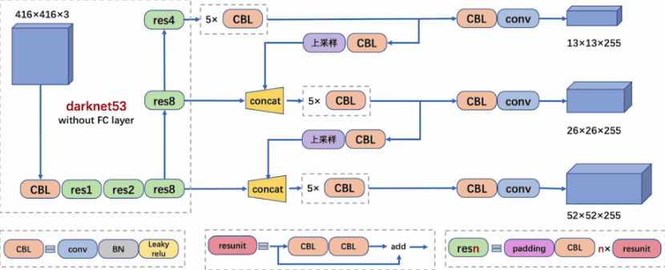

后面的蓝色立方体表示**三种尺度的输出**，用于检测三种不同尺寸的目标，是yolov3最显著的特征，后面会详细解释

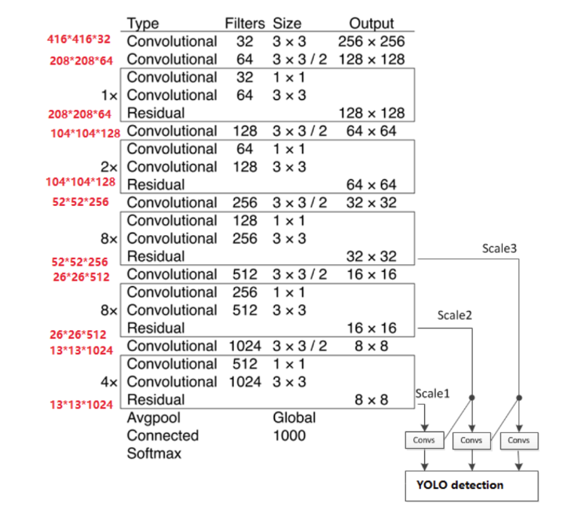

## 3.4 特征金字塔网络（FPN）（★）

**检测大目标需高层语义信息，而小目标需低层细节信息，特征提取需兼顾两者以实现多尺度目标检测。**特征金字塔网络（Feature Pyramid Network，FPN）是一种用于目标检测的网络架构，旨在解决多尺度目标检测中的关键问题：**如何有效地利用不同尺度的特征来检测不同大小的目标**

FPN的原理可以概括为以下三个内容：

- 自底而上的路径（下采样）：基于卷积神经网络（CNN）的前向传播过程。在 CNN 中，输入图像经过一系列的卷积层和池化层，逐渐生成不同层次的特征图，**特征图的语义信息逐渐增强，但空间细节逐渐丢失。**
- 自顶而下的路径（上采样）：将高层的强语义特征传播到低层，**低层特征图不仅保留了精确的空间位置信息，还融入了高层的强语义信息**
- 横向连接：调整特征图的通道数，确保自底向上和自顶向下路径的特征图在通道维度上能够匹配，例如**1×1卷积核或上采样**

## 3.5 多尺度预测

**有了类似FPN的思想，YOLOv3会产生3个尺度的特征图**，简单地说，YOLOv3产生13×13、26×26、52×52三个尺度的特征图，对应总共3616个网格，每个网格产生3个锚框，也就是一共有10647个预测框。这些预测框经过置信度过滤和非极大值抑制（NMS）处理后，**每个网格最多只保留一个最好的框**（事实上更多的网格甚至因为置信度太低而没有框）。**最终保留下来的框就是模型呈现的预测结果**。

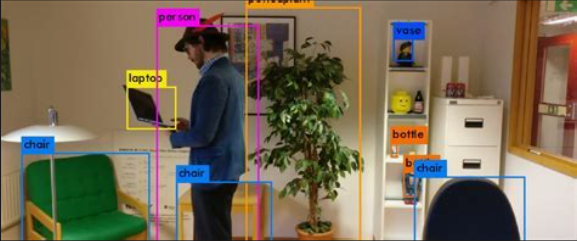

我们再回头来看这张yolov3的结构图，输出的三个检测头对应的检测尺寸如图中标注所示

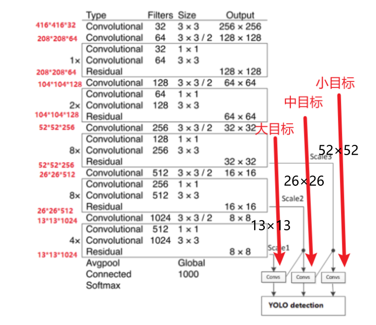

#### 问：为什么尺寸小的检测头反而检测的是大目标呢？（★）

答：决不能根据检测头大小来想象检测的目标大小，上面已经介绍了随着卷积的进行，特征图通过下采样尺寸逐渐变小，进而空间信息丢失，语义信息丰富，从而更能捕捉全局的信息，适合用来检测大目标

# 篇末

YOLO系列从v1到v3不断演进，v1首次提出单阶段目标检测架构，将检测任务转化为单次回归问题，实现了快速检测但对小目标效果欠佳；v2引入锚框和优化网络结构，提升了检测精度；v3采用更深的DarkNet-53骨干网络，引入三尺度预测和多标签分类，显著增强了小目标检测能力和多类别检测效果，进一步平衡了速度与精度，为后续发展奠定了基础。
