# 前言：

这一篇目主要用于介绍yolov5的实战部分，包括如何部署项目以及模型的训练和推理，最后还会结合orc技术来进行车牌识别项目实战

# 一、项目来源

项目可以在 github 搜到：【https://github.com/ultralytics/yolov5】（选择合适的预训练模型，可以直接下载，也可以直接git到本地）

将下载好的文件解压，最后在vscode中打开的文件目录如下，一定要确保项目名即为最开始的yolov5中没有另外一层yolov5文件结构：

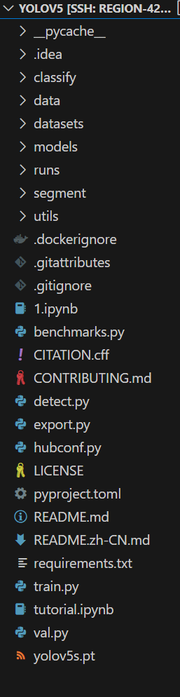

# 二、环境配置

首先需要创建虚拟环境（这里我是直接在云GPU上部署的项目，可以直接选择别人已经创建好并且很稳定的虚拟环境）

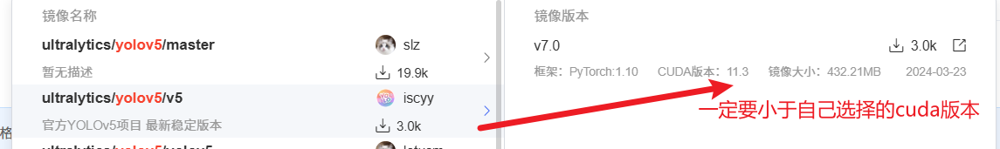

**对于 yolo 系列目前来说，需要安装的 python 版本 >= 3.8 的，pytorch 版本>= 1.8**

如果是在本地部署的话，那么在创建激活并切换环境后需要运行如下命令安装依赖包

```
pip install -r requirements.txt
```

注意：这里运行后只能默认是CPU的版本，如果想安装GPU版本还需要安装合适版本cuda后去官网下载对应pytorch，然后注释requirements.txt中15,16行

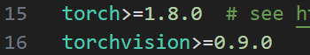

安装完requirements.txt后再运行如下指令即可完成基础环境配置

```
pip install Ultralytics
```


## 2.1 初步使用yolov5

这里我们选择在终端使用命令来运行yolov5s.pt模型推理图片

```python
python detect.py --weights yolov5s.pt --source data/images/bus.jpg
```

参数解析：

- detect.py：执行的文件

- --weights：指定权重文件的路径

- --source：检测的资源文件路径

  - 0：打开计算机的摄像头

  - 图片路径：一张图片

  - 文件夹路径：多张图片

这里我们用yolo文件夹自带的data/images/bus.jpg来进行测试

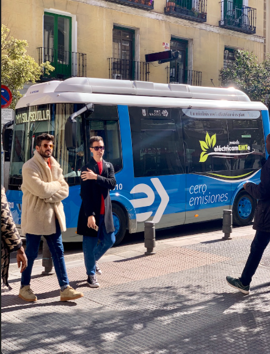

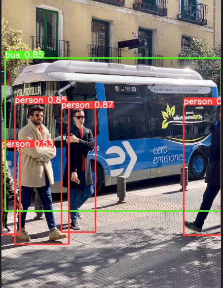

此时run文件夹下会产生保存结果的位置exp1,exp2.....

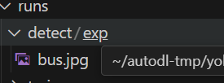

# 三、部署项目

## 3.1 数据集

我们将使用车牌识别项目来进行实战，先来看看数据集文件结构。

在项目根目录下创建新文件夹datasets，然后将我们的图片和标注数据放到文件夹中

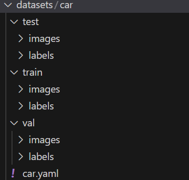

然后我们来编辑**car.yaml配置文件**，这个文件中包含了car数据集的结构，类别等信息，是训练过程不可缺失的一步，具体内容如下，只关注没有被注释的部分：

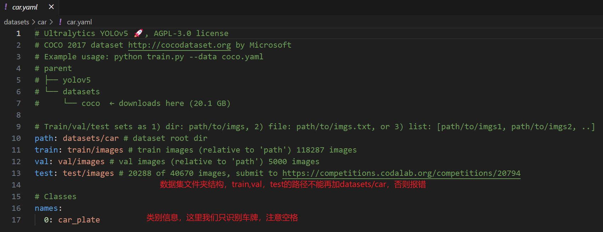

## 3.2 更改代码

接下来需要更改两处位置避免报错，版本更新问题，对照着改就行，如果是cpu设备将"cuda"改为"cpu"

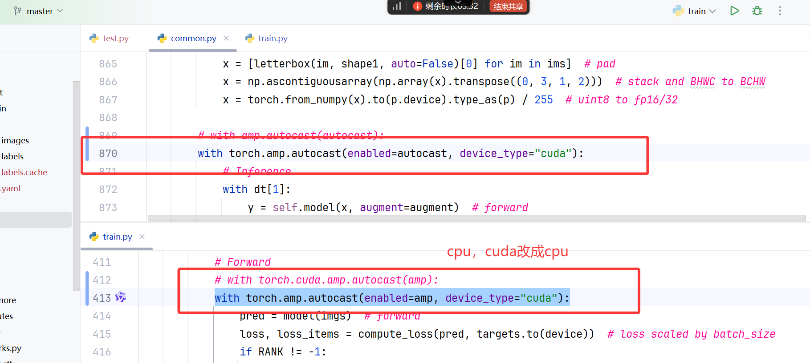

# 四、模型训练和验证

## 4.1 训练

使用如下指令来运行train.py，主要是可以自定义指定参数

```python
python train.py --data datasets/car/car.yaml --epochs 30 --weights yolov5s.pt --batch-size 16 --workers 8 --device 0 --cfg yolov5s.yaml
```

参数解析：

1. **`python train.py`**
   - 这是执行训练脚本的命令，`train.py` 是 YOLOv5 的训练脚本文件。
2. **`--data datasets/car/car.yaml`**
   - 指定数据集配置文件的路径。`car.yaml` 是一个 YAML 格式的文件，包含了训练和验证数据集的路径、类别名称等信息。
   - `datasets/car/` 目录下应该有一个 `car.yaml` 文件，这个文件定义了数据集的相关信息。
3. **`--epochs 30`**
   - 设置训练的总轮数（epochs）。每个 epoch 包含对整个训练集的一次前向传播和一次反向传播。
   - 在这个例子中，模型将被训练 30 个 epochs。
4. **`--weights yolov5s.pt`**
   - 指定预训练权重文件的路径。`yolov5s.pt` 是 YOLOv5s 模型的预训练权重文件。
   - 使用预训练权重可以帮助模型更快地收敛，并且通常可以获得更好的性能。
5. **`--batch-size 16`**
   - 设置每个批次（batch）中的样本数量。批大小（batch size）是影响训练速度和模型性能的重要超参数。
   - 在这个例子中，每个批次包含 16 张图像。
6. **`--workers 8`**
   - 设置用于数据加载的工作线程数。增加工作线程数可以加快数据加载速度，但过多的线程可能会导致内存消耗增加。
   - 在这个例子中，将使用 8 个工作线程来加载数据。
7. **`--device 0`**
   - 指定用于训练的设备。`0` 通常表示第一个 GPU 设备（如果有多个 GPU，编号从 0 开始）。
   - 如果设置为 `-1`，则表示使用 CPU 进行训练。
8. **`--cfg yolov5s.yaml`**
   - 指定模型配置文件的路径。`yolov5s.yaml` 是一个 YAML 格式的文件，包含了模型结构的详细信息。
   - `yolov5s.yaml` 对应于 YOLOv5s 模型的配置，它是 YOLOv5 系列中较小的模型，适合在资源有限的环境中使用。

这里只训练了三十轮，实际需要更多以追求更高的精度

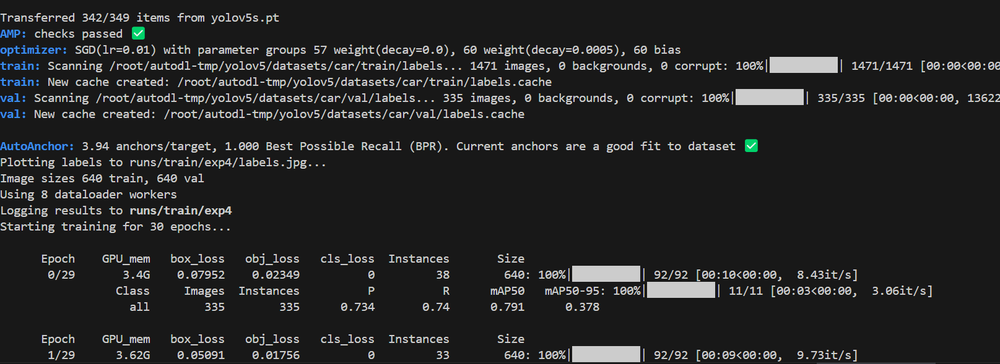

运行结束后会在run文件夹生成如下信息，包含了最佳模型和最终模型，以及训练中的损失数据及其可视化

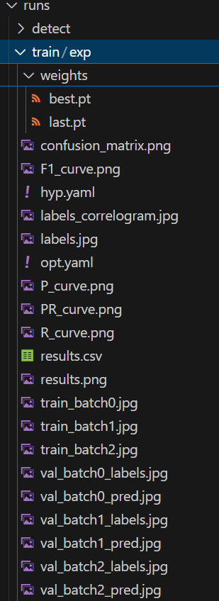

## 4.2 验证

接下来我们使用如下指令来队训练出的模型进行验证

```python
python val.py --weights runs/train/exp/weights/best.pt --data datasets/car/car.yaml --device 0 --batch-size 16
```

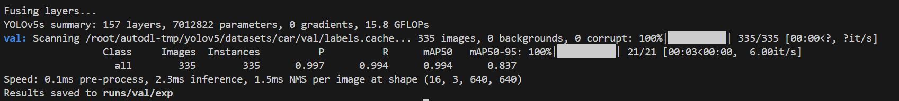

依旧还是在run文件夹下，生成val子文件夹，存储验证损失信息以及示例

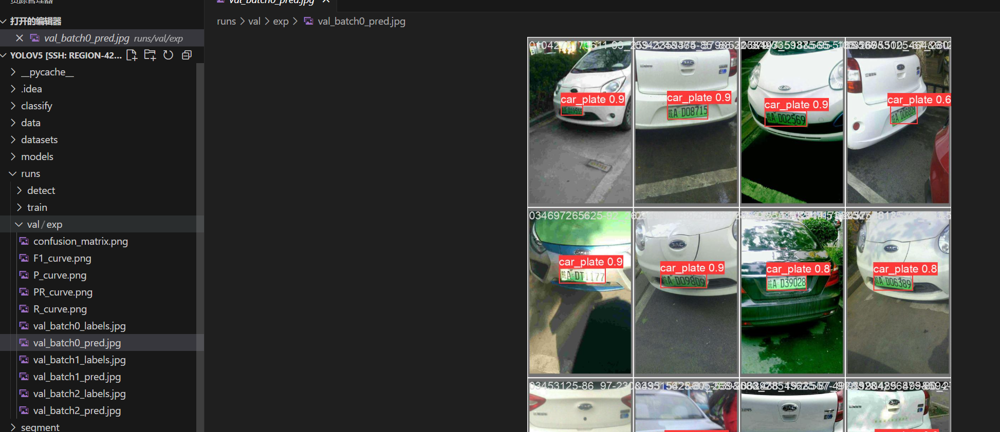

# 五、提取车牌信息

先给一段代码，在根目录下创建orc.py，将代码加进去

```python
import torch

# Load a YOLOv5 model (options: yolov5n, yolov5s, yolov5m, yolov5l, yolov5x)
"""
    torch.hub.load 方法的参数：
        1、固定为 repo_or_dir：ultralytics/yolov5
        2、path：模型的访问路径
        3、model：custom，用户自定义模型
"""
# yolov5 加载自己的模型
model = torch.hub.load('ultralytics/yolov5', 'custom', path='runs/train/exp/weights/best.pt')

# Define the input image source (URL, local file, PIL image, OpenCV frame, numpy array, or list)
img = "datasets/car/test/images/04-91_254-145&472_529&567-529&567_164&552_145&472_529&485-0_0_3_25_24_24_24_29-148-355.jpg"  # Example image

# Perform inference (handles batching, resizing, normalization automatically)
results = model(img)

# Process the results (options: .print(), .show(), .save(), .crop(), .pandas())
results.print()  # Print results to console
results.show()  # Display results in a window

results.crop()
results.save()  # Save results to runs/detect/exp
```

这段代码对一个指定的图像进行目标检测，然后处理检测结果，包括打印结果、显示结果、裁剪检测到的目标对象，并将结果保存到本地文件系统

**说人话就是传入一张图片进行检测，并将框选出来的部分单独截取出来**

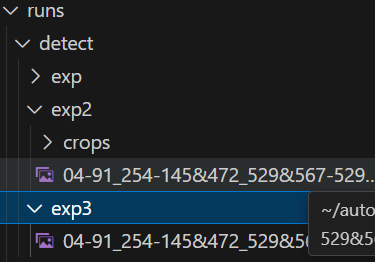

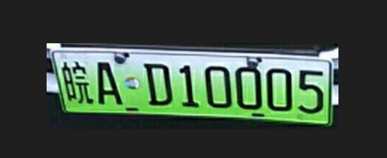

# 

