# 前言

因为yolov11训练需要的配置要求已经超过我电脑了，所以我还是在AutoDL上租用一台GPU来跑，租用云服务器实际上就是租用一台装配了GPU显卡的Linux虚拟机来跑自己的模型，那么我们就需要提前把自己的代码和数据通过传输软件传上服务器（也可以直接拖到窗口，但是太慢了，这里我用的软件是Xftp），下面配备了比较完整的流程，在前面的yolov5相关操作教程中写的也比较详细了，这篇博客主要是用来分析yolov11训练后产生的结果文件。

# 一、项目部署教程

我们在注册并登录AutoDL后，选择合适型号的GPU，建议如果是学习过程的话可以租用便宜一点的，比如2080ti，相对性能也够用了

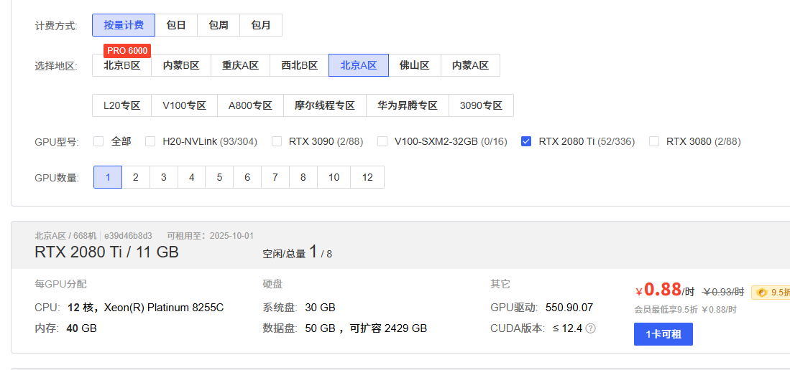

**记得在选择镜像时去使用就已经创建好的yolov11镜像，可以免去很多麻烦**

在容器实例中选择刚才租的实例，选择更多--无卡模式开机，这样我们在传输数据时成本就要低一点，不然他就会一直按照0.88元来扣费，无卡模式除了没有GPU，其他都是一样的

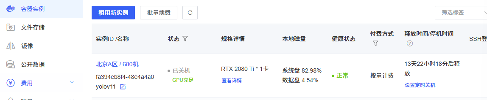

打开后我们进入vscode，下载扩展远程资源管理器


点击图标输入ssh指令和密码（在容器实例上复制），我之前登录过，就只用输密码了

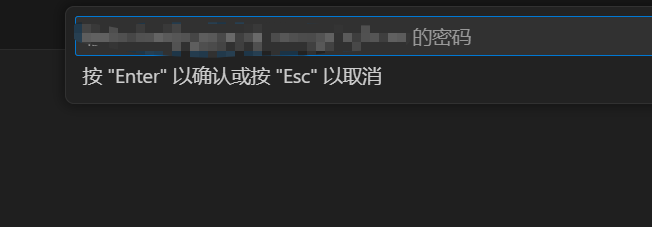

完成后我们就成功连接到服务器了，接下来就是传输数据部分

我们用到Xftp，具体下载安装教程可以看这个

[免费Xshell、Xftp下载、安装、连接教程【图文】详细-CSDN博客](https://blog.csdn.net/qq_43012792/article/details/107272797)

安装好后点击右上角加号创建新连接

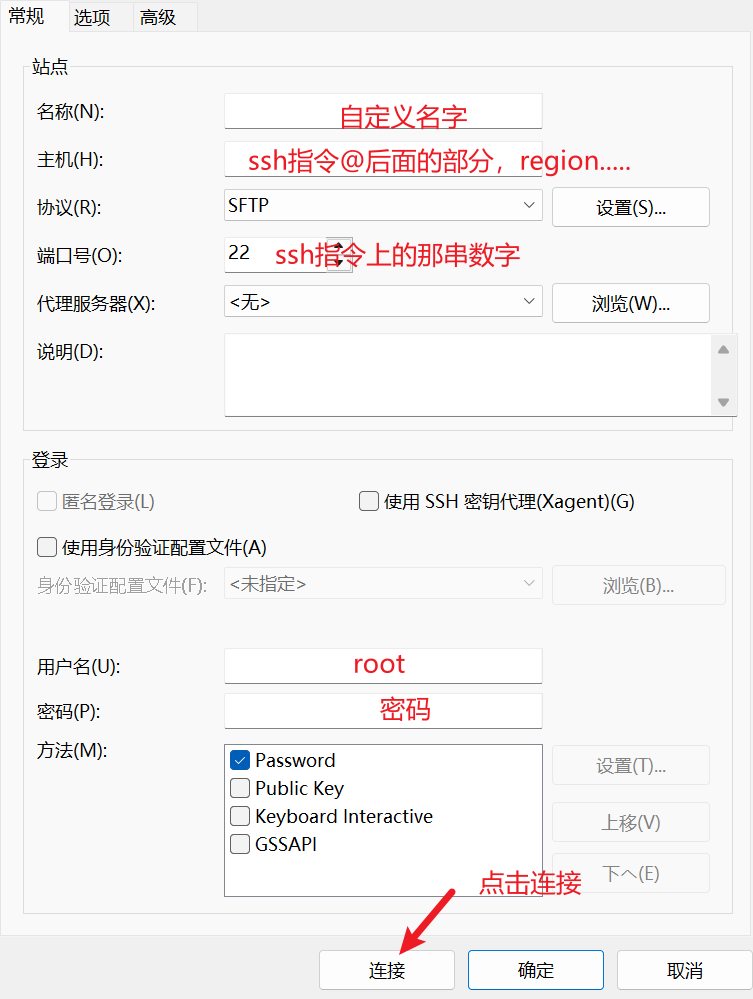

连接成功后，点击autodl-tmp文件夹，将我们的yolov11项目整个打包上传到这里，稍后去命令行解压

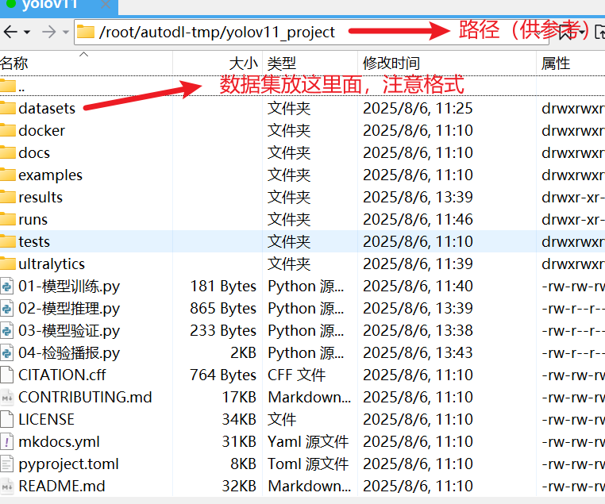

**解压压缩包**

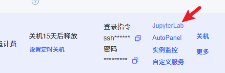

点进来可以看到jupyter页面，进到autodl-tmp文件夹后点击左上角加号新建终端，输入指令进行解压

```
unzip 压缩包名称.zip
```

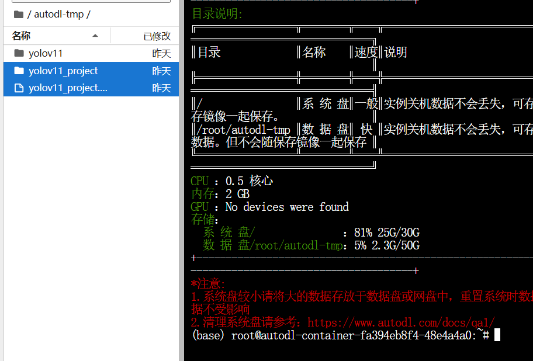

到这里我们的项目部署就完成了，接下来打开vscode选择对应路径可以看到我们解压的项目，过程中让我们再次输入密码是正常的

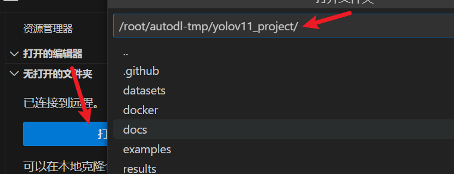

# 二、模型训练和验证

模型已经提前训练完成了，这里只是提供基本代码，项目准备和yolov5是相似的，但前面yolov5我们介绍的使用命令行指令来进行模型训练，这里我们用Python代码文件来操作，也很简单

## 2.1 模型训练

```Python
from ultralytics import YOLO


model = YOLO("yolo11s.pt")

model.train(
    data="datasets/ball/ball.yaml",
    epochs=100,
    batch=32,
    save=True,
    device="0",
)
```

还可以指定一下默认可选参数，比如学习率，优化算法等

## 2.2 模型推理

```python
from ultralytics import YOLO
import os

# 创建保存结果目录
os.makedirs('results', exist_ok=True)

# 加载训练好的模型
model = YOLO('runs/detect/train/weights/best.pt')

# 设置测试图片文件夹路径
test_folder = 'datasets/ball/test/images'

# 遍历测试文件夹中的所有图片
for filename in os.listdir(test_folder):
    if filename.endswith(('.jpg', '.png', '.jpeg', '.bmp')):  # 支持常见的图片格式
        # 构造完整的图片路径
        image_path = os.path.join(test_folder, filename)
        
        # 运行预测
        results = model(image_path)
        
        # 构造保存的文件名
        save_filename = os.path.join('results', f'predicted_{filename}')
        
        # 保存预测结果
        results[0].save(filename=save_filename)
        print(f'预测结果已保存到 {save_filename}')
```

## 2.3 模型验证

```Python
from ultralytics import YOLO


if __name__ == '__main__':
    model = YOLO('runs/detect/train/weights/best.pt')
    # 验证
    model.val(
        data='datasets/ball/ball.yaml',
        batch=32,
        device='0',
    )
```

## 2.4 检验播报

这段代码使用 `ultralytics` 提供的 YOLO 模型对指定图像进行目标检测，当检测到特定目标（如“棒球”）时，通过 `pyttsx3` 库进行**语音提示**，并提取检测结果中的类别和置信度信息存储到列表中。

使用之前先安装对应依赖库

```
pip install pyttsx3
```

```Python
from ultralytics import YOLO
# import winsound
import pyttsx3

def set_voice():
    # 初始化
    engine = pyttsx3.init()
    # 设置声音：音量、类型、语速
    engine.setProperty('volume', 1.0)  # 音量
    engine.setProperty('rate', 150)  # 语速
    # 如果在 python 代码中遇到路径是 \，需要改成 \\ 或者 /
    engine.setProperty('voice','HKEY_LOCAL_MACHINE\\SOFTWARE\\Microsoft\\Speech\\Voices\\Tokens\\TTS_MS_ZH-CN_HUIHUI_11.0')

    # 设置播放的内容
    info = '发现棒球'
    engine.say(info)
    # 执行
    engine.runAndWait()


if __name__ == '__main__':
    model = YOLO('runs/detect/train/weights/best.pt')
    results = model.predict(
        source='datasets/ball/test/images/cricket_ball_3.jpg',
    )
    """
        提取出每一个框的信息：
            类别信息 置信度信息
        思路：
            1、定义一个列表，来存储每一条数据 one_list
            2、定义一个列表，存储所有的数据 result_list
    """
    result_list = []
    # 遍历处理结果
    for result in results:
        for item in result.boxes:
            # 类别信息
            cls = result.names[int(item.cls.item())]
            """
                如果发现球(cricketBall),进行播报
            """
            if cls == 'cricketBall':
                # 频率  持续时间
                # winsound.Beep(500, 2000)
                set_voice()
            # 置信度信息
            conf = round(item.conf.item(), 2)
            result_list.append([cls, conf])
    print(result_list)
```

## 2.5 视频检测

可以使用训练好的模型来对视频帧进行检测

```Python
from ultralytics import YOLO
import cv2

# 1. 加载训练好的YOLOv11模型
# 替换为你的模型路径（如.pt文件），若使用预训练模型可直接写'models/yolov11n.pt'（n/s/m/l/x版本）
model = YOLO(r"runs\detect\train\weights\best.pt")

# 2. 配置视频源和输出
input_video_path = "input_video_2.mp4"  # 输入视频路径
output_video_path = "output_video_2.mp4"  # 输出视频路径

# 3. 读取视频并获取基本信息
cap = cv2.VideoCapture(input_video_path)
fps = cap.get(cv2.CAP_PROP_FPS)  # 帧率
width = int(cap.get(cv2.CAP_PROP_FRAME_WIDTH))  # 宽度
height = int(cap.get(cv2.CAP_PROP_FRAME_HEIGHT))  # 高度

# 4. 设置视频写入器（编码格式推荐使用mp4v）
fourcc = cv2.VideoWriter_fourcc(*"mp4v")
out = cv2.VideoWriter(output_video_path, fourcc, fps, (width, height))

# 5. 逐帧处理视频
while cap.isOpened():
    ret, frame = cap.read()
    if not ret:
        break  # 视频读取完毕
    
    # 6. 使用YOLOv11进行检测
    # conf: 置信度阈值（如0.5，过滤低置信度结果）
    # iou: IOU阈值（非极大值抑制参数）
    results = model(frame, conf=0.5, iou=0.45)
    
    # 7. 可视化检测结果（在帧上绘制边界框和类别）
    annotated_frame = results[0].plot()  # 直接调用plot()方法生成带标注的帧
    
    # 8. 显示实时结果（可选，用于调试）
    cv2.imshow("YOLOv11 Detection", annotated_frame)
    if cv2.waitKey(1) & 0xFF == ord('q'):  # 按q退出
        break
    
    # 9. 写入输出视频
    out.write(annotated_frame)

# 10. 释放资源
cap.release()
out.release()
cv2.destroyAllWindows()
print(f"检测完成，结果保存至：{output_video_path}")
```

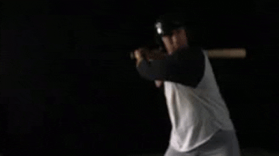

## 2.6 推理加速

    导出为 tensorRT 格式
    model.export(format="engine")
    使用的目的：实现推理加速，大幅度的缩减了推理时间

```Python
from ultralytics import YOLO

if __name__ == '__main__':
    model = YOLO("runs/detect/train/weights/best.pt")
    model.export(format="engine", dynamic=True, int8=True, data="datasets/fire/fire.yaml")
```


# 三、结果分析

一个训练集指标，一个验证集指标，以训练集指标为例

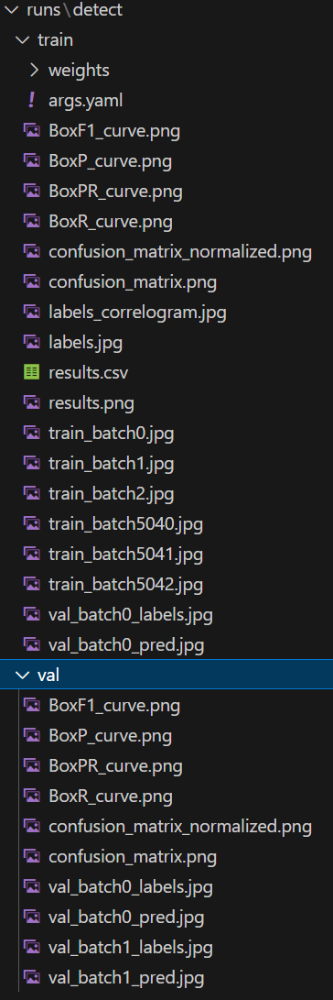

**weight文件夹**

存储了最佳模型best.pt和最终模型last.pt，如果训练过程中断可以调用这两个模型其中一个来进行继续训练，使用模型测试是一般选用best.pt

**args.yaml**

存储模型训练参数配置信息，比如学习率，轮次等，可以再训练阶段的代码中设置

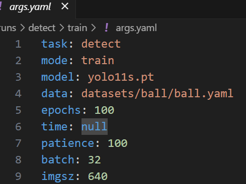

**BoxF1_curve.png**

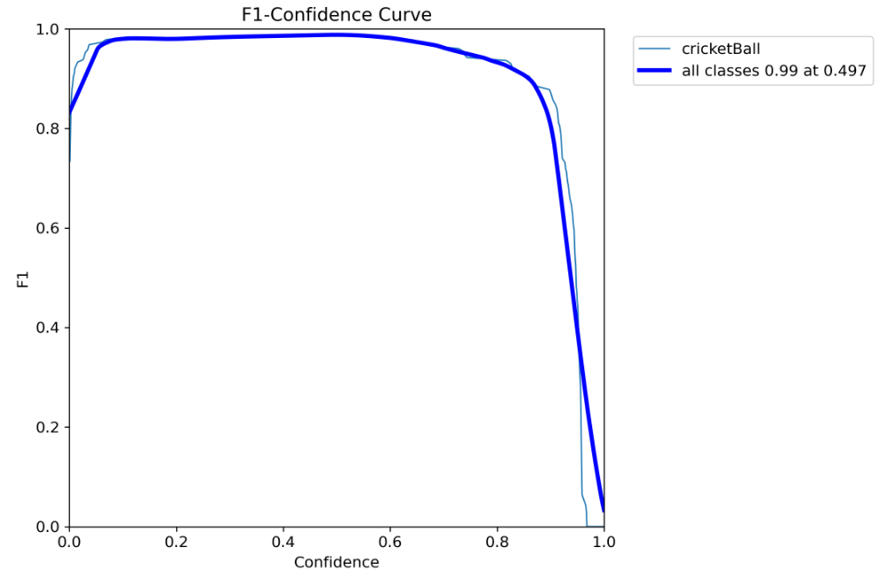

F1指标是精确率和召回率的调和平均值,对于我们本次的任务而言，这样图在置信度阈值为0.497的时候，所有类的F1指标可以达到99%

**BoxP_curve.png**

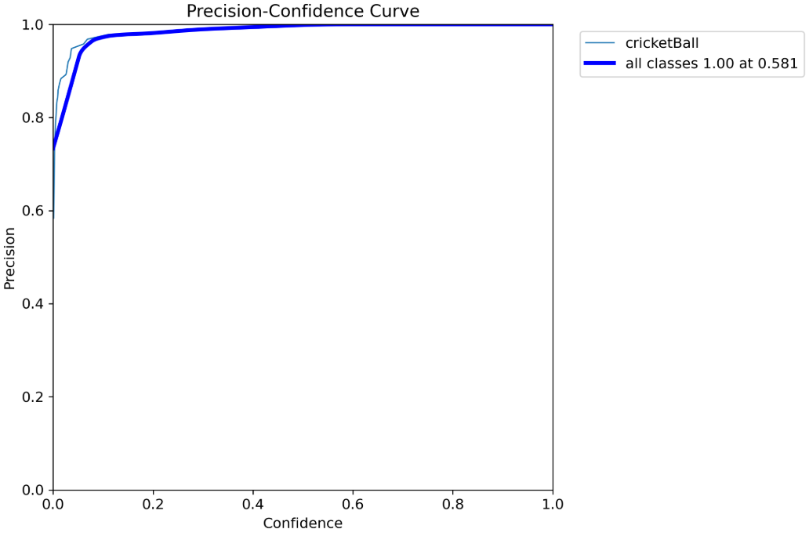

P表示模型预测的正样本中，有多少是正确的,这张图表示在置信度为0.581的情况下，P值可以达到1.0

**BoxPR_curve.png**

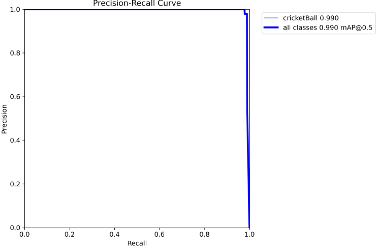

1. 浅蓝色曲线：表示“cricketBall”类别，平均精确率（AP）为0.990，表现接近完美。
2. 深蓝色曲线：表示**所有类别的平均精确率（mAP@0.5）**，值为0.990，整体表现优异。

**BoxR_curve.png**

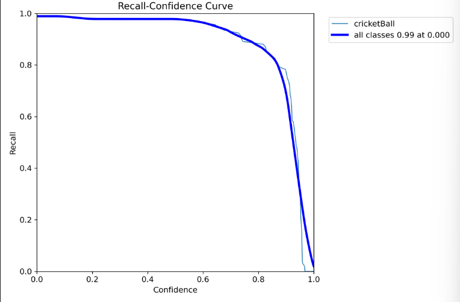

R表示真实正样本中，有多少被正确预测,当置信度阈值为0的时候，我们模型的召回率可以达到0.99%

**confusion_matrix_normalized.png和confusion_matrix.png**

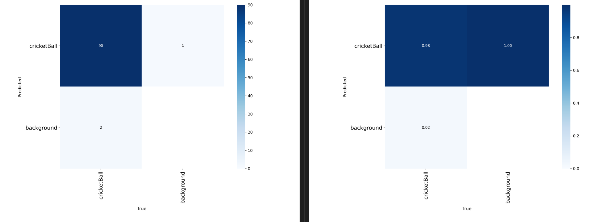

混淆矩阵及其归一化

**labels_correlogram.jpg**

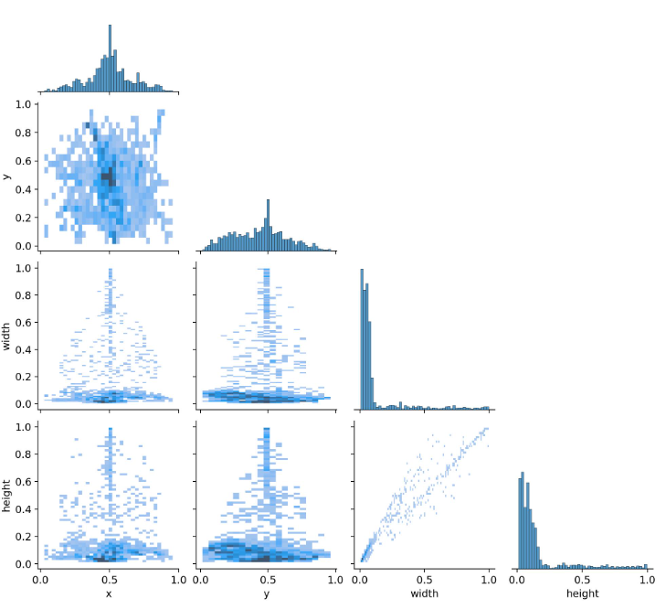

这幅图是用来描述数据集中中心点、宽高的相关性。比如在有的数据集中，如果目标位于中心，那这个图像的高度也可能比较高一些，主要是用来描述指标之间的关联性

**labels.jpg**

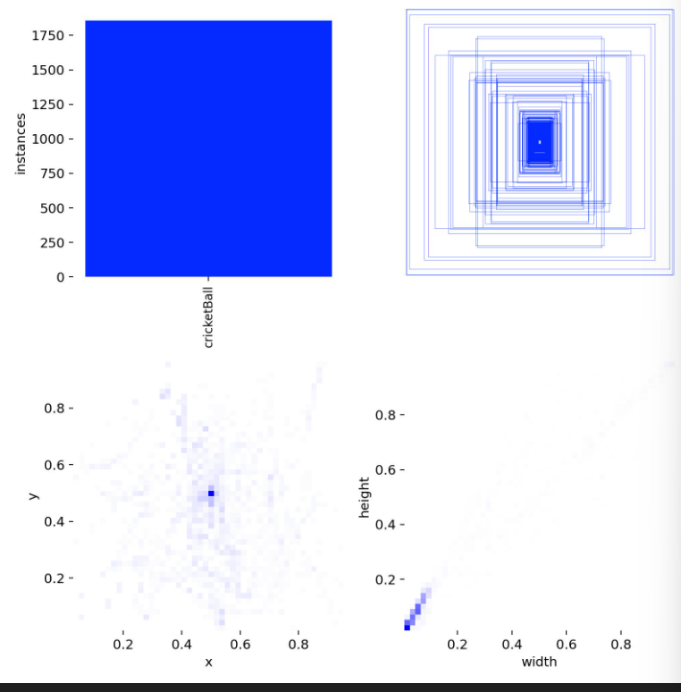

图中包含四个部分：

1. 左上角：类别样例个数分布。
2. 右上角：边界框分布。
3. 左下角：样本中心点分布，显示棒球多在图片中间。
4. 右下角：目标宽高分布。

**result.csv和result.jpg**

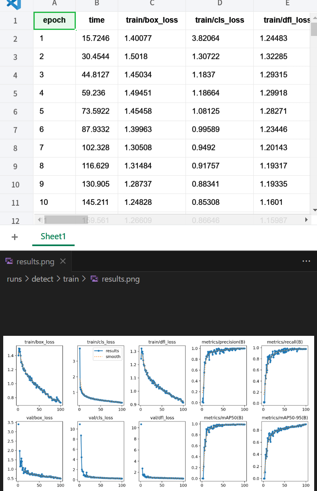

训练过程中loss和准确率的变化数据及其可视化

**train_batch.jpg**

主要是用来描述数据是如何进入网络的，也能看出数据集是如何进行数据增强的，图上没有置信度信息

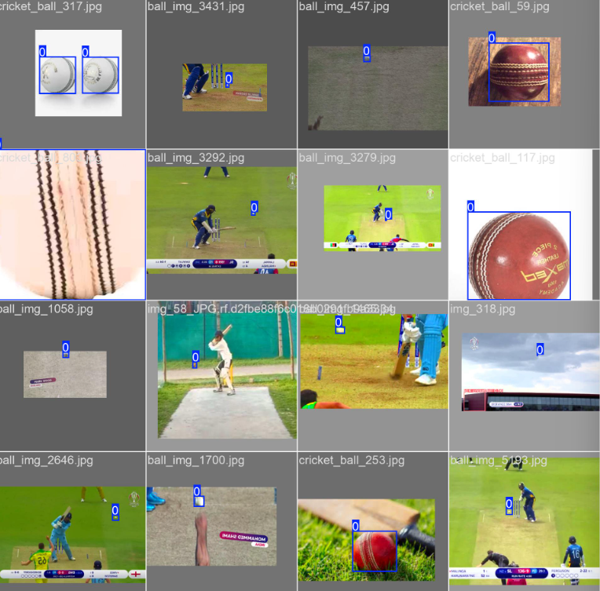

**val_batch_labels.jpg和val_batch_pred.jpg**

验证集信息，同一张图预测结果图有置信度

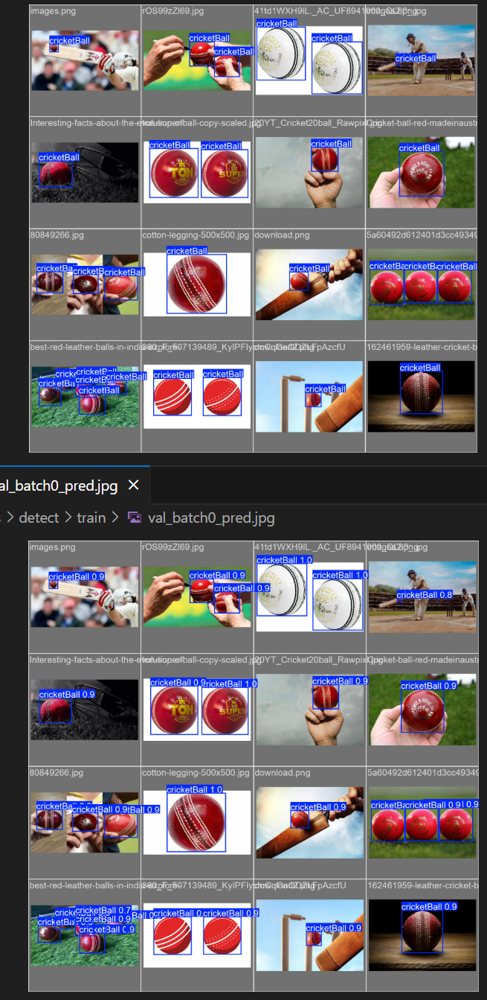
