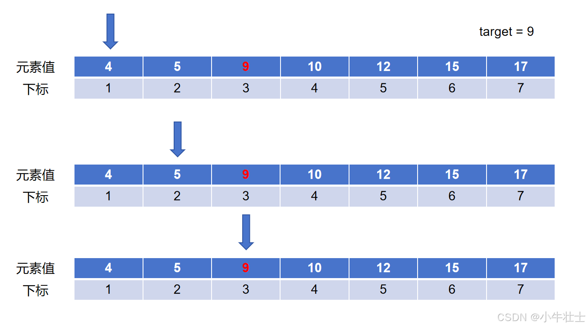
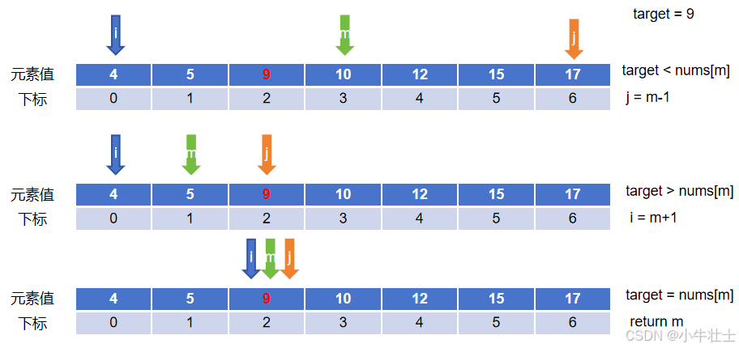
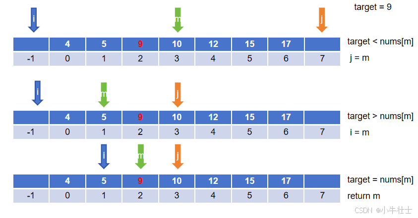
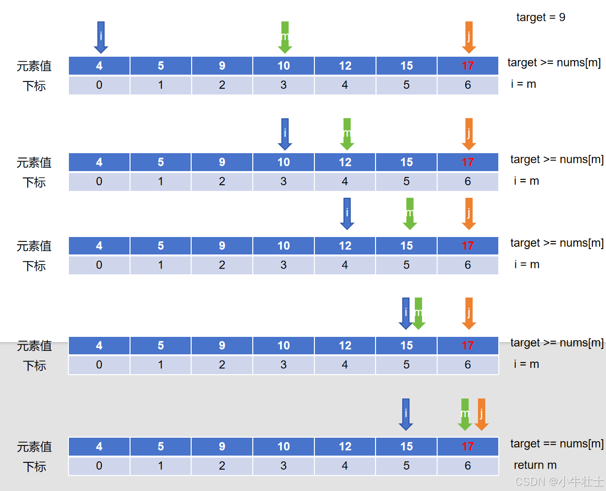
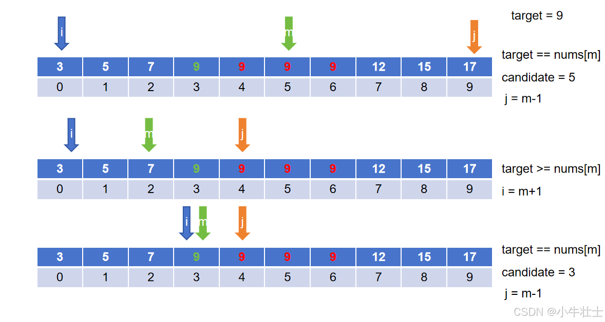
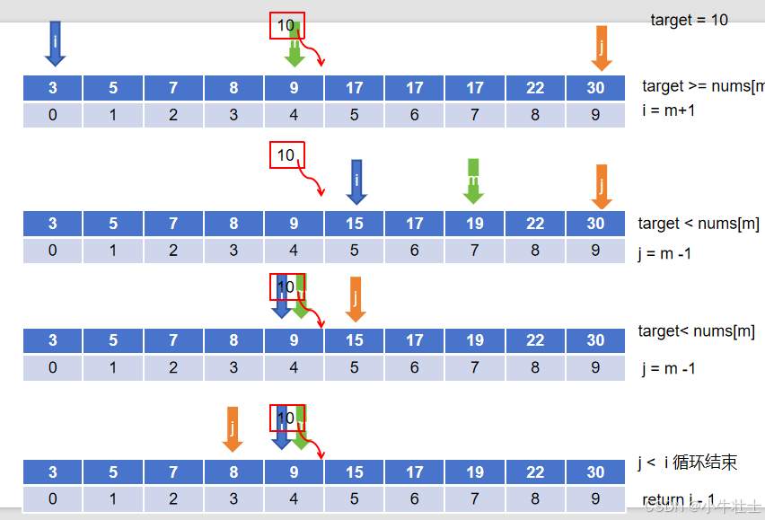
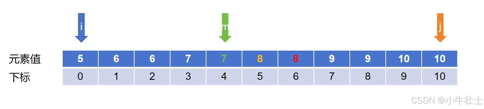
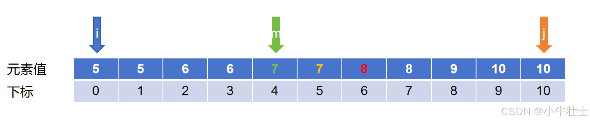
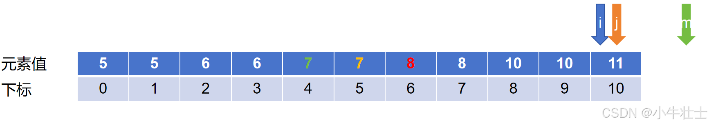

 刷题指南参考：[CyC2018/CS-Notes: :books: 技术面试必备基础知识、Leetcode、计算机操作系统、计算机网络、系统设计https://github.com/CyC2018/CS-Notes/tree/master/](https://github.com/CyC2018/CS-Notes/tree/master/)

知识点参考：[Hello 算法https://www.hello-algo.com/](https://www.hello-algo.com/)

# 前言

力扣刷题学习笔记和思路记录

# 1.基础知识

​    在一个已经排好序的数组中（可能需要自己来排序），我们需要用尽可能快速的方法来查找一个元素，通常想到的方法是线性查找，既通过遍历的方法来进行暴力搜索

## 1.1 线性查找

**时间复杂度计算：**

最坏情况：O(n)，平均情况：O(n)，空间复杂度：O(1)

```python
def linear_search(arr, x):

    for i in range(len(arr)):

        if arr[i] == x:

            return i

    return -1

nums = [4,5,9,10,12,15,17]

target = 9

index = linear_search(nums,target)

print(index)
```


**图解：** 



这种解法在小范围数据里面是比较方便的，但是数据一多就显得比较笨重

## 1.2 基础版

​    二分查找算法也称折半查找，在数组的首个元素和最后一个元素分别设置一个节点，通过不断更新两个节点的值来找最终的元素

**时间复杂度计算：**

​    二分查找的时间复杂度是O(log2(n)，其中n是待查找的数组的长度。因此，在查找范围缩小到一定程度后，二分查找的效率将会非常高。

**空间复杂度计算：**

​    二分查找算法的空间复杂度是O(1)，不需要为每一次查找创建单独空间，因为它只需要常数的额外空间。

```python
def binarySearchBasic(nums,target):
    i,j = 0,len(nums)-1#设置初始指针
    while i <= j:#范围内有东西，注意，i和j共同指向的元素也可能是target，因此这里是<=
        m = (i + j) // 2 #取证得到中间索引
        if target < nums[m]:
            j = m-1#目标在中间值左边，左边的j向右移
        elif target > nums[m]:
            i = m+1#目标在中间值右边，右边的j向左移
        else:
            return m#找到了中间值，返回索引
    return False#经过循环仍然没有找到target
nums = [4,5,9,10,12,15,17]
target = 9
index = binarySearchBasic(nums,target)
print(index)
```


**图解：**



​    其中m是i和j向下取整的结果，用来确定两个节点的中间值，通过左右节点与中间值作比较来更新节点

## 1.3 改动版 （判断谁来替代m节点）

​    如果现在我们的i和j最开始不指向节点，而是指向数组之外，既i,j = -1,len(nums),更新节点时让节点停留在m的位置，而不像靠近m的方向加1，这意味着左右节点永远指向target，即i和j代表**target的左右边界，实际是由闭区间改到开区间，**这种想法似乎也可以

```python
def binarySearchBasic(nums,target):
    i,j = -1,len(nums)#第一处，这里及以后i和j指向的是一个边界而非查找目标
    while i < j:#第二处
        m = (i + j) // 2 
        if target < nums[m]:
            j = m#第三处
        elif target > nums[m]:
            i = m#第四处
        else:
            return m
    return False
nums = [4,5,9,10,12,15,17]
target = 9
index = binarySearchBasic(nums,target)
print(index)
```


**图解：**



有开区间和闭区间就会有左开右闭和左闭右开区间，不在赘述

## 1.4 平衡版（平衡了迭代过程中的比较次数）

当target在数组的位置靠左边时，这里极端一点让他在第一个，似乎按照上面的算法在每一次循环中只需要判断

```python
if target < nums[m]:
     j = m-1
```


但是如果target在数组的最后一个元素 ，在第一个if语句判断都为false后，再去进行下一个elif的判断似乎用了更多的成本，下面这个方法平衡了查找的成本

**思路：**

既然老方法在最坏的情况下每次查找都要进行两次比较，那何不把elif去掉，只留下双分之结构。

现在不让i和j一定要指向target了，而是不断缩小j-i的范围到只剩下一个元素，判断这个元素是不是等于target。

其实通俗易懂的讲，if target < a[m]，那就有else target >= a[m],等循环结束再来看target到底是大于还是等于a[m]

```python
def binary_search3(a, target):
    i = 0
    j = len(a)
    while 1 < j - i:
        m = (i + j) >> 1
        if target < a[m]:
            j = m
        else:
            i = m
    if a[i] == target:
        return i
    else:
        return -1
```


**图解：**



**优势：**

减少循环内平均比较次数（数据量大时明显）

不存在最好情况，是在循环外进行target比较，时间复杂度不改变


## 1.4 Leftmost

​    现在有另外一个问题，如果数组中存在有一些相同的元素，经过排序后他们就挨在一起了，那么我在进行二分查找的时候似乎取出的值并不可控，那有没有一种方法能够取出指定的值呢？

​    接下来介绍取出最左侧target元素的方法。

​    上面说到当target == nums[m]时我们停止循环返回索引，但是这并不能保证时最左侧的元素，那我们如果在相等后将当前num[m]作为候选值，然后继续缩小j的值来让查找范围向做移动来找下一个候选值，似乎可行

**代码：**

```python
def binary_Leftmost(nums,target):
    i,j = 0,len(nums)-1
    candiate = -1
    while i <= j:
        m = (i + j) // 2 
        if target < nums[m]:
            j = m-1
        elif target > nums[m]:
            i = m+1
        else:
            candiate = m
            j = m-1

    return candiate
nums = [1,3,3,3,3,5,8,14,14,14,14,16,28,28,28,28,28,28,28,34]
target = 14
index = binary_Leftmost(nums,target)
print(index)
```


**图解：** 



## 1.5 Rightmost

​    有Leftmost肯定就会有Rightmost啦，但是这里不单单是上面代码简单修改，而是考虑在小于等于目标target的最靠右的索引

**代码：**

```python
def Rightmost(nums,target):
    i,j = 0,len(nums)-1
    while i <= j:
        m = (i + j) // 2 
        if target < nums[m]:
            j = m-1
        else:
            i = m+1
    return i-1
    #这里返回i很关键，表示小于等于目标target的最靠右的索引


nums = [1,3,5,8,14,14,14,14,16,28,34]
target = 13
index = Rightmost(nums,target)
print(index)
```


**图解：**



# 2.Leetcode实战

## 2.1 X的平方根

给你一个非负整数 `x` ，计算并返回 `x` 的 **算术平方根** 。

由于返回类型是整数，结果只保留 **整数部分** ，小数部分将被 **舍去 。**

**注意：**不允许使用任何内置指数函数和算符，例如 `pow(x, 0.5)` 或者 `x ** 0.5` 。


**示例 1：**

```
输入：x = 4
输出：2
```

**示例 2：**

```
输入：x = 8
输出：2
解释：8 的算术平方根是 2.82842..., 由于返回类型是整数，小数部分将被舍去。
```

​    这个题是常规的二分查找，但是需要留意两个问题来提升算法效率

​    按照常规解法，输入的是一个列表和一个target，但是这样就需要我们自己生成列表，当x的值很大时，这样的方法就会导致测试用例不通过，因此我们直接去掉这个列表参数，通过比较target和mid的值，不断更新target，也就是说，现在mid不是下标了，而是实际的比较值，**这道题给我的启示是当列表数字连续时，常规二分法传入的列表参数似乎就没有那么有必要了。**

​    另外，我发现当x > 2时，算术平方所得的数字似乎都要比x的一半小，所以我们再循环外设置一个额外的条件，再循环内部将right的初始值设置成target//2，以此来优化程序。

**代码：**

```python
class Solution(object):

    def mySqrt(self, x):
        """
        :type x: int
        :rtype: int
        """
        def binary_rightmost_search(target):
            left,right = 1,target // 2
            while left <= right:
                mid = (left + right)//2
                if target < mid * mid:
                    right = mid - 1
                else:
                    left = mid + 1
            return right
        if x < 2:
            return x
        ans = binary_rightmost_search(x) 
        return ans
```


## 2.2 寻找比目标字母大的最小字母

给你一个字符数组 `letters`，该数组按**非递减顺序**排序，以及一个字符 `target`。`letters` 里**至少有两个不同**的字符。

返回 `letters` 中大于 `target` 的最小的字符。如果不存在这样的字符，则返回 `letters` 的第一个字符。


**示例 1：**

```
输入: letters = ["c", "f", "j"]，target = "a"
输出: "c"
解释：letters 中字典上比 'a' 大的最小字符是 'c'。
```

**示例 2:**

```
输入: letters = ["c","f","j"], target = "c"
输出: "f"
解释：letters 中字典顺序上大于 'c' 的最小字符是 'f'。
```

**示例 3:**

```
输入: letters = ["x","x","y","y"], target = "z"
输出: "x"
解释：letters 中没有一个字符在字典上大于 'z'，所以我们返回 letters[0]。
这个题是关于字母的二分查找，比较方法也和数字一样，Python默认使用Unicode编码来比较，唯一要注意的是他的附加条件，“`如果不存在这样的字符，则返回 `letters` 的第一个字符。`”这里还需要判断返回的left是不是在列表内，这相当于是leftmost条件的补充
```

**`代码：`**

```python
class Solution(object):
    def nextGreatestLetter(self, letters, target):
        """
        :type letters: List[str]
        :type target: str
        :rtype: str
        """
        def binary_left_search(letters,target):
            left,right = 0,len(letters)-1
            while left <= right:
                mid = (left + right)//2
                if target < letters[mid]:
                    right = mid - 1
                else:
                    left = mid + 1
            if left == len(letters):
                return letters[0]
            return letters[left]

        ans = binary_left_search(letters,target)
        return ans
```


## 2.3 有序数组中的单一元素

给你一个仅由整数组成的有序数组，其中每个元素都会出现两次，唯有一个数只会出现一次。

请你找出并返回只出现一次的那个数。

你设计的解决方案必须满足 `O(log n)` 时间复杂度和 `O(1)` 空间复杂度。


**示例 1:**

```
输入: nums = [1,1,2,3,3,4,4,8,8]
输出: 2
```

**示例 2:**

```
输入: nums =  [3,3,7,7,10,11,11]
输出: 10
```

​    这个题说难不难，说简单也不简单，主要是从原有的判断大小的基础上更改为判断nums[mid]和前一个还是后一个元素相等 。

​    先来说说这道题下标和元素值的关系，如果没有目标值存在的情况下，数组中都是两个相同的数字来排列，那么对于这两个相同的数字，我们给他取名叫做数对，下标呈现的状态肯定是先偶后奇，也就是说，**如果在某一个数对之前插入一个单一的目标值，那么他后面的数对所对应的下标奇偶肯定会调转，而数对之前的数没有影响，**因此我们通过设置mid指针，确保mid指针始终指向下标为偶数的地方，通过目标值对数组的影响来更新mid，这也满足二分法的思想。

下面是更加具象化的图解：

**第一种情况，target在mid之前，看偶数下标上的mid是和mid-1相等，因此数对下标呈现先奇数，后偶数的情况，target在左边部分，更新right的值：right = mid - 2**



**第二种情况， 更新left的值：left = mid + 2**



​    目前能够将数组排列的通解考虑进来，但是存在一个特殊情况

​    当目标值在数组第一个或者最后一个位置时，left和right最后会指向同一个节点，（首节点或尾节点），这样再来判断mid+1是行不通的，但是这个节点刚好是目标值，所以直接就返回了



**代码：**

```python
class Solution(object):
    def singleNonDuplicate(self, nums):
        """
        :type nums: List[int]
        :rtype: int
        """
        def binary_search_single(nums):
            left, right = 0, len(nums) - 1
            while left < right:
                mid = (left + right) // 2
                # 确保mid是偶数，方便判断
                if mid % 2 == 1:
                    mid -= 1
                
                if mid + 1 < len(nums) and nums[mid] == nums[mid + 1]:
                    # 如果mid和mid+1相同，说明唯一值在mid+2之后
                    left = mid + 2
                elif mid - 1 >= 0 and nums[mid] == nums[mid - 1]:
                    # 如果mid和mid-1相同，说明唯一值在mid-2之前
                    right = mid - 2
                else:
                    # 如果mid不是重复元素，则返回
                    return nums[mid]
            
            return nums[left]  # 最终left会指向唯一元素

        return binary_search_single(nums)
```


这道题属于是魔改最小二乘法

## 2.4 寻找旋转排序数组中的最小值

已知一个长度为 `n` 的数组，预先按照升序排列，经由 `1` 到 `n` 次 **旋转** 后，得到输入数组。例如，原数组 `nums = [0,1,2,4,5,6,7]` 在变化后可能得到：

- 若旋转 `4` 次，则可以得到 `[4,5,6,7,0,1,2]`
- 若旋转 `7` 次，则可以得到 `[0,1,2,4,5,6,7]`

注意，数组 `[a[0], a[1], a[2], ..., a[n-1]]` **旋转一次** 的结果为数组 `[a[n-1], a[0], a[1], a[2], ..., a[n-2]]` 。

给你一个元素值 **互不相同** 的数组 `nums` ，它原来是一个升序排列的数组，并按上述情形进行了多次旋转。请你找出并返回数组中的 **最小元素** 。

你必须设计一个时间复杂度为 `O(log n)` 的算法解决此问题。


**示例 1：**

```
输入：nums = [3,4,5,1,2]
输出：1
解释：原数组为 [1,2,3,4,5] ，旋转 3 次得到输入数组。
```

**示例 2：**

```
输入：nums = [4,5,6,7,0,1,2]
输出：0
解释：原数组为 [0,1,2,4,5,6,7] ，旋转 4 次得到输入数组。
```

**示例 3：**

```
输入：nums = [11,13,15,17]
输出：11
解释：原数组为 [11,13,15,17] ，旋转 4 次得到输入数组。
```
