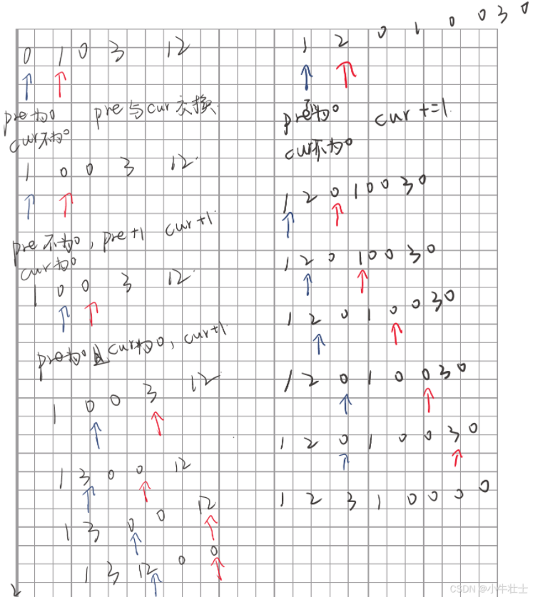
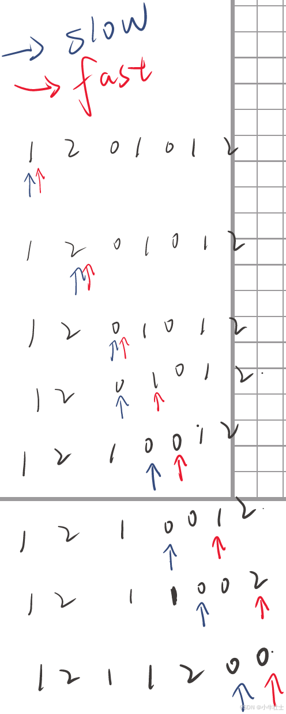
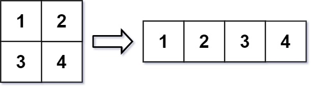
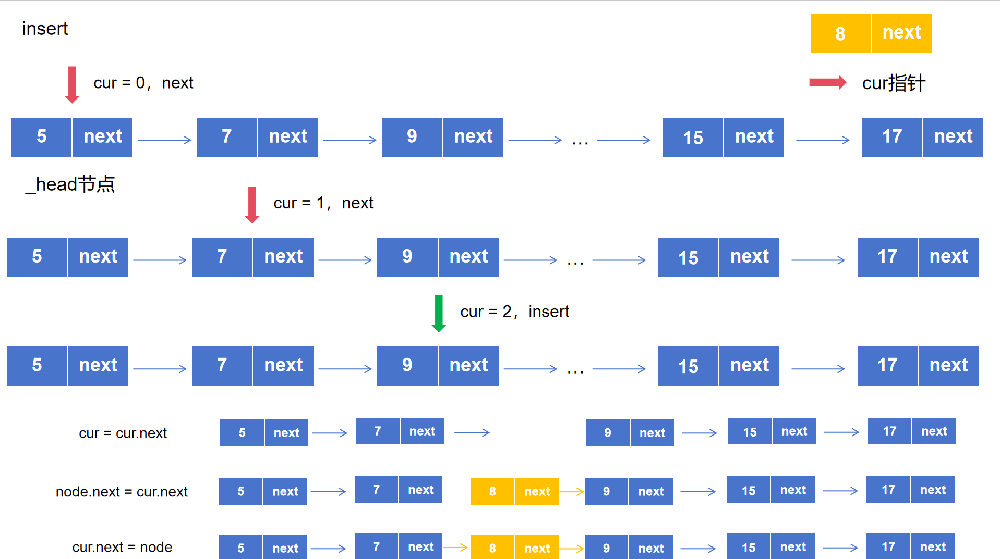
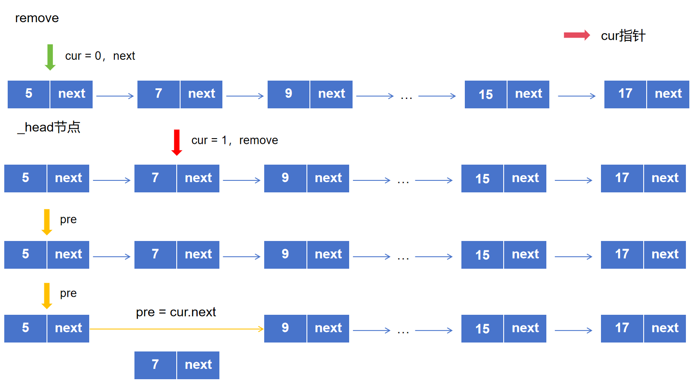
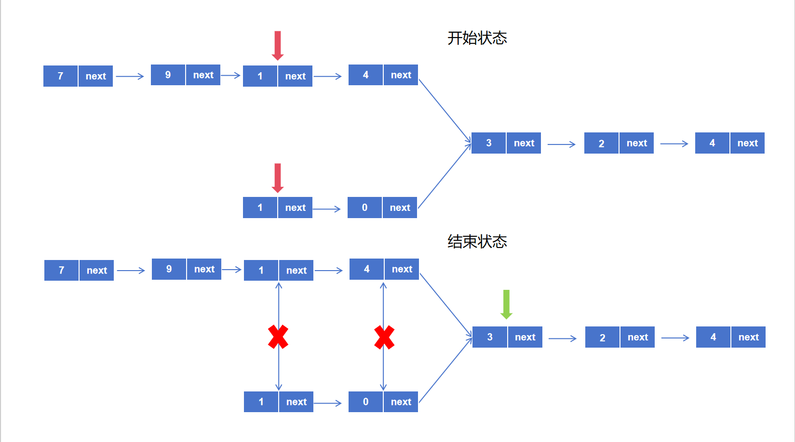
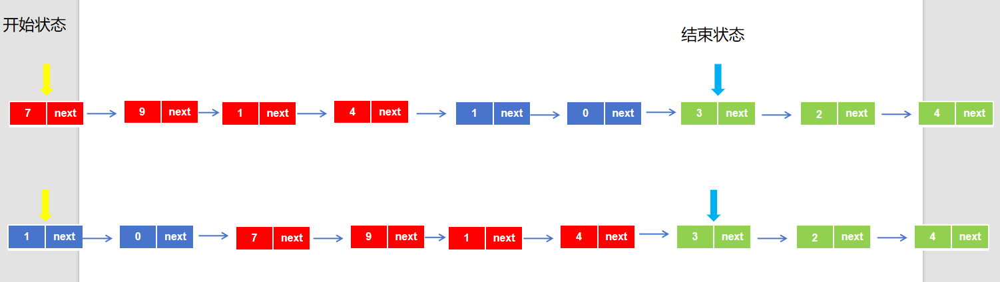
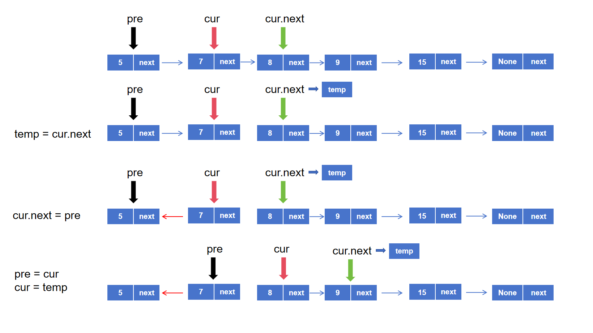
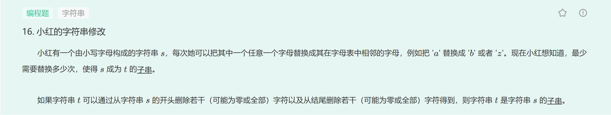

#  前言

力扣刷题知识笔记和思路记录

刷题指南参考：[CyC2018/CS-Notes: :books: 技术面试必备基础知识、Leetcode、计算机操作系统、计算机网络、系统设计https://github.com/CyC2018/CS-Notes/tree/master/](https://github.com/CyC2018/CS-Notes/tree/master/)

知识点参考：[Hello 算法!https://www.hello-algo.com/](https://www.hello-algo.com/)

# 一、数组

## （1）280-移动零

给定一个数组 `nums`，编写一个函数将所有 `0` 移动到数组的末尾，同时保持非零元素的相对顺序。

**请注意** ，必须在不复制数组的情况下原地对数组进行操作。

**示例 1:**

```
输入: nums = [0,1,0,3,12]

输出: [1,3,12,0,0]
```

**示例 2:**

```
输入: nums = [0]

输出: [0]
```

```python
class Solution(object):
    def moveZeroes(self, nums):
        """
        :type nums: List[int]
        :rtype: None Do not return anything, modify nums in-place instead.
        """
        # 自解
        pre = 0
        cur = 1
        while cur < len(nums):
            if nums[pre] == 0 and nums[cur] != 0:
                nums[pre],nums[cur] = nums[cur],nums[pre]
            elif nums[pre] != 0 and nums[cur] == 0:
                pre += 1
                cur += 1
            elif nums[pre] == 0 and nums[cur] == 0:
                cur += 1
            elif nums[pre] != 0 and nums[cur] != 0:
                cur += 1
```


自己的解法思路：

使用两个指针pre和cur,将指针指向数字是否为零将情况分为4类

①pre=0,cur!=0:pre与cur两个数交换位置，将pre的0移动到后面

②pre!=0,cur!=0:cur+1,寻找下一个0

③pre!=0,cur=0:pre+1,cur+1

④pre=0,cur=0:cur+1,寻找下一个非0

总的来说就是移动pre和cur，交换两个数位置

测试结果似乎移动了原来非零数的相对位置



Testcase

```
[4,2,4,0,0,3,0,5,1,0]
```


Answer

```
[4,2,4,5,1,3,0,0,0,0]
```


Expected Answer

```
[4,2,4,3,5,1,0,0,0,0]
```


次优解：

直接利用python列表内置函数，是0的删除，并且在末尾加0

```python
for i in range(len(nums)):
      if nums[i]==0:
          nums.remove(0)
          nums.append(0)
```


最优解：快慢双指针

```python
        # 最优解
        slow = 0
        for fast in range(len(nums)):
            if nums[fast]!=0:
                nums[fast],nums[slow] = nums[slow],nums[fast]
                slow += 1
            
```





## （2）566-重塑举证 

在 MATLAB 中，有一个非常有用的函数 `reshape` ，它可以将一个 `m x n` 矩阵重塑为另一个大小不同（`r x c`）的新矩阵，但保留其原始数据。

给你一个由二维数组 `mat` 表示的 `m x n` 矩阵，以及两个正整数 `r` 和 `c` ，分别表示想要的重构的矩阵的行数和列数。

重构后的矩阵需要将原始矩阵的所有元素以相同的 **行遍历顺序** 填充。

如果具有给定参数的 `reshape` 操作是可行且合理的，则输出新的重塑矩阵；否则，输出原始矩阵。


**示例 1：**





```
输入：mat = [[1,2],[3,4]], r = 1, c = 4
输出：[[1,2,3,4]]
```

**示例 2：**


```
输入：mat = [[1,2],[3,4]], r = 2, c = 4
输出：[[1,2],[3,4]]
```

思路：

先创建r×c的0矩阵，依次遍历mat，将0变为对应元素

```python
class Solution(object):
    def matrixReshape(self, mat, r, c):
        """
        :type mat: List[List[int]]
        :type r: int
        :type c: int
        :rtype: List[List[int]]
        """
        if r * c != len(mat[0]) * len(mat):
            return mat
        else:
            lst = [[] for i in range(r)]
            for i in lst:
                for _ in range(c):
                    i.append(0)

            r_index = 0
            c_index = 0
            for _ in mat:
                for num in _:
                    print(num)
                    if c_index < c:
                        lst[r_index][c_index] = num
                        c_index += 1
                    else:
                        r_index += 1
                        c_index = 0
                        lst[r_index][c_index] = num
                        c_index += 1
            return lst
```


方法二：

https://link.csdn.net/?from_id=146317665&target=https%3A%2F%2Fleetcode.cn%2Fproblems%2Freshape-the-matrix%2Fsolutions%2F606281%2Fzhong-su-ju-zhen-by-leetcode-solution-gt0g

 mat元素索引对

```python
ans[x // c][x % c] = nums[x // n][x % n]
```


（3）485-最大连续1的个数

给定一个二进制数组 `nums` ， 计算其中最大连续 `1` 的个数。

**示例 1：**

```
输入：nums = [1,1,0,1,1,1]
输出：3
解释：开头的两位和最后的三位都是连续 1 ，所以最大连续 1 的个数是 3.
```

**示例 2:**

```
输入：nums = [1,0,1,1,0,1]
输出：2
```

思路：

暴力解法遍历，与最大个数count_max作比较，看是否进行替换

```python
class Solution(object):
    def findMaxConsecutiveOnes(self, nums):
        """
        :type nums: List[int]
        :rtype: int
        """
        count = 0
        count_max = 0
        for i in range(len(nums)):
            if nums[i] == 1:
                count += 1
            if count > count_max:
                    count_max = count
            elif nums[i] ==0:
                count = 0 
                

        return count_max
```


（3）240-搜索二维矩阵

编写一个高效的算法来搜索 `*m* x *n*` 矩阵 `matrix` 中的一个目标值 `target` 。该矩阵具有以下特性：

- 每行的元素从左到右升序排列。
- 每列的元素从上到下升序排列。


**示例 1：**


```
输入：matrix = [[1,4,7,11,15],[2,5,8,12,19],[3,6,9,16,22],[10,13,14,17,24],[18,21,23,26,30]], target = 5
输出：true
```

**示例 2：**


```
输入：matrix = [[1,4,7,11,15],[2,5,8,12,19],[3,6,9,16,22],[10,13,14,17,24],[18,21,23,26,30]], target = 20
输出：false
```

# **二、链表**

这里介绍几种形式的链表的增删查改以及列出了题库里面的一些Leetcode例题的解决思路，链表作为一种数据结构，在Leetcode系统上作答是不需要自己去定义节点和链表的类，一般是会在注释中给出定义的提示的，我们只需要按照提示去创建节点就好，为了更好地理解这种算法的优势以及劣势，我们该是需要掌握关于链表的增删查改函数怎么写。

```python
#
# @lc app=leetcode.cn id=160 lang=python
#
# [160] 相交链表
#

# @lc code=start
# Definition for singly-linked list.
# class ListNode(object):
#     def __init__(self, x):
#         self.val = x
#         self.next = None
```


## 1. 单向链表


​    单向链表就是最简单的一种形态，每个节点属性为自身的值（val）和指向下一节点地址的指针（next），节点通过指针相连成链表

### 1.1 创建链表容器和节点

链表相当于一个容器，里面装着节点，节点也可以看成一个容器，在单向链表中，节点里面装着val和next

**创建节点：**

```python
class Node():

    def __init__(self, val):

        self.val = val

        self.next = None
```


用类来创建节点，初始化有两个属性，只需要调用这个类就可以形象的创建出节点

 **创建链表容器：**

```python
class SingleLinkList():

    # 这个相当于是一个容器，初始化里面只装着None的头节点

    # 定义头指针

    def __init__(self):

        self._head = None
```


初始状态下，链表中只装着空值的_head节点，等待传入上面创建的node节点

### 1.2 创建链表

**第一步：实例化对象创建一个容器**

```python
link_list = SingleLinkList()
```


**第二步：创建节点，此时只是产生一个节点，并没有加进链表**

```python
node1 = Node(100)

node2 = Node(200)
```


**第三步：将节点插入链表中，现在第一个结点是node1**

```python
link_list._head = node1
```


将第一个节点node1指向node2

```python
node1.next = node2
```


**第四步：访问链表节点数据**

第一个节点

```python
print(link_list._head.val)
```


第二个节点

```python
print(link_list._head.next.val)
```


### 1.3 单向链表的操作

这里是直接在链表容器类中添加方法

```python
class SingleLinkList():
    def __init__(self):
        self._head = None
    
    # 判断是否为空
    def is_empty(self):
        # 直接判断链表容器是不是只有None的头结点
        return self._head is None
    
    # 链表长度
    def length(self):
        # cur指针指向_head
        cur = self._head
        count = 0
        while cur is not None:
            count += 1
            # cur指针后移
            cur = cur.next
        return count
    
    # 遍历链表
    def vals(self):
        cur = self._head
        while cur is not None:
            # 生成器生成当前指针节点的val值
            yield cur.val
            cur = cur.next

    # 向链表头部添加元素
    def add(self,val):
        node_add = Node(val)
        node_add.next = self._head
        self._head = node_add

    # 向链表尾部添加元素
    def append(self,val):
        node_append = Node(val)
        if self.is_empty():
            self._head = node_append
        else:
            cur = self._head
            while cur.next is not None:
                cur = cur.next
            cur.next = node_append

      # 插入指定位置
    def insert(self,index,val):
        # 如果指定位置在第一个元素之前，则在头结点插入
        if index <= 0:
            self.add(val)
        # 超过尾节点，则在尾部插入
        elif index > (self.length() - 1):
            self.append(val)
        else:
            node = Node(val)
            cur = self._head
            for _ in range(index-1):
                # 找到要插入的节点
                cur = cur.next
            # 先链接node节点前面箭头
            node.next = cur.next
            # 再链接node节点后面箭头
            cur.next = node


    # 删除指定值的节点
    def remove(self,val):
        #当前节点和前一节点
        cur = self._head
        pre =  None
        while cur is not None:
            if cur.val == val:
                # 如果删除的节点是第一个节点，既没有前节点
                if not pre:
                    self._head = cur.next
                else:
                    # 将删除位置前一个节点的next指向删除位置的后一个节点
                    pre.next = cur.next
                return True
            else:
                # 两个节点依次向后移
                pre = cur
                cur = cur.next
                
    # 查找元素是否存在
    def find(self,val):
        return val in self.val
```


链表的增删查改只要是应用了指针的思想，这里拿出节点插入指定位置和删除指定位置节点来做简单分析

#### 1.3.1 节点插入指定位置

```python
    def insert(self,index,val):
        # 如果指定位置在第一个元素之前，则在头结点插入
        if index <= 0:
            self.add(val)
        # 超过尾节点，则在尾部插入
        elif index > (self.length() - 1):
            self.append(val)
        else:
            node = Node(val)
            cur = self._head
            for _ in range(index-1):
                # 找到要插入的节点
                cur = cur.next
            # 先链接node节点前面箭头
            node.next = cur.next
            # 再链接node节点后面箭头
            cur.next = node
```


**图解：** 



​    为了保证插入前后，链表其他节点值不变，插入过程中首先断开insert处的节点，**插入的新节点先链接后方链表，再连接前方链表** 

#### **1.3.2** 删除指定位置节点

```python
    def remove(self,val):
        #当前节点和前一节点
        cur = self._head
        pre =  None
        while cur is not None:
            if cur.val == val:
                # 如果删除的节点是第一个节点，既没有前节点
                if not pre:
                    self._head = cur.next
                else:
                    # 将删除位置前一个节点的next指向删除位置的后一个节点
                    pre.next = cur.next
                return True
            else:
                # 两个节点依次向后移
                pre = cur
                cur = cur.next
```


**图解：** 




### 1.4 Leetcode实战

#### （1）相交链表

Leetcode题号：160

##### 解法一：

思路：这个题求的是相交链表，既相交过后两个链表将合并指向一个值，那么相交后最后到达终点经历的的节点数是一样的，判断相交的条件是两个链表第一个相同地址，根据这两个特点，我们可以设计出一条思路：

先让两条链表的起点在距离相交节点相同数量的节点上，既让长的那条链表先移动一定距离，然后两条链表共同向前移动，等到有节点相等时，即为相交链表。

**图解：**




但是要注意一个细节，链表节点判定相等的条件是指向同一个地址，而不是同一个值，因此代码中不是比较val

**代码：** 

```python
class Solution(object):
    def getIntersectionNode(self, headA, headB):
        """
        :type headA, headB: ListNode
        :rtype: ListNode
        """
        def length(head):
            count = 0
            cur = head
            while cur is not None:
                count += 1
                cur = cur.next
            return count

        la = length(headA)
        lb = length(headB)

        cur_a, cur_b = headA, headB

        if lb > la:
            la, lb = lb, la
            cur_a, cur_b = cur_b, cur_a

        gap = la - lb
        while gap != 0:
            cur_a = cur_a.next
            gap -= 1

        while cur_a is not None and cur_b is not None:
            if cur_a == cur_b:
                return cur_a
            cur_a = cur_a.next
            cur_b = cur_b.next

        return None
```


##### 解法二： 

图解：



不难看出，解这道题的关键其实就是**对齐相交节点**，那么我们将第一条链表的所有节点遍历完，再去遍历第二条链表的所有节点，与先二后一所遍历的节点的节点数是一样的，但是在第二次遍历到相同节点时是同时的，这就达到了我们对齐链表的目的，上面图解画的不是很准确，但是基本思想是相同的

```python
class Solution(object):
    def getIntersectionNode(self, headA, headB):
        """
        :type headA, headB: ListNode
        :rtype: ListNode
        """

        def length(head):
            count = 0
            cur = head
            while cur is not None:
                count += 1
                cur = cur.next
            return count
        cur_a = headA
        cur_b = headB
        length_tol = length(headA) + length(headB)
        count = 0
        while count < length_tol:
            if cur_a == cur_b:
                return cur_a
            else:
                count += 1
            if cur_a.next is not None:
                cur_a = cur_a.next
            else:
                cur_a = headB
            if cur_b.next is not None:
                cur_b = cur_b.next
            else:
                cur_b = headA
```


#### （2）反转链表

Leetcode题号：206

这是一个比较经典的题目，要求将链表反转，既头结点变尾节点，可以抽象的认为反转链表就是反转链表的箭头，这个题**主要难点在于理清楚临时变量的作用**

**图解：**



**临时变量存储的是cur.next，既cur之后节点的信息，不至于在cur.next = pre的时候丢失 cur.next原本指向的后续节点**

**代码：** 

```python
class Solution(object):
    def reverseList(self, head):
        """
        :type head: Optional[ListNode]
        :rtype: Optional[ListNode]
        """
        pre = None
        cur = head
        while cur is not None:
            temp = cur.next
            cur.next = pre
            pre = cur
            cur = temp

        return pre
```


至于最后为什么返回的是pre，是因为循环停止到最后一个cur节点时，代码仍然执行了pre = cur，cur = temp，也就是指针向后又移了一位，此时cur = None，而pre才是原链表的最后一个节点，**既新链表的第一个节点**

记录一个题：



```python
number_to_letter = {chr(96 + i): i for i in range(1, 27)}
def fn(str1,str2,number_to_letter):
    steps = []
    length = len(str1)
    for i in range(len(str2[:length])+1):
      
        # print("---")
        step = 0
        # 第一个循环是取出所有子串
        str2_ = str2[i:i+length]
        if length > len(str2_):
            break
        print(str1,str2_)
        
            
        for i in range(len(str1)):
            # 第二个循环是计算每一个子串的距离
            
            left = str1[i]
            right = str2_[i]
            diff = abs(number_to_letter[left] - number_to_letter[right])
            if diff >= 13:
              diff = 26-diff
            step+=diff
            # print("diff",diff)
        steps.append(step)
        # print("step",step)
    return steps

str1 = "ddhnayalcs"
str2 = "tffivyioexdqifmeadcz"
steps = fn(str1,str2,number_to_letter)
min(steps)
```

