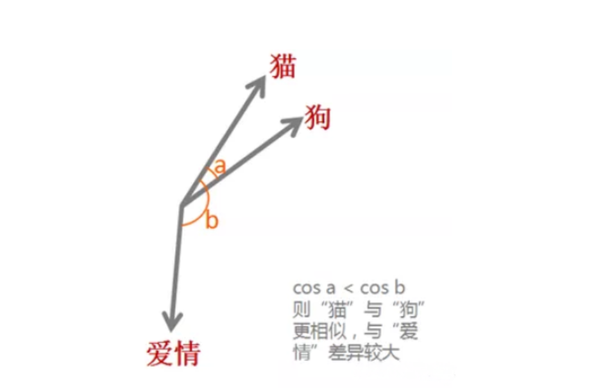
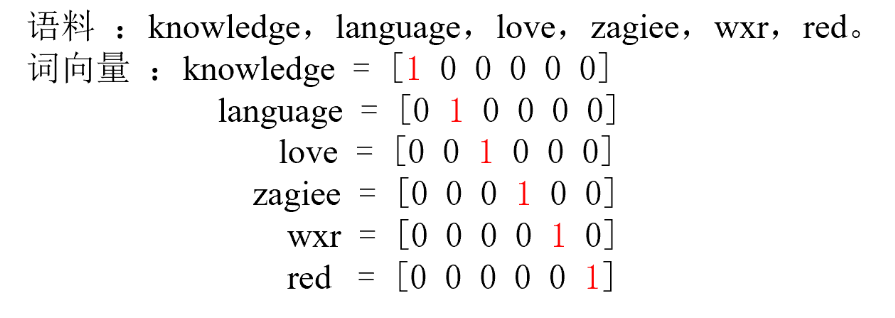
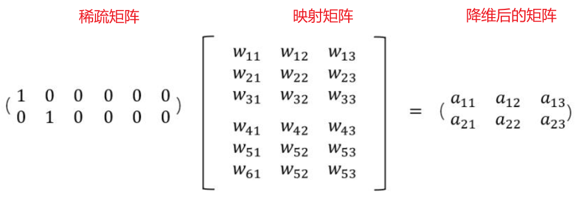
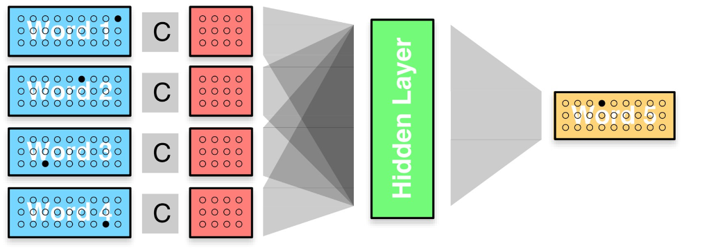
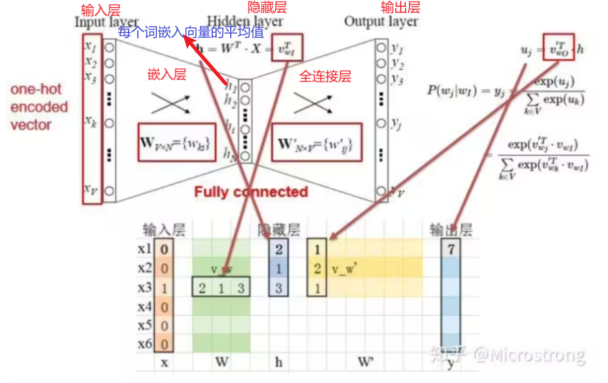
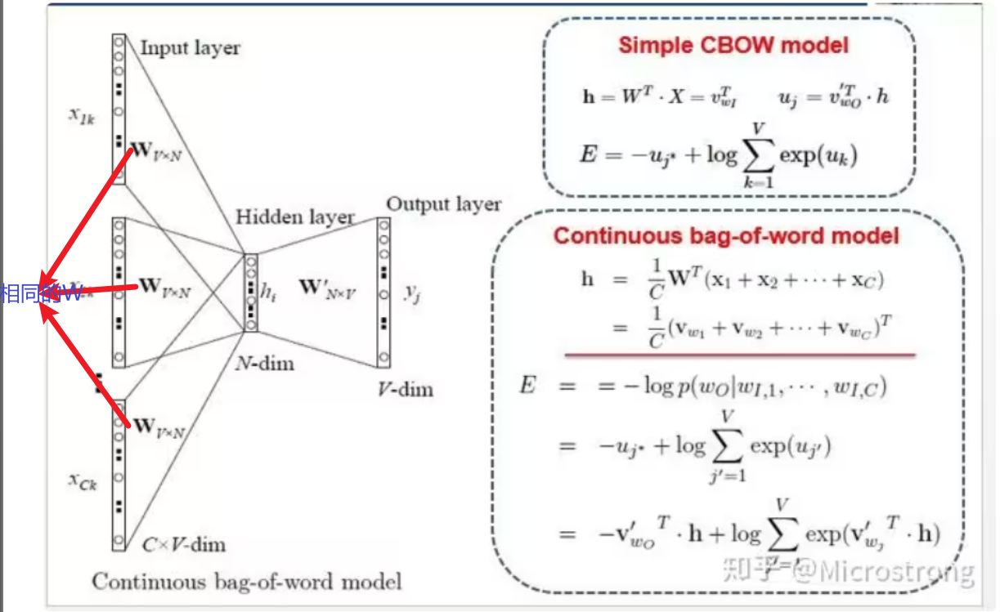
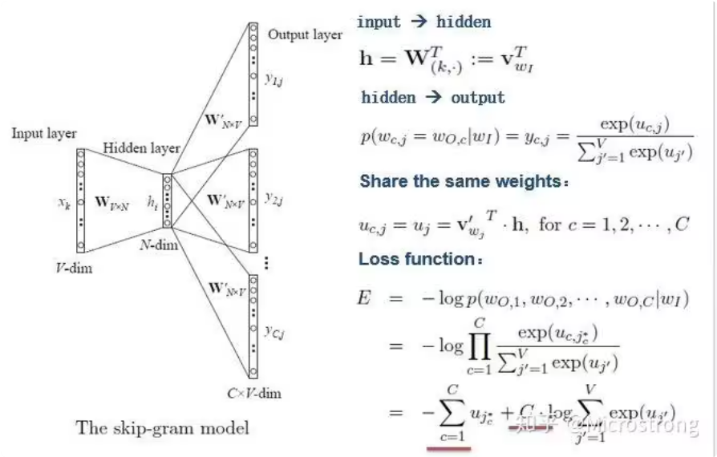

# 前言

自然语言处理（NLP）是计算机科学与语言学交叉领域，旨在**使计算机能够理解、生成和处理人类语言**，通过算法和模型分析语言结构与语义，实现机器翻译、情感分析、语音识别等功能，推动人机交互智能化发展。

# 一、NLP中的特征工程

特征工程在自然语言处理（NLP）中是**将文本数据转换为机器学习模型可处理的数值形式的过程**，通过提取词性、语法、相似度等信息，将非结构化的文本转化为对预测有用且模型能理解的特征。

说人话就是机器理解不了人类常用的字母和汉字，如果我们要进行文本处理就必须将这些转换为数值形式，也就是**词向量**，用这些向量来代替文字体现他们之间的语义关系，进而帮助计算机理解文本信息

举个例子，现在有“猫”，“狗”，“爱情”三个词语，通过词向量技术，将他们映射到向量空间(0.2,0.1,0.3)，(0.2,0.2,0.2)，(-0.4,-0.5,-0.2)，在词嵌入模型的最初始阶段，单词的向量通常是由随机初始化的，需要经过模型的训练（后续会介绍）。例如通过这些向量，我们可以得到他们的余弦相似性



# 1.1 独热编码 one - hot

一个简单示例：



## 1.2 n-grams

n-grams是一种自然语言处理技术，它将文本数据切分成长度为n的连续词或字符序列，用于捕捉文本中的局部模式和上下文信息。以I love NLP为例

- **1-gram（Unigram）**：["I","love", "NLP"]。
- **2-grams（Bigram）**：["I love", "love NLP"]。
- **3-grams（Trigram）**：["I love NLP"]。

# 二、词嵌入工程

## 2.1 稠密编码

上述one - hot编码描述的是一个形状非常大并且极为稀疏的矩阵，矩阵中**大部分元素为零**，**直接存储和计算会浪费大量空间和时间，通过处理可以高效地存储非零元素并优化计算过程，从而提高性能和资源利用率。**将**离散或高维稀疏**的数据转换为**低维密集**的向量，既稠密编码。通常采用词嵌入来实现

## 2.2 词嵌入算法

### 2.2.1 Embedding Layer 随机生成词向量

首先来说说什么叫Embedding （嵌入层）。对于稀疏矩阵太大会过度占用资源的问题，假设我们有一个2 x 6的矩阵，然后乘上一个6 x 3的矩阵后，变成了一个2 x 3的矩阵



对系数矩阵的处理也是这样，让他与一个矩阵映射相乘（**Embedding 生成的映射矩阵最开始是随机，需要经过模型训练**），实现**对稀疏矩阵的降维**



当然也可以实现升维，**把一些其他特征给放大了，或者把笼统的特征给分开了**，这里我们不考虑

实现步骤：分词--->构建词表--->引入嵌入层

```Python
self.embed = nn.Embedding(n_class, m)
```

- **`n_class`**：表示嵌入层可以处理的最大索引值。换句话说，它定义了嵌入矩阵的**行数**。
- **`m`**：表示每个嵌入向量的维度，即嵌入矩阵的**列数**。

**注意这里的n_class是可以随便设置的，因为及时设置很大的值，最后我们在调用的时候输出的矩阵形状不会受影响，但是过大会导致内存占用，因此常设置为训练集此表类别数**

```Python
import torch.nn as nn
import torch
str = "今天是好日子,明天也是个好日子。"
words = set([word for word in str])
word_index = {word:i for i,word in enumerate(words)}
index_word = {i:word for i,word in enumerate(words)}

embed = nn.Embedding(num_embeddings=len(words),embedding_dim=4)
for word in words:
    idx = torch.tensor(word_index[word])
    e = embed(idx)
    print(f"{word}------->{e}")
```

输出结果：

```
天------->tensor([-0.6919,  0.5285, -0.3013,  1.1803], grad_fn=<EmbeddingBackward0>)
也------->tensor([-1.8954,  0.1884, -1.6260, -1.2255], grad_fn=<EmbeddingBackward0>)
个------->tensor([-1.9864,  0.7118, -1.7517, -1.2229], grad_fn=<EmbeddingBackward0>)
。------->tensor([-0.3166, -0.1661,  2.5313,  0.3019], grad_fn=<EmbeddingBackward0>)
明------->tensor([-0.1306,  0.0123,  1.5784, -0.2198], grad_fn=<EmbeddingBackward0>)
,------->tensor([-0.0843,  0.3335,  0.6253, -0.0683], grad_fn=<EmbeddingBackward0>)
日------->tensor([ 0.8149,  0.3129,  1.3001, -0.0166], grad_fn=<EmbeddingBackward0>)
今------->tensor([-0.1982, -0.0454, -0.1025, -0.9523], grad_fn=<EmbeddingBackward0>)
子------->tensor([-0.8979, -0.8173, -0.7013,  0.2355], grad_fn=<EmbeddingBackward0>)
好------->tensor([ 0.6073, -0.5672,  0.9432, -0.9843], grad_fn=<EmbeddingBackward0>)
是------->tensor([ 1.0151, -1.5450, -1.0290,  0.8026], grad_fn=<EmbeddingBackward0>)
```

下面是使用一个简单的全连接神经网络实现对输入的前两个字来预测第三个字的案例

例如输入

```
sentences = [
  "i like dog", 
  "i love coffee", 
  "i hate milk", 
  "i do nlp",
]
```

流程：模型将前两个单词提出作为输入，最后一个词作为输出，，输入的句子经过**`make_batch`** 函数，转变为自变量**`input_batch`**和应变量**`target_batch`**，**`input_batch`**是每个句子的前两个单词在**`word_dict`**中的索引通过模型将其转换为稠密矩阵，进入全连接层得到输出每个类的概率**`output`**，**`target_batch`**是每个句子最后一个单词的索引，**`output`**和**`target_batch`**经过交叉熵函数得到损失

```Python
import numpy as np
import torch
import torch.nn as nn
import torch.optim as optim

sentences = [
    "i like dog", 
    "i love coffee", 
    "i hate milk", 
    "i do nlp",
]
# 创建词汇表和映射关系
word_list = ' '.join(sentences).split()  # 将所有句子合并并分割成单词列表
word_list = list(set(word_list))  # 去重
word_dict = {w: i for i, w in enumerate(word_list)}  # 单词到索引的映射
number_dict = {i: w for i, w in enumerate(word_list)}  # 索引到单词的映射

n_class = len(word_dict)  # 词汇表大小，即类别数

# 设置模型超参数
m = 2  # 嵌入向量维度
n_step = 2  # 输入的步长（前两个单词）
n_hidden = 2  # 隐层的神经元数量

# 创建输入和目标批次
def make_batch(sentence):
    input_batch = []
    target_batch = []

    for sen in sentence:
        word = sen.split()  # 将句子分割成单词
        input = [word_dict[n] for n in word[:-1]]  # 输入为句子中的前n_step个单词
        target = word_dict[word[-1]]  # 目标为句子的最后一个单词

        input_batch.append(input)  # 添加输入
        target_batch.append(target)  # 添加目标

    return input_batch, target_batch  # 返回输入批次和目标批次

# 定义神经网络语言模型
class NNLM(nn.Module):
    def __init__(self, n_class, m, n_step, n_hidden):
        super(NNLM, self).__init__()
        self.embed = nn.Embedding(n_class, m)  # 定义嵌入层，将单词索引映射为嵌入向量
        self.linear1 = nn.Linear(n_step * m, n_hidden)  # 第一层线性层，输入大小为n_step*m，输出为n_hidden
        self.linear2 = nn.Linear(n_hidden, n_class)  # 第二层线性层，输出大小为n_class

    def forward(self, x):
        x = self.embed(x)  # 通过嵌入层得到嵌入向量，形状为 batch_size x n_step x m
        x = x.view(-1, x.size(1) * x.size(2))  # 将嵌入向量展平成二维，大小为 batch_size x (n_step * m)
        tanh = torch.tanh(self.linear1(x))  # 通过第一层线性层，并使用tanh激活函数
        output = self.linear2(tanh)  # 通过第二层线性层，得到分类输出
        return output  # 返回输出

# 初始化模型
model = NNLM(n_class, m, n_step, n_hidden)

# 定义损失函数和优化器
# 不需要 softmax：nn.CrossEntropyLoss 已经隐含了 softmax 操作
criterion = nn.CrossEntropyLoss()  # 使用交叉熵损失
optimizer = optim.Adam(model.parameters(), lr=0.001)  # 使用Adam优化器，学习率为0.001

# 准备输入和目标数据
input_batch, target_batch = make_batch(sentences)
"""
为什么要转换为 LongTensor？
input_batch 和 target_batch 包含的是单词的索引（整数值），而 PyTorch 的 nn.Embedding 层和损失函数（如 CrossEntropyLoss）要求输入的索引必须是 LongTensor 类型（即整数类型的张量），而不是 FloatTensor 或其他类型。
因此，必须将这些输入和目标数据显式转换为 LongTensor。
"""
input_batch = torch.LongTensor(input_batch)  # 直接转换为 LongTensor
target_batch = torch.LongTensor(target_batch)  # 直接转换为 LongTensor

# 开始训练
for epoch in range(5000):
    optimizer.zero_grad()  # 清零梯度
    output = model(input_batch)  # 前向传播，得到输出
    loss = criterion(output, target_batch)  # 计算损失

    if (epoch + 1) % 1000 == 0:  # 每1000个epoch打印一次损失
        print(f'epoch: {epoch + 1:04d}, cost = {loss.item():.6f}')

    loss.backward()  # 反向传播计算梯度
    optimizer.step()  # 更新模型参数

# 使用训练好的模型进行预测
predict = model(input_batch).max(1, keepdim=True)[1]  # 得到最大概率对应的索引（即预测的单词类别）

# 打印输入的前两个单词和模型预测的最后一个单词
print([sen.split()[:2] for sen in sentences], '->', [number_dict[n.item()] for n in predict.squeeze()])
```

### 2.3.1 Word2vec 经过模型生成词向量

Word2vec 是一个将单词转换为向量的工具，通过这些向量可以计算单词间的语义相似度（通过余弦相似度测量）。

参考文档：https://www.bilibili.com/opus/888368896878313474

词向量是将单词转换为向量以便于数学处理的方法。Word2Vec通过上下文学习词向量，采用两种模型：CBOW（利用上下文预测单词）和Skip-gram（利用单词预测上下文）。训练后，输入层到隐藏层的权重即为词的分布式表示。

### **问1：什么是中心词，什么是周围词（上下文），以及在Word2vec 中是怎么确定的？**

答：**中心词是指在文本中当前被关注的词语**

**上下文是指与中心词在一定窗口范围内相邻的词语。**

在Word2vec模型中，通过**设定一个固定大小的窗口来确定中心词和周围词的关系**，

例如窗口大小为2，那么对于句子中的某个中心词，其周围词就是它前面和后面各两个词。**Word2vec通过训练这些中心词和周围词的组合来学习词向量**，使语义相近的词在向量空间中更接近。

以"**The quick brown fox jumps over the lazy dog**"为例，用一段代码来解释就是

```Python
def get_context_words(sentence, window_size):
    context_words = []
    for i in range(len(sentence)):
        center_word = sentence[i]
        left_context = sentence[max(0, i - window_size):i]
        right_context = sentence[i + 1:min(len(sentence), i + window_size + 1)]
        context_words.append((center_word, left_context + right_context))
    return context_words

# 示例句子
sentence = "The quick brown fox jumps over the lazy dog".split()

# 窗口大小为 2
window_size = 2

# 获取上下文词
context_words = get_context_words(sentence, window_size)

# 打印结果
for center_word, context in context_words:
    print(f"中心词: {center_word}, 上下文: {context}")
```

输出：

```
中心词: The, 上下文: ['quick', 'brown']
中心词: quick, 上下文: ['The', 'brown', 'fox']
中心词: brown, 上下文: ['The', 'quick', 'fox', 'jumps']
中心词: fox, 上下文: ['quick', 'brown', 'jumps', 'over']
中心词: jumps, 上下文: ['brown', 'fox', 'over', 'the']
中心词: over, 上下文: ['fox', 'jumps', 'the', 'lazy']
中心词: the, 上下文: ['jumps', 'over', 'lazy', 'dog']
中心词: lazy, 上下文: ['over', 'the', 'dog']
中心词: dog, 上下文: ['the', 'lazy']
```

### 2.3.1.1 CBOW模型

CBOW（连续词袋模型）模型是一种用于训练词嵌入的神经网络模型，**给定一个窗口大小为 n 的上下文单词序列，连续词袋模型的任务是预测中间的目标单词。**

细分下来，单个词语框架如下图。Word2Vec模型使用**单词的One-Hot编码作为输入层**，通过**权重矩阵\(也就是嵌入层生成的矩阵W\)将输入映射到隐藏层**，这相当于从权重矩阵中选择与输入单词对应的行。**隐藏层到输出层也有一个权重矩阵\(全连接层的W'\)**，输出层的每个值是隐藏层向量与\(W'\)的点积。最后，**通过softmax函数将输出向量转换为概率分布**，**最大概率值对应的索引即为预测的单词**。




**总体结构**



### 2.3.1.2 skip-gram模型

和上面的相反，这是根据**中心词来预测周围词**，但是由于输入的是一个词，那么就直接在嵌入层之后接全连接层就行了，**不需要求平均**



### 问2：Word2vec 生成词向量的原理是什么？

答：Word2vec的原理是利用上下文信息，**通过预测目标单词或上下文单词，学习单词的低维向量表示**，从而将高维向量转为低纬的同时使得语义相似的单词**在向量空间中更接近**。同时用负采样技术提升效率

### 问3：什么是负采样？

答：**计算损失函数需要计算某个目标样本与其他所有样本之间的关系（例如相似度或关联度**），当数据集很大时效率更低。

负采样通过**选择少量与目标样本不相关的负样本来代替整个数据集进行计算**，从而在**保持计算精度**的同时，显著**减少计算量**

### 2.3.2 Word2vec 生成词向量示例

```Python
from gensim.models import Word2Vec
from gensim.models.word2vec import LineSentence

# 示例文本数据
sentences = [
    "The quick brown fox jumps over the lazy dog",
    "I love natural language processing",
    "Word2Vec is a powerful tool for text analysis",
    "Machine learning is fascinating",
    "Deep learning models are very powerful"
]

# 将文本数据转换为单词列表
sentences = [sentence.split() for sentence in sentences]
print(sentences)

# 训练 Word2Vec 模型
# vector_size: 词向量的维度
# window: 上下文窗口大小
# min_count: 忽略出现次数少于 min_count 的单词
# workers: 训练时使用的线程数
model = Word2Vec(sentences, vector_size=5, window=5, min_count=1, workers=4)

# 获取单词的词向量
word_vector = model.wv["love"]
print("Word vector for 'love':", word_vector)

# 查找与某个单词最相似的单词
similar_words = model.wv.most_similar("love")
print("Words similar to 'love':", similar_words)

# 保存模型
model.save("./model_save/word2vec.model")

# 加载模型
loaded_model = Word2Vec.load("./model_save/word2vec.model")
print("Loaded word vector for 'love':", loaded_model.wv["love"])
```

输出：

```
[['The', 'quick', 'brown', 'fox', 'jumps', 'over', 'the', 'lazy', 'dog'], ['I', 'love', 'natural', 'language', 'processing'], ['Word2Vec', 'is', 'a', 'powerful', 'tool', 'for', 'text', 'analysis'], ['Machine', 'learning', 'is', 'fascinating'], ['Deep', 'learning', 'models', 'are', 'very', 'powerful']]
Word vector for 'love': [ 0.10911588  0.16691907 -0.02907481 -0.18416286  0.08741105]
Words similar to 'love': [('processing', 0.8060944080352783), ('analysis', 0.6299389004707336), ('language', 0.5046244859695435), ('dog', 0.497951865196228), ('lazy', 0.49438247084617615), ('Deep', 0.47717276215553284), ('Machine', 0.37548205256462097), ('I', 0.32661738991737366), ('natural', 0.3093468248844147), ('are', 0.3062337040901184)]
Loaded word vector for 'love': [ 0.10911588  0.16691907 -0.02907481 -0.18416286  0.08741105]
```

