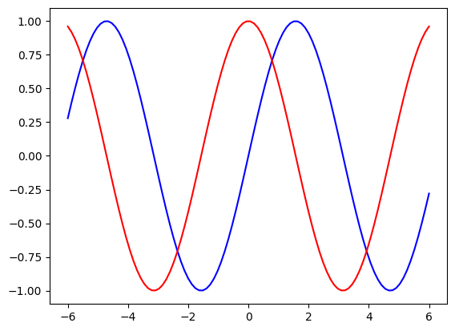
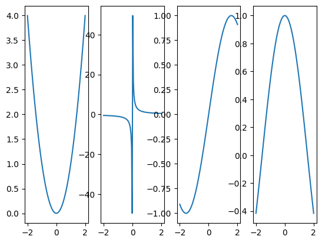
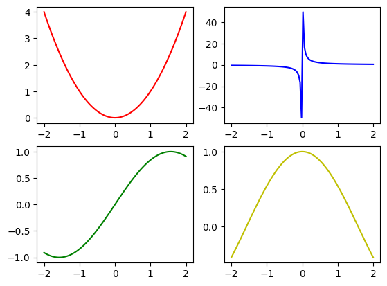
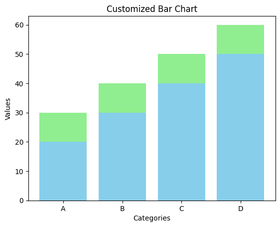
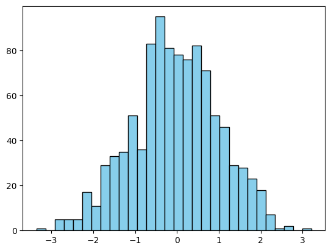
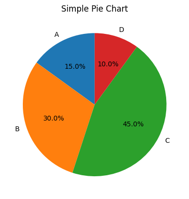
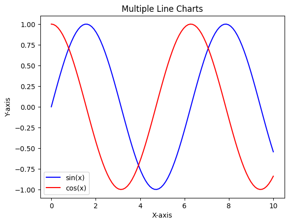
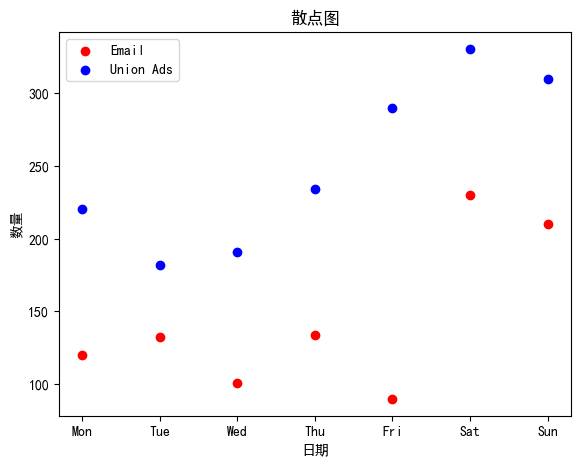

# 前言：

Python三个常用库的学习笔记

# 一、numpy

## 1.1 数组创建

**创建函数：array()**

几个参数：

object：默认参数，输入一个列表，列表中又可以嵌套列表来表示多维数据

dtype:指定数据类型，可选，如果不指定则自动识别

order：指定存储方式，C-按行（先存储第一行的所有元素，然后是第二行的所有元素） F-按列（先存储第一列的所有元素，然后是第二列的所有元素，依此类推）

ndmin: 设置数组维度，一般嵌套有几层列表就是几维

```python
a = np.array([[1,2,3],[4,5,6]],
             dtype = np.float32,
             order = "F",
             ndmin = 3)
```


**运行结果：**

array([[[1., 2., 3.],
     [4., 5., 6.]]], dtype=float32)

**打印数组形状**

返回一个元组（行，列）

```python
a = np.array([[1,2,3],[4,5,6],[7,8,9]])
print(a.shape)
```


**运行结果：**

(3, 3)

**填充数组：**

zeros(（行，列）):根据指定形状创建数组，元素默认以0填充

```python
a = np.zeros((3,3))
a
```


**运行结果：**

array([[0., 0., 0.],
     [0., 0., 0.],
     [0., 0., 0.]])

ones(（行，列）):根据指定的形状创建数组，元素默认以1填充

```python
a = np.ones((3,4))
a
```


**运行结果：** 

array([[1., 1., 1., 1.],
     [1., 1., 1., 1.],
     [1., 1., 1., 1.]])

full(（行，列），fill_value = 填充值):根据指定的形状创建数组，元素可以使用指定值填充

```python
a = np.full((3,3),fill_value=5)
a
```


**运行结果：** 

array([[5, 5, 5],
     [5, 5, 5],
     [5, 5, 5]])

arange(start,stop,step):根据参数创建一个一维的等差数组

```python
a = np.arange(0,10,2)
print(a)
```


linspace():生成一个等差数列的一维数组

start:起始值

stop:终止值

num:要分成的份数，默认是50

endpoint:默认为True，表示包含stop

每一份之间的间隔值：（stop - start）/num - 1

```python
a = np.linspace(0,10,21)
print(a)
```


 **运行结果：**

[ 0. 0.5 1. 1.5 2. 2.5 3. 3.5 4. 4.5 5. 5.5 6. 6.5 7. 7.5 8. 8.5 9. 9.5 10. ]

## 1.2 数组属性

**shape:**

1.返回一个形状元祖

2.直接修改数组形状，数组的元素不能改变，既行×列＝元素个数

```python
a = np.array([1,2,3,4,5,6,7,8,9,10,11,12])
print(a)
print(a.shape)
a.shape = (2,6)
print(a)
print(a.shape)
a.shape = (3,4)
print(a)
print(a.shape)
```


 **运行结果：** 

[ 1  2  3  4  5  6  7  8  9 10 11 12]
 (12,)
 [[ 1  2  3  4  5  6]
 [ 7  8  9 10 11 12]]
 (2, 6)
 [[ 1  2  3  4]
 [ 5  6  7  8]
 [ 9 10 11 12]]
 (3, 4)

**ndim:**

返回数组维度数

```python
a = np.array([1,2,3,4,5,6,7,8,9,10,11,12])
print(a.ndim)
```


**运行结果：** 

1

## 1.3 数组索引

**切片索引：**

(行start:行stop:行step,列start:列stop:列step)stop是不包含的

numpy数组切片可以按行也可以按列

```python
a = np.array([[1,2,3],[4,5,6],[7,8,9]])
print(a[:,0])

# ...表示保留整行/列数据,相当于：：
print(a[...,0])

# 查询第一行第一二列数据
print(a[0,0:2])

# 查询第二三行，第二三列数据
print(a[1:3,1:3])

# 查询第二行，第二列的数据
print(a[1,1])

# 查询第二三行数
print(a[1:3,...])
```


**运行结果:**

[1 4 7]
 [1 4 7]
 [1 2]
 [[5 6]
 [8 9]]
 5
 [[4 5 6]
 [7 8 9]]

**整数数组索引:**

数组正常创建，在切片的时候a[[行索引],[列索引]]，行索引和列索引组合成为坐标定位到数组元素

```python
a = np.array([[1, 2, 3], [4, 5, 6]])
print("整数数组索引的结果：", a[[0, 0, 1], [1, 2, 0]])
```


**运行结果：**

整数数组索引的结果： [2 3 4]

**布尔索引 ：**

使用条件表达式来访问满足条件的元素，二维数组布尔索引直接返回满足条件的一维数组

```python
a = np.array([[[1,2,3],[4,5,6]]])
bool_index = a>2
print(bool_index)
result = a[bool_index]
print(result)
```


**运行结果：**

[[[False False  True]
  [ True  True  True]]]
 [3 4 5 6]

也可以再细化判断条件，例如索引第3个元素大于3的所有行

```python
print(arr[arr[:, 2] > 6])
```


索引第2行 值大于3 的所有的元素 所在的列

```python
print(arr[:, arr[1] > 5])
```


## 1.4 数组广播

目的：把两个不同形状的数组变成相同形状

手段：将数组的形状较小的数组复制到数组较大的数组的对应位置，使得它们具有相同的形状。

广播的前提：两个数组的维度相同，或者其中一个数组的维度为1。

维度：维度是指数组中元素的数量，数组的维度越高，数组中元素的数量就越多。

```python
import numpy as np
a = np.array([[1], [2],[3]])
print(a.shape)
# 3×1的数组加上1×3的数组
b = np.array([10,20,30])
print(b.shape)
c = a + b
print(c)

a = np.array([1,2,3])
b = np.array([[10],[20],[30]])
c = a + b 
print(c)
```


**运行结果：**

(3, 1)
 (3,)
 [[11 21 31]
 [12 22 32]
 [13 23 33]]
 [[11 12 13]
 [21 22 23]
 [31 32 33]]

## 1.5 数组遍历

for循环遍历：

二维数组直接使用for循环遍历，输出结果是每一个一维数组，有几维就要写几层for循环，效率不高

```python
a = np.array([[1, 2, 3], [4, 5, 6]])
for row in a:
    print(row)
```


**运行结果：**

[1 2 3]
 [4 5 6]

**nditer()函数**

可以对数组进行迭代，并返回一个迭代器对象。

控制参数：

1.order:设置遍历数组的顺序，C-按行优先，F-按列优先。

```python
a = np.array([[1,2,3],[4,5,6]])
for i in np.nditer(a,order="C"):
    print(i,end = " ")
print("=====")
for i in np.nditer(a,order="F"):
    print(i,end = " ")
```


1 2 3 4 5 6 =====
 1 4 2 5 3 6

flags（[参数]）：指定迭代器的额外行为

参数值：

multi_index:返回元素对应的下标索引元组(行，列)

external_loop:将遍历的单个元素添加到一个一维数组，遍历完成后输出一维数组

```python
a = np.array([[1,2,3],[4,5,6]])
it = np.nditer(a,flags = ["multi_index"])
for i in it:
    print(it.multi_index)

b = np.array([[7,8,9],[10,11,12]])
for x in np.nditer(b, flags=['external_loop'], order='C'):
    print(x)
```


[1 2 3 4 5 6]

## 1.6 数组运算

**dot**

**一维数组点积**

```python
a = np.array([1, 2, 3])
b = np.array([4, 5, 6])
print(np.dot(a, b))
```


1×4＋2×5＋3×6 = 32

**二维数组矩阵乘法**

```python
a = np.array([[1, 2], [3, 4]])
b = np.array([[5, 6], [7, 8]])
c = np.dot(a, b)
print(c)
```


[[19 22]
 [43 50]]

**matmul()**

**两个矩阵的乘法运算**

```python
a = np.array([[1, 2], [3, 4],[9,10]])
b = np.array([[5, 6], [7, 8]])
c = np.matmul(a, b)
print(c)
```


[[ 19  22]
 [ 43  50]
 [115 134]]

**np.linalg.det（）**

计算一个方阵的行列式

```python
a = np.array([[1, 2, 3], [4, 8, 6], [7, 8, 9]])
print(np.linalg.det(a))
```


-36.0

## 1.7 数组操作

reshape((行，列))：修改数组形状

修改后返回一个新数组，不直接返回原数组

返回的新数组是原数组的一个视图，修改视图会影响原数组

 reshape和shape的区别：reshape是改变数组的形状，shape是查看数组的形状

```python
a = np.array([1,2,3,4,5,6])
a1 = a.reshape((2,3))
print(a1)
# 修改视图
a1[0][0] = 100
print(a)
print(a1)
```


[[1 2 3]
 [4 5 6]]
 [100  2  3  4  5  6]
 [[100  2  3]
 [  4  5  6]]
 参数：

-1占位符：numpy会自动计算该占位符的维度

```python
a = np.array([1,2,3,4,5,6])
print(a)
a1 = a.reshape((3,-1))
print(a1)
# 等价于
a1 = a.reshape((3,2))
print(a1)
```


[1 2 3 4 5 6]
 [[1 2]
 [3 4]
 [5 6]]
 [[1 2]
 [3 4]
 [5 6]]

np.resize(arr,(x,y)):重塑数组形状，但是没有元素个数限制,直遍历原数组填充新数组直至填满新数组,剩下未遍历完的数组丢弃

```python
a = np.arange(1,13).reshape(3,4)
a1 = np.resize(a,(6,5))
print(a1)
```


[[ 1  2  3  4  5]
 [ 6  7  8  9 10]
 [11 12  1  2  3]
 [ 4  5  6  7  8]
 [ 9 10 11 12  1]
 [ 2  3  4  5  6]]

np.expand_dims(arr,axis):根据指定的轴方向进行升维

axis = 0,按行升维，axis = 1,按列升维

```python
a = np.array([1,2,3])
a1 = np.expand_dims(a,axis = 0)
print(a1)
print(np.shape(a1))

a2 = np.expand_dims(a,axis = 1)
print(a2)
print(np.shape(a2))
```


[[1 2 3]]
 (1, 3)
 [[1]
 [2]
 [3]]
 (3, 1)

**多维数组扁平化**

**flat属性**：返回一个一维数组迭代器，可以使用循环来遍历

```python
a = np.arange(1,13).reshape(3,4)
for i in a.flat:
    print(i,end=' ')
print()
```


1 2 3 4 5 6 7 8 9 10 11 12 

**flatten()方法**：返回一个一维数组

浅拷贝，是原数组的副本，修改新数组不会影响原数组

```python
a = np.arange(1,13).reshape(3,4)
b = a.flatten()
print(b)
b[0] = 100
print(a)
```


[ 1  2  3  4  5  6  7  8  9 10 11 12]
 [[ 1  2  3  4]
 [ 5  6  7  8]
 [ 9 10 11 12]]

**ravel()方法**：返回一个一维数组

深拷贝，是原数组的试图，修改新数组会影响原数组

```python
a = np.arange(1,13).reshape(3,4)
b = a.ravel()
print(b)
b[0] = 100
print(a)
```


[ 1  2  3  4  5  6  7  8  9 10 11 12]
 [[100  2  3  4]
 [  5  6  7  8]
 [  9  10  11  12]]

**数组转置**

```python
a = np.array([[1, 2, 3], [4, 5, 6]])
print(a.T) 
```


[[1 4]
 [2 5]
 [3 6]]

**squeeze(arr,axis):**根据指定的轴进行降维

降维前提：所在轴上的维度必须为1才能进行降维

axis按照轴方向进行降维，0-按最外层降维，1-按第二层降维，以此类推

假设数组为二维数组

axis = 0，按行降维

axis = 1，按列降维

axis = None，或不指定axis，对所有维度数为1的项降维

移除元素个数为1的维度

```python
a = np.array([[[[[1,2,3],[4,5,6],[7,8,9]],[[10,11,12],[13,14,15],[16,17,18]]]]])
print(a.shape)

# 按照第一层降维
a1 = np.squeeze(a,axis=0)
print(a1)
print(a1.shape)

# 按照第二层降维
a2 = np.squeeze(a,axis=1)
print(a2)
print(a2.shape)
```


(1, 1, 2, 3, 3)
 [[[[ 1  2  3]
   [ 4  5  6]
   [ 7  8  9]]

 [[10 11 12]
   [13 14 15]
   [16 17 18]]]]
 (1, 2, 3, 3)
 [[[[ 1  2  3]
   [ 4  5  6]
   [ 7  8  9]]

 [[10 11 12]
   [13 14 15]
   [16 17 18]]]]
 (1, 2, 3, 3)

**数组拼接stack**

hstack(tuple):接收一个包含要连接元素的元组，**横向连接**，要求行数相同

```python
a = np.array([[1,2],[3,4]])
b = np.array([[5],[6]])
c = np.hstack((a,b))
print(c)
```


[[1 2 5]
 [3 4 6]]

vstack(tuple):接收一个包含要连接元素的元组，**纵向连接**，要求列数相同

```python
a = np.array([[1,2,3],[4,5,6]])

b = np.array([7,8,9])

c = np.array([[10,11,12],[13,14,15]])

d = np.vstack((a,b,c))

print(d)
```


[[ 1  2  3]
 [ 4  5  6]
 [ 7  8  9]
 [10 11 12]
 [13 14 15]]

**数组切割split**

hsplit(arr,[index]):**水平切割数组**

```python
a = np.arange(1,13).reshape(3,4)
print(a)
a1 = np.hsplit(a,[1,3])
for ai in a1:
  print("===========")
  print(ai)
  print("===========")
```


[[ 1  2  3  4]
 [ 5  6  7  8]

 [ 9 10 11 12]]

 [[1]
 [5]

 [9]]

 ===========
 [[ 2  3]
 [ 6  7]

 [10 11]]

 ===========
 [[ 4]
 [ 8]

 [12]]

vsplit(arr,[index]):**竖直切割数组**

```python
a2 = np.vsplit(a,[1,2])
for ai in a2:
  print("===========")
  print(ai)
  print("===========")
```


===========

 [[1 2 3 4]]

 ===========

 [[5 6 7 8]]

 ===========

 [[ 9 10 11 12]]

**append()**:在数组**尾部**添加值（可以是数组）

axis = None，添加后**整合成一维数组输出**

```python
a = np.array([[1,2,3],[4,5,6]])

a1 = np.append(a,[1,1,1],axis = None)

print(a1)
```


axis = 0**添加到行**，维度必须保持一致

```python
a2 = np.append(a,[[1,1,8]],axis = 0)

print(a2)
```


axis = 1**添加到列**，维度必须保持一致

```python
a3 = np.append(a,[[1,1,1],[4,5,6]],axis = 1)

print(a3)
```


[1 2 3 4 5 6 1 1 1]
 [[1 2 3]
 [4 5 6]
 [1 1 8]]
 [[1 2 3 1 1 1]
 [4 5 6 4 5 6]]

**insert()**指定位置添加值

axis = None,返回一维数组

axis = 0,插入行，自动广播

axis = 1,插入列，自动广播

```python
a = np.array([[1,2,3],[4,5,6]])
a1 = np.insert(a,1,[6],axis = None)
print(a1)

a2 = np.insert(a,1,[6],axis = 0)
print(a2)

a3 = np.insert(a,1,[6],axis = 1)
print(a3)
```


[1 6 2 3 4 5 6]
 [[1 2 3]
 [6 6 6]
 [4 5 6]]
 [[1 6 2 3]
 [4 6 5 6]]

**delete()：**删除指定位置的元素

参数和append类似

```python
a = np.arange(1,13).reshape(3,4)
a1 = np.delete(a,1,axis = None)
print(a1)

a = np.arange(1,13).reshape(3,4)
a2 = np.delete(a,1,axis = 0)
print(a2)

a = np.arange(1,13).reshape(3,4)
a3 = np.delete(a,1,axis = 1)
print(a3)
```


[ 1  3  4  5  6  7  8  9 10 11 12]
 [[ 1  2  3  4]
 [ 9 10 11 12]]
 [[ 1  3  4]
 [ 5  7  8]
 [ 9 11 12]]

**argwhere()**:默认返回非0元素的索引坐标，可自己设置条件

```python
a = np.array([[0,1,0,2],[0,2,0,3]])
a1 = np.argwhere(a)
print(a1)
```


[[0 1]
 [0 3]
 [1 1]
 [1 3]]

**where**和argwhere功能一样，但是返回的是元组

(行索引下标数组，列索引下标数组)

可以整合布尔数组和索引数组，实现复杂的条件筛选

```python
a = np.array([[0,1,0,2],[0,2,0,3]])
a1 = np.where(a)
print(a1)
a2 = np.where(a>1)
print(a2)
a3 = np.where(a>0,a,9)#将小于等于0的元素替换为9
print(a3)
```


(array([0, 0, 1, 1], dtype=int64), array([1, 3, 1, 3], dtype=int64))
 (array([0, 1, 1], dtype=int64), array([3, 1, 3], dtype=int64))
 [[9 1 9 2]
 [9 2 9 3]]

**argmax()**获取数组中第一个最大值对应的**下标索引**

```python
a = np.array([[0,3,0,2],[0,2,0,3]])
a1 = np.argmax(a,axis=0)
print(a1)
```


[0 0 0 1]

**unique()函数：**返回数组中唯一的元素

参数：

 arr：输入数组

return_index：如果为True，返回**索引数组**；否则，返回值**数组**。

return_inverse：如果为True，返回**反向映射**(反向映射：元素到其在数组中出现的索引)数组；否则，返回**None**。

return_counts：如果为True，返回**每个元素的计数**；否则，返回**None**。

```python
arr = np.array([1, 2, 3, 2, 4, 1, 5])
print(np.unique(arr))  # [1 2 3 4 5]
a,index = np.unique(arr,return_index=True)
print("数组：",a,"\n索引：",index)
a,index,inverse = np.unique(arr,return_index=True,return_inverse=True)
print("数组：",a,"反向映射：",inverse)
a,index,inverse,count = np.unique(arr,return_index=True,return_inverse=True,return_counts=True)
print("数组：",a,"计数：",count)
```


[1 2 3 4 5]
 数组： [1 2 3 4 5] 
 索引： [0 1 2 4 6]
 数组： [1 2 3 4 5] 反向映射： [0 1 2 1 3 0 4]
 数组： [1 2 3 4 5] 计数： [2 2 1 1 1]

**amin()和amax()函数**

对于二维数组来说，

axis = 0表示沿着竖直的方向求最小值或最大值，

axis = 1表示沿着水平的方向求最小值或最大值。

axis = None表示沿着整个数组的方向求最小值或最大值。

```python
a = np.array([[0, 7, 3], [7, 9, 6], [4, 2, 9]])
print(np.amin(a,axis=0))  # 每一列的最小值
print(np.amax(a,axis=1))  # 每一行的最大值
print(np.amin(a,axis=None))  # 整个数组的最小值
```


[0 2 3]
 [7 9 9]
 0

**ptp()计算峰值的差**

```python
arr = np.array([[1,6,8],[0,9,4],[5,6,9]])
a1 = np.ptp(arr)#整个数组的最大值和最小值相减
print(a1)
a2 = np.ptp(arr,axis = 0)#数组每一列的最大值和最小值相减
print(a2)
a3 = np.ptp(arr,axis = 1)#数组每一行的最大值和最小值相减
print(a3)
```


9
 [5 3 5]
 [7 9 4]

**median()计算中位数**

参数axis和ptp一样，都可以单独按行或者按列操作

中位数计算方法和数学一样（特殊情况取平均）

```python
# 中位数计算方法和数学一样（特殊情况取平均）
arr = np.array([[1,2,0],[0,9,4],[5,6,9]])
a1 = np.median(arr)
print(a1)
a2 = np.median(arr,axis = 0)
print(a2)
a3 = np.median(arr,axis = 1)
print(a3)
```


4.0
 [1. 6. 4.]
 [1. 4. 6.]

**mean()计算算术平均值**

```python
arr = np.array([[1,2,0],[0,9,4],[5,6,9]])
a1 = np.mean(arr)
print(a1)

a2 = np.mean(arr,axis=0)
print(a2)

a3 = np.mean(arr,axis = 1)
print(a3)
```


4.0
 [2.     5.66666667 4.33333333]
 [1.     4.33333333 6.66666667]

**average()加权平均值**

```python
arr = np.array([1,2,6])
weight = np.array([0.1,0.2,0.7])
a1 = np.average(arr,weights=weight)  # 必须使用关键字参数 weights
print(a1)
```


4.699999999999999

**二维数组的加权平均值**

axis=None表示沿着所有维度求平均值

axis=0表示沿着行方向求平均值，axis=1表示沿着列方向求平均值

weights的维度必须与数组arr的维度相同，且每一行的权重之和必须为1

```python
arr2 = np.array([[1,2,3],[4,5,6]])
weight2 = np.array([[0.1,0.2,0.2],[0.1,0.1,0.3]])
a2 = np.average(arr2,axis=None,weights=weight2)
print(a2)
a3 = np.average(arr2,axis=0,weights=weight2)
print(a3)
a4 = np.average(arr2,axis=1,weights=weight2)
print(a4)
```


3.8
 [2.5 3.  4.8]
 [2.2 5.4]

**var()方差**

```python
a1 = np.array([1, 2, 3, 4, 5,6])
a2 = np.array([[1,2,3],[4,5,6]])
print(np.var(a1))
print(np.var(a2,axis=0))
print(np.var(a2,axis=1))
```


2.9166666666666665
 [2.25 2.25 2.25]
 [0.66666667 0.66666667]

在样本数据中，样本均值的估计会引入一定的偏差。通过使用 n−1作为分母，可以校正这种偏差，得到更准确的总体方差估计。

```python
arr = np.array([1, 2, 3, 4, 5])
print(np.var(arr, ddof=1))
```


2.5

**std()标准差**

```python
a = np.array([1, 2, 3, 4, 5, 6])
print(np.std(a))
a1 = np.array([[1, 2, 3], [4, 5, 6]])
print(np.std(a1, axis=0))
print(np.std(a1, axis=1))
```


1.707825127659933
 [1.5 1.5 1.5]
 [0.81649658 0.81649658]

# 二、matplotlib

## 2.1 画图操作

**第一种绘图方式，直接使用plot()绘图**

plot 绘制曲线函数

这是最简单的绘制方式，常用于简单的查看数据分布

```python
def test01():
    x = np.linspace(-6,6,100)
    y = np.sin(x)
    z = np.cos(x)

    plt.plot(x,y,"b")
    plt.plot(x,z,"r")

    plt.show()

test01()
```




下面是创建画布和子图的操作：

**subplots()函数创建多个子图**

```python
def test03():
    x = np.linspace(-2,2,100)
    y = x ** 2
    z = x ** -1
    m = np.sin(x)
    n = np.cos(x)


    # 为避免频繁调用add_subplot，subplot(nrows, ncols)
    # nrows: 行数
    # ncols: 列数
    # 返回的对象：fig 画布对象，ax 子图对象列表,该对象是一个数组
    fig,ax = plt.subplots(1,4)
    
    # 在绘图区域上分别绘图
    ax[0].plot(x,y,label = "y = x^2")
    ax[1].plot(x,z,label = "z = x^-1")
    ax[2].plot(x,m,label = "m = sin(x)")
    ax[3].plot(x,n,label = "n = cos(x)")

    fig,ax = plt.subplots(2,2) #可以随意改变形状，但是子图区域必须一致
    ax[0][0].plot(x,y,"r",label = "y = x^2")
    ax[0][1].plot(x,z,"b",label = "z = x^-1")
    ax[1][0].plot(x,m,"g",label = "m = sin(x)")
    ax[1][1].plot(x,n,"y",label = "n = cos(x)")

    plt.show()

test03()
```






## 2.2 绘制图表

**柱状图bar()**

```python
x = ["A","B","C","D"]

y = [20,30,40,50]
y2 = [30,40,50,60]
# 参数：
# height：y轴数据
# bottom：X轴数据
# align:刻度在柱子的位置：center，left，right
fig,ax = plt.subplots()

# 绘制第二个数据集的柱状图，堆叠在第一个数据集上
ax.bar(x, y2, color='lightgreen', align="center")

ax.bar(x,y,color = "skyblue",align="center")
ax.set_title('Customized Bar Chart')
ax.set_xlabel('Categories')
ax.set_ylabel('Values')

plt.show()
```




直方图hist

```python
data = np.random.randn(1000)


fix,ax = plt.subplots()


ax.hist(data, bins=30, color='skyblue', edgecolor='black')

plt.show()
```




**饼图ple()**

```python
labels = ['A', 'B', 'C', 'D']

sizes = [15, 30, 45, 10]


fig, ax = plt.subplots()


ax.pie(sizes, labels=labels, autopct='%1.1f%%', startangle=90)


# 设置标题

ax.set_title('Simple Pie Chart')


# 显示图形

plt.show()
```




**折线图plot**

```python
x = np.linspace(0, 10, 100)

y1 = np.sin(x)

y2 = np.cos(x)


# 创建图形和子图

fig, ax = plt.subplots()


# 绘制多条折线图

ax.plot(x, y1, label='sin(x)', color='blue')

ax.plot(x, y2, label='cos(x)', color='red')


# 设置标题和标签

ax.set_title('Multiple Line Charts')

ax.set_xlabel('X-axis')

ax.set_ylabel('Y-axis')


# 添加图例

ax.legend()


# 显示图形

plt.show()
```




**散点图scatter（）** 

```python
plt.rcParams['font.sans-serif'] = ['SimHei']
plt.rcParams['axes.unicode_minus'] = False
fig = plt.figure()
axes = fig.add_axes([.1,.1,.8,.8])
x = ['Mon', 'Tue', 'Wed', 'Thu', 'Fri', 'Sat', 'Sun']
data = [
    [120, 132, 101, 134, 90, 230, 210],
    [220, 182, 191, 234, 290, 330, 310],
]
y0 = data[0]
y1 = data[1]
axes.scatter(x,y0,color='red')
axes.scatter(x,y1,color='blue')
axes.set_title('散点图')
axes.set_xlabel('日期')
axes.set_ylabel('数量')
plt.legend(labels=['Email', 'Union Ads'],)
plt.show()
```




# 三、pandas库

## 3.1 series创建

创建Series对象

```python
s = pd.Series([1, 2, 3, 4, 5],dtype = "f8")
print(s)
```


指定索引和名称：

```python
# 创建Series对象，并指定索引
s = pd.Series([1, 2, 3, 4, 5], index=['a', 'b', 'c', 'd', 'e'])
print(s.index)

# 创建Series对象，并指定索引和名称
s = pd.Series([1, 2, 3, 4, 5], index=['a', 'b', 'c', 'd', 'e'], name='my_series')
print(s.name)
```


使用数组创建Series

```python
array_one = np.array(["xiaoming","xiaohuang","xiaozhang"])
series_one = pd.Series(data = array_one,index = [i+1 for i in range(len(array_one))])
print(series_one)
```


## 3.2 Series遍历

切片 

```python
s = pd.Series([1, 2, 3, 4, 5],index = ['a', 'b', 'c', 'd', 'e'])
print(s["a"])
# 使用下标切片，终止值不被包含
print(s[0:3])
# 使用标签切片，终止值被包含
print(s['a':'d'])
```


使用Series的index属性：

```python
s = pd.Series([1, 2, 3, 4, 5],index = ['a', 'b', 'c', 'd', 'e'])
for index in s.index:
    print("index:",index,"value:",s[index])
```


values属性：

```python
s = pd.Series([1, 2, 3, 4, 5],index = ['a', 'b', 'c', 'd', 'e'])
for value in s.values:
    print("values:",value)
```


## 3.3 dataframe创建

**创建dataframe空对象**

```python
df = pd.DataFrame()

print(df)
```


**通过嵌套字典创建**

```python
l = [{"name":"zhangsan","age":20},{"name":"lisi","age":"30","sex":"boy"}]

df = pd.DataFrame(l)

print(df)
```


**字典嵌套Series创建,如果第二列比第一列多一个元素，自动用nan填充第一列**

```python
dic = {"name":pd.Series([1,2,3],index = ["a","b","c"]),

       "age":pd.Series([10,20,30,40],index = ["a","b","c","d"])}

df = pd.DataFrame(dic)

print(dic)
```


## 3.4 dataframe列操作

```python
dic = {"one":[1,2,3],"two":[4,5,6],"three":[7,8,9]}
df = pd.DataFrame(dic)
print(df)
# 取一列返回Series
print(df["one"])
# 取多列返回dataframe
print(df[["one","two"]])
```


one  two  three
 0   1   4    7
 1   2   5    8
 2   3   6    9
 0   1
 1   2
 2   3
 Name: one, dtype: int64
   one  two
 0   1   4
 1   2   5
 2   3   6

**添加空列：**

```python
data = {"one":pd.Series(data = [1,2,3],index = ["a","b","c"]),
        "two":pd.Series(data = [1,2,3,4],index = ["a","b","c","d"])}
df = pd.DataFrame(data)
print(df)
```


**添加一列空值：**

```python
df["Three"] = None

print(df)
```


**通过assign()添加一列,等号左边是要添加的列名，右边是对应的列值**

**assign()是链式调用**

```python
df1 = df.assign(four = [40,50,60,70]).assign(five = [1,2,3,4])
print(df1)
```


one  two
 a  1.0   1
 b  2.0   2
 c  3.0   3
 d  NaN   4
   one  two Three
 a  1.0   1  None
 b  2.0   2  None
 c  3.0   3  None
 d  NaN   4  None
   one  two Three  four  five
 a  1.0   1  None   40   1
 b  2.0   2  None   50   2
 c  3.0   3  None   60   3
 d  NaN   4  None   70   4

insert()在指定位置插入数据

**参数：loc-要插入的索引下标，column-要插入的列名，value-要插入的数据**

```python
data = {
    "one":pd.Series(data = [1,2,3],index = ["a","b","c"]),
    "two":pd.Series(data = [7,4,1],index = ["a","b","c"]),
    "three":pd.Series(data = [2,4,6],index = ["a","b","c"])
}

df = pd.DataFrame(data)
df.insert(loc=1,column="four",value=[5,6,7])
print(df)
```


**修改数据**

```python
data = {
    "one":pd.Series(data = [1,2,3],index = ["a","b","c"]),
    "two":pd.Series(data = [7,4,1],index = ["a","b","c"]),
    "three":pd.Series(data = [2,4,6],index = ["a","b","c"])
}
df = pd.DataFrame(data)
print(df)

print("======================")
```


**修改列名**

```python
df.columns = ["col1","col2","col3"]
print(df)

print("======================")
```


**修改列值(这里用了广播机制)**

```python
df["col1"] += 100
print(df)

print("======================")
```


**rename()返回一个新的DataFrame对象，不修改原对象**

**columns参数可以传入一个字典，将原列名映射到新列名**

```python
de1 = df.rename(columns={"col1":"col4","col2":"col5","col3":"col6"})
print(de1)
```


one  two  three
 a   1   7    2
 b   2   4    4
 c   3   1    6

   col1  col2  col3
 a   1   7   2
 b   2   4   4
 c   3   1   6

   col1  col2  col3
 a  101   7   2
 b  102   4   4
 c  103   1   6

   col4  col5  col6
 a  101   7   2
 b  102   4   4
 c  103   1   6

**修改数据类型**

```python
data = {
    "one":pd.Series(data = [1,2,3],index = ["a","b","c"]),
    "two":pd.Series(data = [7,4,1],index = ["a","b","c"]),
    "three":pd.Series(data = [2,4,6],index = ["a","b","c"])
}
df = pd.DataFrame(data)
print(df.dtypes)

print("="*50)

df["one"] = df["one"].astype(float)
df["two"] = df["two"].astype(int)
df["three"] = df["three"].astype(str)
print(df.dtypes)
```


**删除数据drop()**

参数

labels:要删除的标签，可以是行，也可以是列

axis：轴方向，和labels结合使用

index：要删除的行标签或列标签列表

columns:要删除的列标签或列表

inplaces:如果为True表示原地删除数据，False则是返回一个新的dataframe

**删除列 "two"，返回一个新的 DataFrame**

```python
df1 = df.drop(labels="two", axis=1, inplace=False)
print("df1:")
print(df1)
```


**删除索引 "a" 和 "b"，并删除列 "one"，直接在原 DataFrame 上修改**

```python
df.drop(index=["a", "b"], columns=["one"], inplace=True)
print("df:")
print(df)
```


## 3.5 行操作

**获取a行数据**

```python
data = {
    "one": pd.Series(data=[1, 2, 3], index=["a", "b", "c"]),
    "two": pd.Series(data=[7, 4, 1], index=["a", "b", "c"]),
    "three": pd.Series(data=[2, 4, 6], index=["a", "b", "c"])
}
df = pd.DataFrame(data)
print(df.loc["a"])
```


**对行切片，获取a行到b行的数据**

```python
print(df.loc["a":"b"])
```


**对行和列切片**

```python
print(df.loc["a":"b","one":"two"])
```


**定位获取一个标量**

```python
print(df.loc["a","one"])
```


**选择获取多行多列**

```python
print(df.loc[["a","c"],["one","three"]])
```


**iloc：根据索引选择数据**

```python
data = {
    'A': [1, 2, 3, 4],
    'B': [5, 6, 7, 8],
    'C': [9, 10, 11, 12]
}
df = pd.DataFrame(data, index=['a', 'b', 'c', 'd'])
df.columns = ["1", "2", "3"]
df.index = ["A","B","C","D"]
print(df)

# 使用 iloc 选择数据，先行后列
print(df.iloc[0])  # 选择第 0 行的数据
print(df.iloc[0:2])  # 选择第 0 到 1 行的数据
print(df.iloc[0, 1])  # 选择第 0 行，第 1 列的元素
print(df.iloc[[0, 2], [0, 2]])  # 选择第 0 和 2 行，第 0 和 2 列的数据
print(df.iloc[:,[0,2]]) # 选择第 0 和 2 列的数据
```


**添加新行,只能有loc，不能用iloc**

```python
data = {
    'A': [1, 2, 3, 4],
    'B': [5, 6, 7, 8],
    'C': [9, 10, 11, 12]
}
df = pd.DataFrame(data,index=["a","b","c","d"])
df.loc["e"] = [17,18,19]
df.loc[:,"D"] = [13,14,15,16,17]
df
```


**concat拼接dataframe**

```python
data1 = {
    'A': [1, 2, 3, 4],
    'B': [5, 6, 7, 8],
    'C': [9, 10, 11, 12]
}
data2 = {
    'B': [5,6,7,8],
    'C': [7,8,9,10],
    'G': [0,1,0,1,]
}
df1 = pd.DataFrame(data1,index = ["a","b","c","d"])
df2 = pd.DataFrame(data2,index = ["a","b","c","e"])
print(df1)
print(df2)
# ignore_index如果为True，则忽略原来的标签重新生成,否则标签中可能有重复名字
df3 = pd.concat([df1,df2],axis=1,ignore_index=False)
print(df3)

print("_"*50)
# inner表示交集
df4 = pd.concat([df1,df2],axis=0,ignore_index=False,join="inner")
print(df4)

print("_"*50)
# 默认outer拼接，并集
df5 = pd.concat([df1,df2],axis=0,ignore_index=False,join="outer")
print(df5)
```


**3.6 函数操作**

```python
data = {
    'A': [1, 2, 3, 4, 5],
    'B': [10, 20, 30, 40, 50],
    'C': [100, 200, 300, 400, 500]
}
df = pd.DataFrame(data)

# 计算每列的均值
mean_values = df.mean()
print(mean_values)

# 计算每列的中位数
median_values = df.median()
print(median_values)

#计算每列的方差
var_values = df.var()
print(var_values)

# 计算每列的标准差
std_values = df.std()
print(std_values)

# 计算每列的最小值
min_values = df.min()
print("最小值:")
print(min_values)

# 计算每列的最大值
max_values = df.max()
print("最大值:")
print(max_values)

# 计算每列的总和
sum_values = df.sum()
print(sum_values)

# 计算每列的非空值数量
count_values = df.count()
print(count_values)
```


**reindex重置索引**

```python
data = {
    'A': [1, 2, 3, 4, 5],
    'B': [10, 20, 30, 40, 50],
    'C': [100, 200, 300, 400, 500]
}
df = pd.DataFrame(data)
print("原始 DataFrame:")
print(df)

# 使用 reindex 方法重置行索引
new_index = ["b", "c", "d", "e", "f"]
df_reindexed = df.reindex(index = new_index)

print("\n使用 reindex 方法重置行索引后的 DataFrame:")
print(df_reindexed)
```


原始 DataFrame:
   A  B   C
 0  1  10  100
 1  2  20  200
 2  3  30  300
 3  4  40  400
 4  5  50  500

使用 reindex 方法重置行索引后的 DataFrame:
   A  B  C
 b NaN NaN NaN
 c NaN NaN NaN
 d NaN NaN NaN
 e NaN NaN NaN
 f NaN NaN NaN
