# 前言

先来一个高级的功能，获取图像指定位置坐标

```python
import cv2 as cv
import pandas as pd
import os

# 回调函数，用于处理鼠标事件
def mouse_callback(event, x, y, flags, param):
    if event == cv.EVENT_LBUTTONDOWN:  # 左键点击
        print(f"Left button clicked at: ({x}, {y})")
        # 将左键点击的坐标和类型保存到 CSV 文件
        pd.DataFrame([{"X": x, "Y": y, "Type": "Left"}]).to_csv("click.csv", mode='a', header=False, index=False)
    elif event == cv.EVENT_RBUTTONDOWN:  # 右键点击
        print(f"Right button clicked at: ({x}, {y})")
        # 将右键点击的坐标和类型保存到 CSV 文件
        pd.DataFrame([{"X": x, "Y": y, "Type": "Right"}]).to_csv("click.csv", mode='a', header=False, index=False)

# 读取图像
img = cv.imread(r"data\1.jpg")
if img is None:
    print("Error: Unable to load image.")
    exit()

# 创建窗口
cv.namedWindow("mywindow", cv.WINDOW_NORMAL)

# 检查文件是否存在，如果不存在，写入表头
if not os.path.exists("click.csv"):
    pd.DataFrame(columns=["X", "Y", "Type"]).to_csv("click.csv", index=False)

# 设置鼠标回调函数
cv.setMouseCallback("mywindow", mouse_callback)

# 显示图像
cv.imshow("mywindow", img)

# 等待键盘事件
cv.waitKey(0)

# 销毁所有窗口
cv.destroyAllWindows()
```


左键点击图片直接在csv文件里保存当前鼠标位置坐标

# 一、图像操作

## 1.1 读取并显示图像

OpenCV在读取图片时通常用cv.imread和cv.imshow来操作，可以个性化设置窗口属性，在末尾还需要在显示图像或视频窗口后关闭窗口，否则程序可能会一直等待用户操作，导致程序无法正常结束。调用 `cv.destroyAllWindows()` 可以确保所有窗口都被关闭，释放相关资源。

```python
# 读取图像
img = cv.imread("1.jpg")
# 创建窗口cv.namedWindow("窗口名"，属性)
# cv.namedWindow("mywindow",cv.WINDOW_AUTOSIZE)#默认窗口大小不可调整
cv.namedWindow("mywindow",cv.WINDOW_NORMAL)#窗口可调整大小
# 显示图像：cv.imshow("之前创建的窗口名"，img)
cv.imshow("mywindow",img)
cv.waitKey(0)
cv.destroyAllWindows()
```


## 1.2 创建黑白图像

像素是图像的基本单元，每个像素存储着图像的颜色、亮度和其他特征。一系列像素组合到一起就形成了完整的图像，在计算机中，图像以像素的形式存在并采用二进制格式进行存储。根据图像的颜色不同，每个像素可以用不同的二进制数表示。

计算机采用0/1编码的系统，数字图像也是利用0/1来记录信息，我们平常接触的图像都是8位数图像。opencv中常用的是8位图像,大多数彩色和灰度图像使用8位表示每个通道的像素值，范围从0到255，其中0，代表最黑，1，表示最白。

日常生活中常见的图像是RGB三原色图。RGB图上的每个点都是由红（R）、绿（G）、蓝（B）三个颜色按照一定比例混合而成的，几乎所有颜色都可以通过这三种颜色按照不同比例调配而成。在计算机中，RGB三种颜色被称为RGB三通道，每个通道的取值都是0-255，根据这三个通道存储的像素值，来对应不同的颜色。

图像本质上是像素值的二维或三维矩阵（对于彩色图像），因此可以通过构建矩阵来创建图像

```python
img = cv.imread("data/1.jpg")
print(img)
```


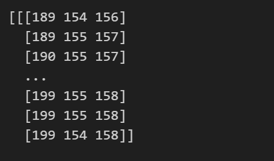

每个像素由三个颜色值组成，例如 `[189, 154, 156]` 表示一个像素的蓝色通道值为189，绿色通道值为154，红色通道值为156，在这个例子中，每个像素的颜色值由三个数字组成，分别对应于蓝色（B）、绿色（G）和红色（R）通道的强度值。而不是RBG

将数组中数字全部置于0即可创建一张黑色图片

```python
h,w = 50,50
c = 3
img = np.zeros((h,w,c),dtype = np.uint8)
cv.imshow("black",img)
cv.waitKey(0)
cv.destroyAllWindows()
```


也可以全部置于255，得到白色图片

```python
h,w = 500,500
c = 3
img = np.full((h,w,c),255,dtype = np.uint8)
cv.imshow("white",img)
cv.waitKey(0)
cv.destroyAllWindows()
```


当然也可以随机填充数字，随机生成像素

```python
# 生成随机像素值
img[:,:,:]=np.random.randint(0,256,(h,w,c))
# 显示图像
cv.imshow("Colorful",img)
print(img,img.shape)
cv.imwrite("Colorful.jpg",img)
cv.waitKey(0)
cv.destroyAllWindows()
```


## 1.3 读取图像

既然是（高度，宽度，通道数）的numpy数组，就可以进行一系列切片操作

```python
import cv2 as cv
# 读取图像
img = cv.imread(r"data\1.jpg")
# 打印图像numpy信息
print(img,img.shape)
# 定义起点和宽高
x = 100
y = 200
# 剪裁起点和宽高和通道
w = 500
h = 500
img2 = img[y:y+h,x:x+w,0:1]
cv.imshow("img",img)
cv.imshow("img2",img2)
print(img2.shape)
cv.waitKey(0)
cv.destroyAllWindows()
```


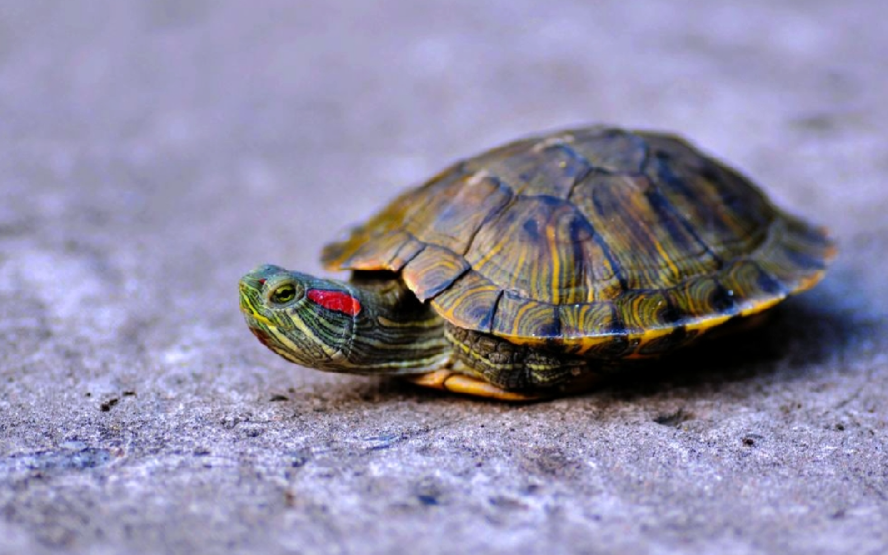

切片结果（这里是把通道数也一起进行了切片，但是这个操作是没有意义的，因为像素点的维度为（高度，宽度，3）时是彩色，为（高度，宽度，1）时则是代表只有一个颜色通道，既灰度图，每个像素的灰度值通常是一个介于0（黑色）到255（白色）之间的整数，表示该像素的亮度。灰度值越高，像素越亮；灰度值越低，像素越暗。**这个1省略，即灰度图为二维数组**）


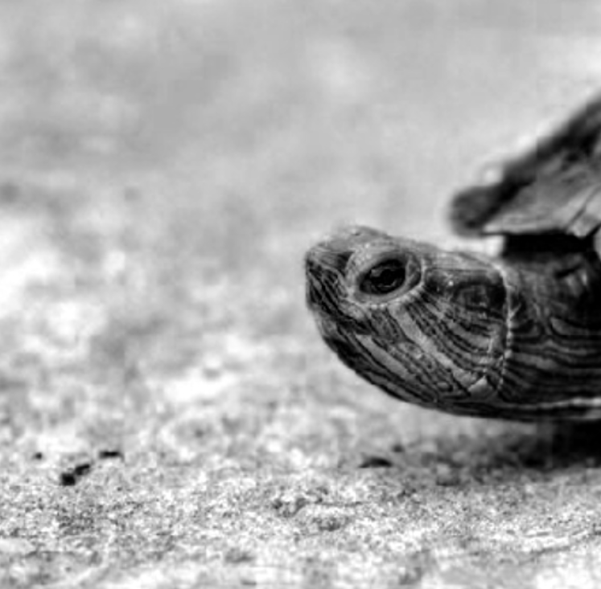

## 1.4 cv.resize()函数


`cv.resize()` 函数用于改变图像的尺寸（在不改变颜色通道的前提下改变宽高），其工作原理是通过插值方法来重新计算新尺寸下的像素值。插值方法决定了如何根据原始图像的像素值来估算新图像中像素的值。在使用 `cv.resize()` 函数时，如果目标尺寸小于原始尺寸，图像会被缩小，这通常会导致像素数量减少。即原来的宽×高大于resize后的宽×高，就用插值方法（可选）去掉一些像素点

```python
# 读取图片
img = cv.imread(r"data\1.jpg")
print(img.shape)
# 修改形状
img2 = cv.resize(img,(500,400))
print(img2.shape)
cv.imshow("view of picture",img)
cv.imshow("view of picture2",img2)
cv.waitKey(0)
cv.destroyAllWindows()
```


(820, 1307, 3)
 (400, 500, 3)

resize后的图片（网页自动填充图片，导致显示结果不是那么直观，但是图片大小确实是变了）：

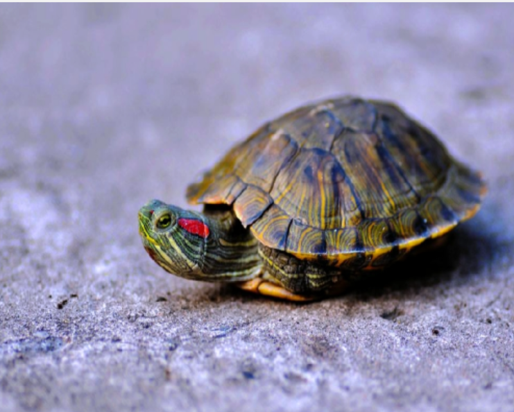

1.5 绘制图像

可以在原有图像的基础上绘制一些简单的线条，直线，圆，矩形，文字（只能是英文）

```python
# 绘制直线和圆形和矩形
img = cv2.imread(r"data\1.jpg")
# 起点，终点，颜色，宽度
cv2.line(img,(700,700),(200,200),(255,0,0),5)
# 圆形，半径，颜色，宽度
cv2.circle(img,(300,300),150,(200,255,200),3)
# 左上角，右下角，颜色，宽度
cv2.rectangle(img,(100,250),(450,450),(255,0,0),2)
cv2.imshow("img",img)
cv2.waitKey(0)
```


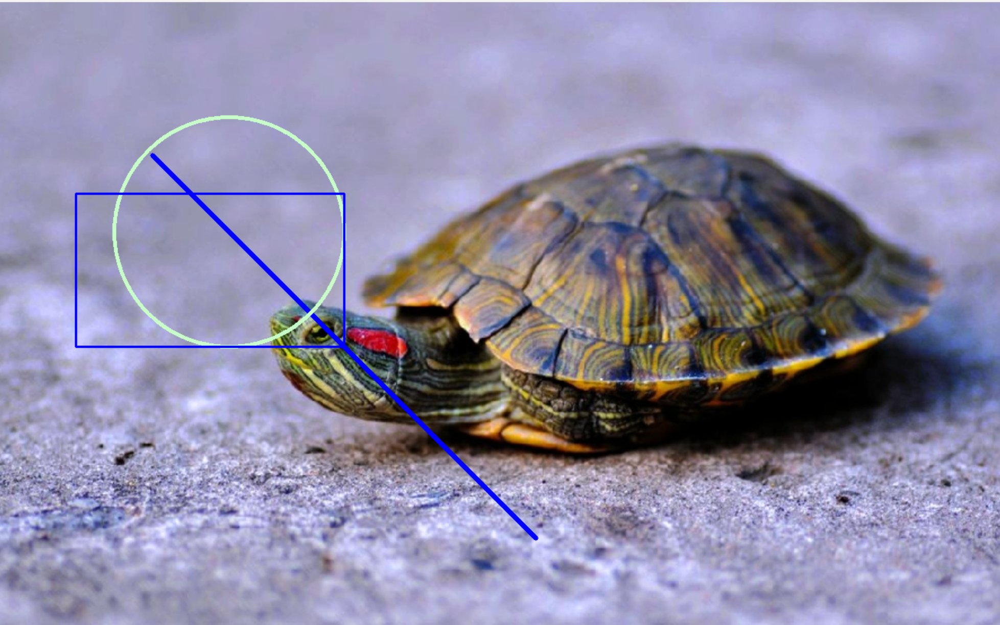

```python
# 添加文字
img = cv2.imread(r"data\1.jpg")
cv2.putText(img,
            "wugui",
            (100,200),#位置
            cv2.FONT_ITALIC,#字体样式
            3,#字号
            (255,255,0),#颜色
            15,#粗细
            cv2.LINE_AA)#高级线条类型，实现文本高质量渲染
cv2.imshow("img",img)
cv2.waitKey(0)
```


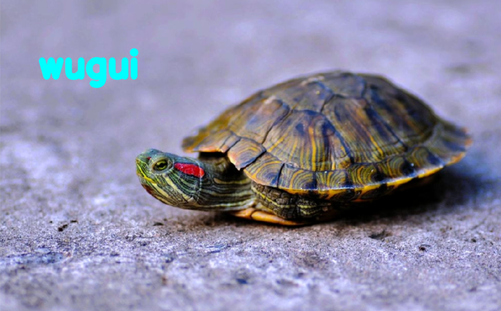

## 1.6 读取视频

固定招数，按q退出，cv2.VideoCapture(0)表示获取设备前置摄像头资源

```python
# 捕获摄像头实时视频
cap = cv2.VideoCapture("data\lions.mp4")
while True:
    # 读取一帧视频
    ret,frame = cap.read()
    print(frame)
    
    if not ret:
        break
    
    cv2.imshow("camera feed",frame)

    if cv2.waitKey(40)&0xFF == ord('q'):
        break
    
# 释放摄像头资源并关闭所有窗口
cap.release()
cv2.destroyAllWindows()
```


# 二、图像预处理 

## 2.1 翻转图像 

图像大小会影响训练复杂度，一般在训练时是将所有图片设置成一个大小以确保一致性

```python
img = cv.imread(r"data\1.jpg")
img_r = cv.resize(img,(800,600))
# 图像翻转cv2.flip(img,翻转标志0，-1,1)
# 垂直翻转，flipcode = 0,沿着x轴上下翻转
flip0 = cv.flip(img_r,0)
# 水平翻转，flipcode = 1,沿着y轴左右翻转
flip1 = cv.flip(img_r,1)
# 水平加垂直翻转，flipcode = -1,沿着x,y都翻转
flip_ = cv.flip(img_r,-1)
# cv.imshow("img",img)
# cv.imshow("img_r",img_r)
cv.imshow("flip0",flip0)
cv.imshow("flip1",flip1)
cv.imshow("flip_",flip_)
cv.waitKey(0)
cv.destroyAllWindows()
```


## 2.2 图像仿射变换

仿射变换实质是通过线性变换，将二维空间中的点(x,y)映射到新的位置 (x', y')。

矩阵乘法形式来实现这种变换（类似于y=kx+b）

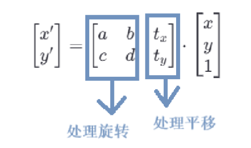

a,b,c,d是线性变换系数，t_x，t_y 是平移部分的系数

**cv2.warpAffine()**：**仿射变换函数** cv2.warpAffine(img,M,dsize)

通常只需要确定需求后设计出仿射变换矩阵M，（既[x,y,1]），填入函数即可得到结果

### 2.2.1 图像旋转

**矩阵：M = cv.getRotationMatrix2D(center,angle,scale)**

**参数：**

center：旋转中心

angle：旋转角度

scale:缩放比例

```python
img = cv.imread(r"data/1.jpg")
img = cv.resize(img,(480,480))
# 获取图像宽高,(高，宽，通道数)
h,w,_ = img.shape
# 设置旋转中心
center = (w//2,h//2)
# 旋转角度
angle = 45
# 缩放比例
scale = 0.6
# 生成旋转矩阵
M = cv.getRotationMatrix2D(center,angle,scale)
# 通过旋转矩阵，使用仿射变换进行仿射变换
img = cv.warpAffine(img,M,(w,h))
cv.imshow("img",img)
cv.waitKey(0)
cv.destroyAllWindows()
```


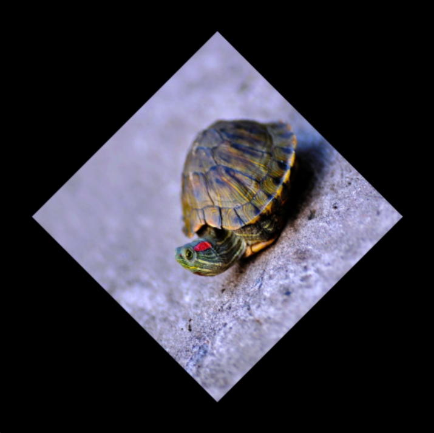

### 2.2.2 图像平移

**矩阵：**

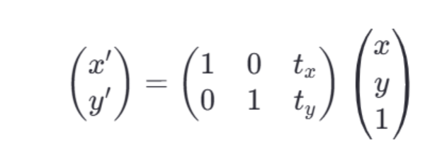

```python
img = cv.imread(r"data/1.jpg")
img_r = cv.resize(img,(480,480))
cv.namedWindow("img",cv.WINDOW_NORMAL)
# 定义相关参数
tx,ty = 100,200
# 获取平移矩阵
M = np.float32([[1,0,tx],[0,1,ty]])
# 通过平移矩阵进行仿射变换
img = cv.warpAffine(img_r,M,(480+tx,480+ty))
cv.imshow("img",img)
cv.waitKey(0)
cv.destroyAllWindows()
```


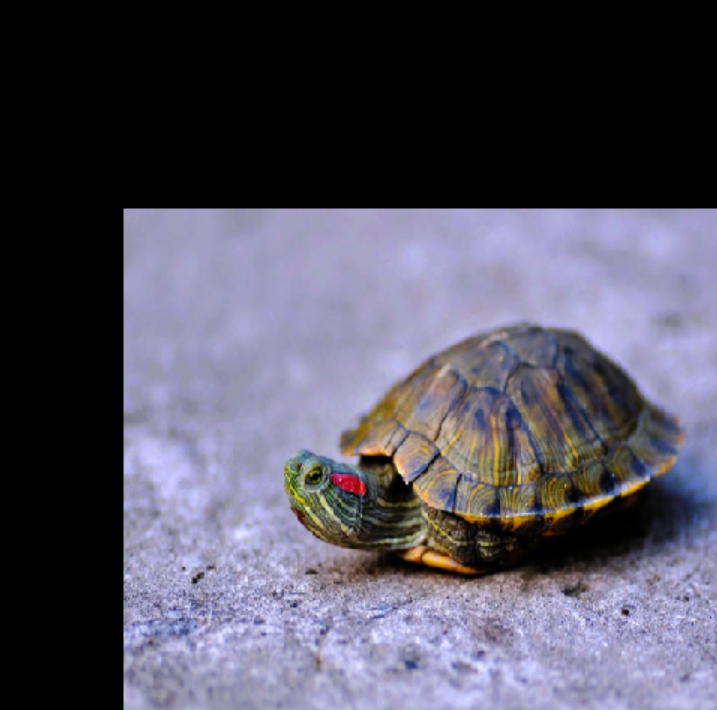

### 2.2.3 图像缩放

**参数：sx,sy分别是x方向和y方向的缩放因子**

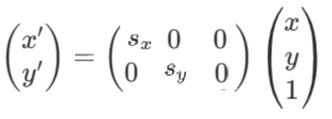

```python
img = cv.imread(r"data/1.jpg")
img_r = cv.resize(img,(480,480))
sx = 0.6
sy = 0.9
w1,h1 = int(img_r.shape[1]*sx),int(img_r.shape[0]*sy)
M = np.float32([[sx,0,0],[0,sy,0]])
img = cv.warpAffine(img_r,M,(w1,h1))
print(img.shape)
cv.imshow("img",img)
cv.waitKey(0)
cv.destroyAllWindows()
```


 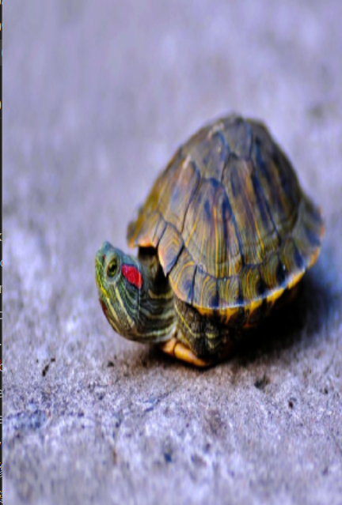

### 2.2.4 图像剪切

矩阵：

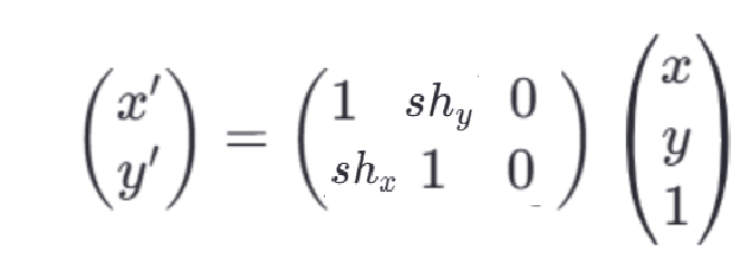

图解：

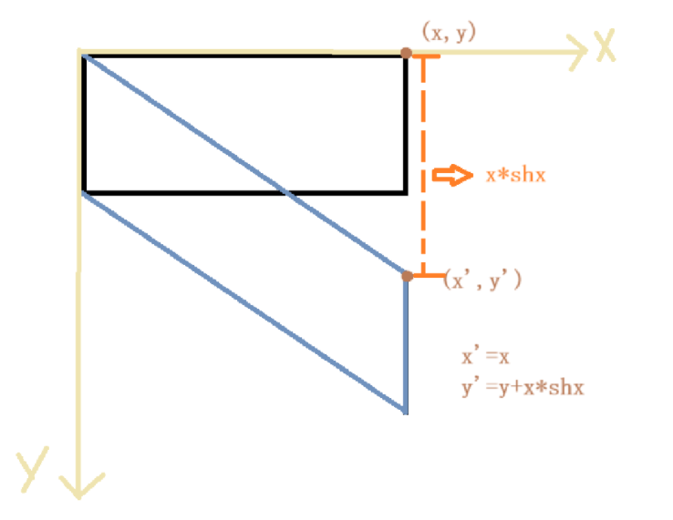


```python
img = cv.imread(r"data/1.jpg")
img_r = cv.resize(img,(480,480))
sx = 0.1
sy = 0.1
M = np.float32([[1,sy,0],[sx,1,0]])
img = cv.warpAffine(img_r,M,(480,480))
print(img.shape)
cv.imshow("img",img)
cv.waitKey(0)
cv.destroyAllWindows()
```


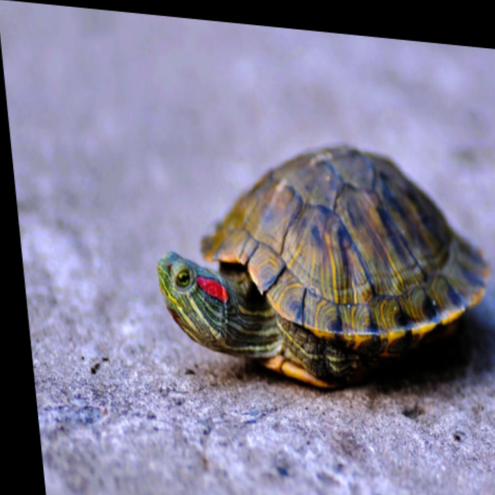

# 三、插值方法

## 3.1 双线性插值

在图像处理中，插值方法用于在图像变换过程中估算新图像中像素点的值，尤其是在图像缩放时

这里给出三种，但是最近邻插值虽然最快，但是效果不是很好，一般常用的是第二种，双线性插值 

```python
img = cv.imread("data/girl.jpg")
h,w = img.shape[:2]
center = (w//2,h//2)
# 获取旋转矩阵
# (中心，旋转角度，缩放比例)
M = cv.getRotationMatrix2D(center,0,0.5)
# 最近邻插值
img1 = cv.warpAffine(img,M,(w,h),flags=cv.INTER_NEAREST)
# 双线性插值
img2 = cv.warpAffine(img,M,(w,h),flags=cv.INTER_LINEAR)
# 像素区域插值
img3 = cv.warpAffine(img,M,(w,h),flags=cv.INTER_AREA)
# 双三次插值
img4 = cv.warpAffine(img,M,(w,h),flags=cv.INTER_CUBIC)
cv.imshow("img1",img1)
cv.imshow("img2",img2)
cv.imshow("img3",img3)
cv.imshow("img4",img4)
cv.waitKey(0)
cv.destroyAllWindows()
```


理论大概看看就行，主要是通过两边点的距离来判断新的点的像素，至于为什么要叫做双线性插值，x方向上插一下，y方向上插一下，不就双线性了嘛 

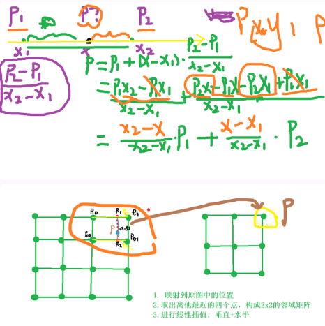

## 3.2 锯齿效应和失真

resize()将图像缩放后，图像可能会出现锯齿化和失真的情况，可以用插值的方法来缓解这一情况

示例基于局域像素重采样插值，插值方法可选

```python
img_new = img_resize(img, interpolation=cv.INTER_AREA)
```


# 四、像素点变换

## 4.1 边缘填充

图象经过旋转和缩小后，像素点在原来窗口中会呈现出一些0值，即黑色，例如下面是缩小了0.5，旋转了45度的图像

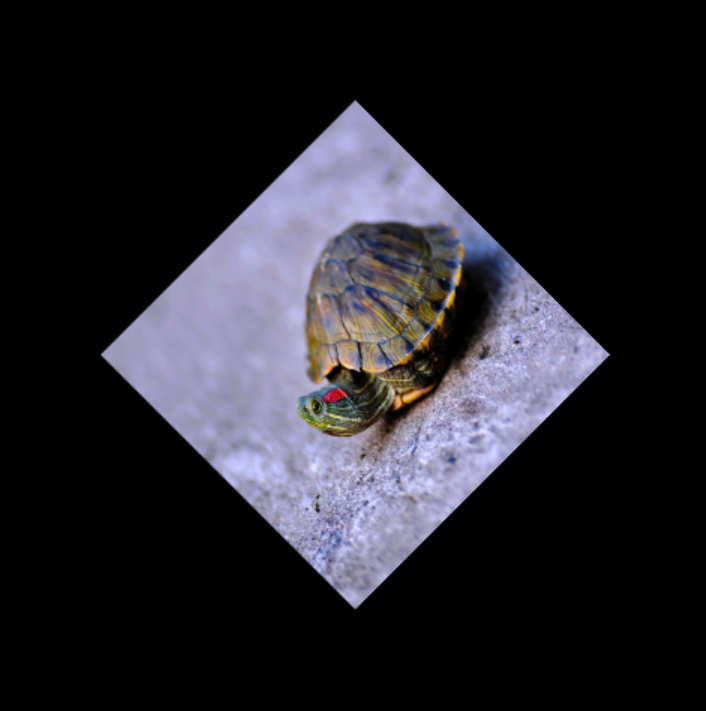

我们需要用边缘填充的方法来消除这些黑色

### 4.1.1边界复制

原理如图，很好理解，每一个格子代表一个像素点

### 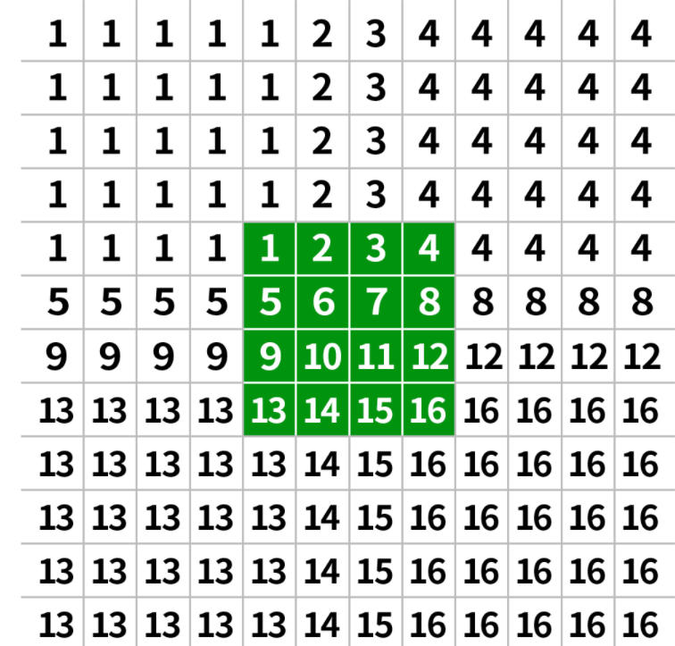

**代码：** 

`注：cv.INTER_LANCZOS4` 是一种高质量的插值方法，使用 Lanczos 窗函数进行插值，适用于对图像质量要求较高的场景

```python
new_img_1=cv.warpAffine(img,M,(w,h),cv.INTER_LANCZOS4,borderMode=cv.BORDER_REPLICATE)
```


**填充结果：**

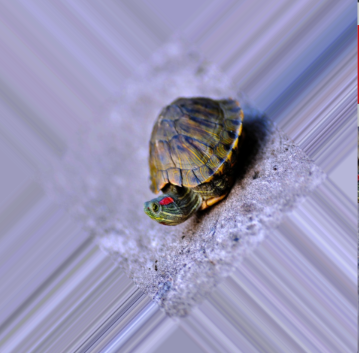

### **4.1.2 边界反射**

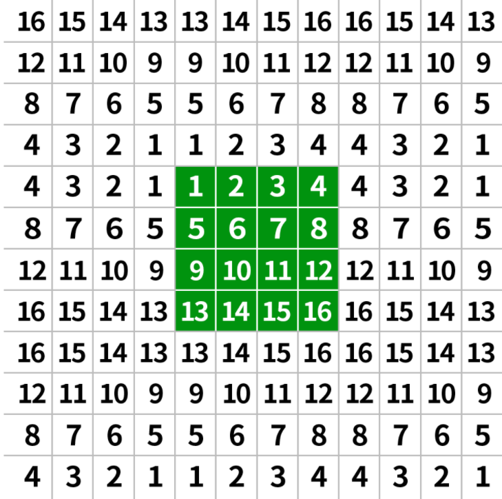

**代码：**

```python
new_img_2 = cv.warpAffine(img,M,(w,h),cv.INTER_LANCZOS4,borderMode=cv.BORDER_REFLECT)
```


**填充结果：**

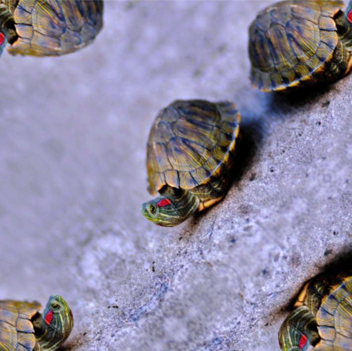

### 4.1.3 边界反射101

在边界反射的基础上去除了反射的第一个相同的像素值

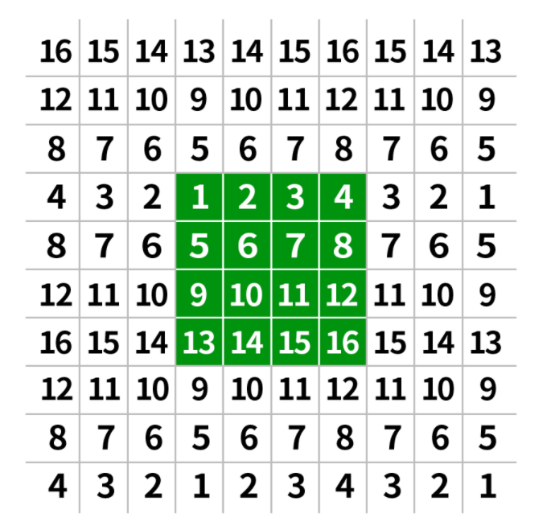

**代码：**

```python
new_img_3=cv.warpAffine(img,M,(w,h),cv.INTER_LANCZOS4,borderMode=cv.BORDER_REFLECT_101)
```


**反射结果：**

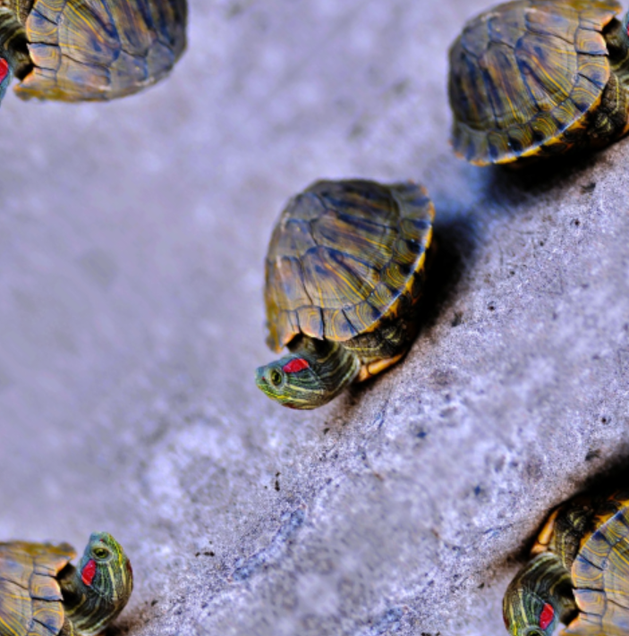

### 4.1.4 边界常数

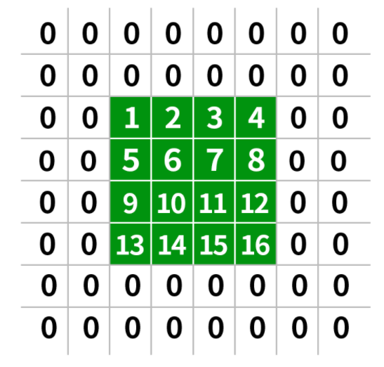

**代码：**

```python
new_img_4=cv.warpAffine(img,M,(w,h),cv.INTER_LANCZOS4,borderMode=cv.BORDER_CONSTANT,borderValue=(0,0,255))
```


**填充结果：**

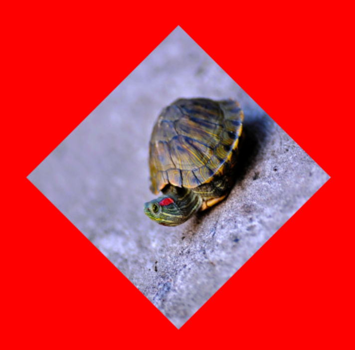

### 4.1.5 边界包裹

### 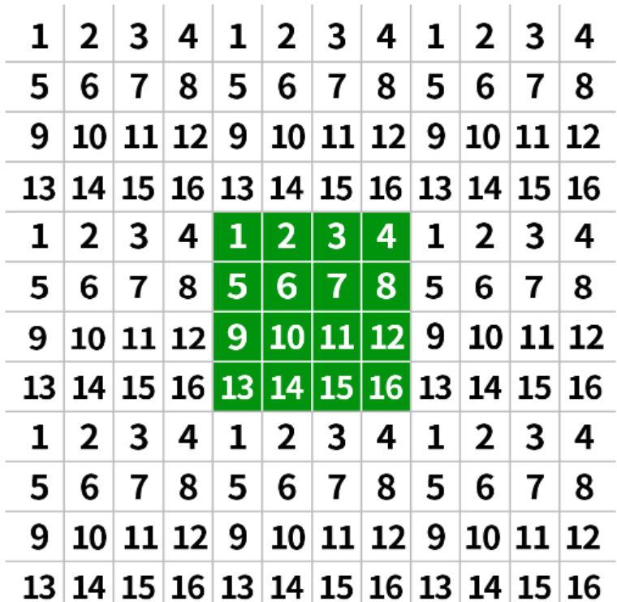

**代码：**

```python
new_img_5=cv.warpAffine(img,M,(w,h),cv.INTER_LANCZOS4,borderMode=cv.BORDER_WRAP)
```


**填充结果：**

### 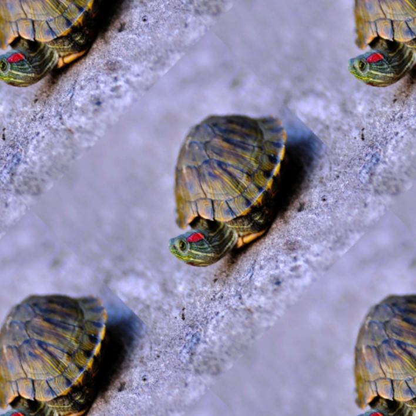

## 4.2 图像矫正

有些时候呈现的图像的角度是倾斜的，比如下面这张倾斜的塔

### 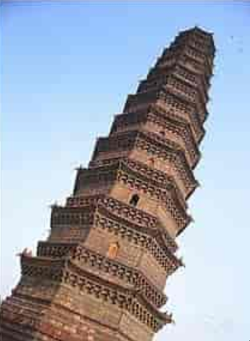

如果我们需要将他进行角度的矫正，可以使用透视变换来进行图像校正，透视变换的原理也和前面提到的仿射变换类似，需要找出一个**透视变换矩阵**

首先我们用前言提到的获取图片坐标的方法来圈出需要进行矫正的区域，这一步不是必须的，只是为了方便对比

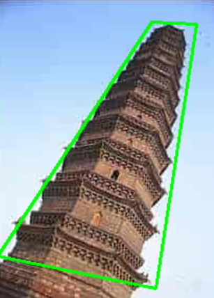

然后应用透视变换

```python
# 读取图像
img = cv.imread("data/tower.jpg")

# 获取图像的形状
shape = img.shape
print("图像形状:", shape)

# 原图中要变换的图像的四个点坐标
pst1 = np.float32([[152,22], [195,24], [156,277], [5,246]])

# 输出图像的四个边缘点坐标（左上、右上、右下、左下）
pst2 = np.float32([[0, 0], [shape[1] - 1, 0], [shape[1] - 1, shape[0] - 1], [0, shape[0] - 1]])

# 拷贝一份原图，绘制出需要变换的部分
img2 = img.copy()
cv.polylines(img2, [pst1.astype(np.int32)], isClosed=True, color=(0, 255, 0), thickness=2)

# 获取透视变换矩阵
M = cv.getPerspectiveTransform(pst1, pst2)

# 应用透视变换
new_img = cv.warpPerspective(img, M, (shape[1], shape[0]), flags=cv.INTER_LINEAR, borderMode=cv.BORDER_CONSTANT)

# 显示结果
cv.imshow("Original Image", img)
cv.imshow("Highlighted Region", img2)
cv.imshow("Transformed Image", new_img)
cv.waitKey(0)
cv.destroyAllWindows()  
```


**变换结果：**

**有点奇怪，但是成功了**

### 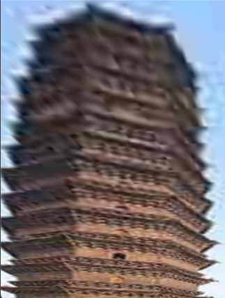

## 4.3 颜色加法

既然图像可以看做是一个数组，那么图像与图像之间肯定也可以进行数组加法，从而实现将两张图片的内容整合到一张图片上去。

首先在进行颜色加法之前，我们要将图片统一形状，不难理解，这一操作也是为了统一数组形状，不然没法相加

```python
img1 = cv.imread("data/1.jpg")
img2 = cv.imread("data/tower.jpg")

# 统一形状
img2 = cv.resize(img2, (img1.shape[1], img1.shape[0]))
```


### 4.3.1 numpy直接相加

直接相加有一个问题，就是两个像素点和和可能超出255的范围，导致图像失真

**代码：**

```python
# numpy直接相加：模运算
img_numpy = img1+img2
```


 **相加结果：**

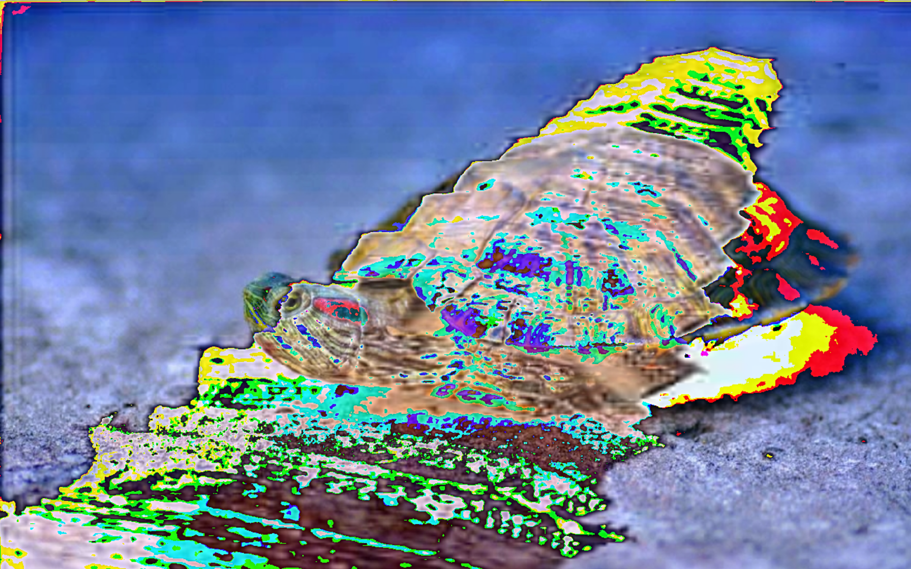

这样肯定达不到处理要求

### 4.3.2 饱和运算

使用OpenCV内置cv2.add()函数 ，最大饱和像素值为255，不会超出边界

**代码：**

```python
# 饱和运算(最大255)
img_add = cv.add(img1,img2)
```


**相加结果：**

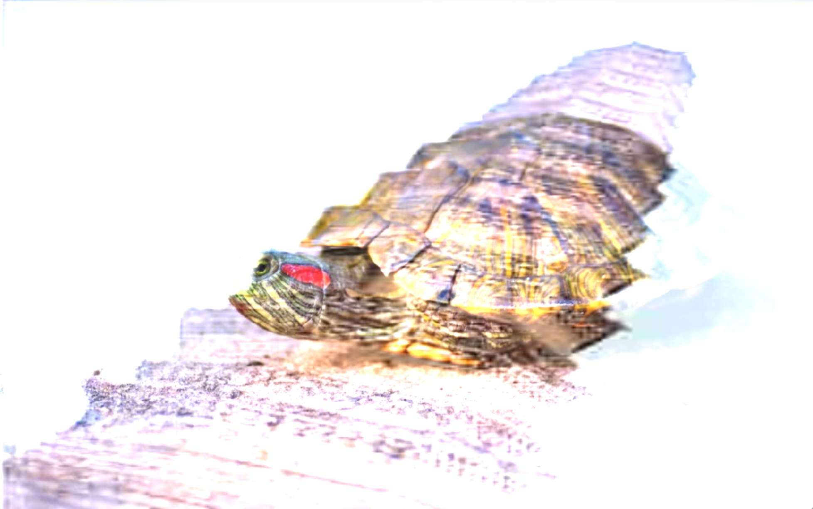

看着大部分像素点都是超过了255，也不行

### 4.3.3 颜色加权

那如果我将两张图片的像素值加权相加，又能将像素值控制在合理范围内，还能通过不断调整权重来选择两张图片的显示程度，岂不妙哉

**代码：**

```python
# 颜色加权法：cv.addWeighted()
img_weight = cv.addWeighted(img1,0.5,img2,0.5,2)
```


**相加结果：**

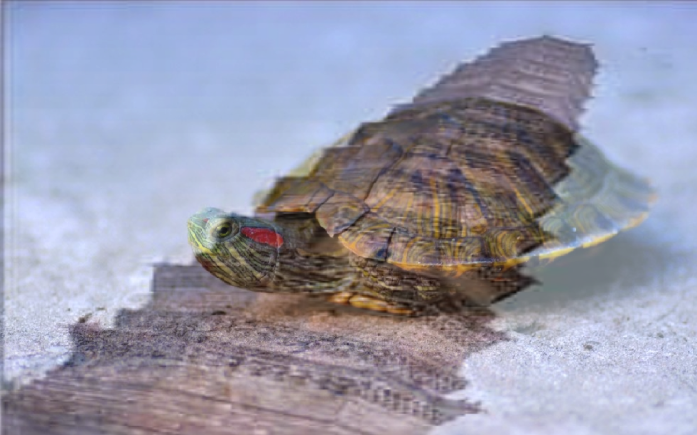

用过调整权重可以实现两张图片不同的显现程度

# 五、图片进阶转换

## 5.1 RBG转HSV

​    RGB颜色空间通过三个颜色分量的线性组合来表示颜色，所有颜色都与这三个分量相关，但**分量间高度相关，导致连续变换颜色时不够直观，**调整图像颜色需改变这三个分量。自然环境下获取的图像易受光照、遮挡和阴影影响，对亮度敏感，而RGB的三个分量均与亮度密切相关，亮度变化会导致分量相应改变，**缺乏更直观的表达方式。**此外，人眼对RGB三种分量的敏感度不同，对红色最不敏感，蓝色最敏感，使得RGB颜色空间均匀性较差。**若直接用欧氏距离度量颜色相似性，结果与人眼视觉感知偏差较大，**难以通过颜色精确推测出对应的三个分量数值。因此，RGB颜色空间虽适合显示系统，却不适合图像处理。

​    在图像处理中，**HSV颜色空间比RGB更常用**，因为它**更接近人们对彩色的感知经验，能够非常直观地表达颜色的色调、鲜艳程度和明暗程度，便于进行颜色对比**。在HSV颜色空间下，**跟踪某种颜色的物体比在RGB空间中更容易，**因此常用于分割指定颜色的物体。

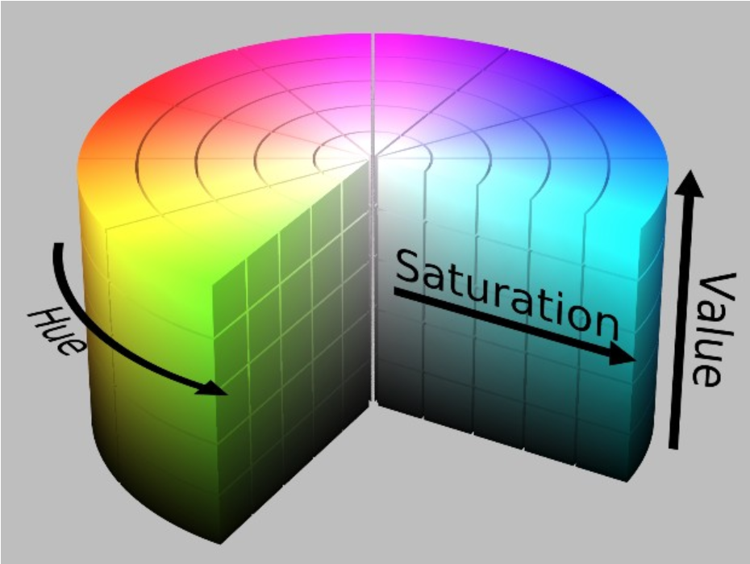

​    HSV颜色空间由三个部分组成：**色调（Hue）、饱和度（Saturation）和明度（Value）**。

​    色调是**颜色的基调**，相当于一个圆的俯视图，**圆上不同位置的颜色基调不同，将颜色分为360°**，每个位置对应不同的颜色基调。

​    饱和度表示**颜色的纯度**，沿着圆的半径方向，**从圆心（纯度为0）到圆弧（该色调纯度为100%）逐渐过渡。**

​    明度则表示**颜色的亮度**，沿着圆柱的高方向变化，**圆柱表面上平行于轴的点颜色基调和纯度相同**，但明暗程度不同，圆柱的半径也不同，类似磁盘的柱面结构。

​    HSV颜色模型对用户来说非常直观，可以**轻松获取单一颜色**，只需指定色调H，并设置明度V和饱和度S为最大值1，然后通过添加黑色或白色来调整所需颜色。增加黑色会降低明度V而保持饱和度S不变，而增加白色则会降低饱和度S而保持明度V不变。例如，要得到深蓝色，可以将V设为0.4，S设为1，H设为240度；要得到浅蓝色，则将V设为1，S设为0.4，H仍为240度。此外，HSV的拉伸对比度增强可以通过对饱和度S和明度V两个分量进行归一化处理来实现，而色调H保持不变。与面向工业的RGB颜色空间相比，HSV颜色空间更贴近用户，因此在**图像识别**领域中被广泛应用，因为它提供了一种更直观的颜色表达方式。

**简单的模式转换代码：**

```python
import cv2 as cv
img = cv.imread(r"data\1.jpg")
img2 = cv.cvtColor(img,cv.COLOR_RGB2GRAY)
cv.imshow("img",img)
cv.imshow("img2",img2)
cv.waitKey(0)
cv.destroyAllWindows()
```


## 5.2 灰度化

灰度化图像大小不变，像素点个数不变，通道数由3变为1，像素值会变成三个通道中的最大值（或其他），灰度化后的图像可以降低数据计算复杂度，突出图像轮廓纹理

有最大值灰度化，最小值灰度化，平均值灰度化以及加权平均灰度化

顾名思义其实就是将三个颜色通道的最大值（或其他）来作为新的像素点的值已达到降维的目的

**代码：**

```python
# 灰度化:图像大小不变，像素点个数不变，通道数由3变为1，像素值会变成三个通道中的最大值（或其他）
img = cv.imread("data/1.jpg")
# 获取原图大小
h,w,_ = img.shape
# 创建一个和原图一样大小的图像，用这张图来进行灰度实验
gray = np.zeros((h,w),dtype = np.uint8)
# 遍历原图，取出每个像素点，拿到三个通道里面的最大值像素，放到创建的图像中
for i in range(h):
    for j in range(w):
        # 取出每个像素点img[i,j]
        # 最大值
        gray[i,j] = max(img[i,j][0],img[i,j][1],img[i,j][2])
        gray[i,j] = max(img[i,j])
        # 最小值
        gray[i,j] = min(img[i,j][0],img[i,j][1],img[i,j][2])
        # 平均值
        gray[i,j] = round((img[i,j][0]+img[i,j][1]+img[i,j][2])/3)
cv.imshow("img",img)
cv.imshow("gray",gray)
cv.waitKey(0)
cv.destroyAllWindows()
        
```


**平均值值灰度化结果：**

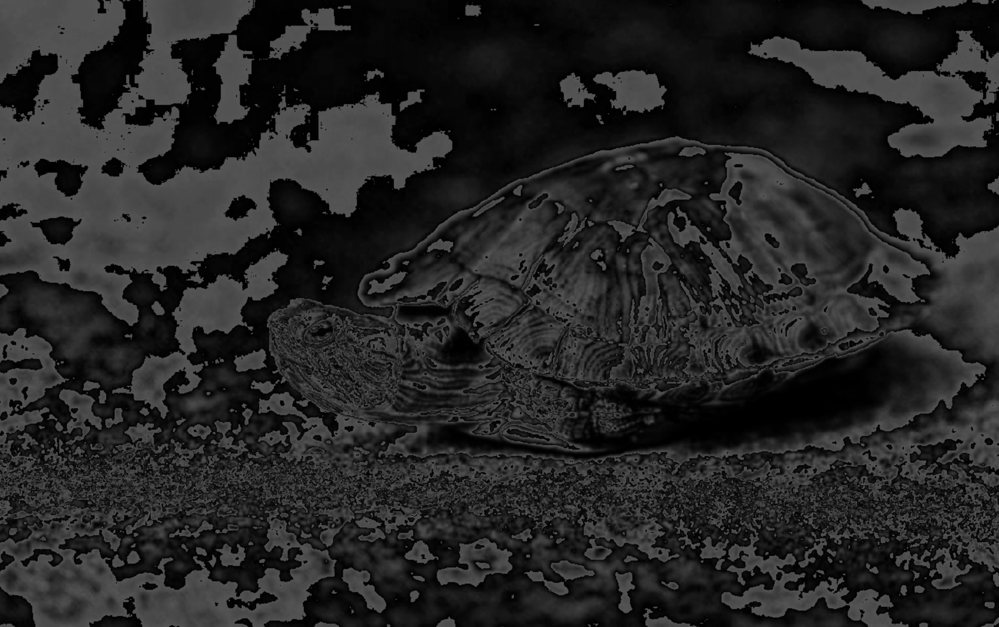

**最小值灰度化结果：** 

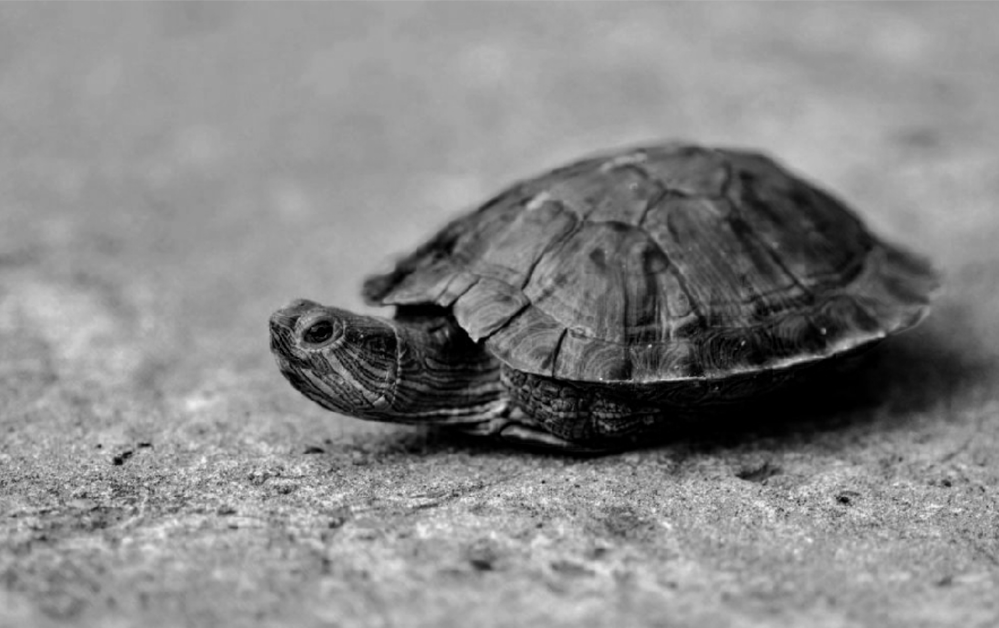**最大值灰度化结果：** 

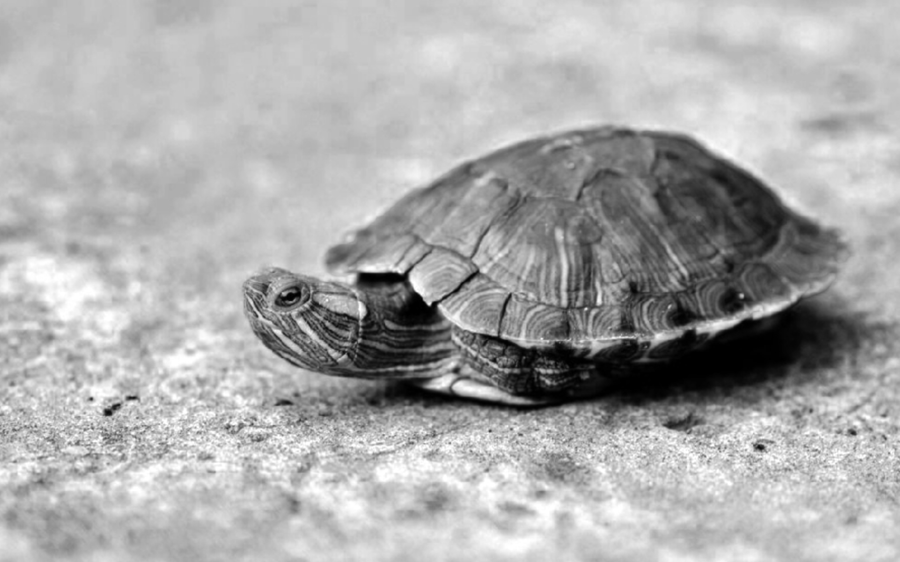

但是实际更多使用的是加权平均cv.IMREAD_GRAYSCALE参数，直接调用内部参数计算，其内部权重设置为0.299R + 0.587G + 0.114*B

```python
gray = cv.imread(r"data\1.jpg",cv.IMREAD_GRAYSCALE)
print(gray)
cv.imshow("gray",gray)
cv.waitKey(0)
cv.destroyAllWindows()
```


**加权平均灰度化结果：** 

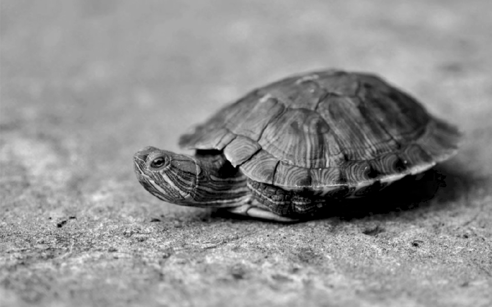

## 5.3 阈值化

图像阈值化是通过设定一个或多个阈值，将图像中的像素分为不同的类别（通常是前景和背景）。根据阈值的不同，可以将像素值设置为特定的值（如0或255），从而实现图像的二值化。

### 5.3.1 自定义阈值

cv2.THRESH_BINARY设置一个像素阈值，超过这个阈值就将该像素设为255，反之为0

```python
# 阈值法
# 以灰度模式读取图像
image = cv2.imread(r"data\1.jpg", 0)
# 二值化，通道超过127取255
_,binary = cv2.threshold(image,127,255,cv2.THRESH_BINARY)
cv2.imshow("binary",binary)
cv2.waitKey(0)
cv2.destroyAllWindows()
```


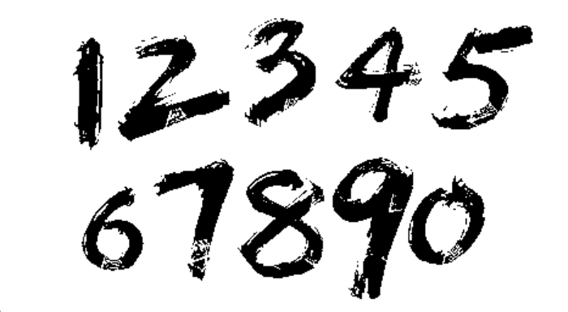

### 5.3.2 反阈值法

顾名思义，cv.THRESH_BINARY_INV

```python
# 反阈值法
# 以灰度模式读取图像
image = cv2.imread(r"data\number.jpg", 0)
# 二值化，通道超过127取0,255代表最大值
_,binary = cv2.threshold(image,127,255,cv2.THRESH_BINARY_INV)
cv2.imshow("binary",binary)
cv2.waitKey(0)
cv2.destroyAllWindows()
```


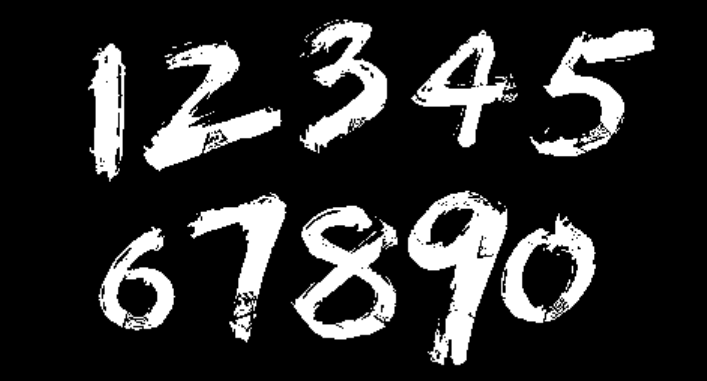

### 5.3.3 截断阈值法

像素值大于阈值的部分将会被修改为阈值，小于等于阈值的部分不变,255代表最大值

```python
# 截断阈值法
# 以灰度模式读取图像
image = cv2.imread(r"data\number.jpg", 0)
# 二值化，像素值大于阈值的部分将会被修改为阈值，小于等于阈值的部分不变,255代表最大值
_,binary = cv2.threshold(image,127,255,cv2.THRESH_TRUNC)
cv2.imshow("binary",binary)
cv2.waitKey(0)
cv2.destroyAllWindows()
```


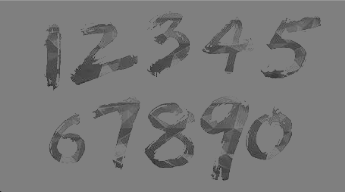

### 5.3.4 低阈值零处理

像素值较低的地方，由于像素值比阈值小，就会被置为0，对应二值化图中的黑色部分,255代表最大值

```python
# 低阈值零处理
# 以灰度模式读取图像
image = cv2.imread(r"data\number.jpg", 0)
# 二值化，像素值较低的地方，由于像素值比阈值小，就会被置为0，对应二值化图中的黑色部分,255代表最大值
_,binary = cv2.threshold(image,127,255,cv2.THRESH_TOZERO)
cv2.imshow("binary",binary)
cv2.waitKey(0)
cv2.destroyAllWindows()
```


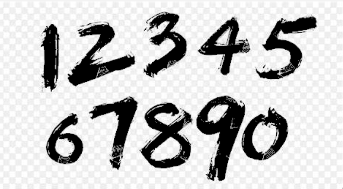

### 5.3.5 超阈值零处理

像素值较低的地方，由于像素值比阈值大，就会被置为0，对应二值化图中的白色部分,255代表最大值

```python
# 超阈值零处理
# 以灰度模式读取图像
image = cv2.imread(r"data\number.jpg", 0)
# 二值化，像素值较低的地方，由于像素值比阈值大，就会被置为0，对应二值化图中的白色部分,255代表最大值
_,binary = cv2.threshold(image,127,255,cv2.THRESH_TOZERO_INV)
cv2.imshow("binary",binary)
cv2.waitKey(0)
cv2.destroyAllWindows()
```


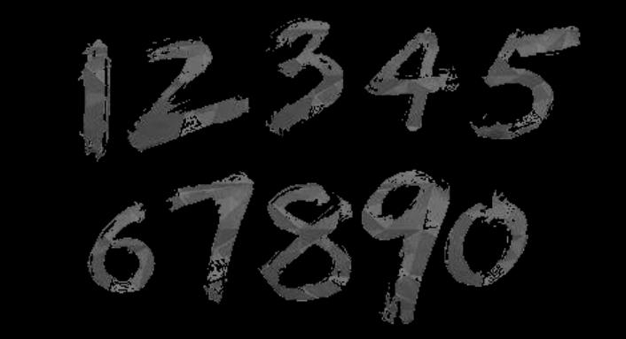

5.3.6 OTSU阈值法

Otsu阈值法是一种非常经典的图像分割方法，它通过自动计算阈值将图像分割为前景和背景。这种方法特别适用于图像的全局阈值化，尤其在图像的前景和背景对比度较高时表现良好。

`THRESH_OTSU` 本身并不是一个独立的阈值化方法，而是与 OpenCV 中的二值化方法结合使用的一个标志。具体来说，`THRESH_OTSU` 通常与 `THRESH_BINARY` 或 `THRESH_BINARY_INV` 结合使用。在实际应用中，如果你使用 `THRESH_OTSU` 标志但没有指定其他二值化类型，默认情况下它会与 `THRESH_BINARY` 结合使用。

说人话就是你不知道阈值设置为多少，那就先**将图片灰度化**，这样可以简化图像信息，只剩下亮度（灰度）这一种信息，减少计算量的同时增强了对比度，然后**初始化一个阈值（默认0）**，通过计算最大类间方差（类间方差 = （前景的平均灰度值 - 背景的平均灰度值）² × 前景的像素数量 × 背景的像素数量）来不断**迭代阈值**，最后达到前景与背景分离效果最好。

**代码：**

```python
# OTSU阈值法
# 以灰度模式读取图像
image = cv2.imread(r"data\number.jpg",0)
# 默认结合反阈值法
_,binary = cv2.threshold(image,127,255,cv2.THRESH_OTSU+cv2.THRESH_TOZERO_INV)
# 可选
_,binary = cv2.threshold(image,127,255,cv2.THRESH_OTSU+cv2.THRESH_TOZERO)
cv2.imshow("binary",binary)
cv2.waitKey(0)
cv2.destroyAllWindows()
```


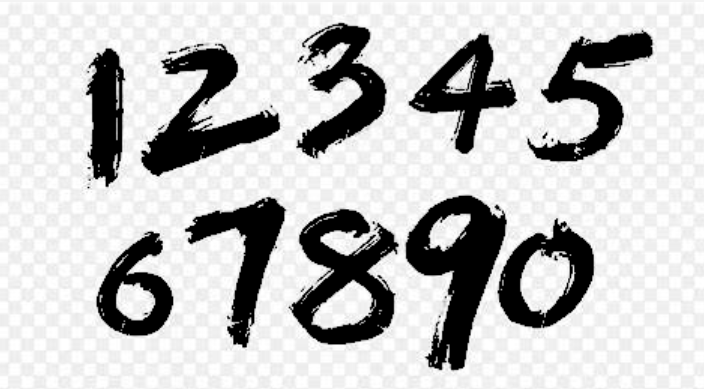

### 5.3.6 自适应二值化

自适应二值化也需要先将图片灰度化来简化数据，他是图像中的所有像素点计算其各自的阈值，也就是说通过某一个像素点周围区域（**奇数边长正方形卷积核**）的像素点，单独计算阈值（如果是边缘像素点则采用填充的方式补全周围像素点），**更加适合用在明暗分布不均的图片**，因为图片的明暗不均，导致图片上的每一小部分都要使用不同的阈值进行二值化处理，这时候传统的二值化算法就无法满足我们的需求了。

值得注意的是，最后计算出来的阈值还要接着减去一个固定值C（减去一个常数C可以调**整阈值的灵敏度**。如果直接使用局部区域的平均值作为阈值，可能会导致一些细节丢失或噪声被误判为前景。通过减去一个常数C，可以**降低阈值**，**使更多的像素被判定为前景**，从而更好地**保留细节**）

#### 5.3.6.1 取均值 

比较好理解，边缘填充方式可选，直接上图 

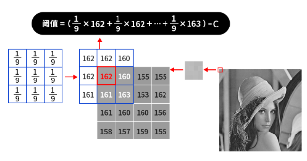

#### 5.3.6.2 加权求和

求和权重值来自于高斯分布，大概知道就行了

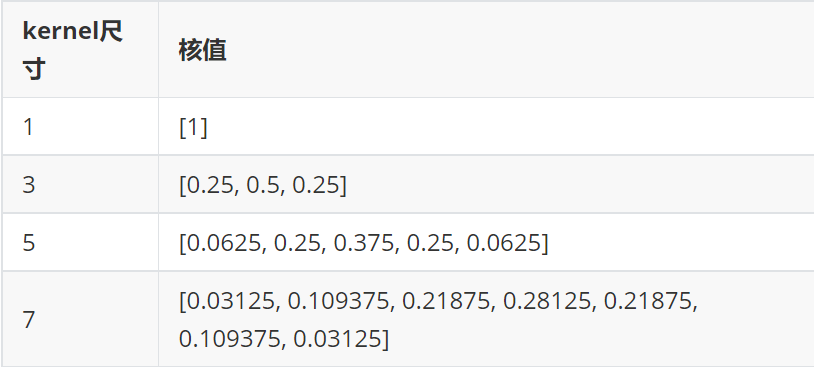

**代码：**

```python
# 取均值
# 以灰度模式读取图像
image = cv2.imread(r"data\1.jpg", 0)
# 二值化，对每个像素点对应区域取均值
# cv2.ADAPTIVE_THRESH_MEAN_C：自适应阈值化方法，使用局部区域的平均值作为阈值。
# cv2.THRESH_BINARY：二值化类型，大于阈值的像素值设为 255，小于阈值的像素值设为 0。
# 7：局部卷积区域的大小（块大小），必须是奇数。
# 10：从平均值或加权平均值中减去的常数，用于调整阈值。
binary = cv2.adaptiveThreshold(image,
                               255,
                               cv2.ADAPTIVE_THRESH_MEAN_C,
                               cv2.THRESH_BINARY,
                               7,
                               10)
cv2.imshow("image",image)
cv2.imshow("binary",binary)
cv2.waitKey(0)
```


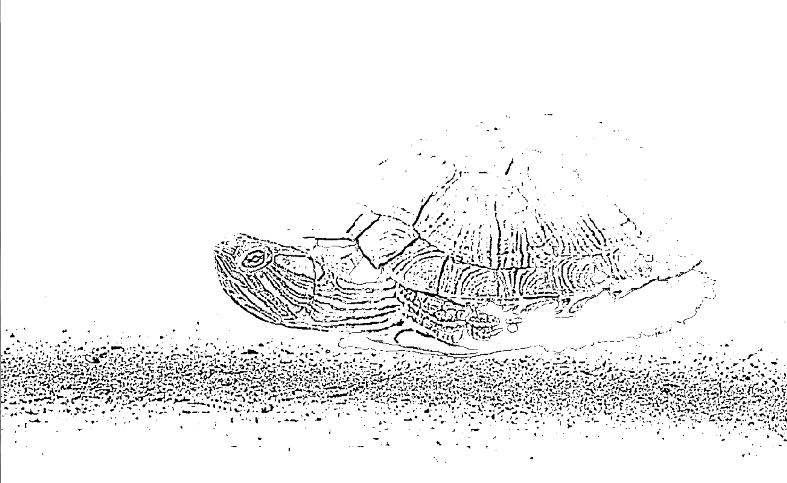

感觉有点不清晰，将c调小一点试试

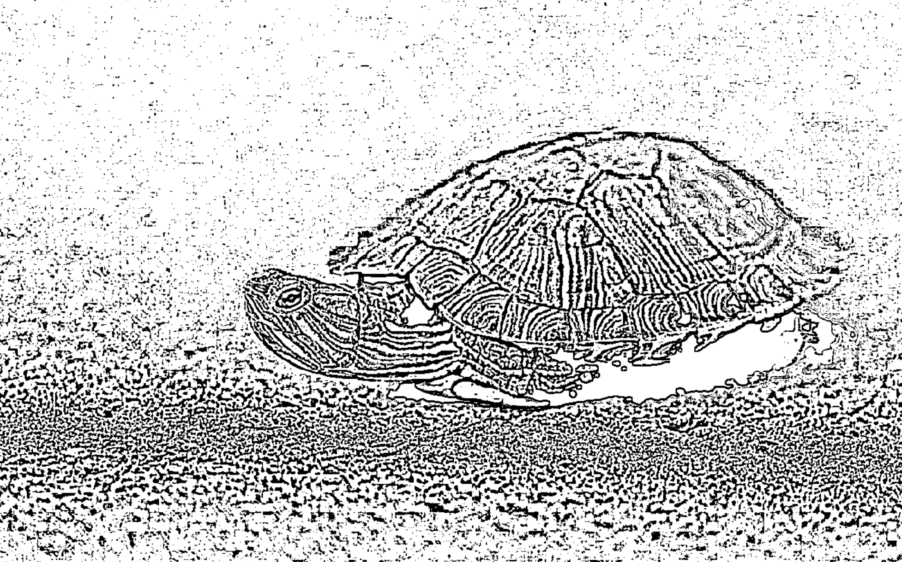

## 5.4 图像掩模

 图像掩模（Image Mask）是一种在图像处理中常用的工具，它通过选定的图像、图形或物体对处理的图像（全部或局部）进行**遮挡**，实现对某些区域进行屏蔽，使其不参与后续的处理或不参与处理参数的计算。

掩膜是基于HSV颜色空间基础上操作的，因此首先要进行颜色空间的转换。

**原图：**


**代码：** 

```python
img = cv.imread("data/heart.jpg")
img = cv.resize(img,(480,480))
# 颜色空间转换
hsv_img_np = cv.cvtColor(img,cv.COLOR_BGR2HSV)
# 创建掩膜cv2.inrange(img,(h,s,v)min,(h,s,v)max)
# 找到颜色范围
color_low = np.array([100,43,46])
color_high = np.array([124,255,255])
# 创建掩膜：大小与原图一直，二值化图像
mask= cv.inRange(hsv_img_np,color_low,color_high)
cv.imshow("img",img)
cv.imshow("mask",mask)
cv.waitKey(0)
cv.destroyAllWindows()
```


颜色范围是通过下表查询的，也可以进行适当修改，这里是只提取了人物蓝色部分，其他部分设置掩膜进行遮挡

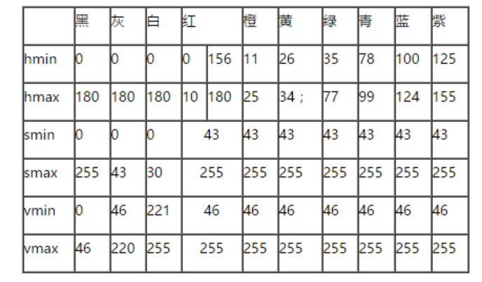

**结果：**


当然也可以提取红心部分，改HSV参数就行

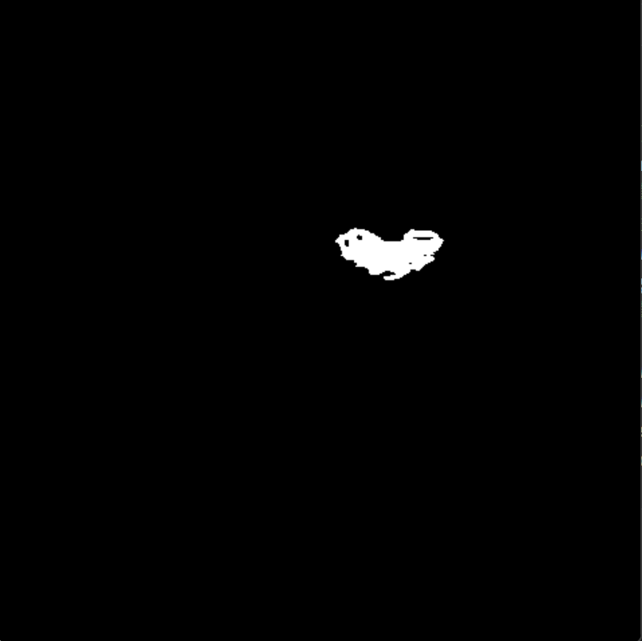

## 5.5 与运算

图像处理中，“与运算”（AND Operation）是一种基本的逻辑运算，通常用于**处理二值图像**（即图像中的像素值只有0和1，或者0和255）。它通过逐像素地比较两个图像（或一个图像和一个掩模），并根据逻辑“**与**”规则（像素值转换为二进制后比较"^"）来**生成新的图像**。

同样基于HSV颜色模式，需要用cv.cvtColor进行模式转换，展示一下转换后的图形

代码：

```python
img = cv.imread("data/heart.jpg")
img = cv.resize(img,(480,480))
# 颜色空间转换
hsv_img_np = cv.cvtColor(img,cv.COLOR_BGR2HSV)
# 创建掩膜cv2.inrange(img,(h,s,v)min,(h,s,v)max)
# 找到颜色范围
color_low = np.array([100,43,46])
color_high = np.array([124,255,255])
# 创建掩膜：大小与原图一直，二值化图像
mask= cv.inRange(hsv_img_np,color_low,color_high)
# 与运算:将原图与掩膜进行与运算，达到提取颜色的目的
# 也就是利用之前创建的掩膜（mask）来选择图像中符合颜色范围的部分
color_add1 = cv.bitwise_and(img,img,mask = mask)
cv.imshow("img",img)
cv.imshow("msak",mask)
cv.imshow("color_add1",color_add1)
cv.waitKey(0)
cv.destroyAllWindows()
```


说明：

在 OpenCV 的 `cv.bitwise_and` 函数中，`cv.bitwise_and(src1, src2, mask)` 的作用是对两个输入图像 `src1` 和 `src2` 进行逐像素的按位与运算，并且可以选择性地应用掩模 `mask`。如果掩模 `mask` 指定了，那么只有掩模中值为非零的像素位置才会参与运算，其他位置的结果像素值会被置为零。

这里将scr1和scr2 都设置为img，是因为内置函数参数要求，不得不这么做，但其实也并非一样，因为mask=mask，结果图像 `color_add1` 中，只有掩模 `mask` 中值为非零的像素位置会被保留，其他位置的像素值会被置为零（黑色）

**再详细解释一下与运算：**

- 如果两个输入图像在某个像素位置上的值都是非零（或在掩模中该位置为非零），则结果图像在该位置的像素值也为非零。
- 如果两个输入图像在某个像素位置上的值中有任何一个是零（或在掩模中该位置为零），则结果图像在该位置的像素值就为零。


## 5.6 替换颜色

有了掩膜，我们将原图中蓝色部分提取出来并改变值为255了，剩下的像素值全为0，那么根据数组的布尔索引，我们可以将这些值为255的数进行替换，那么对应的颜色也会发生改变

**代码：**

```python
# 创建一个与原图相同大小的黑色图像
result_img = np.zeros_like(img)

# 将掩膜中值为 255 的区域替换为绿色色（B,G,R）
result_img[mask == 255] = [0, 255, 0]

# 显示结果图像
cv.imshow("result_img", result_img)
cv.waitKey(0)
cv.destroyAllWindows()
```


**替换结果：**


##  5.7 ROI切割

切割并修改指定图像区域，主要是为了后面图像添加水印做准备

```python
img = cv.imread("data/1.jpg")
# 使用numpy进行ROI切割
roi = img[318:563,364:574]#横纵坐标
roi[:] = (0,0,255)
cv.imshow("img",img)
cv.imshow("roi",roi)
cv.waitKey(0)
cv.destroyAllWindows()
```


这里对切割后得到的roi进行颜色转变，由于两个变量内存地址是相同的，因此原图的对应区域颜色也会改变


## 5.8 添加水印

流程比较负责，但是结合了这一小节所学的大部分知识点

首先，代码读取logo图像和背景图像，接着获取logo图像的高度和宽度，以便从背景图像中提取与logo大小相同的左上角区域（ROI），后续对ROI区域使用阈值法创建掩膜的时候在原图上也会更改，**就像当于在原图上单独提取出与logo同大小的区域创建掩膜**。

然后，将logo图像转换为灰度图像，通过阈值化操作创建两个掩膜：一个用于提取logo的颜色部分（白色logo），另一个用于提取背景颜色部分（黑色logo），提取背景颜色后经过与运算可在原图中提取出logo形状的黑色掩膜。

利用这两个掩膜分别提取logo和背景图像中的对应部分，

最后将提取的logo部分与背景部分进行简单相加，完成图像融合，并显示各个中间结果和最终融合结果，可直接相加，也可以用图像加法。

```python
# 首先，代码读取logo图像和背景图像，接着获取logo图像的高度和宽度，以便从背景图像中提取与logo大小相同的左上角区域（ROI）。
# 然后，将logo图像转换为灰度图像，通过阈值化操作创建两个掩膜：一个用于提取logo的颜色部分（白色logo），另一个用于提取背景颜色部分（黑色logo）。
# 利用这两个掩膜分别提取logo和背景图像中的对应部分，
# 最后将提取的logo部分与背景部分进行简单相加，完成图像融合，并显示各个中间结果和最终融合结果。

logo = cv.imread("data/logo.jpg")
img = cv.imread("data/pic.jpg")

# 获取logo大小
h,w = logo.shape[:2]

# 从背景中切割出和logo大小一样的区域
# 左上角进行roi切割
roi = img[:h,:w]

# 将logo转换为灰度
logo_gray = cv.cvtColor(logo,cv.COLOR_BGR2GRAY)

# 创建掩膜：白色logo，目的是提取到logo颜色，有logo没背景
_,white = cv.threshold(logo_gray,190,255,cv.THRESH_OTSU+cv.THRESH_TOZERO_INV)#OTSU阈值法

# 与运算，提取logo
fg1 = cv.bitwise_and(logo,logo,mask = white)

# 创建掩膜：黑色的logo，目的是获取背景颜色，有背景没logo
_,black = cv.threshold(logo_gray,190,255,cv.THRESH_BINARY)#阈值法

# 与运算，提取背景
fg2 = cv.bitwise_and(roi,roi,mask = black)

# 图像融合
result_img = fg1+fg2

cv.imshow("white",white)

cv.imshow("fg1",fg1)

cv.imshow("black",black)

cv.imshow("fg2",fg2)

cv.imshow("result_img",result_img)

cv.waitKey(0)
cv.destroyAllWindows()
```


## 5.9 滤波消除噪点

噪声：指图像中的一些**干扰因素**，通常是由**图像采集设备、传输信道**等因素造成的，表现为图像中**随机的亮度**，也可以理解为有那么一些点的像素值与周围的像素值格格不入。常见的噪声类型包括**高斯噪声和椒盐噪声**。高斯噪声是一种分布符合正态分布的噪声，会使图像变得**模糊或有噪点**。椒盐噪声则是一些**黑白色的像素值**分布在原图像中。

滤波是一种常用的图像处理技术，用于**消除噪点，使图像更加清晰和平滑。**滤波实际上是通过原矩阵与一个卷积核进行相乘相加的操作后得到新的矩阵，使图像更加平滑。介绍五种常用的滤波，但实际用得多的只有**高斯滤波**（cv.GaussianBlur）

**原图：**


### 5.9.1 均值滤波

k×k的卷积核权重为1/k^2，以3×3卷积核为例：


代码：

```python
# 均值滤波，k×k的卷积核权重为1/k^2
img = cv.imread("data/lvbo2.png")
img = cv.resize(img,(480,480))
img_blur = cv.blur(img,(3,3))
cv.imshow("img",img)
cv.imshow("img_blur",img_blur)
cv.waitKey(0)
cv.destroyAllWindows()
```


好像还是很模糊，但相比于原图而言已经少了很多噪点

### 5.9.2方框滤波

卷积核权重相同，但是其中有一个参数normalize表示是否对其归一化，如果输入True则相当于均值滤波


**代码：**

```python
img_box = cv.boxFilter(img,-1,(3,3),normalize=False)
cv.imshow("img",img)
cv.imshow("img_box",img_box)
cv.waitKey(0)
cv.destroyAllWindows()
```


-1表示ddepth：输出图像的深度，-1代表使用原图像的深度。

图像深度是指在数字图像处理和计算机视觉领域中，每个像素点所使用的位数（bit depth），也就是用来表示图像中每一个像素点的颜色信息所需的**二进制位数**。图像深度**决定了图像能够表达的颜色数量或灰度级。**


不太行。。。

### 5.9.3 高斯滤波

主要用于处理**椒盐噪声**，卷积核权重符合高斯分布，**权重相加等于1，以确保输出图像的亮度保持不变。**


**代码：**

```python
img_gauss = cv.GaussianBlur(img,(5,5),1)
```


第三个参数sigmaX：就是高斯函数里的值，σx值越大，模糊效果越明显。

高斯滤波相比均值滤波效率要慢，但可以有效消除高斯噪声，能保留更多的图像细节

### 5.9.4 中值滤波（中位数）

中值滤波**没有核值**，而是在原图中从左上角开始，将卷积核区域内的像素值进行排序

**选取中值作为卷积核的中点的像素值**,用中值来替代像素值

```python
img_median = cv.medianBlur(img,5)
```


### 5.9.5 双边滤波

乍一看上面几种好像区别都不大，但是有一个缺点就是像素边缘也被模糊掉了，而双边滤波使用了两个高斯核，可以同时考虑将要被滤波的像素点的空域信息（周围像素点的位置的权重）和值域信息（周围像素点的像素值的权重） ，有效保留更多边缘信息。原理就不赘述了，没什么用，直接上代码。

**代码：**

```python
img_bilateral = cv.bilateralFilter(img,9,75,75)
```


**参数说明：** 

img:输入图像

9：卷积核直径

75：颜色差异权重，0-100之间，值越大，颜色差异越大的像素也会被考虑进来，平滑效果越强

75：空间距离权重，0-100之间，值越大，空间距离较远的像素也会被考虑进来，平滑效果越强。


边缘信息被区分的很明显，对边缘检测很友好

# 六、图像边缘检测

## 6.1 垂直边缘提取

图像的像素值实际上是一个**离散的分布函数**，因此可以通过差分的方式来求图像的梯度，当函数中**存在边缘时，一定有较大的梯度值，相反，当图像中有比较平滑的部分时，灰度值变化较小**，则相应的梯度也较小，也就可以识别出像素点边缘了。

可以对x方向上求梯度，也可以对y方向上求梯度，这样达到的结果是不一样的，但是实际上图像的轮廓并非横平竖直，后面我们会介绍如何处理。

 我们先来一个numpy数组模拟图片感受一下，这里使用cv.filter2D来进行与卷积核相乘

**代码：**

```python
import cv2 as cv
import numpy as np
# 模拟一张图像，灰度图
img=np.array([[100,102,109,110,98,20,19,18,21,22],
             [109,101,98,108,102,20,21,19,20,21],
             [109,102,105,108,98,20,22,19,19,18],
             [109,98,102,108,102,20,23,19,20,22],
             [109,102,105,108,98,20,22,19,20,18],
             [100,102,108,110,98,20,19,18,21,22],
             [109,101,98,108,102,20,22,19,20,21],
             [109,102,108,108,98,20,22,19,19,18],
              ],dtype=np.float32)

# 定义卷积核，卷积核必须是奇数尺寸，因为这样卷积核才有中心元素
kernel1=np.array([[-1,0,1],
                 [-1,0,1],
                 [-1,0,1]],dtype=np.float32)

kernel2=np.array([[-1,-2,-1],
                 [0,0,0],
                 [1,2,1]],dtype=np.float32)
# 二维卷积操作
img1=cv.filter2D(img,-1,kernel1)
img2=cv.filter2D(img,-1,kernel2)
# 打印卷积后的图
print(img1)
print("-"*50)
print(img2)
```


**计算结果：**

[[  0.  -13.  22.  -3. -266. -241.  -4.   0.   8.   0.]
 [  0.  -6.  21.  -14. -266. -236.  -4.  -2.   5.   0.]
 [  0.  -22.  23.  -3. -264. -236.  -3.  -7.   4.   0.]
 [  0.  -15.  22.  -14. -264. -231.  -3.  -8.   1.   0.]
 [  0.  -3.  24.  -17. -266. -234.  -4.  -3.   6.   0.]
 [  0.  -7.  21.  -13. -266. -235.  -4.  -2.   5.   0.]
 [  0.  -4.  21.  -16. -266. -235.  -4.  -3.   5.   0.]
 [  0.  -23.  20.  -2. -264. -236.  -3.  -7.   3.   0.]]
 \--------------------------------------------------
 [[  0.  0.  0.  0.  0.  0.  0.  0.  0.  0.]
 [ 18.  5. -10.  -8.  -2.  3.  7.  3.  -7. -12.]
 [ -6.  -2.  5.  4.  0.  2.  4.  2.  1.  2.]
 [  0.  0.  0.  0.  0.  0.  0.  1.  2.  2.]
 [-10.  5.  18.  6.  -6.  -8.  -9.  -5.  1.  2.]
 [ -2.  -9. -15.  -3.  8.  4.  0.  0.  3.  6.]
 [ 18.  9.  -2.  -4.  -2.  3.  7.  3.  -7. -12.]
 [  0.  0.  0.  0.  0.  0.  0.  0.  0.  0.]]

可以看到出现一些竖直差异比较大的行（列），实际上就是边缘区域

**水平：**


**竖直：**


**总梯度：**


一般是使用原图像乘以一个**卷积核**来实现图像的差分，这个卷积核就叫做**算子**，这里我们介绍两种算子

### 6.1.1 Sobel算子

**卷积核权重：**

**垂直边缘：**


**水平边缘：**


 在进行梯度处理之前，我们首先将图像灰度化，灰度化后的图像**保留了亮度信息**，使得梯度计算更加准确。梯度通常是基于像素值的变化率来计算的，灰度图像的亮度变化**可以直接反映边缘信息**。

然后二值化，二值化后的图像使得梯度计算更加简单。由于**只有两个像素值（0 和 255），梯度计算可以快速定位边缘位置**

**上面两个预处理步骤可以极大简化计算**

**原图：**


**预处理后：** 


**代码：**

```python
import cv2 as cv

# 模拟一张图像，灰度图
img=cv.imread("data/lion.jpg",0)
img = cv.resize(img,(480,480))

# 定义卷积核，卷积核必须是奇数尺寸，因为这样卷积核才有中心元素
_,img = cv.threshold(img, 195, 255, cv.THRESH_BINARY)  # 进行二值化

img3 = cv.Sobel(img,ddepth=-1,dx=1,dy=0,ksize=3)#提取垂直边缘
img4 = cv.Sobel(img,ddepth=-1,dx=0,dy=1,ksize=3)#提取水平边缘
img5 = cv.Sobel(img,ddepth=-1,dx=1,dy=1,ksize=3)#提取水平＋垂直边缘

cv.imshow("img3",img3)
cv.imshow("img4",img4)
cv.imshow("img5",img5)
cv.waitKey(0)
cv.destroyAllWindows()
```


可以看到提取垂直梯度和竖直梯度展现出来的效果是不一样的，最后合并到总的梯度后提取的轮廓信息也要丰富一些

### 6.1.2 Laplacian算子

这实际上是求的二阶导，既像素值之间变化率的变化率

**卷积核权重**


**代码：**

```python
import cv2 as cv
img = cv.imread("data/lion.jpg")
img_binary = cv.cvtColor(img,cv.COLOR_BGR2GRAY)
_,img_gray = cv.threshold(img_binary, 195, 255, cv.THRESH_BINARY)
img_laplacian = cv.Laplacian(img_gray,-1)
cv.imshow("img",img)
cv.imshow("img_gray",img_gray)
cv.imshow("img_laplacian",img_laplacian)
cv.waitKey(0)
cv.destroyAllWindows()
```


好像效果比较一般。。。

针对于梯度处理，可以调整二值化方法以达到更好的边缘像素点效果，又或者可以考虑加入滤波，排除噪声点对结果的影响，下面引入一个十分常用的边缘检测算法，它实际上也是基于一个算子，但是在封装的函数中加入了像滤波，，非极大值抑制，阈值筛选等操作，十分简便

## 6.2 边缘检测cv.canny()

**步骤：**


第一步和第二步上面已经解释过了，下面来说说非极大值抑制和双阈值筛选

**非极大值抑制：**该过程在梯度幅值图像中寻找**局部最大值**。具体来说，对于每个像素，非极大值抑制会检查**其梯度幅值是否大于其8邻域（或4邻域）内的所有其他像素的梯度幅值**。如果是，则保留该像素；否则，将其抑制（置为0）。经过这一处理，输出的图像中**只保留了边缘的局部最大值**，从而**形成更加清晰和连续的边缘**。非极大值抑制不仅能有效减少边缘检测结果中的噪声，简化边缘，还能提高后续图像处理步骤的计算效率，是提高边缘检测准确性和效率的关键步骤之一。

**双阈值筛选：该步骤使用两个阈值来确定哪些像素点可以被认为是边缘**。当某一像素位置的幅值**超过最高阈值**时，该像素被认为是**边缘像素**；当幅值**低于最低像素**时，该像素则**不是边缘像素**。而当幅值**处于最高像素与最低像素之间**时，如果它能**连接到一个高于阈值**的边缘时，则被认为是**边缘像素**，否则就不会被认为是边缘，这也是**二值化后图像仍然要进行双阈值筛选**的原因。 


例如途中AC会被识别为边缘像素，而B则不会

**代码：**

```python
import cv2

path = "data/lion.jpg"
image_np = cv2.imread(path, 0)  # 读取灰度图像
_, image_np_thresh = cv2.threshold(image_np, 127, 255, cv2.THRESH_BINARY)  # 二值化
image_np_thresh = cv2.GaussianBlur(image_np,(3,3),1)
# 不同双阈值设置
edges_images_1 = cv2.Canny(image_np_thresh, 50, 150)  # 较低阈值
edges_images_2 = cv2.Canny(image_np_thresh, 100, 200)  # 较高阈值

cv2.imshow("edges_images_1", edges_images_1)
cv2.imshow("edges_images_2", edges_images_2)
cv2.waitKey(0)
cv2.destroyAllWindows()
```


这里使用了不同阈值来进行边缘像素筛选，高低阈值比例建议设置在1:2或者1:3


## 6.3 凸包特征检测

根据边缘检测可以基本确定物体的边缘，接下来需要拟合这些，如确定物体边缘是否满足某种几何形状，如直线、圆、椭圆等，或者拟合出包含前景或者边缘像素点的最小外包矩形、圆、凸包等几何形状，为计算它们的面积或者为模板匹配等操作打下坚实的基础。

凸包其实就是将一张图片中物体的最外层的点连接起来构成的凸多边形，它能包含物体中所有的内容。通俗来说就是**外层轮廓连接形成的一个封闭的空间，空间内包含很多像素点。**

**检验方法**有穷举法和QuickHull法等，具体不细讲，直接上代码，这里代码默认用的是QuickHull法

 该过程主要分为**查找轮廓，获取凸包，绘制凸包**三个环节

### **6.3.1 查找轮廓：**

**contours, hierarchy = cv.findContours(src,mode,method)**

返回值：

**contours：**轮廓点坐标，一个子列表代表一条轮廓

**hierarchy：**轮廓之间对应关系，一个contour对应一个hierarchy，存储内容：[Next, Previous, Child, Parent]，分别表示其后一条轮廓、前一条轮廓、（同层次的第一个）子轮廓、父轮廓的索引（如果没有相应的轮廓，则对应位置为-1）

参数：

**mode:**

mode参数共有四个选项分别为：RETR_LIST(只查找最外层轮廓)，RETR_EXTERNAL，RETR_CCOMP，RETR_TREE。（查找所有轮廓，但是hierarchy里面存储的轮廓关系不同）

**当然这里有了轮廓坐标可以直接绘制轮廓：cv2.drawContours(image, contours, contourIdx, color, thickness)**

- **contours**：包含多个轮廓的列表，每个轮廓本身也是一个由点坐标构成的二维数组（numpy数组）。
- **contourIdx**：要绘制的轮廓索引。如果设为 `-1`，则会绘制所有轮廓。根据索引找到轮廓点绘制出来。默认是-1。

**原图：**

 

**代码：** 

```python
# 读取图像
img = cv.imread("data/number.jpg")

# 转换为灰度图
gray = cv.cvtColor(img, cv.COLOR_BGR2GRAY)

# 二值化
ret, binary = cv.threshold(gray, 127, 255, cv.THRESH_OTSU + cv.THRESH_BINARY_INV)

# 查找轮廓 contours,hierarchy = cv2.findContours(image，mode，method)
contours, hierarchy = cv.findContours(binary, cv.RETR_EXTERNAL, cv.CHAIN_APPROX_SIMPLE)

# contours, hierarchy = cv.findContours(binary, cv.RETR_LIST, cv.CHAIN_APPROX_SIMPLE)

# contours, hierarchy = cv.findContours(binary, cv.RETR_CCOMP, cv.CHAIN_APPROX_SIMPLE)

contours, hierarchy = cv.findContours(binary, cv.RETR_TREE, cv.CHAIN_APPROX_SIMPLE)

print(hierarchy)#[Next, Previous, Child, Parent]
# 在原始图像上绘制轮廓
cv.drawContours(img, contours, -1, (0, 255, 0), 2)
print(contours)

# 显示结果
cv.imshow("number", img)
cv.waitKey(0)
cv.destroyAllWindows()
```


**只查找最外层轮廓：**


**查找所有轮廓：**

 

**method:**

**`CHAIN_APPROX_NONE`**表示将所有的轮廓点都进行存储

**`CHAIN_APPROX_SIMPLE`**表示只存储有用的点，比如直线只存储起点和终点，四边形只存储四个顶点，默认使用这个方法；

### 6.3.2 获取凸包

**hull = cv.convexHull(contour)**

对于每一条轮廓都要用这个函数来进行凸包检测（因此当不止一条轮廓时要用循环遍历contours），最终返回的是凸包点的坐标


### 6.3.3 **绘制凸包**

**cv2.polylines(image, pts, isClosed, color, thickness=1)**

有了凸包点坐标，在原图中将它们连接起来，就是一个凸包

参数：

**pts**:凸包点坐标，即hull

**isclosed:**布尔值,表示是否闭合多边形,如果为 True，会在最后一个顶点和第一个顶点间自动添加一条线段，形成封闭的多边形

**color:**RBG通道的颜色参数（B,G,R）

### 6.3.4 总代码

```python
# 读图
img = cv.imread("data/number.jpg")
# 灰度
gray = cv.cvtColor(img,cv.COLOR_BGR2GRAY)
# 二值化
_,binary = cv.threshold(gray,127,255,cv.THRESH_OTSU)
# 查找轮廓
contours, hierarchy = cv.findContours(binary, cv.RETR_LIST, cv.CHAIN_APPROX_SIMPLE)

# 获取凸包**cv2.convexHull(points)**
for contour in contours:
    hull = cv.convexHull(contour)
    print(hull)
    # 绘制凸包**cv2.polylines(image, pts, isClosed, color, thickness=1)**
    cv.polylines(img,[hull],isClosed=True,color=(0,0,255), thickness=1)


# 显示结果
cv.imshow("number", img)
cv.waitKey(0)
cv.destroyAllWindows()
```


这里我们还是用数字图片来进行演示，最终结果如下


## 6.4 外界图形

在图像处理和计算机视觉任务中，外界图形可以用来**标记图像中的特定目标区域**。例如，在目标检测任务中，绘制矩形框可以清晰地标注出目标物体的位置，方便后续的处理和分析像在人脸识别系统中，通过绘制矩形框来定位人脸的位置，方便后续的人脸特征提取和识别操作。

可以绘制的外界图形有外接矩形和外接圆两种，首先我们来看矩形

### 6.4.1 外接矩形

```python
for contour in contours:
    x, y, w, h = cv.boundingRect(contour)
    cv.rectangle(img_1, (x, y), (x + w, y + h), (0, 255, 0), 2)
```


 原理很简单，暂不考虑最小面积的情况下，调用cv.boundingRect(contour)选取轮廓最左边，最右边，最上边以及最下边的点作为四条边的边界，然后调用cv.rectangle()绘制矩形


### 6.4.2 最小外接矩形

为了更精确地描述物体形状、方向和位置，同时提高空间利用效率和计算效率，通常需要寻找最小外接矩形。

```python
 # 最小外接矩形
rect = cv.minAreaRect(contour)
box = cv.boxPoints(rect).astype(np.int32)
cv.drawContours(img_2, [box], 0, (0, 0, 255), 2)
```


最小外接矩形的旋转原理主要通过以下步骤实现（了解）：

**1.计算凸包**：首先计算点集的凸包，凸包是包含所有点的最小凸多边形。
 **2. 主成分分析（PCA）：**对凸包的顶点进行主成分分析（PCA），找到数据的主方向。这些主方向定义了最小外接矩形的方向。
 **3. 投影和边界计算：**将点集投影到PCA得到的主轴上，计算投影后的边界（最小和最大值），从而确定矩形的宽度和高度。
 **4. 重构矩形顶点：**根据主轴方向和边界值，重构最小外接矩形的四个顶点。
 **5. 旋转角度计算：**OpenCV的`cv2.minAreaRect()`函数返回矩形的中心点、宽高和旋转角度。旋转角度表示矩形的一边与水平轴的夹角，范围为[-90, 0)。通过这个角度，可以将矩形旋转回原始方向。


### 6.4.3 最小外接圆

从初始圆开始，逐步调整圆心和半径，直到所有点都被包含在圆内。

```python
(x, y), radius = cv.minEnclosingCircle(contour)  # 计算最小外接圆
```


返回的值分别为圆心坐标和半径列表，可以用半径来算面积


# 七、像素统计变换

## 7.1 直方图均衡化

通俗来讲，直方图是用来统计图片像素点数据的，横坐标是像素点取值，一共有255个，纵坐标是该像素取值对应的像素个数，接下来我们会介绍如何绘制直方图以及通过直方图均衡化的方式增大图像对比度（黑的更黑，白的更白 ）

### 7.1.1 绘制直方图

**（1）**首先需要获取像素值对应的像素点个数，调用cv.calcHist()

```python
hist = cv.calcHist([image], [0], None, [256], [0, 256])
```


**参数解读：**

[img]：图像列表，可以是一幅图像或者多幅图像

[0]：表示直方图所统计的通道编号。如果输入图像是灰度图，它的值就是 [0]；如果是彩色图像的话，传入的参数可以是 [0]，[1]，[2] 它们分别对应着通道 B，G，R

None:一个与输入图像尺寸相同的二值掩模图像，其中非零元素标记了参与直方图计算的区域,None为全部计算。

[256]: 表示直方图所统计的像素期间大小（横向范围）
[0,256]: 每维度数据取值范围（纵向范围）

返回值：获取hist为一个数组，表示每个像素点对应的灰度等级像素

**（2）**然后需要获取直方图的最小值、最大值及其对应最小值的位置索引、最大值的位置索引

```python
minval,maxval,minloc,maxloc = cv.minMaxLoc(hist)
```


**（3）**最后遍历hist，为每一个像素点绘制直方图单元

```python
#创建一个全黑的图来绘制直方图
hist_img = np.zeros((256, 256,3), np.uint8)
# 限制最高高度
hpt = int(0.9*256)
for h in range(256):  # 遍历所有灰度级（0到255）
    intensity = int(hist[h] / maxval * hpt)  # 计算当前灰度级的高度
    cv.line(hist_img, (h, 256), (h, 256 - intensity), (0, 0, 255), 1)  # 绘制直方图
```


完整代码：

```python
def draw(image, color):
 
    # 获取像素值和像素点个数的相关信息
    hist = cv.calcHist([image], [0], None, [256], [0, 256])
    print(hist)
    
    # 获取像素点个数的最小和最大值及其位置索引
    minval, maxval, minloc, maxloc = cv.minMaxLoc(hist)
    
    # 使用np.zeros创建一幅全黑图像，绘制直方图
    hist_img = np.zeros((256, 256,3), np.uint8)
    
    # 限制直方图的高,直方图的高最大为背景的90%
    hpt = int(0.9 * 256)
    
    # 使用for循环，遍历像素值对应的像素点的个数，遍历hist，绘制直方图
    for h in range(256):
        intensity = int(hist[h].item() / maxval * hpt) if maxval != 0 else 0
        cv.line(hist_img, (h, 256), (h, 256 - intensity), color, 1)
    
    return hist_img

if __name__ == "__main__":
    img = cv.imread("data/1.jpg")
    dst = draw(img, (0, 0, 255))
    cv.imshow("hist", dst)
    cv.waitKey(0)
    cv.destroyAllWindows()
```


## 7.2 直方图均衡化

一副效果好的图像通常在直方图上的分布比较均匀，直方图均衡化就是用来改善图像的**全局亮度**和**对比度**，通俗的讲，就是遍历图像的像素统计出灰度值的个数、比例与累计比例，并重新映射到0-255范围（也可以是其他范围）内，其主要思想是将一副图像的**灰度直方图分布**通过**累积分布函数**变成 **近似均匀分布** （直观上在某个灰阶范围内像素值保持一致 ），从而增强图像的对比度

我们直接将两种均衡化方法结果呈现出来作对比

```python
# 读图
img = cv.imread("data/girl.jpg")
# 转灰度图
gray = cv.cvtColor(img, cv.COLOR_BGR2GRAY)
# 给灰度图绘制直方图
dst_gray = draw(gray, (0, 255, 0))
# 普通的直方图均衡化
eqh=cv.equalizeHist(gray)
dst_eqh=draw(eqh,(0,255,0))
# 对比度受限的自适应直方图均衡化
clahe=cv.createCLAHE(clipLimit=5,tileGridSize=(3,3))
img_clahe=clahe.apply(gray)
dst_clahe=draw(img_clahe,(0,255,0))
# 显示效果
cv.imshow("gray", gray)  # 灰度图
cv.imshow("dst_gray", dst_gray)  # 灰度图的直方图
cv.imshow("eqh",eqh)# 普通的直方图均衡化后的效果
cv.imshow("dst_eqh",dst_eqh)# 普通的直方图均衡化后的直方图
cv.imshow("clahe",img_clahe) #对比度受限的自适应直方图均衡化后的效果
cv.imshow("dst_clahe",dst_clahe)#对比度受限的自适应直方图均衡化后的直方图
cv.waitKey(0)
cv.destroyAllWindows()
```


参数：

clipLimit：对比度限制参数，控制CLAHE中对比度增强程度。值大于1（如2.0或4.0）可限制对比度过度增强，避免噪声放大。默认值由OpenCV提供。
 tileGridSize：图像分块大小，如`(8, 8)`，表示将图像划分为8×8小块独立进行直方图均衡化。分块大小影响效果和处理速度。 

 **原灰度图：**


**第一种：普通的自适应直方图均衡化：**


**第二种：对比度受限的自适应直方图均衡化：**


可以清楚地看出明显第二种五官对比度要更强一点，第一种反而使图片太亮了。

**原理（了解）：**自适应直方图均衡化（AHE）通过**将图像划分为8×8的不重叠小块**（tiles），**独立计算每个小块的灰度直方图并进行均衡化**，以增强局部对比度。为避免噪声放大，对比度限制自适应直方图均衡化（CLAHE）**引入对比度限制参数**，对极端值进行平滑处理。最后，**采用重采样技术**（如双线性插值）融合相邻小块，消除边界效应，合成最终的均衡化图像。

##  7.3 模版匹配

模版匹配用来在一副完整的图像中（大）搜索一个指定目标区域（小）


下面简要介绍一下不同的匹配方法以及对应的API，主要是 使用**归一化交叉相关系数**方法来在原图中直接绘制出匹配框

**（归一化）平方差匹配：**原图与目标图对应项像素值的平方差结果越小，匹配程度越高，cv2.TM_SQDIFF

 **（归一化）相关匹配：**对应像素乘积越大匹配程度越高，cv2.TM_CCORR

**（归一化）相关系数匹配：** 需要先计算模板与目标图像的均值，然后通过每个像素与均值之间的差的乘积再求和来表示其匹配程度，越大越匹配，cv2.TM_CCOEFF

```python
# 读取目标图像和模板图像
img = cv.imread(r"data\ikun.jpg")  # 目标图像
temp = cv.imread(r"data\basketball.jpg")  # 模板图像


# 将图像转换为灰度图像
gray_img = cv.cvtColor(img, cv.COLOR_BGR2GRAY)
gray_temp = cv.cvtColor(temp, cv.COLOR_BGR2GRAY)

# 进行模板匹配
# 使用归一化交叉相关系数方法 (cv.TM_CCOEFF_NORMED)
# 这种方法会计算目标图像中每个可能位置与模板图像的相似度，返回一个匹配结果矩阵 
res = cv.matchTemplate(gray_img, gray_temp, cv.TM_CCOEFF_NORMED)

# 设置阈值
threshold = 0.65
# 获取匹配结果中大于阈值的坐标
loc = np.where(res >= threshold)
print("loc",loc)

# 打印匹配成功的坐标和对应的匹配值
h, w = temp.shape[:2]  # 获取模板图像的高度和宽度
for pt in zip(*loc[::-1]):  # 遍历匹配成功的坐标
    print(f"匹配坐标: {pt}, 匹配值: {res[pt[1], pt[0]]}")
    # 绘制矩形框
    left_upper = (pt[0], pt[1])  # 左上角坐标
    right_bottom = (pt[0] + w, pt[1] + h)  # 右下角坐标
    cv.rectangle(img, left_upper, right_bottom, (0, 255, 0), 1, cv.LINE_AA)

# 显示结果
cv.imshow("img", img)
cv.imshow("temp", temp)
cv.waitKey(0)
cv.destroyAllWindows()
```


**目标图：**


**检测结果：**


##  7.4 霍夫变换

### 7.4.1统计概率霍夫直线变换

​    统计概率霍夫直线变换原理是将图像空间中的直线检测问题转换到参数空间中的点检测问题。其核心是**通过极坐标方程将图像中的边缘点映射到参数空间的曲线，利用累加器矩阵记录这些曲线的交点，最终通过检测累加器中的局部极大值来确定直线的参数.png)。**

```python
# 读取图像
img = cv.imread("data/huofu.jpg")
gray = cv.cvtColor(img, cv.COLOR_BGR2GRAY)

# 边缘检测
dst = cv.Canny(gray, 30, 70)

# 统计概率霍夫直线变换
lines = cv.HoughLinesP(dst,0.8,np.pi/180,90,minLineLength=20,maxLineGap=10)

for line in lines:
    x1,y1,x2,y2 = line[0]

    # 绘制直线
    cv.line(img, (x1, y1), (x2, y2), (0, 255, 0), 1,cv.LINE_AA)

# 显示结果
cv.imshow("dst", dst)
cv.imshow("img", img)
cv.waitKey(0)
cv.destroyAllWindows()
```


### 7.4.2 霍夫圆变换 

​    霍夫圆变换是通过**将图像空间中的圆形检测问题转换到参数空间（圆心坐标（a，b） 和半径 （r）来实现的**。其原理是**利用边缘点在参数空间中投票，累加器矩阵中值较高的点即为圆形的参数。**

```python
# 读取图像
img = cv.imread("data/huofu.jpg")
gray = cv.cvtColor(img, cv.COLOR_BGR2GRAY)

# 边缘检测
dst = cv.Canny(gray, 30, 70)

# 霍夫圆变换
circles = cv.HoughCircles(dst,cv.HOUGH_GRADIENT,1,20,param2=30)
print(circles)

# 将坐标数据转换为整数
circles = np.int_(np.around(circles))
print(circles)

for circle in circles:
    x,y,r = circle[0]
    cv.circle(img,(x,y),r,(0,255,0),2,cv.LINE_AA)

# 显示结果
cv.imshow("dst", dst)
cv.imshow("img", img)
cv.waitKey(0)
cv.destroyAllWindows()
```


## 7.5 亮度变换

对比度调整：图像暗处像素强度变低，图像亮处像素强度变高，从而拉大中间某个区域范围的显示精度。

亮度调整：图像像素强度整体变高或者变低，就是图片中的所有像素值加上或减去一个固定值 。

线性变换：通过一个线性函数对像素值进行映射，从而实现对图像整体亮度和对比度的调整

## 

```python
# 读图
img = cv.imread("data/1.jpg")

# 使用cv2.addWeighted(scr1,alpha,scr2,beta,gamma)实现线性变化g(i,j) = a*f(i,j)+b
dst1 = cv.addWeighted(img,1,np.zeros_like(img),0,50)

# 直接修改像素值,给图像加上或减去一个固定的像素值，再设置阈值以免越界
# 原图 img
# 调整后的 dst2 = img+p
# 防止溢出 np.clip(dst2,0,255)
# 用一个滑条来控制p  cv.createTrackbar(trackbar_name,value,max_val,def) min_val = 0
# 给滑条创建窗口
window_name = "Trackbar"
cv.namedWindow(window_name)
# 写一个改变图像亮度的方法
def change(p):
    img = cv.imread("data/1.jpg")
    # 滑条原始[0,255],映射到[-255,255]
    p = p/255*(255-(-255))-255#(p-255)
    dst2 = np.uint8(np.clip(img+p,0,255))
    cv.imshow("dst2",dst2)

# 创建滑条，设置滑条初始值参数
max_val = 255#最大值
trackbar_name = "p_value"#名字
trackbar_value = 150#初始值

change(trackbar_value)
cv.createTrackbar(trackbar_name,window_name,trackbar_value,255,change)

# 显示结果
# cv.imshow("img",img)
# cv.imshow("dst", dst1)
cv.waitKey(0)
cv.destroyAllWindows()
```


## 7.6 形态学变换 

```python
img = cv.imread("data/start.jpg")
img = cv.resize(img,(480,480))
# 定义一个5×5的卷积核,卷积核大小决定操作程度
kernel = np.ones((5,5),np.uint8)
print(kernel)

# 执行腐蚀操作cv2.erode(img,kernel,iterations = 1)iterations为迭代次数
dst1 = cv.erode(img,kernel = kernel,iterations = 5)

# 执行膨胀操作cv2.dilate(img,kernel = kernel,iterations = 1)
dst2 = cv.dilate(img,kernel = kernel,iterations = 5)

# cv2.morphologyEx(img,method,kernel)
# 开运算: 先腐蚀后膨胀  cv2.morphologyEx(img,cv2.MORPH_OPEN,kernel)
dst3 = cv.morphologyEx(img,cv.MORPH_OPEN,kernel)  

# 闭运算: 先膨胀后腐蚀  cv2.morphologyEx(img,cv2.MORPH_CLOSE,kernel)
dst4 = cv.morphologyEx(img,cv.MORPH_CLOSE,kernel)

# 礼帽运算： 原图像和开运算的差 
dst5 = cv.morphologyEx(img,cv.MORPH_TOPHAT,kernel=kernel)

# 黑帽运算：闭运算和原图的差
dst6 = cv.morphologyEx(img,cv.MORPH_BLACKHAT,kernel=kernel)

# 形态学梯度：用于突出图像中对象的边界，膨胀图像和腐蚀图像的差
dst7 = cv.morphologyEx(img,cv.MORPH_GRADIENT,kernel=kernel)


# 显示结果
cv.imshow("img", img)
# cv.imshow("dst1",dst1)
# cv.imshow("dst2",dst2)
# cv.imshow("dst3",dst3)
# cv.imshow("dst4",dst4)
# cv.imshow("dst5",dst5)
cv.imshow("dst6",dst6)
# cv.imshow("dst7",dst7)
cv.waitKey(0)
cv.destroyAllWindows()
```

