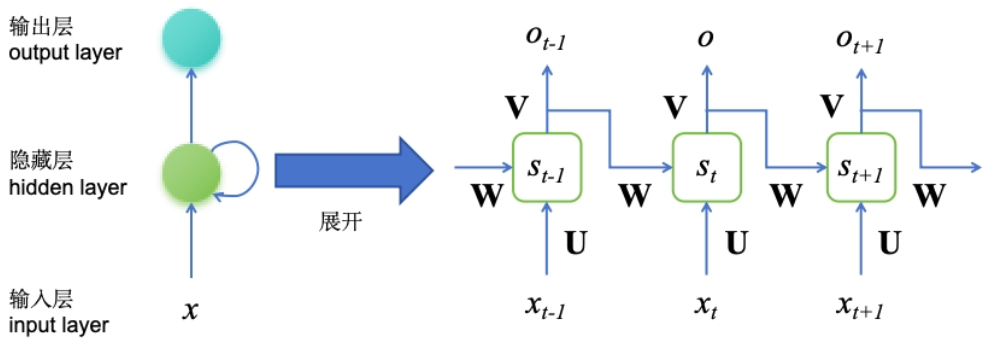
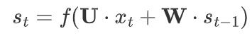
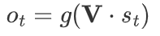
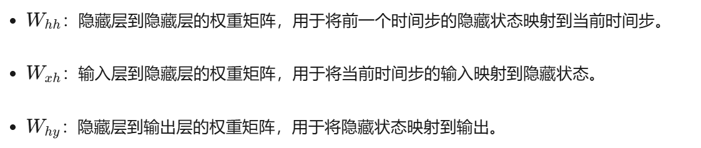
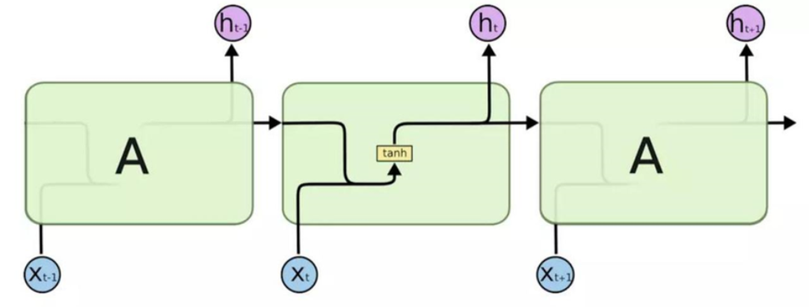

# 前言

对于图像识别，数据顺序不重要，因为图像像素是独立无序的。然而，对于文本、股票、天气和语音等具有时间或逻辑顺序的数据，顺序对结果有显著影响。例如，文本中词语的顺序改变会导致意义完全不同，而股票和天气数据的顺序也很重要，因为后续数据可能受之前数据的影响。

文本理解中，顺序同样关键，如古诗中诗句顺序的改变会改变整首诗的意境。因此，**在处理具有时间或逻辑顺序的数据时，必须考虑顺序的重要性**，并设计相应的模型来利用数据的前后关系，如循环神经网络（RNN），以获得更准确和有意义的结果。

# 一、模型架构

# 1.1 整体结构 

RNN（循环神经网络）通过在网络内部添加循环连接，使其能够利用先前时间步的信息，从而在处理序列数据时能够捕捉和利用结构信息。



RNN在处理一个序列，比如一句话或者一系列的数字时，会**同时考虑当前的数据和之前的数据**。它通过更新一个内部的“记忆”（隐藏状态），来“记住”过去的信息，并用这些信息来帮助理解新的数据。这样，RNN就能捕捉到数据中的顺序和模式，就像你通过记忆来理解连续剧一样。这一过程可以通过数学公式简化为：



其中，S_t表示在时间步t的**隐藏状态**，是当前时间步t的输入，U和W分别是输入到**隐藏状态和隐藏状态到隐藏状态的权重矩阵**。函数f通常是一个非线性函数，如tanh或ReLU，用于引入非线性特性并帮助网络学习复杂的模式，其实就相当于**当前输入和历史隐藏状态的加权求和，将这一加权求和结果经过激活函数作为当前隐藏状态输入下一个时间步**，与此同时当前时间步都伴随着一个输出，

最终除开偏置项，一个时间步需要更新三个权重



## 1.2 内部结构

附上一张非常经典的RNN单元结构图



# 二、代码实现

下面定义了一个简单的循环神经网络（SimpleRNN）模型，该模型包含一个RNN层和一个全连接层。

- RNN层**用于处理输入的序列数据，其输出是每个时间步的隐藏状态**；
- 全连接层则**将RNN层的最终隐藏状态映射到所需的输出维度**。
- 在模型的前向传播过程中，输入数据首先**通过RNN层处理**，然后**提取最后一个时间步的隐藏状态**，最后**通过全连接层得到模型的输出**。

这个模型适用于处理序列数据，如时间序列预测或文本分类任务。

```Python
import torch.nn as nn

class SimpleRNN(nn.Module):
    """
    该模型包含一个 RNN 层，后接一个全连接层。
    RNN 层用于处理序列输入数据，全连接层将 RNN 的最终隐藏状态映射到所需的输出维度。

    """

    def __init__(self, input_dim, n_steps, n_units, num_layers=3):
        """
        初始化 SimpleRNN 模型。

        参数：
            input_dim (int): 输入特征的维度。
            n_steps (int): 输出的维度。
            n_units (int): RNN 隐藏层的单元数。
            num_layers (int, 可选): RNN 的层数，指在时间序列的每个时间步上堆叠的 RNN 层的数量，默认为 3。
        """
        super(SimpleRNN, self).__init__()
        # 初始化 RNN 层，指定参数如下：
        # - input_dim: 输入特征的维度。
        # - n_units: 隐藏状态的维度。
        # - num_layers: RNN 的层数。
        # - batch_first=True: 输入和输出张量的形状为 (batch_size, seq_len, features)。
        self.rnn = nn.RNN(input_dim, n_units, num_layers, batch_first=True)
        
        # 初始化全连接层，将 RNN 的最终隐藏状态映射到输出维度。
        # - n_units: 输入维度（RNN 的隐藏状态大小）。
        # - n_steps: 输出维度。
        self.fc = nn.Linear(n_units, n_steps)

    def forward(self, x):
        """
        SimpleRNN 模型的前向传播。

        参数：
            x (torch.Tensor): 输入张量，形状为 (batch_size, seq_len, input_dim)。

        返回：
            torch.Tensor: 输出张量，形状为 (batch_size, n_steps)。
        """
        # 将输入通过 RNN 层。
        # - rnn_out: RNN 层的输出，形状为 (batch_size, seq_len, n_units)。
        # - _: RNN 的隐藏状态（本模型中未使用）。
        rnn_out, _ = self.rnn(x)
        
        # 提取最后一个时间步的隐藏状态。
        # - rnn_out[:, -1, :]: 形状为 (batch_size, n_units)。
        # 这一步假设最后一个时间步的隐藏状态包含最相关的信息。
        last_hidden_state = rnn_out[:, -1, :]
        
        # 将最后一个时间步的隐藏状态通过全连接层，得到最终输出。
        # - out: 输出张量，形状为 (batch_size, n_steps)。
        out = self.fc(last_hidden_state)
        
        return out
```

# 三、RNN的梯度缺陷

由于**循环结构导致的梯度在时间步上的乘积累积效应**，RNN容易产生梯度消失和梯度爆炸问题。

- **梯度消失**是因为权重矩阵的特征值小于1或激活函数导数小于1，导致梯度逐渐缩小；
- **梯度爆炸**则是权重矩阵特征值大于1或输入数据尺度大，导致梯度急剧增大。

因此**当序列非常长时，RNN难以学习并保持序列早期时间步的信息**

通过选择合适的**激活函数**（tanh改为ReLu）、权重初始化方法、改进网络结构（如**LSTM**和GRU）、梯度裁剪等技术，可以有效缓解这些问题，从而提高RNN在处理长序列数据时的性能和稳定性。
