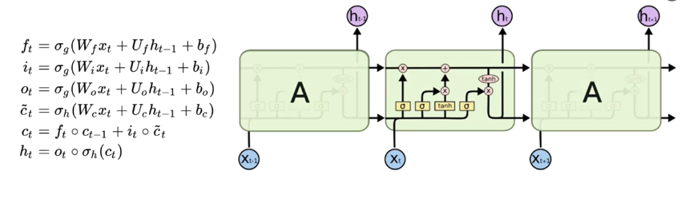
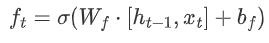
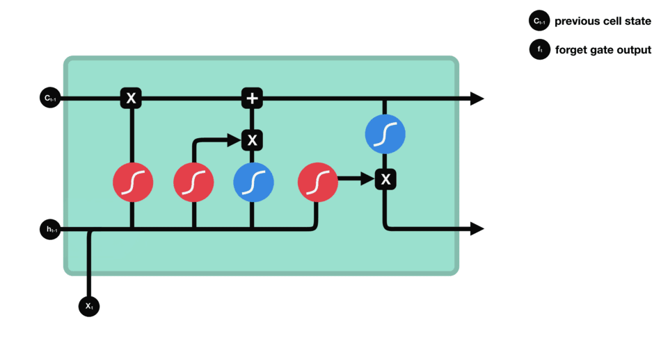
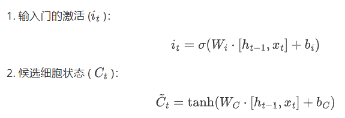
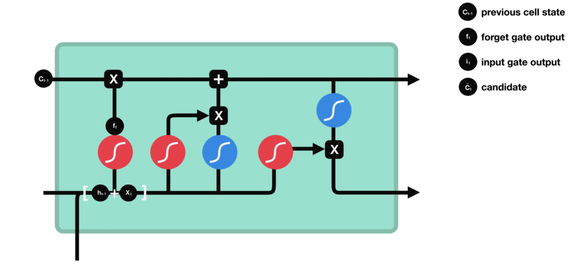
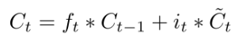
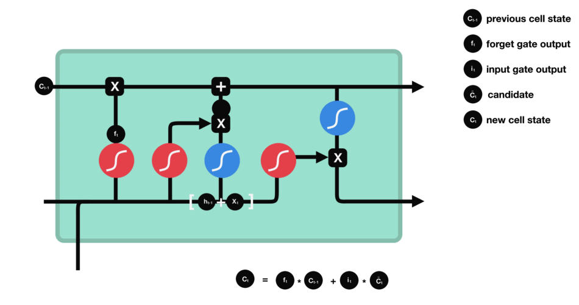
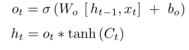
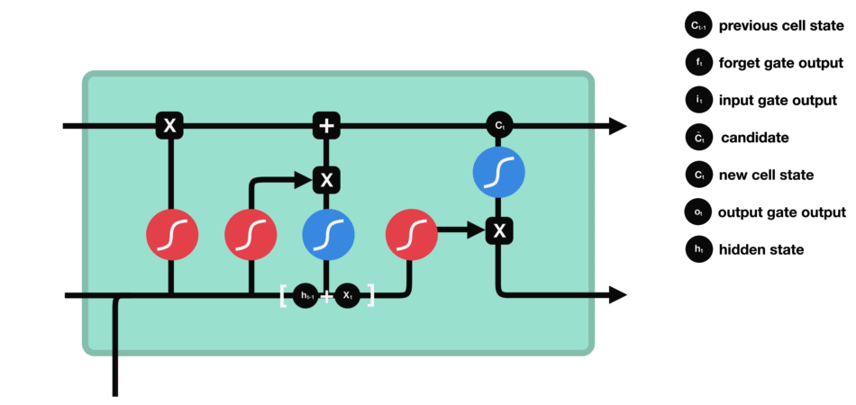
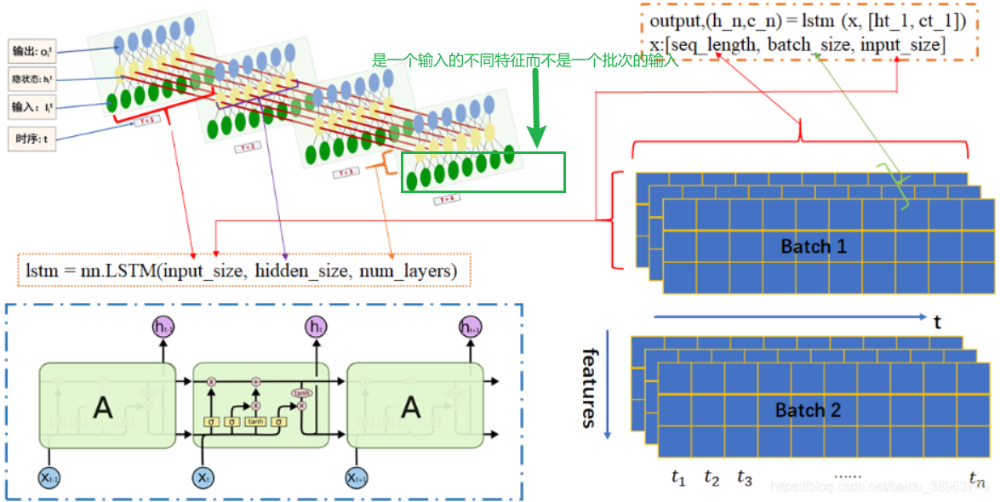

# 前言

前面说到RNN虽然能捕捉时序数据，但是在一些比较长的序列上面会出现梯度问题，而LSTM（长短期记忆网络）通过引入**门控机制**有效地解决了传统RNN中的梯度消失和梯度爆炸问题。

LSTM单元包含输入门、遗忘门和输出门，这些门控结构允许模型有选择性地保留或丢弃信息，从而控制信息流动。

- 遗忘门帮助模型决定**哪些信息应该被遗忘**
- 输入门决定**哪些新信息应该被存储**
- 输出门决定**哪些信息应该被输出到下一个时间步**

这种设计使得LSTM能够在长时间序列中保持梯度的稳定性，避免梯度在反向传播过程中的指数级衰减或增长，从而允许模型学习并记忆长期依赖关系。


# 一、模型结构



## 1.1 非常精辟的理解

LSTM单元通过**当前步的输入，前一步的隐藏状态和细胞状态**，得到**当前步的输出**和**下一步的隐藏状态**

在遗忘门得到了一个**历史细胞状态保留的比例**①

在输入门得到了一个**当前时间步的新信息②**以及该**新信息能被写入细胞状态的比例③**

①与历史细胞状态相乘，**保留历史细胞状态的一部分**，②与③相乘，**将新信息的一部分写入细胞状态**，相加得到**新的细胞状态④**

在输出门结合前一步的隐藏状态得到了**当前步的输出⑤**，又以④得到**当前步的隐藏状态⑥**（当前步的输出并不独立于之前，而是既受到前一步的隐藏状态影响，也影响当前步的隐藏状态）

## 1.2 遗忘门

公式：



**遗忘门通过接受当前时间步的输入$x_t$以及前一时间步的隐藏状态$h_{t-1}$，与遗忘门权重矩阵($W_f$，用于学习$\left[h_{t-1}, x_t\right]$中需要遗忘哪些信息)相乘后经过sigmoid函数，最终得到细胞状态中每个元素应该被保留的比例**



## 1.3 输入门

公式：



**它结合了输入数据和先前的细胞状态，利用sigmoid函数来确定更新的量，并通过tanh函数来产生新的候选值，然后结合遗忘门确定最终的更新**



## 1.4 细胞状态更新

公式：



遗忘门找到了需要忘掉的信息$ f_t $后，再将它与旧状态相乘，丢弃掉确定需要丢弃的信息。再将结果加上$ i_t \times C_t $使细胞状态获得新的信息，这样就完成了细胞状态的更新。



## 1.5 输出门

公式：





# 二、LSTM的维度解析

模型定义代码：

```python
import torch.nn as nn
import torch

class lstm(nn.Module):
    def __init__(self, word_size, input_dim=256, output_dim=2, hidden_dim=128, num_layers=2):
        super(lstm, self).__init__()
        self.word_size = word_size  # 词汇表大小
        self.input_dim = input_dim  # 词向量维度，也是输入特征维度
        self.output_dim = output_dim  # 输出维度
        self.hidden_dim = hidden_dim  # LSTM隐藏层维度
        self.num_layers = num_layers  # LSTM层数

        # 嵌入层：将词汇索引映射到嵌入向量
        self.embed = nn.Embedding(word_size, input_dim)  # 输入维度：(batch_size, seq_len) → 输出维度：(batch_size, seq_len, input_dim)
        # LSTM层：处理序列数据
        self.lstm = nn.LSTM(input_dim, hidden_dim, num_layers, batch_first=True)  # 输入维度：(batch_size, seq_len, input_dim) → 输出维度：(batch_size, seq_len, hidden_dim)
        # 全连接层：将LSTM的输出映射到目标维度
        self.fc = nn.Linear(hidden_dim, output_dim)  # 输入维度：(batch_size, hidden_dim) → 输出维度：(batch_size, output_dim)

    # x: 输入数据，形状为 (batch_size, seq_len)
    def forward(self, x):
        # 嵌入层：将词汇索引转换为嵌入向量
        x = self.embed(x)  # 输入维度：(32, 255) → 输出维度：(32, 255, 256)
        
        # 初始化隐藏状态和细胞状态
        device_choose = torch.device("cuda" if torch.cuda.is_available() else "cpu")
        c0 = torch.zeros(self.num_layers, x.size(0), self.hidden_dim, device=device_choose)  # 形状：(num_layers, batch_size, hidden_dim) = (2, 32, 128)
        h0 = torch.zeros(self.num_layers, x.size(0), self.hidden_dim, device=device_choose)  # 形状：(num_layers, batch_size, hidden_dim) = (2, 32, 128)
        
        # LSTM层：处理序列数据
        x, _ = self.lstm(x, (h0, c0))  # 输入维度：(32, 255, 256) → 输出维度：(32, 255, 128)
        
        # 激活函数：对LSTM的输出应用tanh激活函数
        x = torch.tanh(x)  # 形状不变：(32, 255, 128)
        
        # 取最后一个时间步的输出
        out = self.fc(x[:, -1, :])  # 输入维度：(32, 128) → 输出维度：(32, 2)
        
        return out
```

对于文本处理而言，一个简单的LSTM模型涉及到嵌入层，LSTM层（其中又包含输入层，隐藏层和输出层），全连接层

- **嵌入层**
  
  - `word_size`通常指的是词汇表中单词数量（大于或等于），定义词向量的行数
  - `input_dim`输入到LSTM的维度，既定义词向量的列数
  
  当一个句子的分词数量小于`input_dim`时，填不满他所需要的维度，此时使用0来填充到（`word_size`，`input_dim`）形状
  
- **LSTM层**

  - **`input_dim`**：输入特征的维度，即每个时间步的输入向量长度。
  - **`hidden_dim`**：隐藏状态的维度，即LSTM单元的输出特征向量长度。
  - **`num_layers`**：LSTM的层数，即LSTM单元的堆叠层数，**不同隐藏层的 `hidden_size` 不一定必须相同，但通常在实践中会设置为相同的值**。
  - **`batch_first`**：输入和输出张量的维度顺序。输出形状
    - **`batch_first=True`**：**(batch_size, seq_len,  hidden_size)**（常用）
    - **`batch_first=False`：(seq_len, batch_size, hidden_size)**

下面这张图很好地剖解了LSTM的整体和局部结构，但是需要注意的是**左下角的每一个“A”结构对应的是左上角的一个层**

[图的出处](https://blog.csdn.net/baidu_38963740/article/details/117197619)



- **全连接层**

  - 输入为lstm层最后一个时间步的隐藏状态，形状为（batch_size,hidden_size）,输出为（batch_size,num_class）,这个num_class就是我们的标签类别数

    
