# 前言

​    前面的文章中，我们讲述了用于回归的线性回归算法，用于分类的逻辑回归算法以及其变式softmax函数，其实不管是回归还是分类，都是通过已有的数据集，知道输入和输出结果之间的关系，然后根据这种已知的关系，训练得到一个最优的模型。这样的模式被称为**监督学习**。但是在实际生产中，这样既有**特征(feature)**又有**标签(label)**的数据集似乎需要使用特殊设备或经过昂贵且用时非常长的实验过程进行人工标记才能得到。当我们不知道数据集中数据、特征之间的关系，而是要根据聚类或一定的模型才能得到数据之间的关系时，我们称为这样的模式叫做**无监督学习**。在无监督学习中数据**只有特征(feature)无标签(label)**，它本质上是一个统计手段，在没有标签的数据里可以发现潜在的一些结构的一种训练方式。

​    本篇文章我们来讲讲无监督学习中，**用于聚类的K_Means算法与DBSCAN算法。**

# 一、聚类和分类

​    聚类适用于没有明确类别标签的数据（无监督），目的是通过相似性将数据划分为若干个簇，以发现数据的内在结构和分布规律。它不需要预先定义类别，而是根据数据本身的特征自动分组。

​    分类则适用于有明确类别标签的数据（有监督），目的是根据已有的标签训练模型，对新的数据进行类别预测。它需要有标记的训练数据来学习特征与类别之间的关系，适合用于预测性分析。

​    简单来说，**聚类注重数据之间的相似性关系，通过将相似的数据聚集在一起，发现数据的内在结构；而分类更强调数据特征与预定义标签之间的关系，通过学习特征与标签的映射关系来进行预测。**

# **二、K_Means**

​    K-means 的目标是将数据集划分为 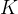 个簇（clusters,表示数据点集合），使得每个数据点属于距离最近的簇中心（所有点的平均值）。通过**反复调整簇中心的位置**，K-means 不断**优化簇内的紧密度**，从而获得尽量紧凑、彼此分离的簇（**高内聚低耦合**）。

## 2.1 简单工作流程介绍

​    K_Means的理论部分其实没有过多要介绍的内容，实际上就是一个不断计算距离并更新簇中心的过程，关于距离的度量，我们通常采用欧几里得距离：

^2}.png)

​    下面是算法工作流程 ：

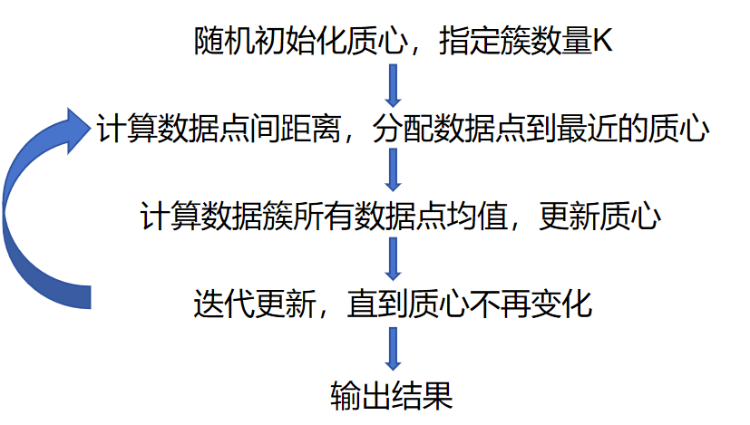

这里介绍一个网站用于K_Means和DBSCAN两种聚类的直观可视化 

[https://www.naftaliharris.com/blog/visualizing-dbscan-clustering/https://www.naftaliharris.com/blog/visualizing-dbscan-clustering/](https://www.naftaliharris.com/blog/visualizing-dbscan-clustering/)

我们选取Picked circles作为案例

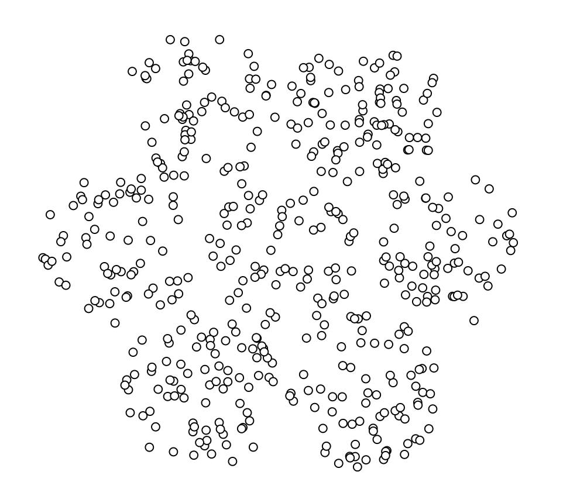

首先指定执行数量，从图上来看，似乎7比较合理，注意，下面的点是我们初始化人为指定的点

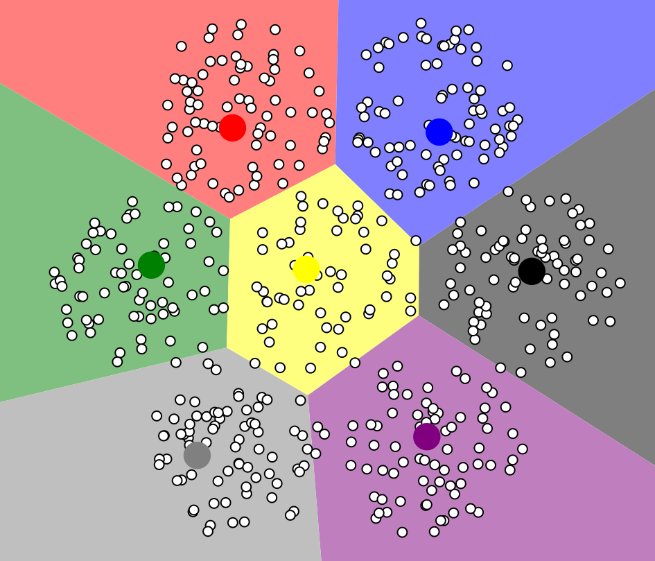

最终经过不断迭代，我们得出聚类结果如下，此时每个簇上的数据点到对应质心的距离之和最小，模型达到稳定 

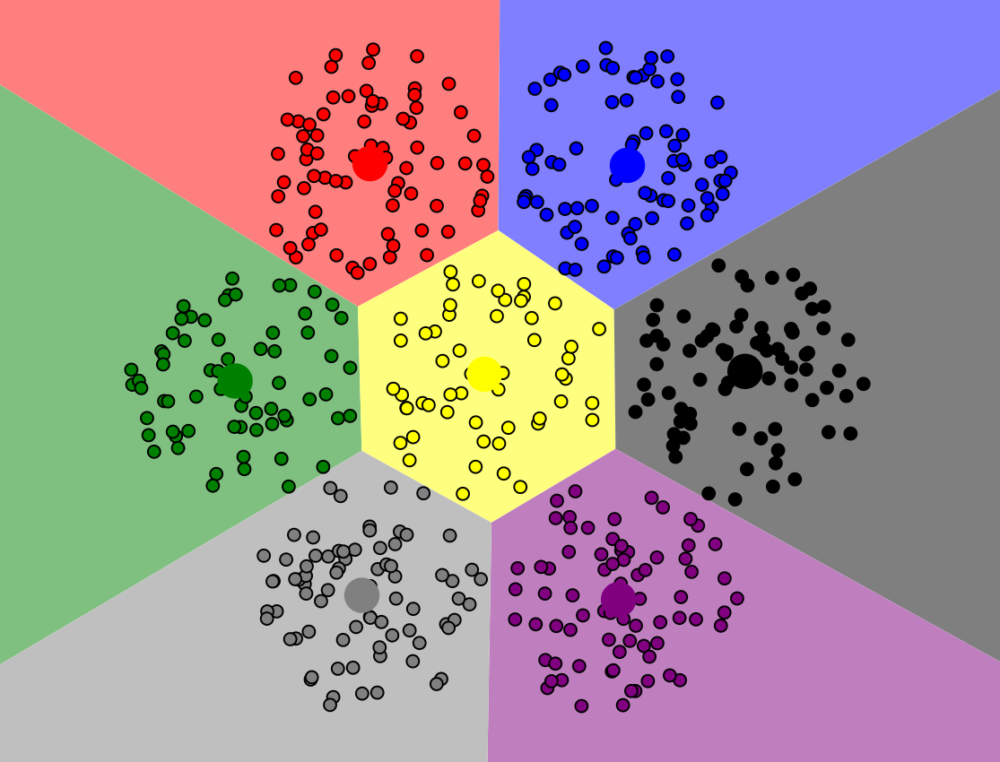

当然，我们也可以选择5个质心来玩一玩，聚类的结果似乎也说得通，**其实聚类结果没有绝对标准解释，**是因为聚类是无监督学习，数据本身缺乏外部标签，且不同聚类算法基于不同原理和假设，对数据分布、特征权重的处理方式各异。**关键在于能否对聚类结果自圆其说。**

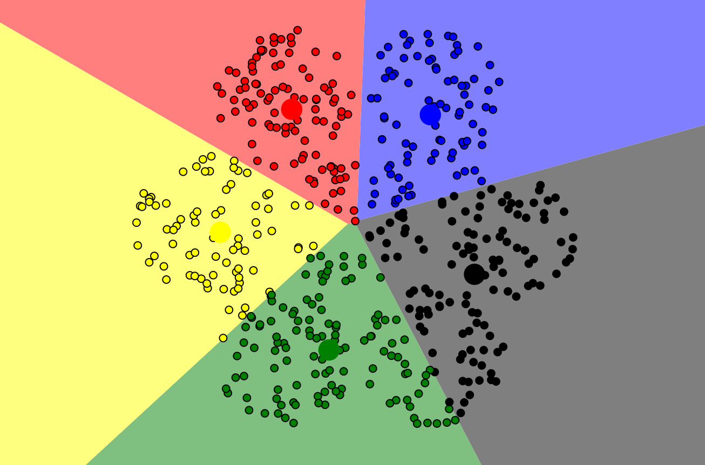

但是注意，**对于初始化质心位置的不同，最终的分类结果也会有差异**，后续我们会继续介绍这一性质。 

## 2.2 sklearn代码复现

详细注释已经在代码中给出了，比较简单，关键是**分配样本到最近的质心**和**更新每个簇的质心**两个环节，因为**没有损失函数**（前面给出的距离并不是损失函数，而是实际的距离，并不需要最小化），自然也**不涉及梯度下降**。

```python
import numpy as np
class Kmeans:
    def __init__(self,data,num_clusters):
        self.data = data
        self.num_clusters = num_clusters

    @staticmethod
    def centroids_init(data,num_clusters):
        # 获取样本量
        num_examples = data.shape[0]
        # 打乱样本索引
        random_ids = np.random.permutation(num_examples)
        # 选取打乱后的K(num_clusters)个样本作为质心
        centroids = data[random_ids[:num_clusters],:]
        return centroids
    
    @staticmethod
    def centroids_find_closest(data,centroids):
        """
        核心计算公式，用于将每个样本分配到最近的簇，返回值是每个样本对应的质心索引
        """
        # 样本数
        num_examples = data.shape[0]
        # 簇数
        num_centroids = centroids.shape[0]
        # 计算距离，选取最近的距离
        # 用于存储每个样本最接近的质心的索引
        closest_centroids_ids = np.zeros((num_examples,1))
        for example_index in range(num_examples):
            # 每条数据都初始化一个distance存储这条数据到所有质心的距离
            distance = np.zeros((num_centroids,1))
            for centroid_index in range(num_centroids):
                # 这里是第example_index条数据减去第centroid_index个质心
                distance_diff = data[example_index,:] - centroids[centroid_index,:]
                # 对差值求平方和后赋值给distance里面对应质心的位置
                distance[centroid_index] = np.sum(distance_diff**2)
            # 选取距离质心最小的长度的索引
            closest_centroids_ids[example_index] = np.argmin(distance)
        return closest_centroids_ids
    
    @staticmethod
    def centroids_compute(data,closest_centroids_ids,num_clustres):
        num_features = data.shape[1]
        centroids = np.zeros((num_clustres,num_features))
        for centroid_id in range(num_clustres):
            # 选出属于当前簇的样本
            closest_ids = closest_centroids_ids == centroid_id
            # 计算这些样本在每个特征上的均值，结果是一个一维数组，表示当前簇的新质心
            centroids[centroid_id] = np.mean(data[closest_ids.flatten(),:],axis=0)
        return centroids
                
    
    def train(self,max_iterations):
        # 第一步：随机选择K个质心
        centroids = Kmeans.centroids_init(self.data,self.num_clusters)
        # 第二步:开始训练
        num_examples = self.data.shape[0]
        closest_centroids_ids = np.empty((num_examples,1))
        for _ in range(max_iterations):
            # 第三步：得到当前每一个样本到K个质心的距离，找到最近的一个
            closest_centroids_ids = Kmeans.centroids_find_closest(self.data,centroids)
            # 第四步：更新中心点距离
            centroids = Kmeans.centroids_compute(self.data,closest_centroids_ids,self.num_clusters)
        return centroids,closest_centroids_ids
```


## 2.3 模型测试

```python
import numpy as np
import pandas as pd
import matplotlib.pyplot as plt

from kmeans import Kmeans


data = pd.read_csv(r'D:\桌面\华清\机器学习\西瓜书\k_means聚类\data\iris.csv')
iris_types = ['SETOSA','VERSICOLOR','VIRGINICA']

x_axis = 'petal_length'
y_axis = 'petal_width'

num_examples = data.shape[0]
x_train = data[[x_axis,y_axis]].values.reshape(num_examples,2)

#指定好训练所需的参数
num_clusters = 3
max_iterations = 50

k_means = Kmeans(x_train,num_clusters)
centroids,closest_centroids_ids = k_means.train(max_iterations)
# 对比结果
plt.figure(figsize=(12,5))
plt.subplot(1,2,1)
for iris_type in iris_types:
    plt.scatter(data[x_axis][data['class']==iris_type],data[y_axis][data['class']==iris_type],label = iris_type)
plt.title('label known')
plt.legend()

plt.subplot(1,2,2)
for centroid_id, centroid in enumerate(centroids):
    current_examples_index = (closest_centroids_ids == centroid_id).flatten()
    plt.scatter(data[x_axis][current_examples_index],data[y_axis][current_examples_index],label = centroid_id)

for centroid_id, centroid in enumerate(centroids):
    plt.scatter(centroid[0],centroid[1],c='black',marker = 'x')
plt.legend()    
plt.title('label kmeans')
plt.show()
```


最后运行实际类别与算法分类结果对比如下图，每种颜色代表一个类别，可以看出相似度还是挺高的

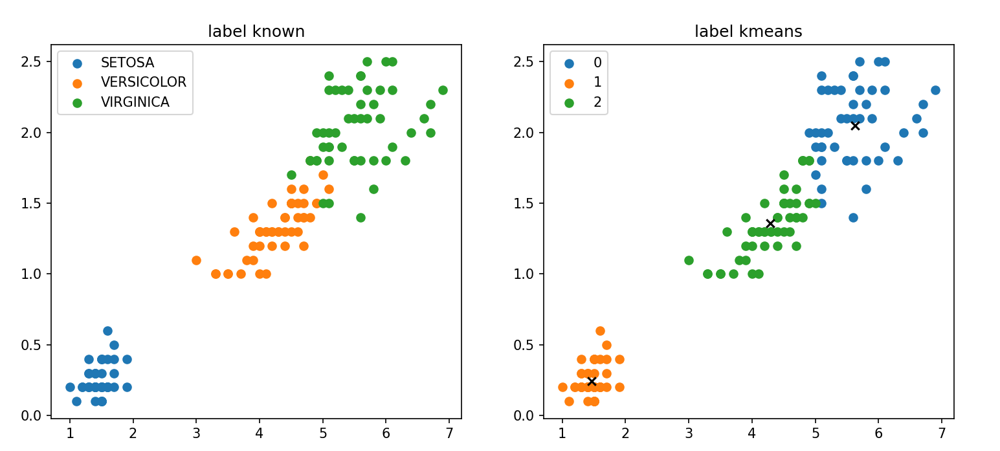

## 2.4 调用sklearn库函数

我们首先来生成一些随机的数据点用于后续实验

```python
import numpy as np
import os
import matplotlib.pyplot as plt
import pandas as pd
plt.rcParams["axes.labelsize"] = 14
plt.rcParams["xtick.labelsize"] = 12
plt.rcParams["ytick.labelsize"] = 12
import warnings
warnings.filterwarnings("ignore")
np.random.seed(42)

from sklearn.datasets import make_blobs

blob_centers = np.array(
    [[0.2,2.3],
     [-1.5,2.3],
     [-2.8,1.8],
     [-2.8,2.8],
     [-2.8,1.3]])

blob_std =np.array([0.4,0.3,0.1,0.1,0.1]) 

x,y = make_blobs(n_samples=2000,centers=blob_centers,
                     cluster_std = blob_std,random_state=7)

def plot_clusters(x, y=None):
    plt.scatter(x[:, 0], x[:, 1], c=y, s=1)
    plt.xlabel("$x_1$", fontsize=14)
    plt.ylabel("$x_2$", fontsize=14, rotation=0)
plt.figure(figsize=(8, 4))
plot_clusters(x)
plt.show()
```


可视化一下

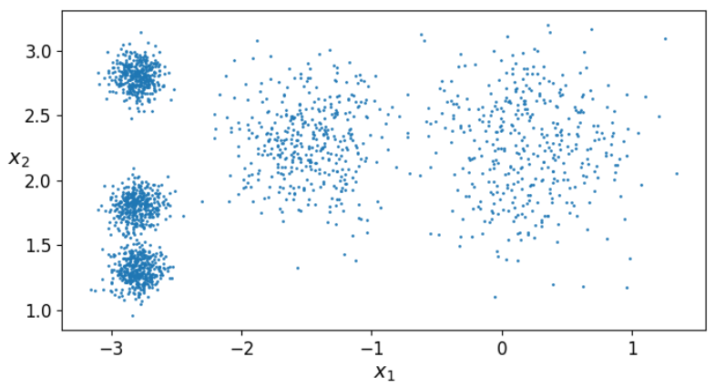

 调用sklearn.cluster中的KMeans对数据进行聚类，这里传入的参数为**KMeans(簇数，初始化质心方式，初始化质心坐标，指定运行次数，最大迭代次数，随机种子)**，三个参数都是可选的，这里我们只传入簇数和随机种子，让他自己初始化质心

```python
from sklearn.cluster import KMeans
k = 5
kmeans = KMeans(n_clusters=k,random_state=42)
y_pred = kmeans.fit_predict(x)
y_pred
```


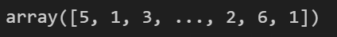

 **kmeans.labels_**：y_pred可以显示最终每条数据样本分类的结果，也可以用kmeans.labels_，输出结果一样

```python
kmeans.labels_
```


 **kmeans.cluster_centers_**：得到每个簇的中心点

```python
 kmeans.cluster_centers_
```


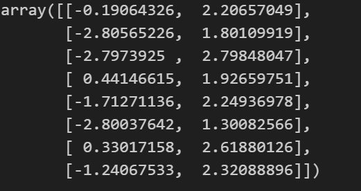

**kmeans.predict(x_new)：**传入新的数据进去进行预测

```python
x_new = np.array([[0,2],[3,2],[-3,-3],[-3,2.5]])
kmeans.predict(x_new)
```


**kmeans.transform(x_new)：**计算每一个样本到每一个簇的中心点的距离

```python
kmeans.transform(x_new)：
```


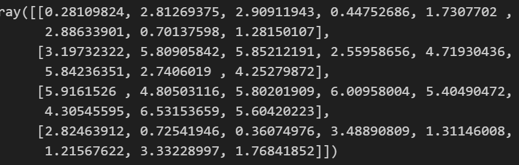

下面绘制决策边界，不用死记硬背代码，知道怎么改参数就行

```python
def plot_data(X):
    plt.plot(X[:, 0], X[:, 1], 'k.', markersize=2)

def plot_centroids(centroids, weights=None, circle_color='r', cross_color='k'):
    if weights is not None:
        centroids = centroids[weights > weights.max() / 10]
    plt.scatter(centroids[:, 0], centroids[:, 1],
                marker='o', s=30, linewidths=8,
                color=circle_color, zorder=10, alpha=0.9)
    plt.scatter(centroids[:, 0], centroids[:, 1],
                marker='x', s=10, linewidths=10,
                color=cross_color, zorder=11, alpha=1)

def plot_decision_boundaries(clusterer, X, resolution=1000, show_centroids=True,
                             show_xlabels=True, show_ylabels=True):
    mins = X.min(axis=0) - 0.1
    maxs = X.max(axis=0) + 0.1
    xx, yy = np.meshgrid(np.linspace(mins[0], maxs[0], resolution),
                         np.linspace(mins[1], maxs[1], resolution))
    Z = clusterer.predict(np.c_[xx.ravel(), yy.ravel()])
    Z = Z.reshape(xx.shape)

    plt.contourf(Z, extent=(mins[0], maxs[0], mins[1], maxs[1]),
                cmap="Pastel2")
    plt.contour(Z, extent=(mins[0], maxs[0], mins[1], maxs[1]),
                linewidths=1, colors='k')
    plot_data(X)
    if show_centroids:
        plot_centroids(clusterer.cluster_centers_)

    if show_xlabels:
        plt.xlabel("$x_1$", fontsize=14)
    else:
        plt.tick_params(labelbottom='off')
    if show_ylabels:
        plt.ylabel("$x_2$", fontsize=14, rotation=0)
    else:
        plt.tick_params(labelleft='off')

plt.figure(figsize=(8, 4))
plot_decision_boundaries(kmeans, x)
plt.show()
```


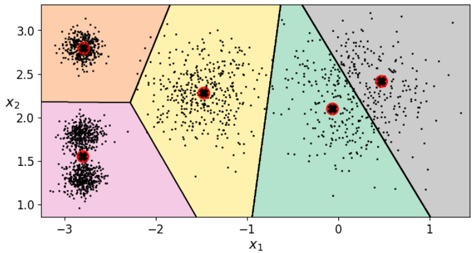

## 2.5 评估指标

### 2.5.1 **kmeans.inertia_**函数

评价模型聚类效果通常是**计算每个样本到其对应质心的距离之和（簇内误差平方和****）**，使用**kmeans.inertia_**函数

```python
kmeans.inertia_
```


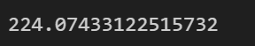

### 2.5.2 **轮廓系数**

轮廓系数综合考虑了**簇内紧密度（内聚度）和簇间分离度（分离度）**，能够有效衡量聚类结果的合理性

**单个数据点的轮廓系数**

对于每个数据点 i，轮廓系数 s(i) 的计算公式为：

%2C b(i))}.png) 

- a(i) 是**样本 i 到其所在簇内其他样本的平均距离**，反映了**簇内的紧密度。**

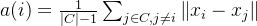 

​    其中 C 是样本 i 所在的簇，∣C∣ 是簇 C 中的样本数量，xi 和 xj 分别是样本 i 和样本 j 的特征向量。

- b(i) 是**样本 i 到最近的其他簇中所有样本的平均距离**，反映了**簇间的分离度。**

.png) 

​    其中 C′ 是与 C 不同的簇，∣C′∣ 是簇 C′ 中的样本数量。 

 **si接近1，则说明样本i聚类合理（高类聚低耦合）；**

 si接近-1，则说明样本i更应该分类到另外的簇；

若si 近似为0，则说明样本i在两个簇的边界上。

**整个数据集的轮廓系数**

整个数据集的轮廓系数是**所有数据点轮廓系数的平均值：**

 .png)


**代码演示：**

**进行聚类：** 

```python
from sklearn.cluster import KMeans
k = 5
kmeans = KMeans(n_clusters=k,random_state=42)
y_pred = kmeans.fit_predict(x)
kmeans.labels_
```


 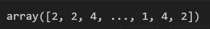

**计算轮廓系数：** 

```python
from sklearn.metrics import silhouette_score
silhouette_score(x, kmeans.labels_)
```


 


## 2.6 找到最佳簇数K 

在介绍之前首先要说明一点，这里所说的最佳簇数只是一个参考值，原因前面已经介绍过了。

### 2.6.1 肘部法则

这是基于**kmeans.inertia_**函数的法则，其核心思想是通过计算不同 K 值下的**簇内误差平方和**，绘制 K 值与 SSE 的关系曲线，寻找曲线的“拐点”（形似肘部），即增加 K 值带来的 SSE 下降幅度开始显著减小的点。

```python
kmeans_per_k = [KMeans(n_clusters = k).fit(x) for k in range(1,10)]

inertias = [model.inertia_ for model in kmeans_per_k]

plt.figure(figsize=(8,4))
plt.plot(range(1,10),inertias,'bo-')
# plt.axis([1,8.5,0,1300])
plt.show()
```


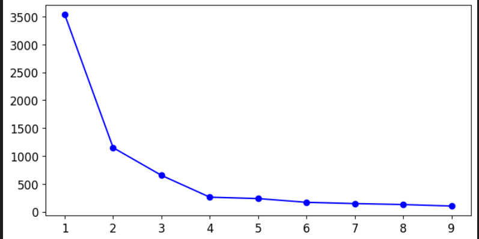

似乎拐点在4处，因此可以把簇数K设置为4

### 2.6.1 轮廓系数法

核心思想和肘部法则类似，都是通过不同簇数来对比产生比较好的那个K

```python
# 聚类数 K 至少需要为 2
kmeans_per_k = [KMeans(n_clusters = k).fit(x) for k in range(2,10)]
silhouette_scores = [silhouette_score(x,model.labels_) for model in kmeans_per_k]
silhouette_scores

plt.figure(figsize=(8,4))
plt.plot(range(2,10),silhouette_scores,'bo-')
# plt.axis([1,8.5,0,1300])
plt.show()
```


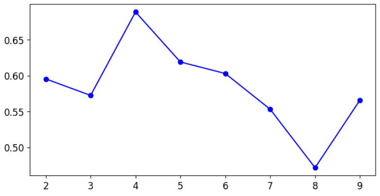

似乎好像还是4。。 。

## 2.7 劣势 

除了K值，前面说到初始质心的设置也会对结果产生比较大的影响，下面我们来进行实验看看是不是这样

首先生成一个边界没有那么清晰的数据

```python
# 生成比较杂乱的数据
X1, y1 = make_blobs(n_samples=1000, centers=((4, -4), (0, 0)), random_state=42)
X1 = X1.dot(np.array([[0.374, 0.95], [0.732, 0.598]]))
X2, y2 = make_blobs(n_samples=250, centers=1, random_state=42)
X2 = X2 + [6, -8]
X = np.r_[X1, X2]
y = np.r_[y1, y2]

plot_data(X)
```


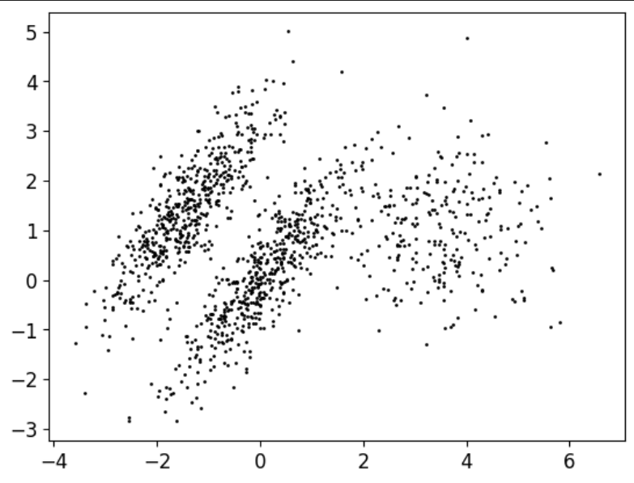

选取不同质心进行聚类 ，并绘制决策边界可视化聚类结果

```python
# 指定初始簇值
kmeans_good = KMeans(n_clusters=3,init=np.array([[-1.5,2.5],[0.5,0],[4,0]]),n_init=1,random_state=42)
# 随机初始簇值
kmeans_bad = KMeans(n_clusters=3,random_state=15)
kmeans_good.fit(X)
kmeans_bad.fit(X)

plt.figure(figsize = (10,4))
plt.subplot(121)
plot_decision_boundaries(kmeans_good,X)
plt.title('Good - inertia = {}'.format(kmeans_good.inertia_))

plt.subplot(122)
plot_decision_boundaries(kmeans_bad,X)
plt.title('Bad - inertia = {}'.format(kmeans_bad.inertia_))
plt.show()
```


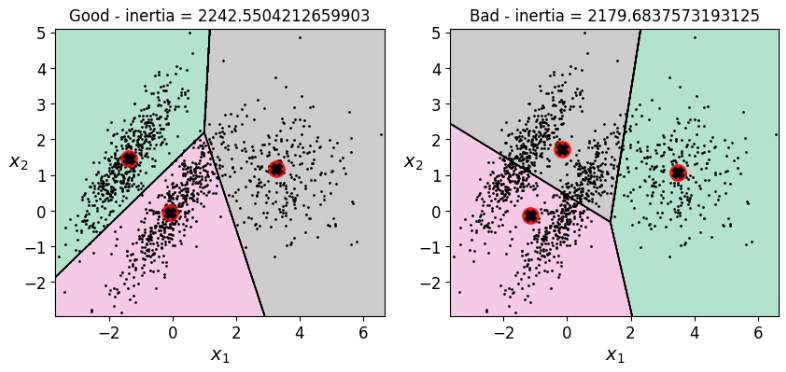

似乎第二种聚类效果还好些，但是直观来看第一种要更好解释一些。。 

## 2.8 图像分割

​    K-Means算法还可以用于图像分割，将图像中的像素根据其特征（如颜色、位置等）划分为不同的簇，从而实现对图像的区域划分。**图像分割**的目标是**将图像划分为若干具有相似特征的区域**，而**K-Means**算法通过聚类的方式，**将相似的像素分配到同一个簇中**，簇的数量K可以根据需要设置，每个簇对应图像中的一个分割区域。

首先我们读入一张图片

```python
import cv2 as cv
img = cv.imread("girl.png")
img_ = img.copy()

cv.imshow("img",img)
cv.waitKey(0)
cv.destroyAllWindows()
```


由于图片像素是三维，不符合KMeans的输入，因此要将三维数据转换成二维

```python
x = img_.reshape(-1,3)
x.shape
```


 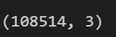

 现在我们相当于有了一个有108514个样本，三个特征的数据，下面我们来进行聚类，并将聚类后的数组形状更改到与原数组一样

```python
kmeans = KMeans(n_clusters=8,random_state=42).fit(x)

segmented_imgs = []  # 初始化一个列表，用于存储不同聚类数量下的分割图像
n_colors = (i for i in range(2, 10))  # 创建一个生成器，生成从 2 到 9 的聚类数量
for n_cluster in n_colors:  # 遍历不同的聚类数量
    kmeans = KMeans(n_clusters=n_cluster, random_state=42).fit(x)  # 使用 K-Means 算法对图像数据 x 进行聚类
    segmented_img = kmeans.cluster_centers_[kmeans.labels_]  # 根据聚类结果生成分割图像
    segmented_imgs.append(segmented_img.reshape(img.shape))  # 将分割图像恢复为原始图像的形状，并存储到列表中
```


遍历列表，一一显示聚类后的新图像

```python
# 假设 segmented_imgs 是包含所有分割后图像的列表
# n_colors 是对应的簇数量

# 确保所有图像的大小一致（如果有需要）
# 如果图像大小不一致，可以使用 cv2.resize 调整大小
max_height = max(img.shape[0] for img in segmented_imgs)
max_width = max(img.shape[1] for img in segmented_imgs)

resized_imgs = []
for img in segmented_imgs:
    resized_img = cv.resize(img, (max_width, max_height), interpolation=cv.INTER_AREA)
    resized_imgs.append(resized_img)

# 水平拼接图像
combined_img = cv.hconcat(resized_imgs)

# 创建窗口
window_name = "Segmented Images"
cv.namedWindow(window_name, cv.WINDOW_NORMAL)

# 显示拼接后的图像
cv.imshow(window_name, combined_img.astype(np.uint8))  # 确保数据类型为 uint8

# 等待按键
cv.waitKey(0)

# 关闭所有窗口
cv.destroyAllWindows()
```


最终结果，将图片从2到10进行聚类：

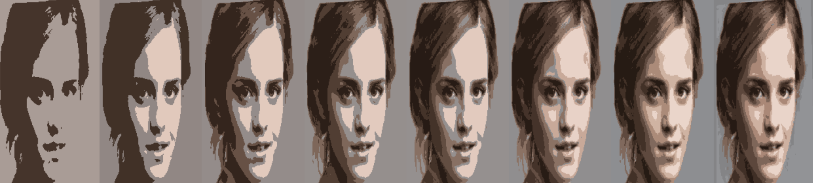

# 三、DBSCN算法

算法原理可谓是相当简单粗暴，DBSCAN 使用两个关键参数：

- **`eps`（ε）**：定义了点之间的最大距离，用于判断两个点是否属于同一个簇。
- **`minPts`**：定义了形成一个簇所需的最小点数。

​    算法通过设定`eps`（点间最大距离）和`minPts`（最小点数）来识别核心点，并从核心点开始递归扩展簇，同时标记边界点和噪声点，最终根据密度关系自动完成聚类，类似于“**发展下线**”。 

 先生成一些数据：

```python
from sklearn.datasets import make_moons
x, y = make_moons(n_samples=1000, noise=0.08, random_state=42)

plt.plot(x[:,0],x[:,1],'b*')
plt.show()
```


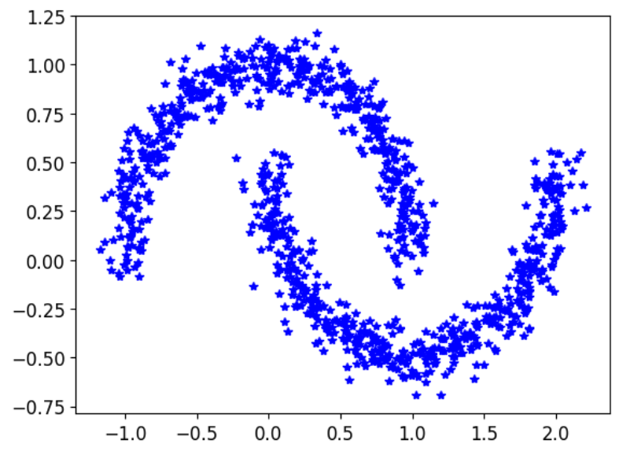

可以看到，这样的数据对KMeans来讲肯定是没法很好地聚出来的，KMeans只看重距离，对簇的形状没有办法识别，而DBSCN可以很好的解决这个问题

我们首先来看看KMeans聚出来的结果

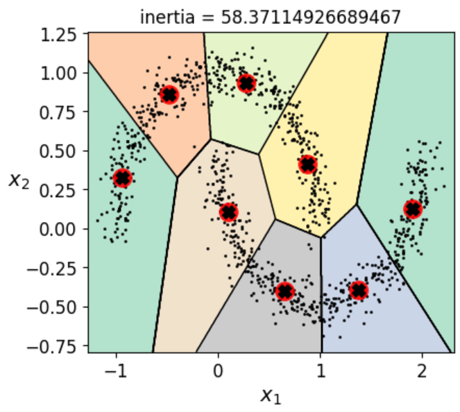

 然后对比一下DBSCN算法

```python
from sklearn.cluster import DBSCAN
# 半径，最小容纳点数
dbscan = DBSCAN(eps = 0.1,min_samples=5)
dbscan.fit(x)

dbscan2 = DBSCAN(eps = 0.2,min_samples=5)
dbscan2.fit(x)

def plot_dbscan(dbscan, X, size, show_xlabels=True, show_ylabels=True):
    core_mask = np.zeros_like(dbscan.labels_, dtype=bool)
    core_mask[dbscan.core_sample_indices_] = True
    anomalies_mask = dbscan.labels_ == -1
    non_core_mask = ~(core_mask | anomalies_mask)

    cores = dbscan.components_
    anomalies = X[anomalies_mask]
    non_cores = X[non_core_mask]
    
    plt.scatter(cores[:, 0], cores[:, 1],
                c=dbscan.labels_[core_mask], marker='o', s=size, cmap="Paired")
    plt.scatter(cores[:, 0], cores[:, 1], marker='*', s=20, c=dbscan.labels_[core_mask])
    plt.scatter(anomalies[:, 0], anomalies[:, 1],
                c="r", marker="x", s=100)
    plt.scatter(non_cores[:, 0], non_cores[:, 1], c=dbscan.labels_[non_core_mask], marker=".")
    if show_xlabels:
        plt.xlabel("$x_1$", fontsize=14)
    else:
        plt.tick_params(labelbottom='off')
    if show_ylabels:
        plt.ylabel("$x_2$", fontsize=14, rotation=0)
    else:
        plt.tick_params(labelleft='off')
    plt.title("eps={:.2f}, min_samples={}".format(dbscan.eps, dbscan.min_samples), fontsize=14)

plt.figure(figsize=(9, 3.2))

plt.subplot(121)
plot_dbscan(dbscan, x, size=100)

plt.subplot(122)
plot_dbscan(dbscan2, x, size=600, show_ylabels=False)

plt.show()
```


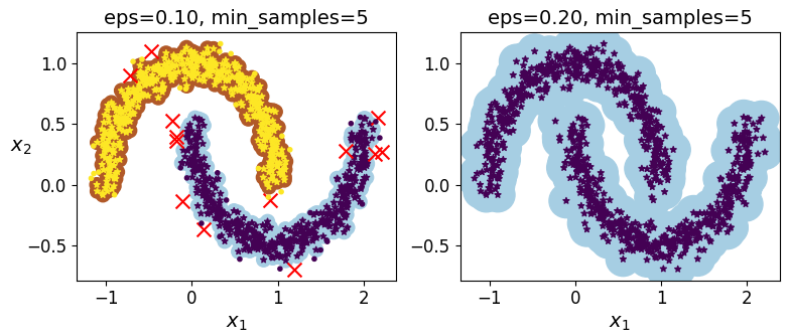

到这里机器学习聚类的内容就差不多结束了，后续如果有补充会再添加。。。 
