#  前言：

本篇文章是为后续更进一步学习经典神经网络，以及更先进的技术筑基，一定要牢牢掌握，年薪百万不是梦！！ 

# 一、Dataset

```python
from torch.utils.data import Dataset
from PIL import Image
import os
import random
```


用torch.utils.data中的Dataset组件来实现图片数据集的的合并以及标记标签的功能

## 1.1 MyData类

这里需要我们自己来写一个MyData类用于初始化根目录，图片目录，并将他们拼接。以及实现取出单条数据和获取数据长度的方法

```python
class MyData(Dataset):
    def __init__(self,root_dir,label_dir):
        """
        获取根目录和标签目录图片地址
        将他们拼接后输出成图片相对路径地址列表
        """
        self.root_dir = root_dir
        self.label_dir = label_dir
        self.path = os.path.join(self.root_dir,self.label_dir)
        # os.listdir将path下面的图片文件名制作成一个列表
        self.img_path = os.listdir(self.path)
        random.shullfe(self.img_path)

    def __getitem__(self, index):
        """
        获取单个图片以及对应的标签
        """
        # 获取img_name列表中的index所对应的图片文件名
        img_name = self.img_path[index]
        # 拼接成最后图片的绝对路径地址
        img_item_path = os.path.join(self.path,img_name)
        print(self.img_path)
        img = Image.open(img_item_path)
        label = self.label_dir
        return img,img_name,label
    
    def __len__(self):
        """
        返回对应数据集文件长度
        """
        return len(self.img_path)
    
root_dir = r"data\hymenoptera_data\train"
label_dir = r"ants"
# 实例化类
ants_dataset = MyData(root_dir,label_dir)
# 返回第一个图片数据标签
img,img_name,label = ants_dataset[1]
print(label)
img
```


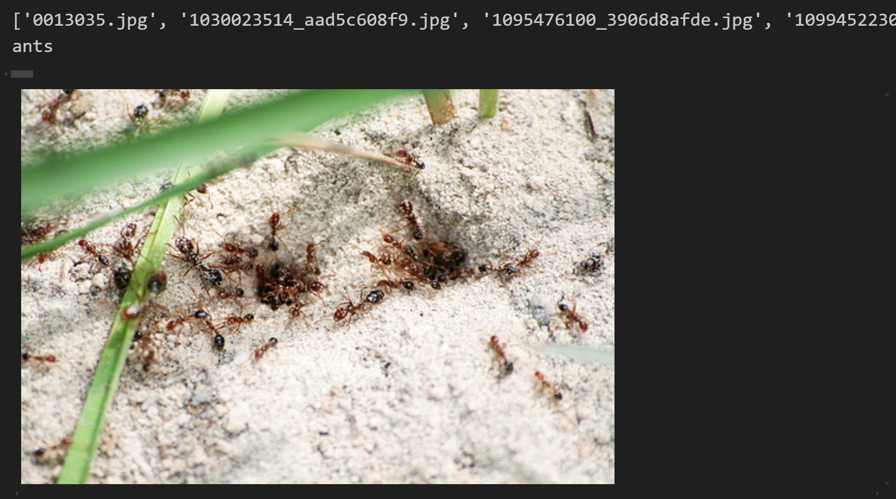

## 1.2 实例化 

接下来是实例化蚂蚁和蜜蜂两个数据集类，并且将他们相加，这里需要MyData继承Dataset才能相加成功，因为前面定义的类中有一步random.shullfe(self.img_path)操作，因此相加后两个数据集中的数据是相互交叉的，这一点比较好

实例化蚂蚁类

```python
root_dir = r"data\hymenoptera_data\train"
ants_dir = r"ants"
# 实例化蚂蚁类
ants_dataset = MyData(root_dir,ants_dir)
# 返回第一个图片数据标签
img,img_name,label = ants_dataset[1]
print(label)
img
```


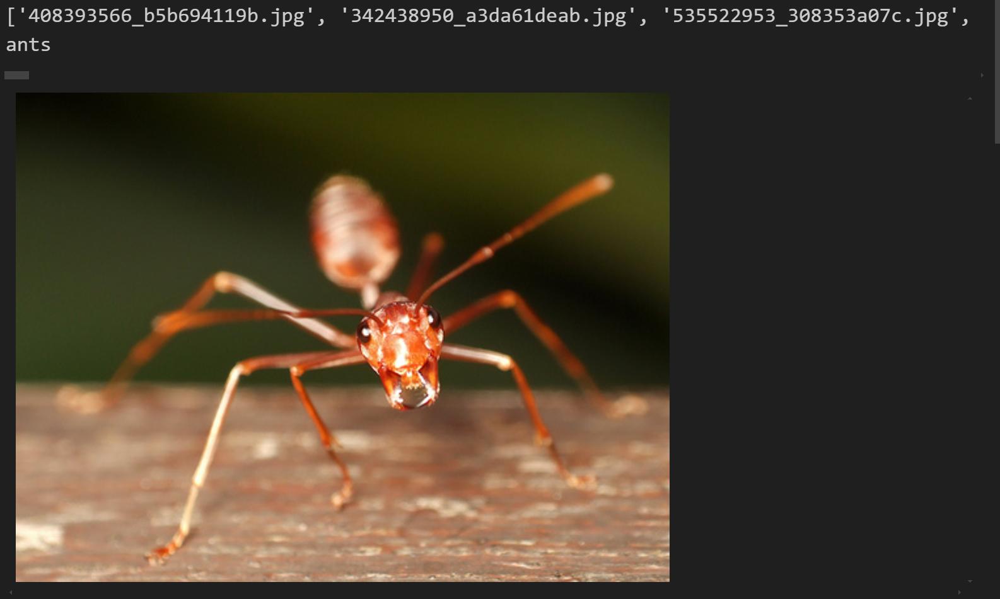

实例化蜜蜂类

```python
root_dir = r"data\hymenoptera_data\train"
bees_dir = r"bees"
# 实例化蜜蜂类
bees_dataset = MyData(root_dir,bees_dir)
# 返回第一个图片数据标签
img,img_name,label = bees_dataset[1]
print(img_name)
print(label)
img
```


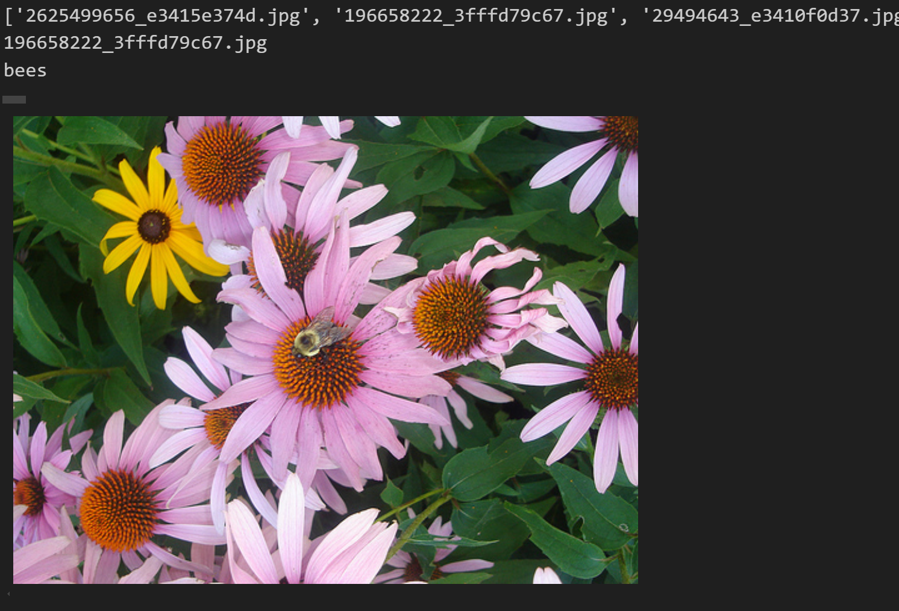

## 1.3 制作训练集类

将两个类合并成一个类，即我们的训练集类

```python
train_dataset = ants_dataset+bees_dataset
print(len(train_dataset))
```


245

将数据集中每张图片的类别标签写入对应的`.txt`文件，文件名与图片名一致。这种做法在机器学习中非常实用，可用于数据标注、管理、清洗、模型训练与评估等环节。

```python
# 创建一个目录用于存放生成的txt文件
output_dir = "data/train_files"
os.makedirs(output_dir, exist_ok=True)  # 如果目录不存在则创建

# 遍历数据集
for img,img_name,label in train_dataset:
    # 获取图片的文件名（不包含扩展名".jpg"）
    file_name = os.path.splitext(os.path.basename(img_name))[0]
    print(file_name)
    # 创建对应的txt文件路径
    txt_file_path = os.path.join(output_dir, f"{file_name}.txt")
    
    # 将类别标签写入txt文件
    with open(txt_file_path, "w") as f:
        f.write(str(label))

print("所有txt文件已生成，每个文件名对应图片文件名，文件内容为图片的类别。")
```


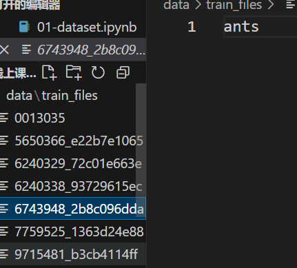

# 二、TensorBoard

```python
from torch.utils.tensorboard import SummaryWriter  
import numpy as np
from PIL import Image
```


TensorBoard 是 TensorFlow 提供的一个可视化工具，用于帮助开发者更好地理解和调试机器学习模型的训练过程。它可以可视化各种指标（如损失函数、准确率等）、模型结构、梯度信息等

##  2.1 add_scalar

该函数用于将标量值（如损失值、准确率等标量数据）记录到 TensorBoard 中，方便在训练过程中可视化这些标量值的变化，下面仅展示一个比较简单的对数函数示例

```python
writer = SummaryWriter("log")
for i in range(1,100):
  y = np.log2(i)
  writer.add_scalar("y = log2(x)",i,y)
writer.close()
```


执行程序后会在同级目录下创建一个“log”文件夹，里面记录了程序日志文件，打开终端，输入

```python
tensorboard --logdir="log" --port=6007
```


点击跳转出来的网址就可以看到日志情况

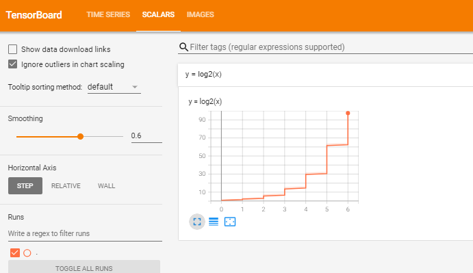

## 2.2 add_images

用于将图像数据批量记录到 TensorBoard 中，方便在训练过程中可视化图像的变化。这在处理图像数据（如计算机视觉任务）时非常有用，例如可视化输入图像、生成的图像、特征图等。 下面仅仅展示向日志中传入一张图片。

```python
# 创建一个 SummaryWriter 对象，指定日志文件夹路径为 "logs"
writer = SummaryWriter("logs")

image_path = r"data\hymenoptera_data\train\bees\21399619_3e61e5bb6f.jpg"

# 使用 PIL 的 Image.open 方法打开图像文件，返回一个 PIL 图像对象
img_PIL = Image.open(image_path)

# 将 PIL 图像对象转换为 numpy 数组，方便后续处理
img_array = np.array(img_PIL)

# 打印图像数组的形状，通常为 (H, W, C)，其中 H 是高度，W 是宽度，C 是通道数
print(img_array.shape)

# 使用 writer 的 add_image 方法将图像写入 TensorBoard 日志
# 参数说明：
# "ants" 是图像的标签，用于在 TensorBoard 中标识图像
# img_array 是图像数据
# 1 是全局步数（global step），用于记录图像的版本
# dataformats='HWC' 指定图像数据的格式为高度、宽度、通道
writer.add_image("ants", img_array, 1, dataformats='HWC')

# 关闭 SummaryWriter，确保所有数据都已写入日志文件
writer.close()
```


查看日志：

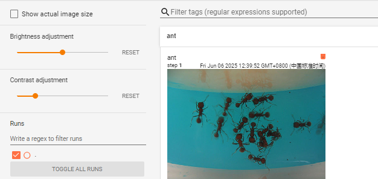

add_images 方法的输入必须是一个 4 维张量，形状为 (batch_size, channels, height, width)。

channels 必须是 3 或 1，因为 TensorBoard 只支持单通道（灰度图）或多通道（RGB 图）的图像

# 三、transformer

```python
from torchvision import transforms
from PIL import Image
import numpy as np
```


`torchvision.transforms` 提供了许多用于图像预处理和数据增强的工具。这些工具可以帮助我们对图像数据进行各种操作，从而提高模型的泛化能力和训练效果。以下是`torchvision.transforms` 中一些常用的功能和类的介绍

**先实例化调用一个Transforms方法，再用这个方法去对图片或者数组进行对应操作**

## 3.1 ToTensor张量化

将输入的 PIL 图像或 NumPy 数组转换为 PyTorch 张量。并将像素值从 [0, 255] 归一化到 [0.0, 1.0]输出。

```python
img = Image.open(r"data\hymenoptera_data\train\ants\5650366_e22b7e1065.jpg")
```


```python
trans_totensor = transforms.ToTensor()
img = Image.open(img_path)
img_tensor = trans_totensor(img)
img_tensor
```


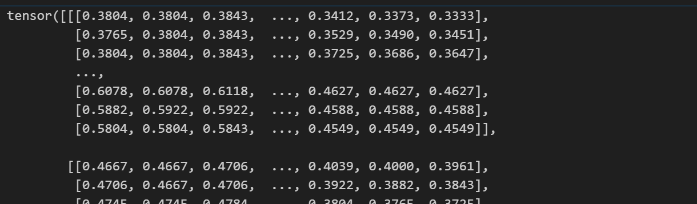

##  3.2 Normalize归一化

这里是对图像的三个通道分别进行标准化，因此均值和方差要设置三个

 [0.5, 0.5, 0.5] 表示对 RGB 三个通道分别使用均值 0.5 和标准差 0.5 进行归一化

```python
trans_norm = transforms.Normalize([0.5,0.5,0.5],[0.5,0.5,0.5])
img_norm = trans_norm(img_tensor)
img_norm
```


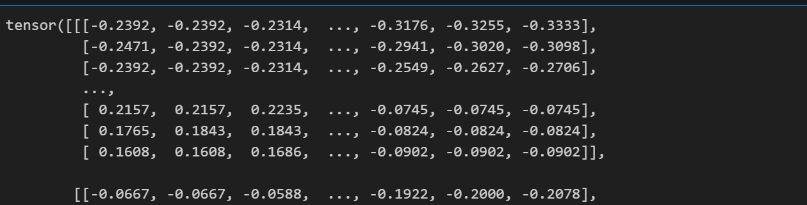

## 3.3 Resize 

参数（512,512）表示不考虑纵横比，强制将图片设置成512×512大小

```python
trans_resize = transforms.Resize((512,512))
img_resize = trans_resize(img_norm)
print(img_norm.shape)
print(img_resize.shape)
```


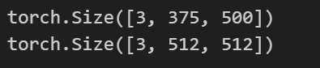

仅有一个512参数表示将图像的较短边调整为 512 像素，而较长边会按比例缩放，以保持图像的宽高比

```python
trans_resize = transforms.Resize(512)
img_resize = trans_resize(img_norm)
print(img_norm.shape)
print(img_resize.shape)
```


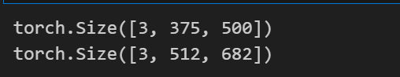

## 3.4 Compose 

用于将多个图像预处理操作组合成一个完整的流程

例如它可以将图像先进行缩放（trans_resize_2），然后转换为张量（trans_totensor）

列表中前一个输出是后一个输入

```python
trans_compose = transforms.Compose([trans_resize_2,trans_totensor])
img_resize_2 = trans_compose(img)
```


##  3.5 RandomCrop随机裁剪

通过从原始图像中随机选择一个区域并裁剪出来，从而生成一个新的图像。这种方法可以增加数据的多样性，有助于提高模型的泛化能力 

```python
trans_crop = transforms.RandomCrop(300)
img_crop = trans_crop(img_resize)
print(img_resize.shape)
print(img_crop.shape)
```


 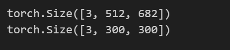

#  四、 torchvision.datasets

这个模块提供了许多常用的数据集，方便用户快速加载和使用这些数据集进行深度学习模型的训练和测试

```python
import torchvision
from torchvision import transforms
```


## 4.1下载torchvision中的数据集

```python
train_set = torchvision.datasets.CIFAR10(root="data",train=True,download=True)
test_set = torchvision.datasets.CIFAR10(root="data",train=False,download=True)
```


## 4.2取出一张图片以及它对应的标签

```python
img,target = test_set[1]
print(img)
print(target)
print(test_set.classes[target])
img.show()
```


<PIL.Image.Image image mode=RGB size=32x32 at 0x1C0E6F2CAC0>
 8
 ship

## 4.3 将图片转换成tensor类型并归一化输出

```python
dataset_transform = transforms.Compose([
    transforms.ToTensor(),
    transforms.Normalize([0.5,0.5,0.5],[0.5,0.5,0.5]),
    transforms.Resize((512,512))
])
# transform=dataset_transform：指定对数据集中的图像应用的预处理操作
train_set = torchvision.datasets.CIFAR10(root="data",train=True,transform=dataset_transform,download=True)
test_set = torchvision.datasets.CIFAR10(root="data",train=False,transform=dataset_transform,download=True)
test_set[0]
```


# 五、DataLoader

`DataLoader` 的主要作用是将数据集（如 `torchvision.datasets` 中的数据集或自定义的数据集）封装成一个可迭代的对象，方便在训练和测试过程中逐批次地获取数据

```python
import torchvision
from torch.utils.data import DataLoader
```


## 5.1 加载数据并转换成张量

```python
test_set = torchvision.datasets.CIFAR10(root="data",train=False,transform=torchvision.transforms.ToTensor())
```


## 5.2 加载每一批次数据

```python
step = 0
for data in test_loader:
    img,target = data
    print(img)
    print(target)
    step += 1
```


# 六、nn_module

```python
from torch import nn
import torch
```


这个部分主要讲怎么来搭建一个基础的神经网络 ，以及如何使用更加便捷的代码表示，并且使用tensorboard可视化神经网络

## 6.1 卷积神经网络骨架

```python
class Network(nn.Module):
    def __init__(self, *args, **kwargs):
        super().__init__(*args, **kwargs)

    def forward(self,input):
        output = input + 1
        return output
    
network = Network()
x = torch.tensor([10])
re = network(x)
re
```


## 6.2 卷积层

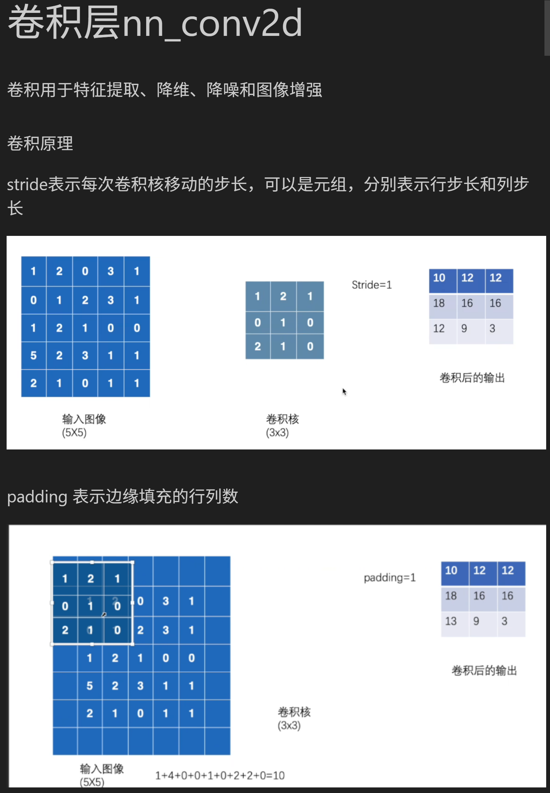

注意：

- 一维卷积的输入数据是 3 维的。
- 二维卷积的输入数据是 4 维的。
- 三维卷积的输入数据是 5 维的。

 对于常用的图片二位卷积，对应的4维数据为(BatchSize,Channels,Height,Width)，dataloader里加载的数据也是4维

**首先创建输入数据和卷积核**

```python
# 创建一个形状为 (3, 4) 的随机整数张量
torch.manual_seed(42) 
input = torch.randint(0, 10, (5, 5))  # 随机生成 0 到 9 之间的整数
print("input tensor:")
print(input)
print("-"*50)

kernel = torch.tensor([[1,2,1],
                       [0,1,0],
                       [2,1,0]])
print("kernel tensor:")
print(kernel)
print("-"*50)


input = torch.reshape(input,(1,1,5,5))
kernel = torch.reshape(kernel,(1,1,3,3))
print("input tensor_resize:")
print(input)
print("kernel tensor_resize:")
print(kernel)
print("-"*50)
```


input tensor:
 tensor([[2, 7, 6, 4, 6],
     [5, 0, 4, 0, 3],
     [8, 4, 0, 4, 1],
     [2, 5, 5, 7, 6],
     [9, 6, 3, 1, 9]])
 \--------------------------------------------------
 kernel tensor:
 tensor([[1, 2, 1],
     [0, 1, 0],
     [2, 1, 0]])
 \--------------------------------------------------
 input tensor_resize:
 tensor([[[[2, 7, 6, 4, 6],
      [5, 0, 4, 0, 3],
      [8, 4, 0, 4, 1],
      [2, 5, 5, 7, 6],
      [9, 6, 3, 1, 9]]]])
 kernel tensor_resize:
 tensor([[[[1, 2, 1],
      [0, 1, 0],
      [2, 1, 0]]]])
 \--------------------------------------------------

 **进行卷积操作**

```python
output_1 = F.conv2d(input,kernel,stride=1)
print("output tensor of 1step:")
print(output_1)
print("-"*50)
```


output tensor of 1step:
 tensor([[[[42, 35, 24],
      [22, 23, 28],
      [45, 28, 23]]]])
 \--------------------------------------------------

可以通过控制stride和padding的参数来控制步长和填充值

**一个很重要的计算卷积神经网络参数的公式，这个公式可以计算卷积层的输入输出维度，以及步长和填充值，也可以迁移到池化层，也可以倒推卷积核维度**

## 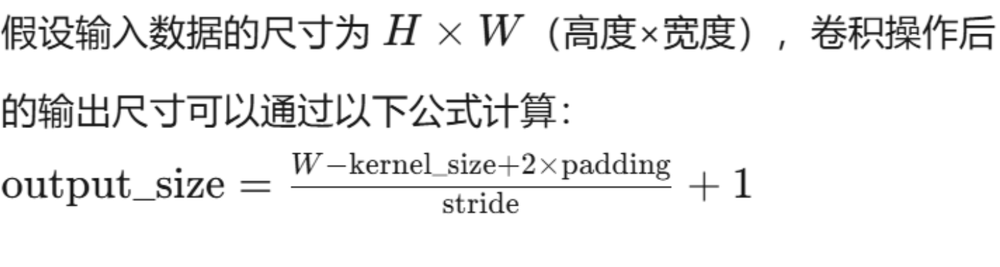 6.3 池化层

**卷积核用于增加通道数，池化层用于缩小特征图**

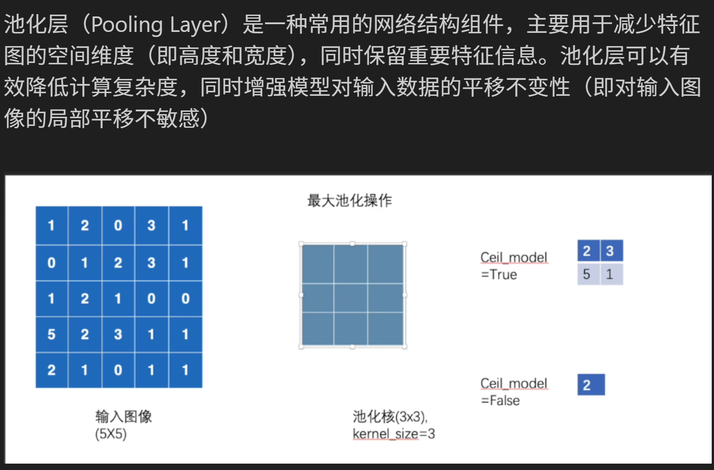

 **定义池化层：**

```python
self.maxpool1 = nn.MaxPool2d(kernel_size=3,ceil_mode=True)
```


## 6.4 非线性激活


**更具实际情况二者选其一** 

```python
self.relu1 = nn.ReLU()

self.sigmoid = nn.Sigmoid()
```


##  6.5 线性层

也称为全连接层，用于创建神经元以及最后输出预测结果

```python
self.linear1 = nn.Linear(196608,10)
```


## 6.6 nn_Sequential

用于按顺序堆叠多个神经网络层。它会自动将输入数据依次传递给每个层，并返回最终的输出,

**实际上就是简化神经网络搭建流程，特别是在前向传播forward()阶段**

```python
class Network(nn.Module):
    def __init__(self, *args, **kwargs):
        super().__init__(*args, **kwargs)
        # self.conv1 = Conv2d(3,32,5,padding=2)# 这里需要通过公式倒推padding的值
        # self.maxpool1 = MaxPool2d(2)
        # self.conv2 = Conv2d(32,32,5,padding=2)
        # self.maxpool2 = MaxPool2d(2)
        # self.conv3 = Conv2d(32,64,5,padding=2)
        # self.maxpool3 = MaxPool2d(2)
        # # 展平数据
        # self.flatten = Flatten()
        # # # 线性层（图中笔添加部分）,具体输入数字由Flatten输出size可以得知
        # self.linear1 = Linear(1024,64)
        # self.linear2 = Linear(64,10)

        # 比起前面更简便的搭建方法
        self.model1 = Sequential(
            Conv2d(3,32,5,padding=2),
            MaxPool2d(2),# 步长默认与池化窗口大小一致，stride = 2，填充默认为1
            Conv2d(32,32,5,padding=2),
            MaxPool2d(2),
            Conv2d(32,64,5,padding=2),
            MaxPool2d(2),
            Flatten(),
            Linear(1024,64),
            Linear(64,10)
        )

    def forward(self,x):
        # x = self.conv1(x)
        # x = self.maxpool1(x)
        # x = self.conv2(x)
        # x = self.maxpool2(x)
        # x = self.conv3(x)
        # x = self.maxpool3(x)
        # x = self.flatten(x)
        # x = self.linear1(x)
        # x = self.linear2(x)
        # 代码简洁很多
        x = self.model1(x)
        return x
network = Network()
print(network)
```


如果想要在原有模型上添加层，可以使用以下代码来进行添加

```python
network.add_module(“model2”,Linear(10,5))
```


## 6.7 可视化搭建流程

可以直观地在里面看到神经网络中一系列内容

```python
writer = SummaryWriter("logs")
writer.add_graph(network,input,verbose=True)
writer.close()
```


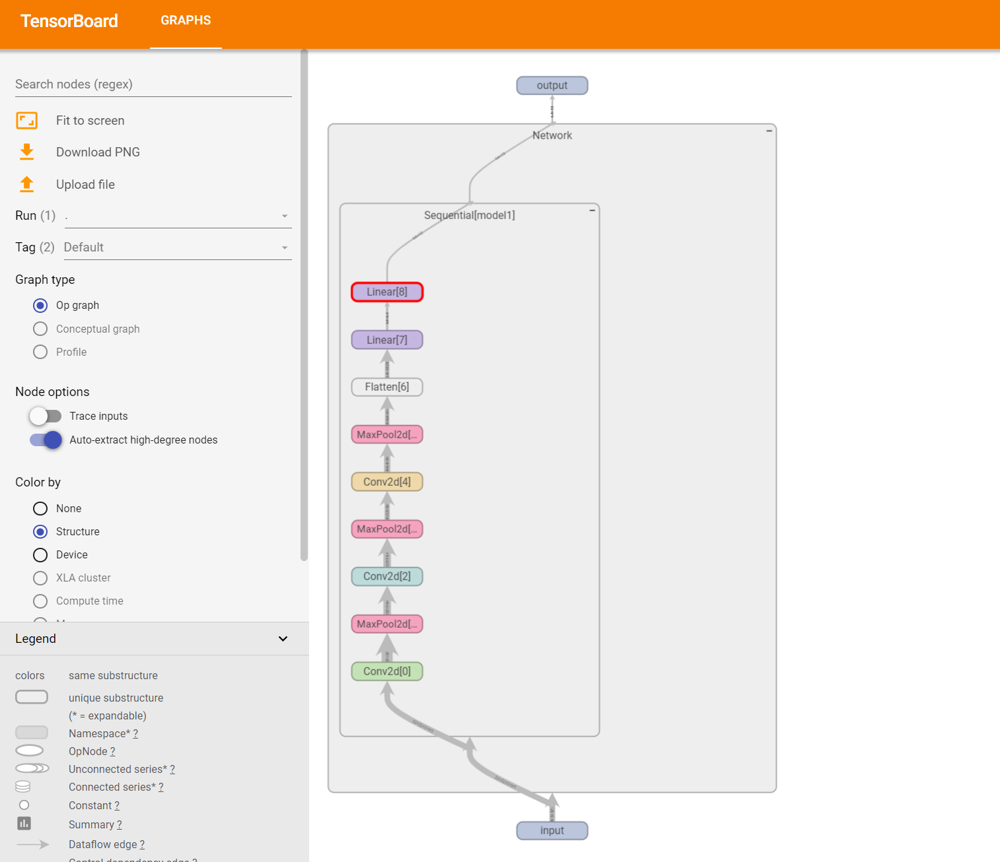

**经过输入层，隐藏层，全连接层过后，输入的 (64,3,32,32)形状数据输出为（64,10），即代表1个bath_size中64条数据在10个类别中的概率值**

#  七、loss_function

```python
import torch
from torch.nn import L1Loss,MSELoss,CrossEntropyLoss
from torch.nn import Conv2d,MaxPool2d,Flatten,Linear,Sequential
from torch import nn
import torchvision
from  torch.utils.data import DataLoader
from torch import nn,optim
from tqdm import tqdm
import matplotlib.pyplot as plt
```


经过神经网络计算的结果可以使用torch框架下的损失函数来计算损失值，并且可以由此使用梯度下降来优化模型

## 7.1 L1Loss和MSELoss

适用于回归任务的损失计算，这里给出一个小的示例

```python
input = torch.tensor([1,2,3],dtype=torch.float32)
target = torch.tensor([1,2,5],dtype=torch.float32)

input = torch.reshape(input,(1,1,1,3))
target = torch.reshape(target,(1,1,1,3))

loss1 = L1Loss(reduction="sum")
result1 = loss1(input,target)
print(result1)

loss2 = MSELoss()
result2 = loss2(input,target)
print(result2)
```


tensor(2.)
 tensor(1.3333)

## 7.2 交叉熵CrossEntropyLoss

CrossEntropyLoss 的输入要求是二维张量，形状为 [batch_size, num_classes],每一行表示一个样本的类别得分。

```python
x = torch.tensor([0.1, 0.2, 0.3])
y = torch.tensor([1])

# 将 x 重塑为形状为 [1, 3] 的张量，以符合 CrossEntropyLoss 的输入要求
x = torch.reshape(x, (1, 3))

loss_cross = CrossEntropyLoss()
result3 = loss_cross(x, y)
print(result3)
```


tensor(1.1019)

## 7.3 综合示例

接下来对之前介绍的神经网络框架的搭建进行一个实战，我们来实现这个网络，具体参数计算这里不进行叙述

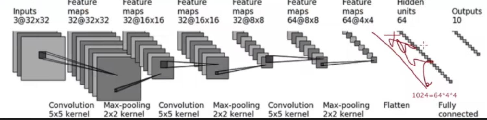


```python
class Network(nn.Module):
    def __init__(self, *args, **kwargs):
        super().__init__(*args, **kwargs)
        # 搭建一个神经网络
        self.model1 = Sequential(
            Conv2d(3,32,5,padding=2),
            MaxPool2d(2),
            Conv2d(32,32,5,padding=2),
            MaxPool2d(2),
            Conv2d(32,64,5,padding=2),
            MaxPool2d(2),
            Flatten(),
            Linear(1024,64),
            Linear(64,10)
        )

    def forward(self,x):
        x = self.model1(x)
        return x
```


使用该网络背景下的数据来进行训练

```python
# 加载 CIFAR-10 数据集（训练集）
transform = transforms.Compose(
[   transforms.ToTensor(),
    transforms.Resize((32,32)),
    transforms.Normalize([0.5,0.5,0.5],[0.5,0.5,0.5])]
)
dataset = torchvision.datasets.CIFAR10(root="data", download=True, train=True, transform=transform)

# 创建 DataLoader，用于批量加载数据
dataloader = DataLoader(dataset, batch_size=64)

# 定义网络模型
network = Network()

# 添加损失函数，使用交叉熵损失
loss_cross = CrossEntropyLoss()

# 选择优化器，使用随机梯度下降（SGD）优化器
optim = optim.SGD(network.parameters(), lr=0.01)

# 定义训练轮数
steps = 5  # 训练轮数

# 用于记录每个轮次的平均损失值
losses = []

# 开始训练过程
for step in tqdm(range(steps), desc="Training Progress", unit="epoch"):
    running_loss = 0.0  # 用于记录每个轮次的累计损失值

    # 遍历 DataLoader 中的每个批次数据
    for data in dataloader:
        # 解包数据，img 是输入图像，target 是对应的标签
        img, target = data

        # 将输入图像通过网络模型，得到输出
        output = network(img)

        # 使用交叉熵损失函数计算损失值
        result_loss = loss_cross(output, target)

        # 将优化器的梯度参数清零，避免梯度累加
        optim.zero_grad()

        # 进行反向传播，计算损失函数相对于模型参数的梯度
        result_loss.backward()

        # 根据计算得到的梯度，更新模型参数
        optim.step()

        # 累加当前批次的损失值
        running_loss += result_loss.item()

    # 计算当前轮次的平均损失值
    avg_loss = running_loss / len(dataloader)
    losses.append(avg_loss)  # 记录平均损失值

    # 动态输出当前轮次的平均损失值
    tqdm.write(f"Step {step + 1}/{steps}, Running Loss: {avg_loss:.4f}")
    break

# 可视化损失值变化曲线
plt.plot(range(1, steps + 1), losses, marker='o')
plt.title("Training Loss Over Epochs")
plt.xlabel("Epochs")
plt.ylabel("Loss")
plt.grid(True)
plt.show()
```


CPU训练比较缓慢，可以用Google cloud上的算力资源提速

# 八、pre_models

```python
import torchvision
import torch
import torchvision.models as models
from torchvision.models import VGG16_Weights
```


## 8.1 加载模型 

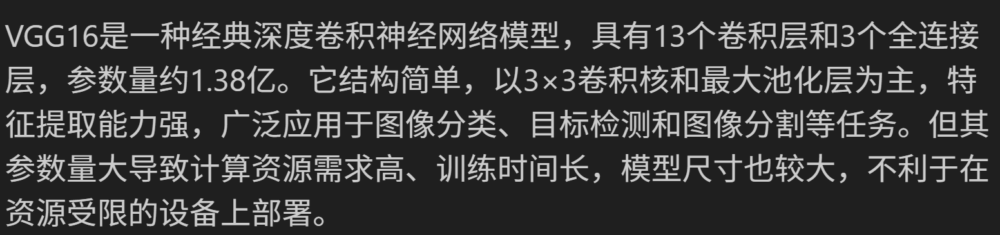

在神经网络框架中，我们可以下载已经搭建好的网络来进行训练，必要时可以进行微调，既神经网络层的添加和删除

```python
torch.hub.set_dir("models")
# 加载不带预训练权重的 VGG16 模型
vgg16_without_weights = models.vgg16(weights=None)

# 加载带有预训练权重的 VGG16 模型
vgg16_with_weights = models.vgg16(weights=VGG16_Weights.DEFAULT)
```


## 8.2 在原有vgg16模型上添加或修改

`vgg16_with_weights.classifier.add_module` 是**将新层添加到 VGG16 模型的 `classifier` 部分**，前向传播时，输入数据会先通过 `features` 部分（卷积层），然后通过 `classifier` 中的所有层，包括新添加的层。输出结果是新层的输出

而 `vgg16_with_weights.add_module` 是**将新层添加到整个模型的末尾**。前者使新层成为 `classifier` 的一部分，后者则使新层成为整个模型的最后一个层。前向传播时，输入数据会先通过 `features` 部分，然后通过 `classifier`，最后通过新添加的层。输出结果是新层的输出，但新层的输入是 `classifier` 的输出。

```python
vgg16_with_weights.add_module("add_model",nn.Linear(1000,10))
vgg16_with_weights
```


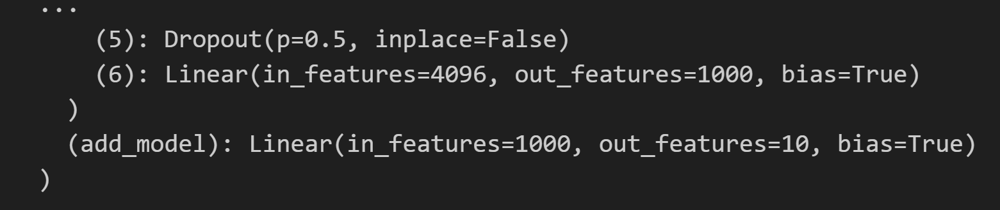

```python
vgg16_with_weights.classifier.add_module("add_model",nn.Linear(1000,10))
vgg16_with_weights
```


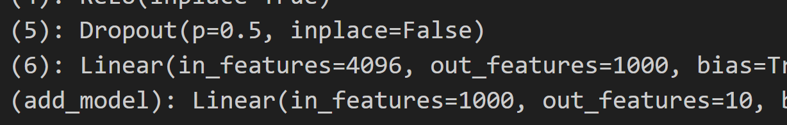

**虽然两种方式都会将新层添加到模型中，但它们在模型中的位置不同，导致前向传播的顺序和最终输出结果不同** 

# 九、save_load

```python
import torchvision
import torch
import torchvision.models as models
from torchvision.models import VGG16_Weights
```


## 9.1 保存模型

```python
vgg16 = torchvision.models.vgg16(weights=VGG16_Weights.DEFAULT)
torch.save(vgg16,"vgg16_metnod1.pth")
```


## 9.2 调用模型

```python
model1 = torch.load(r"models\checkpoints\vgg16-397923af.pth")
print(model1)#打印参数
```


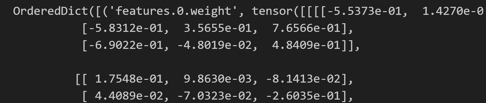
