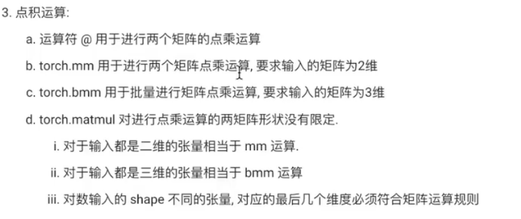
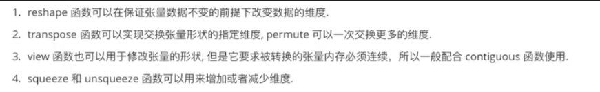
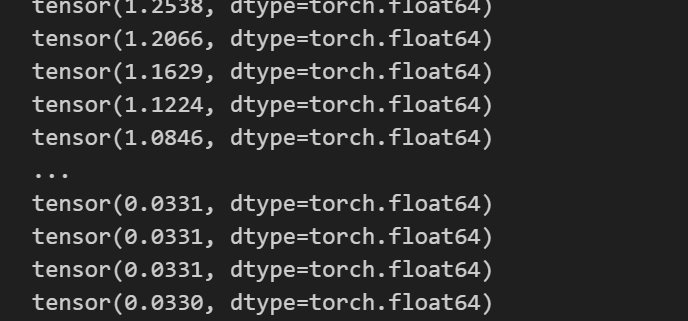
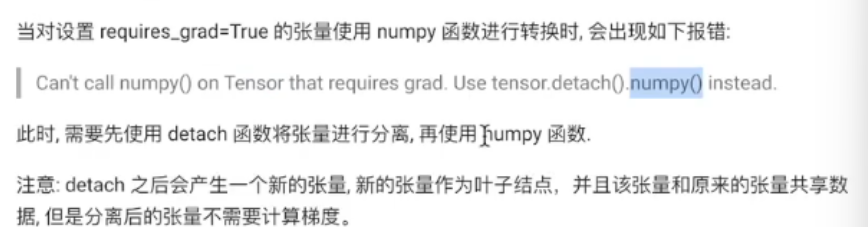
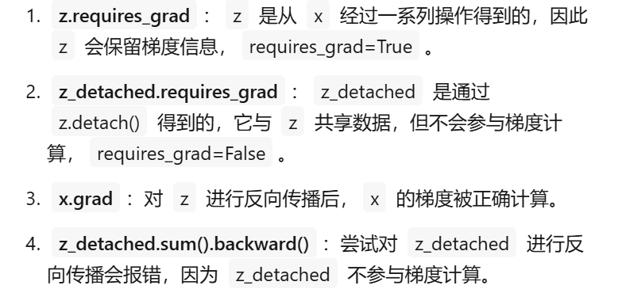
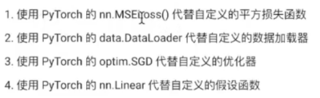
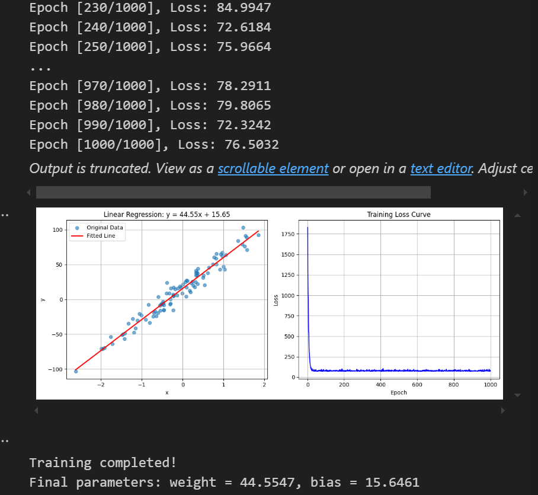

#  前言：

​    **此篇主要涉及pytorch的入门内容，主要是张量的基础操作以及使用pytorch进行反向传播，最后还简要介绍了pytorch的一系列常用的基础组件，以便对后续更深层次的学习任务奠定基础。**

# 一、创建张量

## 1.1 简单张量

**根据已有数据创建张量,torch.tensor默认数字类型是float32**

```python
def test0():
    # 创建标量
    data = torch.tensor(10)
    print(data)

    # 使用numpy数组创建张量
    data = np.random.randn(2,3)
    data = torch.tensor(data)
    print(data)

    # 使用列表创建多维张量
    data = [[[i for i in range(10)],[j for j in range(10,20)]]]
    data = torch.tensor(data)
    print(data)
test0()
```


tensor(10)
 tensor([[ 0.5558,  0.0213,  0.4975],
     [ 0.1977,  2.0550, -0.3598]], dtype=torch.float64)
 tensor([[[ 0,  1,  2,  3,  4,  5,  6,  7,  8,  9],
      [10, 11, 12, 13, 14, 15, 16, 17, 18, 19]]])

**创建指定形状张量**

```python
def test1():
    # 创建两行三列张量
    data = torch.Tensor(2,3)
    print(data)
    # 创建指定值张量
    data = torch.Tensor([2,3])
    print(data)

test1()
```


tensor([[1., 1., 1.],
     [1., 1., 1.]])
 tensor([2., 3.])

**创建指定类型张量,传递数据如果不匹配会发生类型转换**

```python
def test2():
    # 创建int类型张量
    data = torch.IntTensor(2,3)
    print(data)
    
    # 创建float类型张量
    data = torch.FloatTensor(2,3)
    print(data)


test2()
```


tensor([[772014944,    1301,     0],
     [     0,     0,     0]], dtype=torch.int32)
 tensor([[0., 0., 0.],
     [0., 0., 0.]])

## 1.2 线性张量和随机张量

**创建线性张量**

```python
def test3():
    # 创建指定步长张量
    # arange(start,end,步长)
    data = torch.arange(0,10,2)
    data = torch.Tensor(data)
    print(data)
    # 指定区间指定元素个数
    # linspace(start,end,元素个数)
    data = torch.linspace(0,10,100)
    data = torch.Tensor(data)
    print(data)
test3()
```


tensor([0, 2, 4, 6, 8])
 tensor([ 0.0000,  0.1010,  0.2020,  0.3030,  0.4040,  0.5051,  0.6061,  0.7071,
      0.8081,  0.9091,  1.0101,  1.1111,  1.2121,  1.3131,  1.4141,  1.5152,
      1.6162,  1.7172,  1.8182,  1.9192,  2.0202,  2.1212,  2.2222,  2.3232,
      2.4242,  2.5253,  2.6263,  2.7273,  2.8283,  2.9293,  3.0303,  3.1313,
      3.2323,  3.3333,  3.4343,  3.5354,  3.6364,  3.7374,  3.8384,  3.9394,
      4.0404,  4.1414,  4.2424,  4.3434,  4.4444,  4.5455,  4.6465,  4.7475,
      4.8485,  4.9495,  5.0505,  5.1515,  5.2525,  5.3535,  5.4545,  5.5556,
      5.6566,  5.7576,  5.8586,  5.9596,  6.0606,  6.1616,  6.2626,  6.3636,
      6.4646,  6.5657,  6.6667,  6.7677,  6.8687,  6.9697,  7.0707,  7.1717,
      7.2727,  7.3737,  7.4747,  7.5758,  7.6768,  7.7778,  7.8788,  7.9798,
      8.0808,  8.1818,  8.2828,  8.3838,  8.4848,  8.5859,  8.6869,  8.7879,
      8.8889,  8.9899,  9.0909,  9.1919,  9.2929,  9.3939,  9.4949,  9.5960,
      9.6970,  9.7980,  9.8990, 10.0000])

**创建随机张量**

```python
def test4():
    # 随机种子
    torch.random.manual_seed(42)
    data = torch.randn(2,3)
    data = torch.Tensor(data)
    print(data)
test4()
```


tensor([[ 0.3367,  0.1288,  0.2345],
     [ 0.2303, -1.1229, -0.1863]])

## 1.3 指定值张量

```python
def test5():
    # 创建全为零的张量
    data = torch.zeros(2,3)
    print(data)
    # 根据其他张量的形状创建全0张量
    data1 = torch.zeros_like(data)
    print(data1)
    # 创建全为一的张量,ones_like同理
    data = torch.ones(2,3)
    print(data)
    # 创建指定值张量,torch.fill(形状，填充值),full_like同理
    data = torch.full([2,3],6)
    print(data)
test5()
```


tensor([[0., 0., 0.],
     [0., 0., 0.]])
 tensor([[0., 0., 0.],
     [0., 0., 0.]])
 tensor([[1., 1., 1.],
     [1., 1., 1.]])
 tensor([[6, 6, 6],
     [6, 6, 6]])

## 1.4 张量元素类型转换

```python
def test6():
    # type函数转换
    data = torch.full([2,3],6)
    print("转换前",data.dtype)
    # 会返回一个新类型的变量而不是直接修改原张量
    data1 = data.type(torch.FloatTensor)
    print("转换后",data1.dtype)

    # 使用具体类型函数转换
    data2 = data.float()
    print("转换后",data2.dtype)
test6()
```


转换前 torch.int64
 转换后 torch.float32
 转换后 torch.float32

# 二、数值计算

## 2.1 张量的基本运算

**加减乘除相反数**

```python
def test0():
    torch.random.manual_seed(40)
    # torch.randint(start,end,形状)
    data = torch.randint(0,10,[2,3])
    print(data)
    # 计算完成后会产生一个新的张量,满足计算广播机制
    # 加法
    tensor = torch.randint(0,10,[2,1])
    print(tensor)
    data_add = data.add(tensor)
    print("data_add",data_add)
    # 减法
    data_sub = data.sub(tensor)
    print("data_sub",data_sub)
    # 乘法
    data_mul = data.mul(data_sub)
    print("data_mul",data_mul)
    # 除法
    data_div = data.div(tensor)
    print("data_div",data_div)
    # 取相反数
    data_neg = data.neg()
    print("data_neg",data_neg)
test0()
```


tensor([[8, 3, 5],
     [7, 2, 4]])
 tensor([[6],
     [3]])
 data_add tensor([[14,  9, 11],
     [10,  5,  7]])
 data_sub tensor([[ 2, -3, -1],
     [ 4, -1,  1]])
 data_mul tensor([[16, -9, -5],
     [28, -2,  4]])
 data_div tensor([[1.3333, 0.5000, 0.8333],
     [2.3333, 0.6667, 1.3333]])
 data_neg tensor([[-8, -3, -5],

```python
def test2():
    # 使用mul函数
    data1 = torch.tensor([[1,2],[3,4]])
    data2 = torch.tensor([[5,6],[7,8]])
    data = data1.mul(data2)
    print(data)
    # 使用*
    data = data1*data2
    print(data)
test2()
```


     [-7, -2, -4]])

**修改原数据的运算，不需要额外变量来接收运算结果**

**直接在原有运算方法名后面加下划线**

```python
def test1():
    torch.random.manual_seed(40)
    data = torch.randint(0,10,[2,3])
    print(data)
    tensor = torch.randint(0,10,[2,1])
    print(tensor)
    data.add_(tensor)
    print("result",data)
test1()
```


tensor([[8, 3, 5],
     [7, 2, 4]])
 tensor([[6],
     [3]])
 result tensor([[14,  9, 11],
     [10,  5,  7]])

## 2.2 阿达玛积

**阿达玛积:张量对应位置元素相乘**

```python
def test2():
    # 使用mul函数
    data1 = torch.tensor([[1,2],[3,4]])
    data2 = torch.tensor([[5,6],[7,8]])
    data = data1.mul(data2)
    print(data)
    # 使用*
    data = data1*data2
    print(data)
test2()
```


tensor([[ 5, 12],
     [21, 32]])
 tensor([[ 5, 12],
     [21, 32]])

## 2.3 点积运算



```python
def test3():
    # 使用@运算符直接对两个二维矩阵进行计算
    data1 = torch.tensor([[1,2],[3,4],[5,6]])
    data2 = torch.tensor([[5,6],[7,8]])
    data = data1@data2
    print("@",data)

    # 使用mm函数，要求输入张量形状都是二维的
    data1 = torch.tensor([[1,2],[3,4],[5,6]])
    data2 = torch.tensor([[5,6],[7,8]])
    data = torch.mm(data1,data2)
    print("mm",data)

    # 使用bmm函数运算，要求输入数据必须是三维
    torch.random.manual_seed(40)
    # torch.randn(批次，行，列)
    data1 = torch.randn(3,4,5)
    print(data1)
    data2 = torch.randn(3,5,8)
    data = torch.bmm(data1,data2)
    print("bmm",data.shape)

    # 使用matmul函数
    data1 = torch.randn(4,5)
    data2 = torch.randn(5,6)
    data = torch.matmul(data1,data2)
    print("matmul1",data.shape)

    data1 = torch.randn(3,4,5)
    data2 = torch.randn(3,5,8)
    data = torch.matmul(data1,data2)
    print("matmul2",data.shape)
test3()
```


@ tensor([[19, 22],
     [43, 50],
     [67, 78]])
 mm tensor([[19, 22],
     [43, 50],
     [67, 78]])
 tensor([[[-0.2367,  1.8109,  0.1966, -0.7150,  0.1041],
      [ 0.8893, -0.4212, -0.5279,  0.9281,  0.8614],
      [-0.5856,  1.4157, -1.9983, -0.7397, -1.1917],
      [ 0.0635, -1.3966,  0.4813, -1.2866,  0.1643]],

​    [[ 0.4827,  0.4881, -1.8173,  1.0127,  1.3802],
​      [ 0.0903,  0.7811,  0.0891,  0.1531, -0.2344],
​      [ 0.0868, -1.5610, -0.5121, -0.9283,  1.0775],
​      [ 0.1593, -1.8646,  0.5430,  1.4348,  1.1829]],

​    [[-0.3522,  0.9055, -0.1248, -0.1938, -0.3097],
​      [-1.4255,  1.2274, -1.7690, -1.6122,  0.4332],
​      [ 1.6599,  1.6113,  0.1054,  0.1470,  1.1172],
​      [-0.2970, -0.1661, -0.8077, -0.0500,  0.1276]]])
 bmm torch.Size([3, 4, 8])
 matmul1 torch.Size([4, 6])
 matmul2 torch.Size([3, 4, 8])

# 三、 数值转换

## 3.1 tensor张量转numpy数组

**转换后的两个数据共享内存地址，可以使用copy()来区分开来**

```python
def test0():
    data_tensor = torch.tensor([1,2,3])
    # 将张量转换为numpy数组
    data_np = data_tensor.numpy()
    print(data_tensor,type(data_tensor))
    print(data_np,type(data_np))

    # 此时两个数据共享内存
    data_tensor[0] = 2
    print("修改tensor后")
    print(data_tensor)
    print(data_np)
    
    data_np[0] = 3
    print("修改numpy后")
    print(data_tensor)
    print(data_np)

    # 使用copy函数实现不共享内存
    data_tensor = torch.tensor([1,2,3])
    data_np = data_tensor.numpy().copy()
    data_tensor[0] = 2
    print("修改copy的tensor后")
    print(data_tensor)
    print(data_np)

    data_np[0] = 3
    print("修改copy的numpy后")
    print(data_tensor)
    print(data_np)

test0()
```


tensor([1, 2, 3]) <class 'torch.Tensor'>
 [1 2 3] <class 'numpy.ndarray'>
 修改tensor后
 tensor([2, 2, 3])
 [2 2 3]
 修改numpy后
 tensor([3, 2, 3])
 [3 2 3]
 修改copy的tensor后
 tensor([2, 2, 3])
 [1 2 3]
 修改copy的numpy后
 tensor([2, 2, 3])
 [3 2 3]

## 3.2 numpy数组转tensor张量

```python
def test1():
  data_numpy = np.array([2,3,4])
  # from_numpy函数,默认共享内存
  data_tensor1 = torch.from_numpy(data_numpy)
  # 设置不共享地址
  data_tensor_copy = torch.from_numpy(data_numpy.copy())
  print(data_tensor1)
  # 使用tensor，默认不共享内存
  data_tensor2 = torch.tensor(data_numpy)
  print(data_tensor2)


test1()
```


tensor([2, 3, 4])
 tensor([2, 3, 4])

## 3.3 标量张量和数字的转换

**使用item()提取数字，只适用于张量中只有一个元素的情况**

```python
def test2():
    data1 = torch.tensor(0)
    data2 = torch.tensor([10])
    data3 = torch.tensor([[20]])
    print(data1.shape,data2.shape,data3.shape)

    num1 = data1.item()
    num2 = data2.item()
    num3 = data3.item()
    print(num1,num2,num3)
test2()
```


torch.Size([]) torch.Size([1]) torch.Size([1, 1])
 0 10 20

# 四、拼接操作

## **4.1 torch.cat（连接操作）**

- 功能：沿指定维度连接多个张量，输入张量的形状（除拼接维度外）必须完全相同。
- 不新增维度，仅扩展现有维度的大小。
- 适用于需要合并数据但无需新增维度的场景（如拼接多个特征向量）。

```python
import torch
x = torch.randn(2, 3)
y = torch.randn(2, 3)
# 沿维度0拼接（行方向）
z_cat = torch.cat([x, y], dim=0)  # 输出形状：(4, 3)
```


## **4.2 torch.stack（堆叠操作）**

- 功能：在新创建的维度上堆叠多个张量，所有输入张量的形状必须完全一致。
- 新增一个维度，堆叠后的张量比输入张量多一维。
- 适用于需要创建批次维度或组合多个张量的场景（如创建图像批次）。

```python
# 相同输入张量x和y
z_stack = torch.stack([x, y], dim=0)  # 输出形状：(2, 2, 3)
```


**关键差异总结**

- **维度变化**：`cat`不新增维度，`stack`会新增一个维度。
- **输入要求**：`cat`允许拼接维度的大小不同（其他维度相同），`stack`要求所有维度完全一致。
- **典型用途**：`cat`用于合并数据序列，`stack`用于构建批次或组合张量。

# 五、索引操作

## 5.1 简单行列索引

```python
def test0():
    torch.random.manual_seed(42)
    data = torch.randint(0,10,(4,5))
    print(data)

    # 获得某行某列元素
    print(data[0])

    print(data[0,1])
    print(data[0][1])
    
    # 左行右列，左闭右开
    print(data[:3,2:3])
    print(data[:3][2:3])

test0()
```


 tensor([[2, 7, 6, 4, 6],
     [5, 0, 4, 0, 3],
     [8, 4, 0, 4, 1],
     [2, 5, 5, 7, 6]])
 tensor([2, 7, 6, 4, 6])
 tensor(7)
 tensor(7)
 tensor([[6],
     [4],
     [0]])
 tensor(7)

## 5.2 布尔索引

```python
def test1():
    torch.random.manual_seed(42)
    data = torch.randint(0,100,(4,5))
    print(data)

    # 获取所有大于30的元素
    print(data[data>30])

    # 获取第二列有元素大于20的行
    print(data[data[:,1]>=20])

test1()
```


tensor([[42, 67, 76, 14, 26],
     [35, 20, 24, 50, 13],
     [78, 14, 10, 54, 31],
     [72, 15, 95, 67,  6]])
 tensor([42, 67, 76, 35, 50, 78, 54, 31, 72, 95, 67])
 tensor([[42, 67, 76, 14, 26],
     [35, 20, 24, 50, 13]])

## 5.3 多维索引

```python
def test2():
    torch.random.manual_seed(42)
    data = torch.randint(0,100,(3,4,5))
    print(data)

    print(data[0,:,:])
    print(data[:,0,:])
    print(data[:,:,0])

test2()
```


tensor([[[42, 67, 76, 14, 26],
      [35, 20, 24, 50, 13],
      [78, 14, 10, 54, 31],
      [72, 15, 95, 67,  6]],

​    [[49, 76, 73, 11, 99],
​      [13, 41, 69, 87, 19],
​      [72, 80, 75, 29, 33],
​      [64, 39, 76, 32, 10]],

​    [[86, 22, 77, 19,  7],
​      [23, 43, 94, 93, 77],
​      [70,  9, 70, 39, 86],
​      [99, 15, 84, 78,  8]]])
 tensor([[42, 67, 76, 14, 26],
​     [35, 20, 24, 50, 13],
​     [78, 14, 10, 54, 31],
​     [72, 15, 95, 67,  6]])
 tensor([[42, 67, 76, 14, 26],
​     [49, 76, 73, 11, 99],
​     [86, 22, 77, 19,  7]])
 tensor([[42, 35, 78, 72],
​     [49, 13, 72, 64],
​     [86, 23, 70, 99]])

# 六、形状操作



## 6.1 reshape()函数

```python
def test0():
  torch.random.manual_seed(42)
  data = torch.randint(0,10,[4,5])
  print(data.shape)

  # 修改张量形状
  new_data = torch.reshape(data,[2,10])
  print(new_data.shape)

  # 使用-1自动匹配形状
  new_data = torch.reshape(data,[-1,20])
  print(new_data.shape)


test0()
```


torch.Size([4, 5])
 torch.Size([2, 10])
 torch.Size([1, 20])

## 6.2 transpose()函数和permute()函数

**transpose只是简单进行维度交换,一次只能交换两个维度,permute函数在transpose基础上可以一次交换多个维度**

```python
def test1():
    torch.random.manual_seed(42)
    data = torch.randint(0,10,[3,4,5])
    print(data.shape)
    print(data)
    print("-"*50)

    # reshape重新计算形状
    data_reshape = torch.reshape(data,[4,3,5])
    print(data_reshape.shape)
    print(data_reshape)
    print("-"*50)

    data_transpose = torch.transpose(data,0,1)
    print(data_transpose.shape)
    print(data_transpose)
    print("-"*50)

    data_permute = torch.permute(data,(2,0,1))
    print(data_permute.shape)
    print(data_permute)

test1()
```


## 6.3 view()函数和contigous()函数

```python
def test1():
    # view函数的使用
    data = torch.tensor([[10,20,30],[40,50,60]])
    data_view = data.view(3,2)
    print(data_view.shape)

    # 使用is_contigous判断张量是否是连续的内存空间
    print(data.is_contiguous())

    # 如果不是连续的内存空间，不可以使用view来更改维度
    data_transpose = torch.transpose(data,0,1)
    print(data_transpose.is_contiguous())# 非连续
    # print(data_transpose.view(2,3))# 非连续地址，报错

    # 使用contiguous()将非连续内存改为连续内存
    print(data_transpose.contiguous().view(2,3))

test1()
```


torch.Size([3, 2])
 True
 False
 tensor([[10, 40, 20],
     [50, 30, 60]])

## 6.4 squeeze()函数和unsqueeze()函数

```python
def test2():
    # squeeze函数降维，去除数据中的1维度
    data = torch.randint(1,10,[1,3,1,5])
    print(data.shape)
    print(data)
    data_squ = data.squeeze()
    print(data_squ.shape)
    print(data_squ)

    # 制定去除第二个1的维度
    data_squ_1 = data.squeeze(2)
    print(data_squ_1.shape)
    print(data_squ_1)

    print("-"*50)

    # unsqueeze函数升维
    data = torch.randint(1,10,[3,4,5])
    print(data.shape)
    # 参数表示升维的位置
    data_unsqu = data.unsqueeze(-1)
    print(data_unsqu.shape)
    

test2()
```


torch.Size([1, 3, 1, 5])
 tensor([[[[3, 4, 3, 8, 1]],

​     [[6, 7, 2, 8, 8]],

​     [[9, 1, 8, 8, 8]]]])
 torch.Size([3, 5])
 tensor([[3, 4, 3, 8, 1],
​     [6, 7, 2, 8, 8],
​     [9, 1, 8, 8, 8]])
 torch.Size([1, 3, 5])
 tensor([[[3, 4, 3, 8, 1],
​      [6, 7, 2, 8, 8],
​      [9, 1, 8, 8, 8]]])
 \--------------------------------------------------
 torch.Size([3, 4, 5])
 torch.Size([3, 4, 5, 1])

# 七、运算函数

**运算规则和numpy类似**

```python
def test0():
    torch.random.manual_seed(42)
    data1 = torch.randint(0,5,[2,3],dtype=torch.float64)
    print(data1)
    data2 = torch.randint(5,10,[2,3],dtype=torch.float64)

    # 均值,默认对所有数据计算均值
    print(data1.mean())
    # 按照指定维度
    print(data1.mean(dim=1))# 行
    print(data1.mean(dim=0))# 列

    # 求和sum()
    # 平方pow()
    # 平方根sqrt()
    # 指数幂exp()
    # 对数log2()

test0()
```


tensor([[2., 2., 1.],
     [4., 1., 0.]], dtype=torch.float64)
 tensor(1.6667, dtype=torch.float64)
 tensor([1.6667, 1.6667], dtype=torch.float64)
 tensor([3.0000, 1.5000, 0.5000], dtype=torch.float64)

# 八、反向传播

## 8.1 梯度基本计算

### 8.1.1 标量梯度计算

**对于需要求导的张量需要设置参数为True,并且类型指定为小数**

```python
def test0():
    x = torch.tensor(10,requires_grad=True,dtype=torch.float64)
    f = x**2+20

    # backward进行自动微分,2*x
    f.backward()

    # grad访问梯度
    print(x.grad)

test0()
```


tensor(20., dtype=torch.float64)

### 8.1.2 向量梯度计算

**上面f计算出来的是一个向量，不能直接求梯度，梯度必须是在标量基础上的**

**用均值或求和来表示f使f变成标量**

```python
def test1():
    x = torch.tensor([10,20,30,40],requires_grad=True,dtype=torch.float64)

    f = x**2+20
    print("f",f)

    f_mean = f.mean() # f_mean = f/4

    f_mean.backward()

    # grad访问梯度
    print(x.grad)

test1()
```


f tensor([ 120.,  420.,  920., 1620.], dtype=torch.float64,grad_fn=<AddBackward0>)
 tensor([ 5., 10., 15., 20.], dtype=torch.float64)

### 8.1.3 多标量梯度计算

多标量其实大差不差，只是最后要分开访问变量的梯度值就行了

```python
def test2():
    x1 = torch.tensor(10,requires_grad=True,dtype=torch.float64)
    x2 = torch.tensor(20,requires_grad=True,dtype=torch.float64)
    f = x1**2+x2**2+2*x1
    print("f",f)

    f.backward()

    # grad分别访问x1,x2梯度
    print(x1.grad)
    print(x2.grad)

test2()
```


f tensor(520., dtype=torch.float64, grad_fn=<AddBackward0>)
 tensor(22., dtype=torch.float64)
 tensor(40., dtype=torch.float64)

### 8.1.4 多向量梯度计算

```python
def test3():
    x1 = torch.tensor([10,20,30,40],requires_grad=True,dtype=torch.float64)
    x2 = torch.tensor([40,50,60,70],requires_grad=True,dtype=torch.float64)
    f = x1**2+x2**2+2*x1
    print("f",f)

    # 转为标量
    f_mean = f.sum()

    f_mean.backward()

    # grad分别访问x1,x2梯度
    print(x1.grad)
    print(x2.grad)

test3()
```


f tensor([1720., 2940., 4560., 6580.], dtype=torch.float64,
     grad_fn=<AddBackward0>)
 tensor([22., 42., 62., 82.], dtype=torch.float64)
 tensor([ 80., 100., 120., 140.], dtype=torch.float64)

## 8.2 控制梯度计算

8.2.1 控制梯度计算

 **可以通过控制梯度计算，来设定忽略某个变量的梯度，设定后计算梯度将自动跳过**

**第一种方式：**

```python
def test4():
    x = torch.tensor(10,requires_grad=True,dtype=torch.float64)
    # 此时可以调用backward计算f的梯度
    print(x.requires_grad)


    with torch.no_grad():
        f = x**2
    print(f.requires_grad)


test4()
```


True
 False

**第二种方式：**

```python
    @torch.no_grad()
    def my_func(x):
        return x**2
    f = my_func(x)
    print(f.requires_grad)
```


False 

**第三种方式：全局禁用梯度**

由于 f 是在禁用梯度计算的上下文中生成的，因此会抛出错误

```python
    torch.set_grad_enabled(False)
    f = x**2
    print(f.requires_grad)

    f.backward()

    # grad访问梯度
    print(x.grad)
```


### 8.2.2 累计梯度和梯度清零

**通过循环重复对x进行计算会将历史梯度值累加到x.grad属性中,相当于通过循环多次求导**

```python
def test5():
    x = torch.tensor([10,20,30,40],requires_grad=True,dtype=torch.float32)

    for _ in range(3):
        f1 = x**2+20
        # 将向量转换为标量
        f2 = f1.mean()
        # 自动微分
        f2.backward()
        print(x.grad)
test5()  
```


tensor([ 5., 10., 15., 20.])
 tensor([10., 20., 30., 40.])
 tensor([15., 30., 45., 60.]) 

**但是在实际的梯度下降求解最优参数中，我们不希望这样的累加行为来影响梯度求解的结果，而是每次循环有不一样的数据来对损失函数进行优化，因此每次循环要进行梯度清零**

```python
def test6():
    x = torch.tensor([10,20,30,40],requires_grad=True,dtype=torch.float32)

    for _ in range(3):
        f1 = x**2+20
        # 将向量转换为标量
        f2 = f1.mean()

        # 梯度清零
        if x.grad is not None:
            x.grad.data.zero_()
            
        # 自动微分
        f2.backward()
        print(x.grad)
test6() 
```


在PyTorch中，梯度是累加的。这意味着每次调用 `.backward()` 时，计算得到的梯度会被累加到现有的梯度上，而不是替换它。如果不进行梯度清零，历史梯度会不断累积，导致梯度值变得非常大，这会影响模型的训练效果。 

### 8.2.3 梯度下降优化算法案例

在梯度清零的基础上，我们需要更新每次循环后的参数

```python
def test7():
    # 初始化一个x和theta
    x = torch.tensor(10,requires_grad=True,dtype=torch.float64)
    theta = 0.01
    for i in range(1000):
        # 前向传播
        y = x**3

        # 梯度清零
        if x.grad is not None:
            x.grad.data.zero_()
        
        # 自动微分
        y.backward()

        # 更新参数
        x.data = x.data-theta*x.grad

        # 打印x值
        print(x.data)

test7()
```




## 8.3 梯度计算注意



`detach()` 方法用于将张量从计算图中分离出来，返回一个新的张量，该张量与原始张量共享数据，但不会参与梯度计算。它的主要用途包括防止梯度传播、节省内存和优化模型推理。 

### 8.3.1 简单演示

```python
def test8():
    x = torch.tensor([10,20],requires_grad=True,dtype=torch.float64)
    # 演示上述错误
    # print(x.numpy())
    # 演示正确操作
    print(x.detach().numpy())
test8()
```


### 8.3.2 解决方案：detach()数据共享

  **解释：**



```python
def test9():
    # 演示正确操作
    x1 = torch.tensor([10,20],requires_grad=True,dtype=torch.float64)
    x2 = x1.detach()
    print(id(x1.data),id(x2.data))
    
    x2[0] = 100
    print(x1)
    
test9()
```


1607428373376 1607428373376
 tensor([100.,  20.], dtype=torch.float64, requires_grad=True) 

# 九、基础组件



```python
import torch
import torch.nn as nn
import torch.optim as optim
from sklearn.datasets import make_regression
import matplotlib.pyplot as plt
from torch.utils.data import Dataset,DataLoader,TensorDataset
```


## 9.1 基础组件的用法

### 9.1.1 损失函数

```python
def test0():

  # 初始化平方损失函数对象
  criterion = nn.MSELoss()

  # 该对象可以当做函数来使用
  torch.random.manual_seed(42)
  y_pred = torch.randn(3,5,requires_grad=True)
  y_true = torch.randn(3,5,requires_grad=True)

  # 计算损失
  loss = criterion(y_pred,y_true)
  print(loss)  

test0()
```


tensor(1.0192, grad_fn=<MseLossBackward0>) 

### 9.1.2 线性假设函数

```python
def test1():
    # 输入数据特征为10，输出数据特征为5
    model = nn.Linear(in_features=10,out_features=5)

    # 构建4行10列输入数据
    input = torch.randn(4,10)

    y_pred = model(input)

    print(y_pred.shape)
    print(input)
    print(y_pred)

test1()
```


torch.Size([4, 5])
 tensor([[ 0.4771,  0.7262,  0.0912, -0.3891,  0.5279,  1.0311, -0.7048,  1.0131,
      0.7642,  1.0950],
     [ 0.3399,  0.7200,  0.4114, -0.5733,  0.5069, -0.4752, -1.1299, -0.1360,
      1.6354,  0.6547],
     [ 0.5760, -0.3609, -0.0606,  0.0733,  0.4976, -0.4257, -1.3371, -0.1933,
      0.6526, -1.9006],
     [ 0.2286,  0.0249,  0.1947, -1.6535,  0.6814,  1.4611, -0.3098, -1.6022,
      1.3529,  1.2888]])
 tensor([[-0.5221,  0.6345, -0.4408, -1.4161, -0.7894],
     [-0.3523,  1.0458, -0.2068, -1.1083, -0.2492],
     [ 0.3888, -0.0686, -0.2927, -0.1234,  0.3353],
     [ 0.2049,  0.3954,  0.5659, -1.4681, -0.4581]],
     grad_fn=<AddmmBackward0>)

### 9.1.3 优化器 

```python
def test2():
    model = nn.Linear(in_features=10,out_features=5)
    # 传入模型参数和学习率
    optimizer = optim.SGD(model.parameters(),lr=0.01)

    # 此处省略backword

    # 再调用backword之前要梯度清零
    optimizer.zero_grad()
    # 更新模型参数
    optimizer.step()
```


## 9.2 数据加载器的使用

### 9.2.1 数据类创建

**如果是引用数据集，那么就自带有这个部分内容**

```python
class SampleDataset(Dataset):
    def __init__(self,x,y):
        # 初始化
        self.x = x
        self.y = y
        self.len = len(y)
    def __len__(self):
        # 返回数据总量
        return self.len
    def __getitem__(self, index):
        # 根据索引返回一条样本
        # 将index限定在合理范围内
       index = min(max(index,0),self.len-1)
       return self.x[index],self.y[index]
```


### 9.2.2 实例化数据加载类

```python
def test0():
    x = torch.randn(100,8)
    print(x.size())
    y = torch.randint(0,2,(x.size(0),))
    print(y)


    sample_dataset = SampleDataset(x,y)
    print(sample_dataset[0][0])
    print(sample_dataset[0][1])
test0()
```


torch.Size([100, 8])
 tensor([0, 0, 0, 1, 1, 1, 1, 1, 1, 1, 1, 1, 0, 1, 1, 1, 1, 1, 1, 1, 1, 1, 1, 1,
     0, 0, 1, 1, 0, 1, 0, 0, 0, 0, 0, 1, 0, 1, 1, 0, 0, 1, 0, 0, 1, 1, 0, 1,
     0, 0, 0, 1, 1, 1, 1, 1, 0, 0, 0, 0, 1, 0, 1, 0, 1, 1, 0, 0, 0, 0, 1, 0,
     0, 1, 0, 0, 0, 0, 0, 1, 0, 0, 0, 0, 0, 1, 0, 1, 1, 0, 0, 0, 0, 1, 0, 0,
     0, 0, 0, 0])
 tensor([ 1.1179, -1.2956,  0.0503, -0.5855, -0.3900,  0.0358,  0.1206, -0.8057])
 tensor(0) 

### 9.2.3 数据加载类的使用

**一次加载多条数据**

```python
def test1():
    
    # 构建数据对象
    x = torch.randn(100,8)
    y = torch.randint(0,2,(x.size(0),))
    sample_dataset = SampleDataset(x,y)

    # 使用Dataloader
    dataloader = DataLoader(sample_dataset,
                            batch_size=4,
                            shuffle=True)
    for x,y in dataloader:
        print(x)
        print(y)
        break
    
test1()
```


tensor([[-0.5414, -1.0563,  0.2413,  0.1828,  0.6247, -0.7940, -0.6748, -0.3877],
     [ 0.6420, -0.8497, -0.6987, -0.2052, -0.7812,  0.6873,  0.7836, -1.1109],
     [-0.3359, -0.9029,  0.6440,  0.7592, -2.0203, -0.6740, -0.9192,  1.2120],
     [-1.2018, -0.5615, -0.9465, -0.7420,  0.1556, -0.2584, -0.7502,  1.2355]])
 tensor([0, 0, 0, 0]) 

## 9.3 构建简单数据类型

```python
def test2():
    
    # 构建数据对象
    x = torch.randn(100,8)
    y = torch.randint(0,2,(x.size(0),))
    # 使用TensorDataset也可以来构建简单的数据类，就不需要上面的class类了
    sample_dataset = TensorDataset(x,y)
    # 使用Dataloader
    dataloader = DataLoader(sample_dataset,
                            batch_size=4,
                            shuffle=True)
    for x,y in dataloader:
        print(x)
        print(y)
        break
test2()
```


## 9.4 使用组件创建线性回归

### 9.4.1 构建数据集

```python
def create_dataset():
    x, y, coef = make_regression(n_samples=100,
                                 n_features=1,
                                 noise=10,
                                 coef=True,
                                 bias=14.5,
                                 random_state=42)
    # 将构建的数据转换为张量类型
    x = torch.tensor(x, dtype=torch.float32)
    y = torch.tensor(y, dtype=torch.float32).view(-1, 1)  # 转换为列向量
    return x, y, coef
```


### 9.4.2 创建训练函数以及训练结果可视化

```python
def train():

    # 创建数据集
    x, y, coef = create_dataset()
    
    # 构建数据对象
    sample_dataset = TensorDataset(x, y)
    # 使用Dataloader
    dataloader = DataLoader(sample_dataset,
                            batch_size=16,
                            shuffle=True)
    
    # 构建线性模型
    model = nn.Linear(in_features=1, out_features=1)
    
    # 构建损失函数
    criterion = nn.MSELoss()
    
    # 优化方法
    optimizer = optim.SGD(model.parameters(), lr=0.01)
    
    # 初始化训练参数
    epochs = 1000
    # 记录每个epoch的损失
    epoch_losses = []
    
    for epoch in range(epochs):
        epoch_loss = 0.0
        batch_count = 0
        
        for train_x, train_y in dataloader:
            # 将一个batch的数据输入模型
            y_pred = model(train_x)
            # 计算损失
            loss = criterion(y_pred, train_y.reshape(-1, 1))
            # 梯度清零
            optimizer.zero_grad()
            # 反向传播
            loss.backward()
            # 更新参数
            optimizer.step()
            
            # 累加损失
            epoch_loss += loss.item()
            batch_count += 1
        
        # 计算平均损失
        avg_loss = epoch_loss / batch_count
        epoch_losses.append(avg_loss)
        
        # 每10个epoch打印一次损失
        if (epoch + 1) % 10 == 0:
            print(f'Epoch [{epoch+1}/{epochs}], Loss: {avg_loss:.4f}')
    
    # ==== 绘制拟合曲线 ====
    plt.figure(figsize=(12, 5))
    
    # 子图1：原始数据和拟合线
    plt.subplot(1, 2, 1)
    # 绘制原始数据点
    plt.scatter(x.numpy(), y.numpy(), alpha=0.6, label='Original Data')
    
    # 生成测试数据用于绘制拟合线
    x_test = torch.linspace(x.min(), x.max(), 100).reshape(-1, 1)
    with torch.no_grad():  # 禁用梯度计算
        y_pred = model(x_test)
    
    # 绘制拟合线
    plt.plot(x_test.numpy(), y_pred.numpy(), 'r-', linewidth=2, label='Fitted Line')
    
    # 获取模型参数
    w, b = model.weight.item(), model.bias.item()
    plt.title(f'Linear Regression: y = {w:.2f}x + {b:.2f}')
    plt.xlabel('x')
    plt.ylabel('y')
    plt.grid(True)
    plt.legend()
    
    # ==== 绘制损失曲线 ====
    plt.subplot(1, 2, 2)
    plt.plot(range(1, epochs + 1), epoch_losses, 'b-')
    plt.title('Training Loss Curve')
    plt.xlabel('Epoch')
    plt.ylabel('Loss')
    plt.grid(True)
    
    plt.tight_layout()
    plt.show()
    
    # 打印最终参数
    print(f'\nTraining completed!')
    print(f'Final parameters: weight = {w:.4f}, bias = {b:.4f}')

# 调用训练函数
train()
```



