# 前言

​    全连接神经网络（又称**前馈神经网络**或**多层感知机**）是最基础的神经网络结构，由众多带有参数的神经元组成，常用语对图像进行分类

博主会经常分享自己在人工智能阶段的学习笔记，欢迎大家访问我滴个人博客！（养成系Blog！）

[小牛壮士滴Blog~ - 低头赶路 敬事如仪https://kukudelin.top/](https://kukudelin.top/)

# 一、人工神经元（全连接神经网络的最小单位）

# 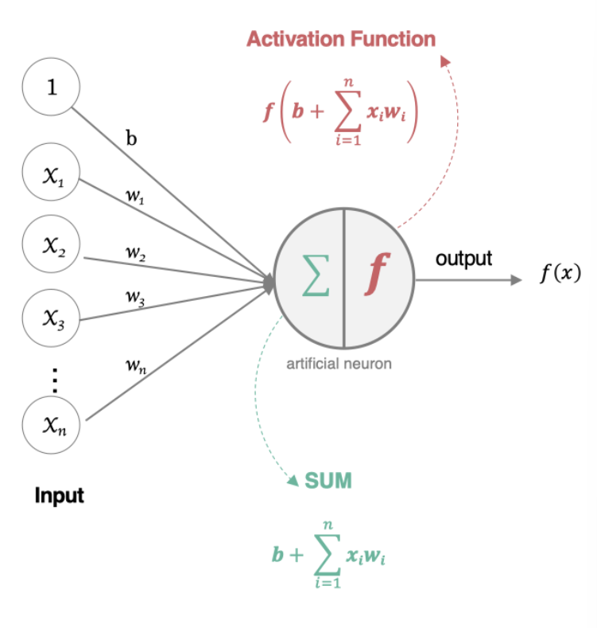

神经元中的核心公式，本质上就是在每个神经元上进行一次逻辑回归，得到下一层的输入值：

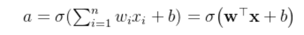

构成人工神经元的三个关键因素，这里比较重要的是激活函数，如果没有激活函数的话本质上模型还是线性的。

**神经元需要激活函数**，核心原因在于**引入非线性变换**，从而突破线性模型的表达能力限制，如果神经元上全是Wx+b的运算，最终合成的网络都可以做矩阵合并成一个大的线性网络，而异或分类、图像识别等复杂任务是非线性问题，前面的文章我们已经对机器学习算法中的激活函数sigma，以及梯度下降法BGD，SGD和MGD进行了介绍，后续我们将继续介绍深度学习领域中涉及到的一些激活函数以及梯度下降算法。

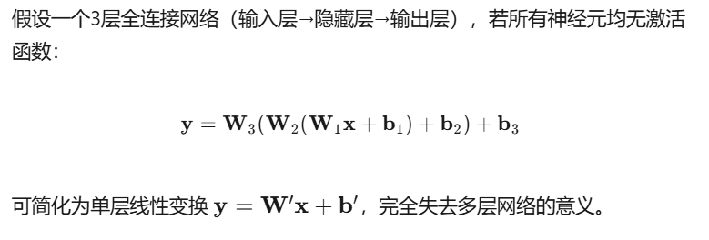

# 二、全连接神经网络的组成

在介绍激活函数和梯度下降之前，我们先介绍最基础的神经网络模型，以一个比较简单的神经网络为例，主要由输入层，隐藏层，以及输出层三部分组成

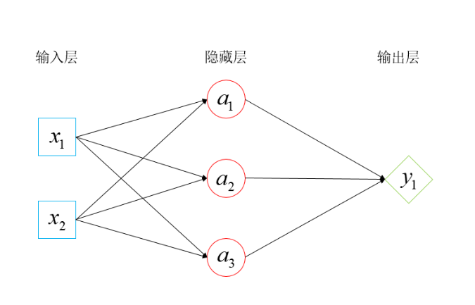

| 输入层 | 接收原始特征向量；**无**可学习参数 | **不参与**权重更新 |
| ------ | ---------------------------------- | ------------------ |
| 隐藏层 | 提取、抽象特征；包含 **W、b**      | **参与**权重更新   |
| 输出层 | 产生最终预测；包含 **W、b**        | **参与**权重更新   |

**相邻层之间所有神经元两两相连，每个连接都有独立的权重和偏置**

**如果还不够具象，那么。。。**

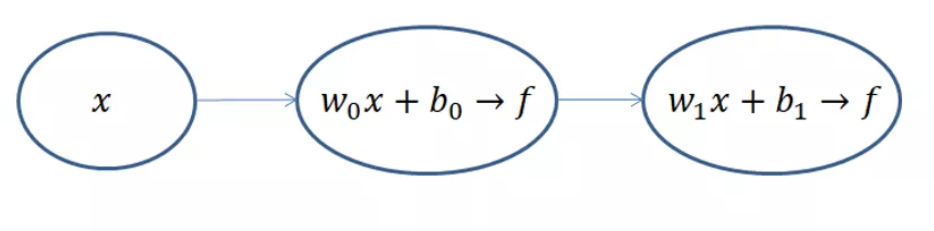

**机器学习精髓：首先由前向传播计算出预测值，在由预测值经过梯度下降来调整模型参数，从而降低损失函数的误差**

# 三、激活函数

除了sigmod常见的激活函数还有：

- **饱和激活函数：** sigmoid、 tanh...
- **非饱和激活函数:** ReLU 、Leaky Relu 、ELU、PReLU、RReLU...

相对于饱和激活函数，使用**非饱和激活函数**的**优势**在于两点：

1.非饱和激活函数能解决深度神经网络（层数非常多）带来的**梯度消失**问题，适用于神经网络

2.使用非饱和激活函数能**加快收敛速度**。

##  3.1 sigmod

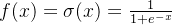

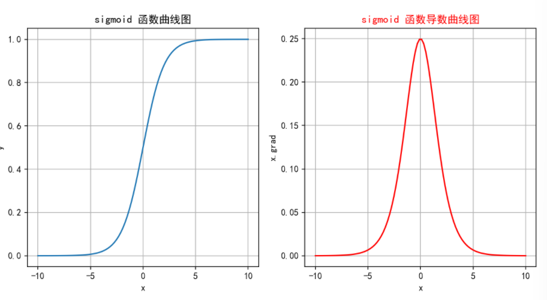

**缺点：**

Sigmoid 把数值压进 (0,1) 的同时，也把深度网络压进了“**梯度消失、信息塌缩、计算昂贵**”的死胡同：

> **在两端饱和区梯度≈0，反向传播时连乘迅速趋于 0，早期层得不到有效更新；大输入与小输入都被挤成 1，100 倍差距被抹平；指数运算又拖慢每一步前向/反向。**

## 3.2 tanh

##  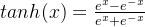

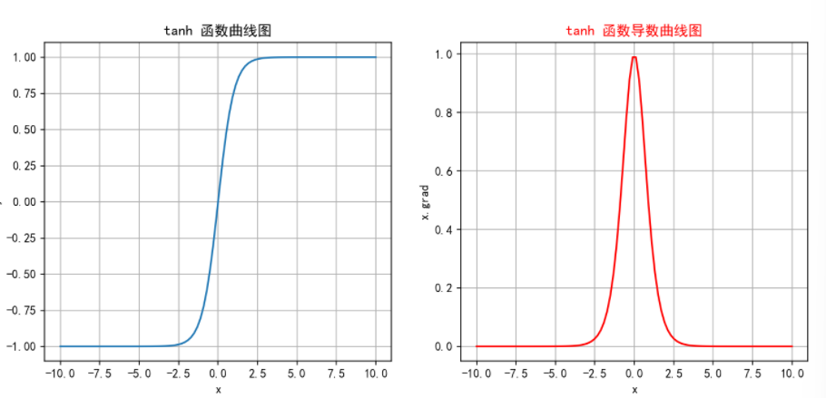 

**缺点：** 

Tanh 把 Sigmoid 的 (0,1) 区间搬到 (−1,1)，**梯度更大但仍小于 1，层数多了过后会导致梯度消失**；
 在极值区依旧饱和，**多层连乘后梯度照样指数级衰减**——训练变慢甚至停滞 

## 3.3 RELU 

神经网络中经常会用到的线性层激活函数

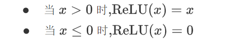

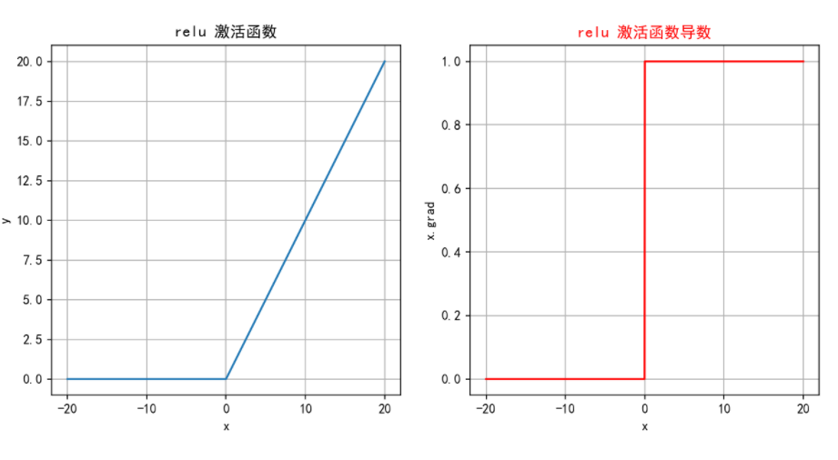

**特点：**

1. **算得快**：比指数简单，一次比较就行。
2. **不饱和**：正区间导数=1，梯度不消失。
3. **够稀疏**：负值直接变 0，很多神经元“**罢工**”。 

## 3.4 LeakyReLU

在RELU（）的基础上增加了负半轴的斜率，**避免神经元死亡**

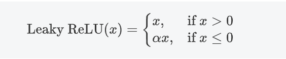

 **特点：**

1. **不死神经元**：x≤0 时给个小斜率 α，梯度≠0，权重还能更新，避免 ReLU“死亡”。
2. **算得快**：跟 ReLU 一样，一次比较 + 一次乘法，开销极低。
3. **调参麻烦**：α 得人工试，设不好照样输出负值、训练拉胯。

##  3.5 softmax

Sigmod函数是Softmax函数的一个特例，Sigmod函数只能用于预测值为0或1的二元分类。

Softmax激活函数通常用于**多分类问题**的**输出层**，它能够将网络的输出**转换为概率分布**，**使得输出的各个类别的概率之和为 1，**最后一层输出可直接解释为类别置信度。

 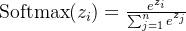

**缺点：** 

在计算过程中，如果z_i的数值过大，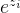可能会导致**数值溢出**。因此在实际应用中，经常会对z_i进行调整，如减去最大值以确保数值稳定  

#  四、参数初始化

1. **打破对称性**
    如果所有权重都相同，每一层得到的梯度完全一样，**权重更新后仍然保持相同会导致特征无法分化**。
2. **避免零梯度**
    全零初始化时，ReLU、Sigmoid 等激活在 0 附近梯度非常小或为 0，**反向传播一开始就走不动**，训练直接卡死。
3. **控制信号幅度**
    良好的初始化（如 Xavier、He）让每层的激活和梯度方差保持在 1 左右，**既防止梯度消失，也防止梯度爆炸**，使得深层网络可以真正被训练。

下面介绍两种常用的初始化方法：

##  4.1 Xavier 初始化

根据输入和输出神经元的数量来选择权重的初始值 ，**让每层输入与输出的方差都≈1，从而把信号和梯度“刚好”传到最深处，既不过小也不过爆。**

## **4.2 He初始化**

**调整权重的初始化范围，使得每一层的输出的方差保持一致** ，**专为 ReLU 族激活设计：把权重放大 √2 倍，抵消 ReLU 的“砍半效应”，让前向方差和反向梯度仍≈1。**

# 五、优化梯度下降法

通过对标准的梯度下降方法进行改进，从而提高收敛速率和稳定性

## 5.1 指数加权平均

 **用指数加权平均代替原始梯度，减少震荡、加速收敛、跳出局部极小值。**

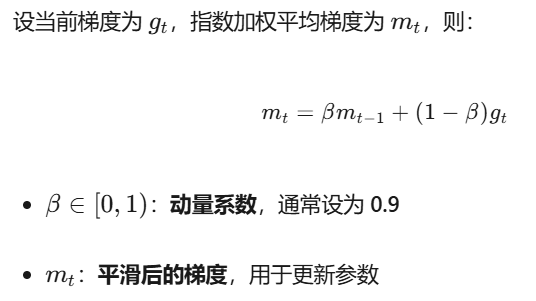

可以看到：

- 当 **β=0.9 时，历史数据的权重较高**，平滑效果较强。EMA值变化缓慢（新数据仅占10%权重），滞后明显。
- 当 **β=0.1时，近期数据的权重较高**，平滑效果较弱。EMA值快速逼近最新数据（每次新数据占90%权重）。

## 5.2 Momentum

**核心思想：**

通过引入 **指数加权平均** 来积累历史梯度信息，从而在更新参数时形成“动量”，**帮助优化算法更快地越过局部最优或鞍点。**  

## 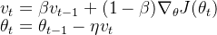

Momentum 通过“历史梯度惯性”实现**方向平滑+速度累积**：在一致方向上叠加加速，在矛盾方向上抵消震荡，用固定学习率也能更快、更稳地穿越复杂损失地形，但不改变学习率本身 

- **β 过大**（如 0.99）：惯性过强，响应变化慢，可能错过最优解。
- **β 过小**（如 0.5）：近似无动量，震荡抑制效果弱。
- **典型配置**：β = 0.9 兼顾加速与稳定。

## 5.3 AdaGrad

它通过**自适应地为每个参数分配不同的学习率**（频繁更新的参数学习率减小，稀疏的参数学习率较大），从而提升收敛效果。

 流程：

1. **初始化**：

   - 初始化参数 \theta_0 和学习率 \eta 。
   - 将梯度累积平方的向量 G_0 初始化为零向量。

2. **梯度计算**：

   - 在每个时间步 t，计算损失函数.png)对参数 \theta 的梯度.png)。

3. **累积梯度的平方**：

   - 对每个参数 i 累积梯度的平方：
      	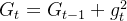

     其中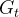是累积的梯度平方和，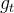是第 i 个参数在时间步t 的梯度。

     推导：
      	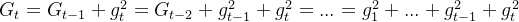

4. **参数更新**：

   - 利用累积的梯度平方来更新参数：
      	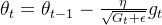
   - 其中：
     - 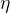 是全局的初始学习率。
     - 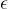 是一个非常小的常数，用于避免除零操作（通常取 10^{-8}）。
     - 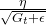 是自适应调整后的学习率。

AdaGrad 用一个**单调递增的累积量**（梯度平方和）去**除学习率**，于是：

1. 它天然**把学习率压成 0** → 训练提前结束；
2. 在非稀疏数据上**衰减更快** → 刚跑几步就“熄火”。

##  5.4 RMSProp

 把 AdaGrad 的“**累加到死**”改成“**滑动平均**”，用指数衰减给旧梯度打折扣，既保留自适应学习率，又避免学习率过早归零。

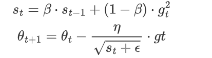

**特点：**

1. **自适应**：每个参数的学习率随梯度动态缩放，步子稳。
2. **非稀疏友好：**不会让学习率一路掉到 0，适合稠密数据。
3. **防衰减：**指数滑动平均给旧梯度打折，避免 AdaGrad 的“累加致死”。

##  5.5 **Adam**

**Adam（Adaptive Moment Estimation）** 是目前最常用的优化器之一，**结合了 Momentum 和 RMSProp 的思想**，通过 **一阶动量（均值）** 和 **二阶动量（方差）** 自适应调整每个参数的学习率，兼顾了**加速收敛**和**稳定性**。

总结就是：Adam = **Momentum 的惯性** + **RMSProp 的自适应学习率** + **偏差修正**，是深度学习中的“万金油”优化器。

步骤如下，能知道个大概就行，主要是它的特征：

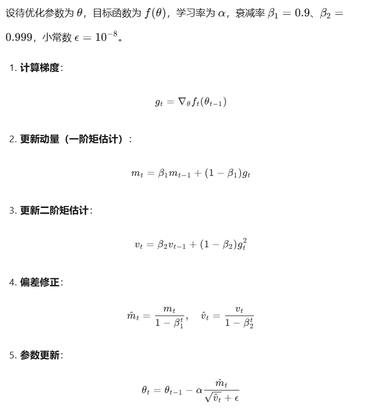

 **Adam 以“自适应学习率 + 动量”实现高效稳健，开箱即用；但对超参数仍敏感，且早期快速收敛可能带来过拟合风险，必要时可与 SGD 联用取长补短。**

# 六、批量标准化

这个内容也很重要！

**BN 在训练时对每个 mini-batch 做标准化并用可学习的 γ、β 进行缩放平移，测试时改用训练集累计的全局均值/方差，从而缓解内部协变量偏移、加速收敛并附带正则化效果；它通常置于全连接或卷积层之后、激活之前。**

BN 用 mini-batch 统计量**加速训练**、**提升稳定性并附带正则化来减少过拟合**，但依赖足够大 batch、训练和推断行为不一致，且在小 batch、RNN 或分布式场景下效果下降、实现复杂度增加。

流程：

关于全连接神经网络以及一部分基础知识的补充就到这里，接下来会在这个系列更新更多类型的神经网络模型，敬请关注！ 
