# 前言

这一篇文章我们基于随机梯度下降分类器（一种线性分类器）来讲讲如何对模型准确度进行评估，涉及到交叉验证，混淆矩阵以及ROC曲线等内容

# 一、交叉验证

在机器学习中，我们通常把数据分成训练集和验证集，交叉验证可以确保模型在不同的数据子集上都能表现良好。如果模型在某些子集上表现很好，但在其他子集上表现很差，这可能表明模型存在过拟合或欠拟合的问题。通过交叉验证，可以更全面地评估模型的泛化能力，从而避免过拟合和欠拟合。

下面对比两种检查验证的特点

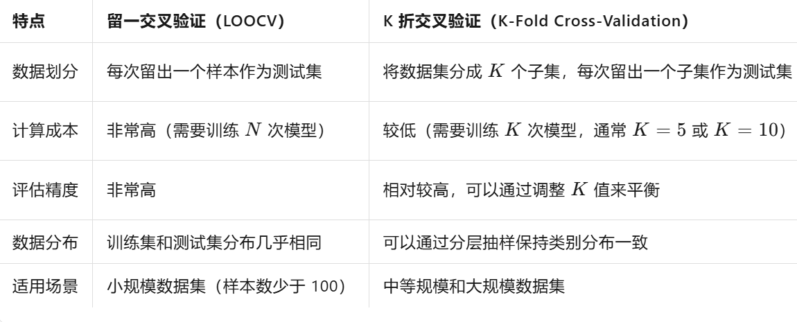

可以看出似乎K折检查验证更加科学，接下来我们展示一个K折交叉验证的案例

当然，也可以用**`StratifiedKFold实现`**

```python
import numpy as np
import os
import matplotlib.pyplot as plt
import pandas as pd
plt.rcParams["axes.labelsize"] = 14
plt.rcParams["xtick.labelsize"] = 12
plt.rcParams["ytick.labelsize"] = 12
import warnings
warnings.filterwarnings("ignore")
np.random.seed(42)

# 加载数据
mnist = pd.read_csv("data\mnist-demo.csv")
x = mnist.iloc[:,1:]
y = mnist.iloc[:,:1]
x, y = x.to_numpy(), y.to_numpy()

# 分割数据集
x_train,x_test,y_train,y_test = x[:8000],x[8000:],y[:8000],y[8000:]
# 使用索引随机对数据集打乱
shuffle_index = np.random.permutation(8000)
x_train,y_train = x_train[shuffle_index],y_train[shuffle_index]

# 将任务转换为二分类任务
y_train_5 = (y_train==5)
y_test_5 = (y_test==5)
y_train_5[:10]

# 使用随机梯度下降分类器（一种线性分类器）进行分类预测
from sklearn.linear_model import SGDClassifier
sgd_clf = SGDClassifier(max_iter=5,random_state=42)
sgd_clf.fit(x_train,y_train_5)
prediction = sgd_clf.predict(x_test)
print(prediction)

# 进行交叉验证
from sklearn.model_selection import cross_val_score
accuracy = cross_val_score(sgd_clf,x_train,y_train_5,cv = 10,scoring="accuracy")
# cv = 10表示将数据分割十个部分，用九个来训练，剩下一个作为测试
# scoring="accuracy"这指定了评估模型性能的指标为准确率（accuracy）
plt.plot([i for i in range(10)],accuracy)
plt.xlabel("times")
plt.ylabel("accuracy")
plt.legend()
plt.show()
```


最终得到的每次循环的准确率为[0.9525 0.965 0.96125 0.9625 0.96375 0.9725 0.9725 0.95 0.97 0.96125] ，我们将这些值**取平均**，得到最后模型的准确率为0.963125

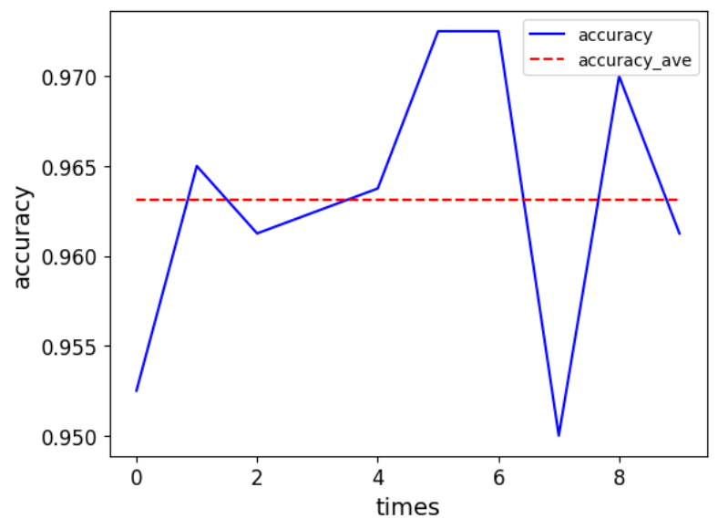

# 二、混淆矩阵 

在介绍混淆矩阵之前，我们先来看几个概念

- **True Positive (TP)**：模型正确地将正类样本预测为正类。
- **False Negative (FN)**：模型错误地将正类样本预测为负类。
- **False Positive (FP)**：模型错误地将负类样本预测为正类。
- **True Negative (TN)**：模型正确地将负类样本预测为负类。

混淆矩阵（Confusion Matrix）是评估分类模型性能的一种重要工具，它以表格形式展示了模型预测结果与实际标签之间的关系。

混淆矩阵排列如下

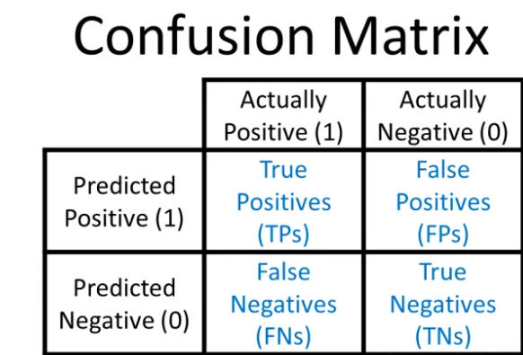

```python
from sklearn.model_selection import cross_val_predict
# cross_val_predict用于在交叉验证的每一折中对测试集进行预测，并返回所有预测结果的拼接，这里就是我们的预测值
y_train_pred = cross_val_predict(sgd_clf,x_train,y_train_5,cv=3)

# 通过混淆矩阵输出的矩阵[[TN , FP],[FN , TP]]
from sklearn.metrics import confusion_matrix
confusion_matrix(y_train_5,y_train_pred)
```


 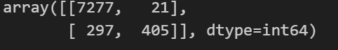

 假设我们要判断样本是不是5这个类别，那么上述混淆矩阵直观的表示为：

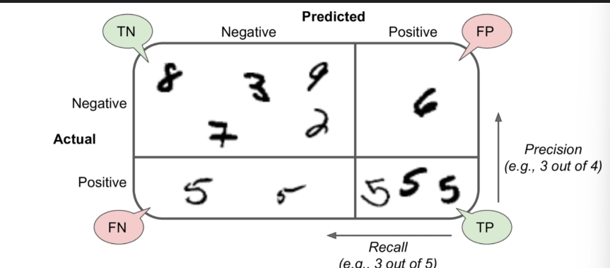


一个完美的分类器应该只有true positives 和 true negatives, 即**主对角线元素不为0，其余元素为0** 

有了上述四个基础组成部分，我们就可以导出多种评价指标来更全面地评估模型的性能。

# 三、 评价指标

**（1）准确率（Accuracy）**

准确率是模型正确预测的样本数占总样本数的比例。**衡量模型整体的正确性。**

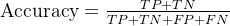

 **（2）精确率（Precision）**

精确率是模型预测为正类的样本中，实际为正类的比例。**衡量模型预测正类的可靠性。**

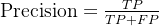

**（3）召回率（Recall）** 

召回率是实际为正类的样本中，模型正确预测为正类的比例。**衡量模型识别正类的能力。**

**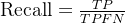**

**（4）F1 分数（F1 Score）**

F1 分数是精确率和召回率的调和平均值，用于综合评估模型的性能。**平衡精确率和召回率。**

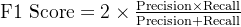

```python
# 精确率（Precision）和召回率（Recall）
from sklearn.metrics import precision_score
from sklearn.metrics import recall_score
precision = precision_score(y_train_5,y_train_pred)
recall = recall_score(y_train_5,y_train_pred)
print(precision,recall)

# 将两个指标结合成一个F1 score 调和平均数
from sklearn.metrics import f1_score
f1= f1_score(y_train_5,y_train_pred)
print(f1)
```


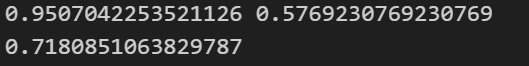


# 四、ROC曲线和AUC值：

**阈值（Threshold）\**是一个用于将这些连续的概率值划分为正类别和负类别的\**决策边界**。

- 如果模型输出的概率值**大于或等于阈值**，则将该样本划分为**正类别**。
- 如果模型输出的概率值**小于阈值**，则将该样本划分为**负类别**。

ROC曲线与阈值之间的关系是密切的。ROC曲线是通过在不同的阈值下计算真阳性率（TPR）和假阳性率（FPR）来绘制的。每个阈值都会对应ROC曲线上的一个点。

TPR和FPR分别是ROC曲线的纵坐标和横坐标（只适用于**分类**）

TPR = TP / (TP + FN) (Recall)**它衡量了模型识别正类样本的能力**

FPR = FP / (FP + TN)**它衡量了模型错误地将负类样本识别为正类的概率**

```python
from sklearn.metrics import roc_curve
fpr, tpr, thresholds = roc_curve(y_train_5, y_scores)
def plot_roc_curve(fpr, tpr, label="ROC"):
    plt.plot(fpr, tpr, linewidth=2, label=label)
    plt.plot([0, 1], [0, 1], 'k--')
    plt.axis([0, 1, 0, 1])
    plt.xlabel('False Positive Rate', fontsize=16)
    plt.ylabel('True Positive Rate', fontsize=16)

plt.figure(figsize=(8, 6))
plot_roc_curve(fpr, tpr)
plt.show()
```


 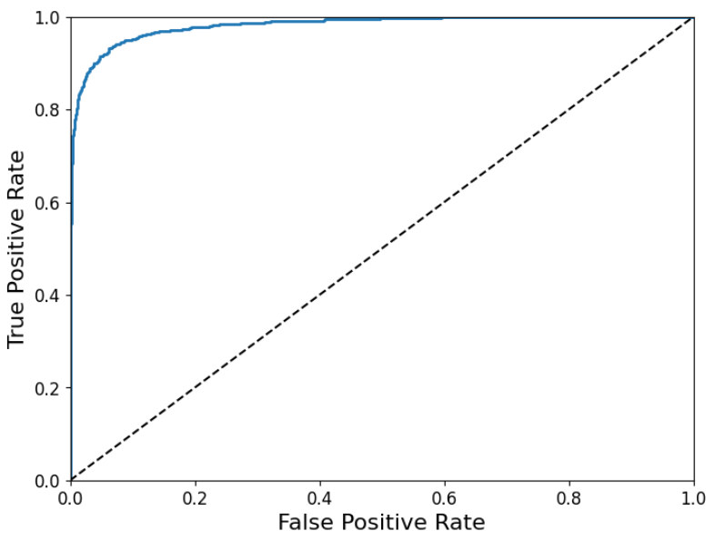

**AUC值是ROC曲线下方的面积，其取值范围在0到1之间，越接近一说明分类模型预测效果越好。**

从概率角度理解，AUC可以解释为：随机从正例集中选取一个样本，又从负例集中选取一个样本，分类器正确地将正例样本的预测概率排在负例样本预测概率之前的概率

```python
from sklearn.metrics import roc_auc_score
roc_auc_score(y_train_5,y_scores)
```


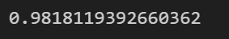

注意：AUC衡量的是模型在**所有可能的分类阈值**下的表现，因此它是一个**阈值无关**的指标 ，不同的阈值会生成不同的（FPR, TPR）点，这些点连接起来就形成了ROC曲线。
