# 前言

​    线性回归是一种统计方法，用于建立一个或多个自变量（解释变量）与因变量（响应变量）之间的关系。线性回归模型假设因变量与自变量之间存在线性关系，即因变量可以表示为自变量的线性组合加上一个随机误差项。通俗来讲，线性回归就是找到一条直线（或者平面）来拟合数据点，在这条直线后面，我们加入了一个误差项，并且假设这个误差符合正态分布并且相互独立。

**说到假设：**

1. 线性关系：因变量与自变量之间存在线性关系。

2. 独立性：自变量之间相互独立，没有多重共线性。

3. 正态性：随机误差项 ϵ 服从正态分布。

4. 同方差性：随机误差项 ϵ 的方差在所有自变量的取值范围内保持不变。

5. 无自相关：随机误差项 ϵ 之间相互独立，没有自相关性。

   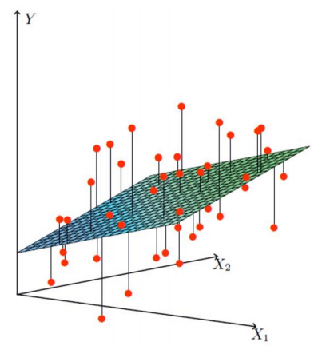

   

   # 

# 一、理论部分简单概述 

对于简单线性回归的每个样本**x**以及对应的输出**y**,我们假设：

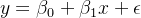

对于多元线性回归的每个样本矩阵**X**以及对应的输出**y**,我们假设： 

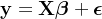

- y 是因变量向量，大小为 n×1。
- X 是设计矩阵，大小为 n×(p+1)，其中第一列是常数项（全为1），其余列是自变量的值。
- β 是参数向量，大小为 (p+1)×1。这里p+1的1表示截距项 β_0
- ϵ 是误差向量，大小为 n×1。

##  1.1 误差

对于线性回归问题的求解，我们通常是从误差项开始入手，下面是从统计学角度上来给出的（阉割版）误差分布情况推导过程（大概知道怎么来的就行）

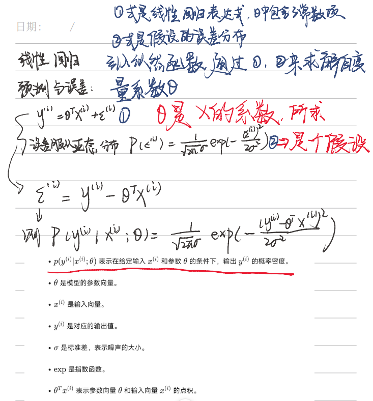

对于机器学习任务，实质上就是通过迭代来不断减小误差，让预测值更加接近实际值，从而达到预测的效果，那么我们最根本的目的就是让误差最小化，通过**最大化似然函数（最大似然估计，MLE）**，可以找到一组最优参数，使得观测数据出现的概率最大。

如何理解“**使得观测数据出现的概率最大**”？

在机器学习的线性回归中，我们有一堆数据点（比如房价和房子面积的数据）。我们假设这些数据点是由某个线性模型生成的，但模型的参数（比如斜率和截距）我们不知道。

我们希望找到一组参数（比如斜率和截距），使得这些数据点在这个模型下出现的概率最大。换句话说，我们希望找到一个模型，它最能解释我们看到的数据，**使它计算出来的值与实际数据最接近**。

## 1.2 最大似然估计（MLE）

相关概念和推导看这里（依旧阉割版，省略了复杂的矩阵计算过程，直接上结论）

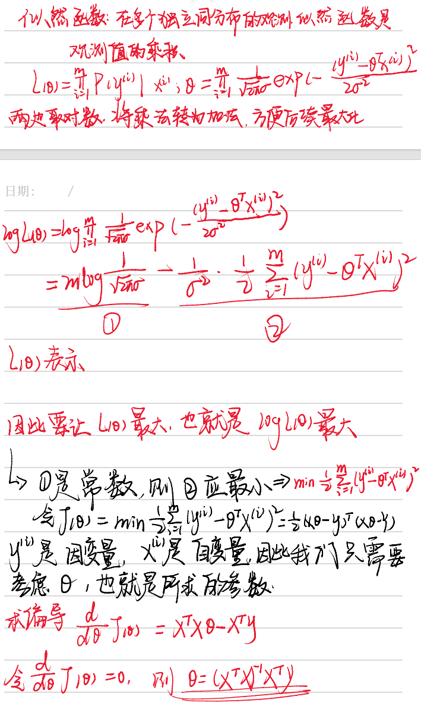

因此最后解得参数：

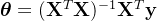

并没有经过迭代更新，到这里似乎直接用矩阵变换就已经求解出了线性回归的目标参数theta，但是**这并不是机器学习的思想**，在面对成千上万条数据时，矩阵的维度也跟随着增大，这样的计算量对于矩阵运算来说是非常耗时并且占用的内存巨大，并且对于非线性模型（如逻辑回归、神经网络），损失函数不再是二次函数，无法直接通过矩阵运算求解，在带有正则化项（如 L1 或 L2 正则化）的线性回归中，最小二乘法也可能不再适用。

我们下面来介绍一种机器学习离不开的参数优化方法，梯度下降。

## 1.3 梯度下降

前面在这个式子中，我们说过要让②式最小

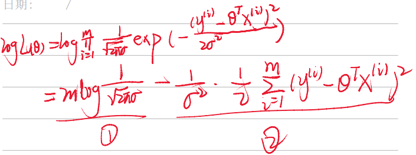

等价于最小化下面这个目标损失函数：

^2.png)

​    其中 m 是样本总数。除以 m 的原因是为了计算**平均误差**，这样可以**确保损失函数的值与样本数量无关**，即无论样本数量多少，损失函数的值都是可比较的。

说到求函数的最小值，最先想的方法肯定就是求导，而梯度下降的核心思想也是求损失函数对参数的倒数，具体流程如下

**损失函数定义：**

^2.png)

**求偏导：**

** (-x_{ij}).png)**

**更新梯度：**

** x_{ij}.png)**

其中其中 **α 是学习率**（learning rate步长） ，表示一次更新的值有多大，宁可小，不能大，否则拟合效果很差。

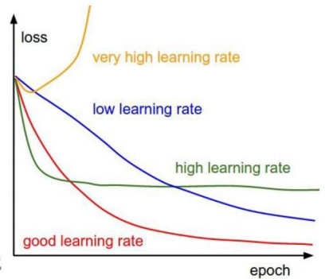


手写阉割版如下：

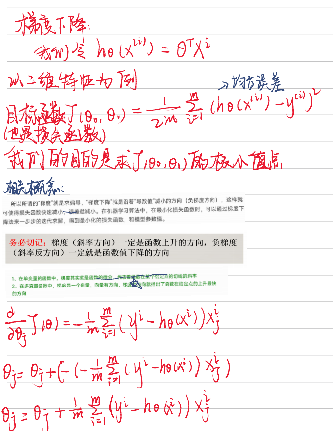

这里一定要知道**梯度下降的方向是斜率的反方向（负梯度）**

**对于线性回归的理论基础知识而言，基本上知道回归之前的误差假设，最大似然估计的作用，以及如何应用梯度下降来对参数进行更新，就足够支撑我们进行接下来的学习了**

# 二、sklearn库中线性回归代码复现

sklearn库中线性回归代码涉及到比较多的方面，包括数据变换，参数更新，损失计算，预测等内容，这里我们只是简单剖析一下大概框架，看看每个部分都是用来干嘛的

首先我们整体看一下代码结构，这里直接是写出来的，每个序号代表了一个变量或者函数

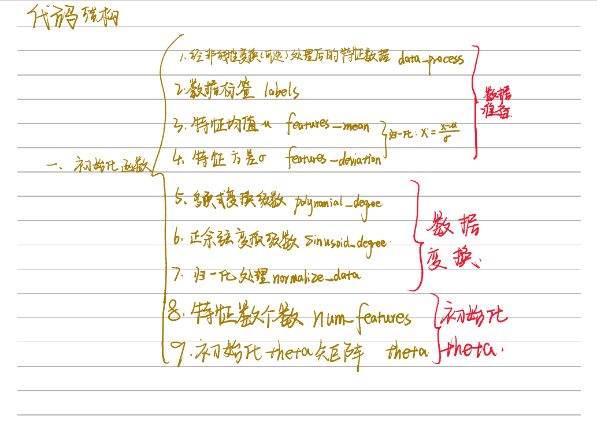

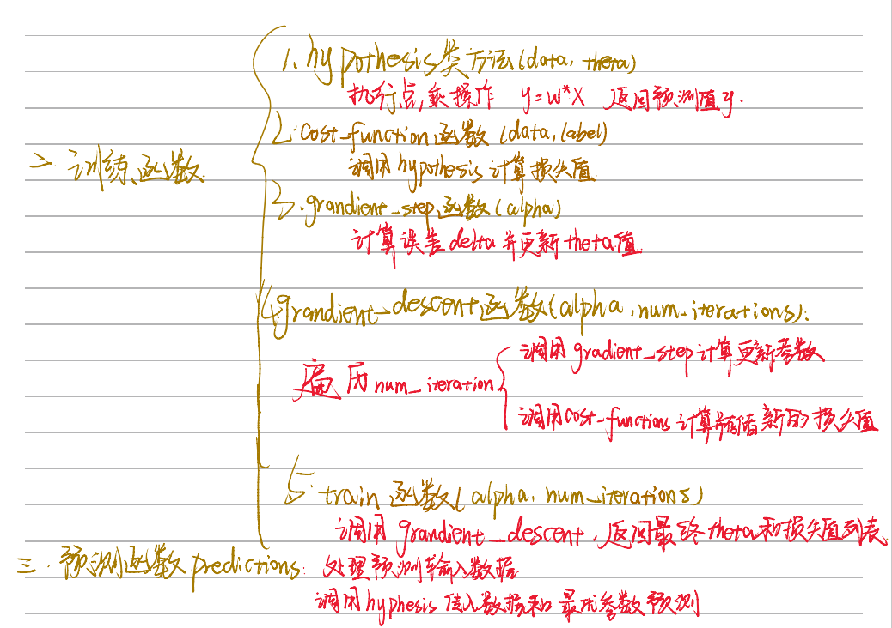

## 2.1 初始化模块

```ruby
import numpy as np
from utils.features import prepare_for_training


class LinearRegression:
    def __init__(self, data, labels, polynomial_degree=0, sinusoid_degree=0, normalize_data=True):
        """
        1.对数据预处理
        2.得到所有特征个数
        3.得到初始化参数矩阵
        """
        (data_processed,
         features_mean,
         features_deviation) = prepare_for_training(data, polynomial_degree, sinusoid_degree, normalize_data=True)

        self.data = data_processed  # 非线性变化（可选）处理后的特征数据
        self.labels = labels
        # 原始特征的均值，通常用于归一化过程
        self.features_mean = features_mean
        # 原始特征的标准差或方差，用于归一化过程
        self.features_deviation = features_deviation

        self.polynomial_degree = polynomial_degree
        # polynomial_degree 大于 1，函数可能会对原始特征进行多项式扩展
        self.sinusoid_degree = sinusoid_degree
        # 如果 sinusoid_degree 大于 0，函数可能会对原始特征进行正弦和余弦变换
        self.normalize_data = normalize_data
        # 如果 normalize_data=True，函数会对数据进行归一化处理

        num_features = self.data.shape[1]  # 特征数即为theta的个数（下标）
        self.theta = np.zeros((num_features, 1))  # 根据theta个数创建初始化矩阵
```


这一步主要提供了一些可选的参数，比如是否进行归一化，标准化，或者是否要对数据进行线性变换，这里的线性变换主要针对非线性数据。

对**非线性数据进行变换的原因**在于，许多机器学习算法（尤其是线性回归）假设数据之间存在线性关系。然而，现实世界中的数据往往具有复杂的非线性关系。通过适当的变换，我们可以**将非线性关系转化为线性关系**，从而使得线性模型能够**更好地拟合数据**。

主要方法是在数据原有列上面添加幂次方项或者正余弦变换后的数据，例如：

.png) 

## 2.2 训练模块

```ruby
    @staticmethod
    def hypothesis(data, theta):
        """
        预测函数
        """
        prediction = np.dot(data, theta)
        return prediction

    def cost_function(self, data, labels):
        """
        损失计算方法
        """
        num_example = data.shape[0]
        delta = LinearRegression.hypothesis(self.data, self.theta) - labels
        cost = (1 / (2 * num_example)) * np.dot(delta.T, delta)
        return cost[0][0]  # 返回损失值

    def gradient_step(self, alpha):
        """
        参数更新计算公式,矩阵运算
        """
        num_examples = self.data.shape[0]
        # 直接调用类方法进行预测
        prediction = LinearRegression.hypothesis(self.data, self.theta)
        delta = prediction - self.labels
        # 梯度下降公式
        theta = self.theta
        theta = theta - alpha * (1 / num_examples) * (np.dot(delta.T, self.data)).T
        self.theta = theta

    def gradient_descent(self, alpha, num_iterations):
        """
        通过参数更新公式更新参数，会执行num_iterations次
        """
        # 每一次损失的变化
        cost_history = []
        for _ in range(num_iterations):
            self.gradient_step(alpha)
            cost_history.append(self.cost_function(self.data, self.labels))
        return cost_history

    def train(self, alpha, num_iterations=500):
        """
        训练函数模块，执行梯度下降
        """
        cost_history = self.gradient_descent(alpha, num_iterations)
        return self.theta, cost_history
```


代码很长，主要实现了通过迭代num_iteration次来优化最初self.theta = np.zeros((num_features, 1))定义的theta参数，并且存储了损失值cost_history用于后续绘制损失图像,预测数据直接通过参数与预测数据的自变量相乘就能得到，根据这个预测数据来算损失值和更新参数。

## 2.3 预测模块

```ruby
    def prediction(self, data):
        """
        用训练好的参数模型来预测新数据
        """
        data_processed = prepare_for_training(data,
                                              self.polynomial_degree,
                                              self.sinusoid_degree,
                                              self.normalize_data)[0]
        prediction = LinearRegression.hypothesis(data_processed, self.theta)
        return prediction
```


这串代码比较简单，主要是将预测数据的自变量进行和训练数据自变量一样的处理，并调用预测函数来将train中得到的最优参数与自变量进行相乘，最后输出预测结果，说白了就是一个矩阵乘法。

## 2.4 数据测试

这一个部分我们分别用一维线性数据，多维线性数据，以及非线性数据来对上面的代码进行测试

### 2.4.1 一维线性数据

```ruby
import pandas as pd
import matplotlib.pyplot as plt

from 线性回归.linear_regression import LinearRegression

import matplotlib
matplotlib.use('TkAgg')

data = pd.read_csv(r'data\world-happiness-report-2017.csv')

# 得到训练和测试数据
train_data = data.sample(frac=0.8)
test_data = data.drop(train_data.index)

input_param_name = 'Economy..GDP.per.Capita.'
output_param_name = 'Happiness.Score'

x_train = train_data[[input_param_name]].values
y_train = train_data[[output_param_name]].values

x_test = test_data[[input_param_name]].values
y_test = test_data[[output_param_name]].values

plt.scatter(x_train, y_train, label='Train data')
plt.scatter(x_test, y_test, label='test data')
plt.xlabel(input_param_name)
plt.ylabel(output_param_name)
plt.title('Happy')
plt.legend()
plt.show()
```


这里直接就选取将表格中的单列数据来作为自变量，我们先来看看数据分布，成大致的线性趋势，可以用来执行线性回归

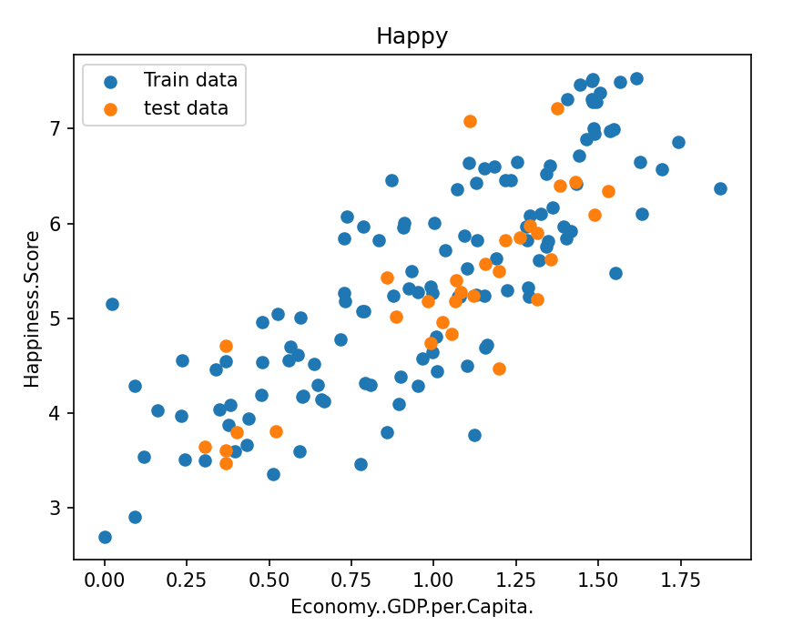

```ruby
num_iterations = 5000
learning_rate = 0.01

linear_regression = LinearRegression(x_train, y_train)
(theta, cost_history) = linear_regression.train(learning_rate, num_iterations)

print('开始时的损失：', cost_history[0])
print('训练后的损失：', cost_history[-1])

plt.plot(range(num_iterations), cost_history)
plt.xlabel("Iter")
plt.ylabel("cost")
plt.title("GD")
plt.show()
```


初始化训练次数和学习率后调用类函数开始训练，并绘制损失值变化情况，可以看到最终损失值经过迭代更新趋近于收敛，说明模型已经趋于稳定

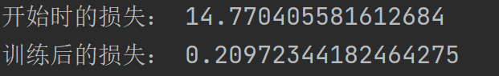

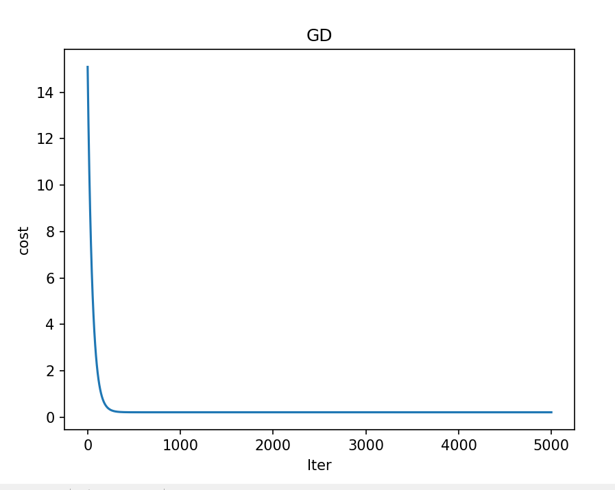


```ruby
predictions_num = 100
y_predictions = linear_regression.prediction(x_test)

for i in range(len(y_predictions)):
    print(y_test[i], y_predictions[i])

plt.scatter(x_train, y_train, label='Train data')
plt.scatter(x_test, y_test, label='test data')
plt.plot(x_test, y_predictions, "r", label='prediction data')
plt.xlabel(input_param_name)
plt.ylabel(output_param_name)
plt.title('Happy')
plt.legend()
plt.show()
```


调用预测函数来对测试集进行预测，并绘制预测曲线，输出预测结果

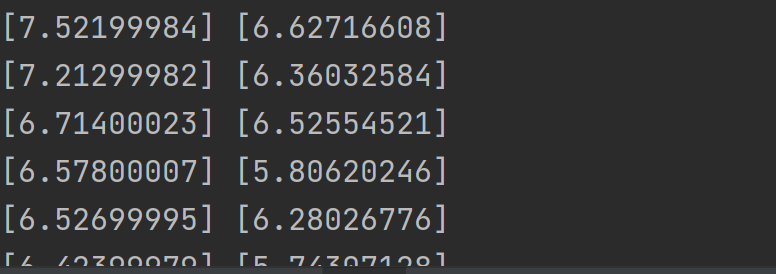

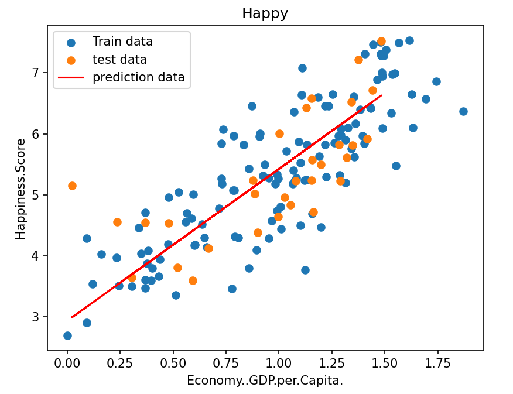

### 2.4.2 多维线性数据

都是矩阵乘法，思想基本一样，这里只展示代码和损失值变化

```ruby
import numpy as np
import pandas as pd
import matplotlib.pyplot as plt

# 导入绘图模版
import plotly
import plotly.graph_objs as go

plotly.offline.init_notebook_mode()

from linear_regression import LinearRegression

data = pd.read_csv(r'data\world-happiness-report-2017.csv')

import matplotlib

matplotlib.use('TkAgg')

train_data = data.sample(frac=0.8)
test_data = data.drop(train_data.index)

input_param_name = [input_param_name for input_param_name in data.columns[3:]]
output_param_name = 'Happiness.Score'

x_train = train_data[input_param_name].values
y_train = train_data[[output_param_name]].values

x_test = test_data[input_param_name].values
y_test = test_data[[output_param_name]].values


num_iterations = 5000
learning_rate = 0.01
polynomial_degree = 0
sinusoid_degree = 0

linear_regression = LinearRegression(x_train, y_train, polynomial_degree, sinusoid_degree)

(theta, cost_history) = linear_regression.train(
    learning_rate,
    num_iterations
)

print('开始损失', cost_history[0])
print('结束损失', cost_history[-1])

plt.plot(range(num_iterations), cost_history)
plt.xlabel('Iterations')
plt.ylabel('Cost')
plt.title('Gradient Descent Progress')
plt.show()


y_predictions = linear_regression.prediction(x_test)

def r2_score(y_true, y_pred):
    return 1 - (sum((y - p) ** 2 for y, p in zip(y_true, y_pred)) /
                sum((y - sum(y_true) / len(y_true)) ** 2 for y in y_true))

print(r2_score(y_test,y_predictions))
```


###  2.4.3 非线性数据

```ruby
import numpy as np
import pandas as pd
import matplotlib.pyplot as plt

from 线性回归.linear_regression import LinearRegression

import matplotlib

matplotlib.use('TkAgg')

data = pd.read_csv(r'D:\桌面\华清\机器学习\西瓜书\线性回归\data\non-linear-regression-x-y.csv')

x = data['x'].values.reshape((data.shape[0], 1))
y = data['y'].values.reshape((data.shape[0], 1))

data.head(10)

plt.plot(x, y)
plt.show()

# 加上数据变换
num_iterations = 50000
learning_rate = 0.02
polynomial_degree = 15
sinusoid_degree = 15
normalize_data = True

linear_regression = LinearRegression(x, y, polynomial_degree, sinusoid_degree, normalize_data)

(theta, cost_history) = linear_regression.train(
    learning_rate,
    num_iterations
)

print('开始损失: {:.2f}'.format(cost_history[0]))
print('结束损失: {:.2f}'.format(cost_history[-1]))

theta_table = pd.DataFrame({'Model Parameters': theta.flatten()})

plt.plot(range(num_iterations), cost_history)
plt.xlabel('Iterations')
plt.ylabel('Cost')
plt.title('Gradient Descent Progress')
plt.show()

predictions_num = 1000
x_predictions = np.linspace(x.min(), x.max(), predictions_num).reshape(predictions_num, 1);
y_predictions = linear_regression.prediction(x_predictions)

plt.scatter(x, y, label='Training Dataset')
plt.plot(x_predictions, y_predictions, 'r', label='Prediction')
plt.show()
```


这里加上了线性变换，表示数据要进行标准化，polynomial_degree = 15用于设置多项式回归中多项式的最高次数，sinusoid_degree = 15用于设置正弦变换中正弦函数的最高次数。如果数据具有周期性特征，使用正弦变换可能有助于模型捕捉这些特征

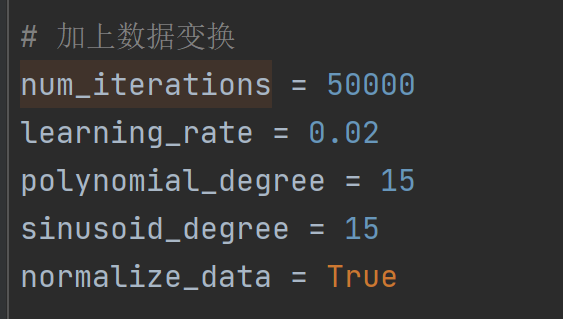

最终拟合结果：

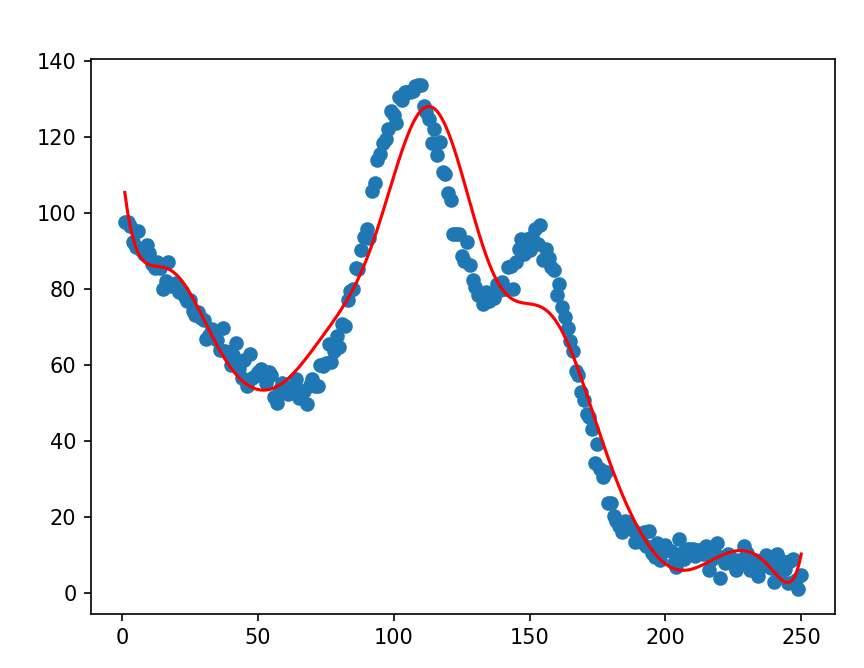 后续还涉及到三种梯度下降对参数优化更新的不同效果，以及基于线性回归的模型 
