# 前言

上一篇文章讲了线性回归的基础理论以及sklearn库底层代码实现，这一篇文章我们来讲讲对于不同的梯度下降法，模型参数的更新效果有什么不同，这里列出了批量梯度下降法，随机梯度下降法和小批量梯度下降法三种，并且在文章的最后，还介绍了多项式回归以及如何通过岭回归对数据进行正则化从而降低模型过拟合风险。

首先回归一下之前的知识，对回归参数进行优化的本质实际上是使用梯度下降最小化目标损失函数，也就是求损失函数对参数的导数。

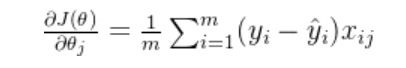

这里的 θ是模型输入特征对应的参数，在梯度下降中，每次迭代选定一个样本（或一批样本），然后根据这个样本计算所有参数的梯度，并根据这些梯度更新所有参数。

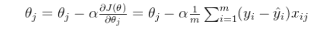

# 一、三种梯度下降对比 

## 1.1 BGD批量梯度下降

简单粗暴的每次都选取所用样本来进行梯度下降，这样虽然能达到优化参数的效果，并且迭代次数相对较小，但是在大数据样本中，这样的矩阵计算量是比较大的

```python
n_iterations = 1000#迭代次数
m = len(x_b)#样本数


def plot_gradient_descent(theta,eta):
    theta = np.random.randn(2,1)#theta初始值
    theta_path_bgd = []
    m = len(x_b)
    plt.plot(x,y,'b.')
    n_iterations = 1000
    for iteration in range(n_iterations):
        y_predict = x_new_b.dot(theta)
        plt.plot(x_new,y_predict,'b-')
        gradients = 2/m* x_b.T.dot(x_b.dot(theta)-y)
        theta = theta - eta*gradients
        theta_path_bgd.append(theta)

    print(theta[-1])
    # 展示下降结果

    # 绘制数据点
    plt.plot(x, y, 'b.')
    plt.xlabel('X_1')
    plt.axis([0, 2, 0, 15])

    # 绘制最终的预测直线
    y_predict = x_b.dot(theta)
    plt.plot(x, y_predict, 'r-')
    plt.show()

    # 可视化 theta_path_mgd 的结果
    theta_path_bgd = np.array(theta_path_bgd)  # 转换为 NumPy 数组
    plt.figure(figsize=(10, 6))
    plt.plot(theta_path_bgd[:, 0], theta_path_bgd[:, 1], 'b-')
    plt.xlabel('Theta[0]')
    plt.ylabel('Theta[1]')
    plt.title('Mini-batch Gradient Descent: Path of Theta')
    plt.grid(True)
    plt.show()
    return theta_path_bgd
```


有了这个函数，我们可以进一步探究学习率alpha的选取对参数优化的影响，学习率控制着模型参数在训练过程中的更新幅度。一个合适的学习率能够在确保模型收敛的同时，提高训练效率。

下面选取了三个不同的学习率进行对比

```python
# 初始化 theta
theta = np.random.randn(2, 1)


theta_path_bgd = plot_gradient_descent(theta, eta=0.01)#进程较慢，但是准确
print(theta_path_bgd)

theta_path_bgd = plot_gradient_descent(theta, eta=0.1)#进程较快，并且准确
print(theta_path_bgd)
theta_path_bgd = plot_gradient_descent(theta, eta=1)#进程很快，但不准确
print(theta_path_bgd)
plt.show()
```


**这里蓝色的线表示每次优化时的参数绘制的拟合曲线** 


**alpha = 0.01**

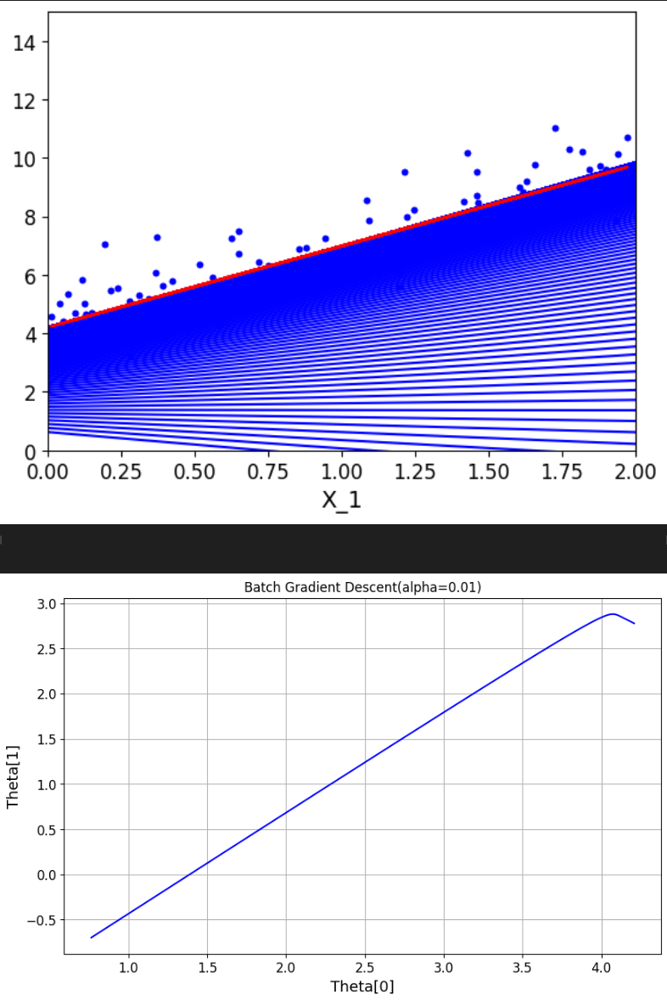

**alpha = 0.1** 

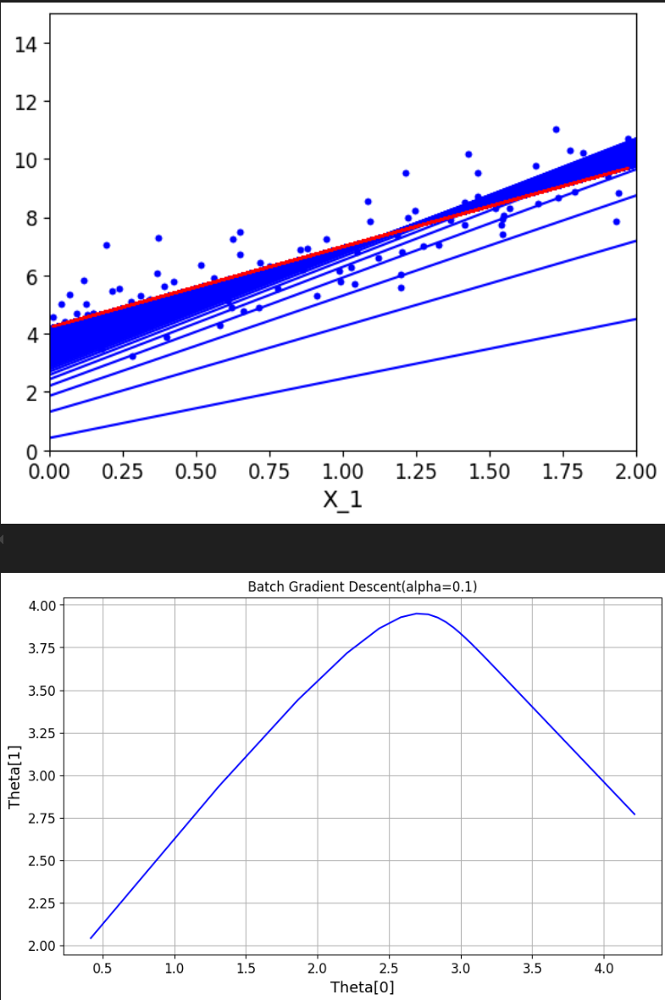

**alpha = 1** 

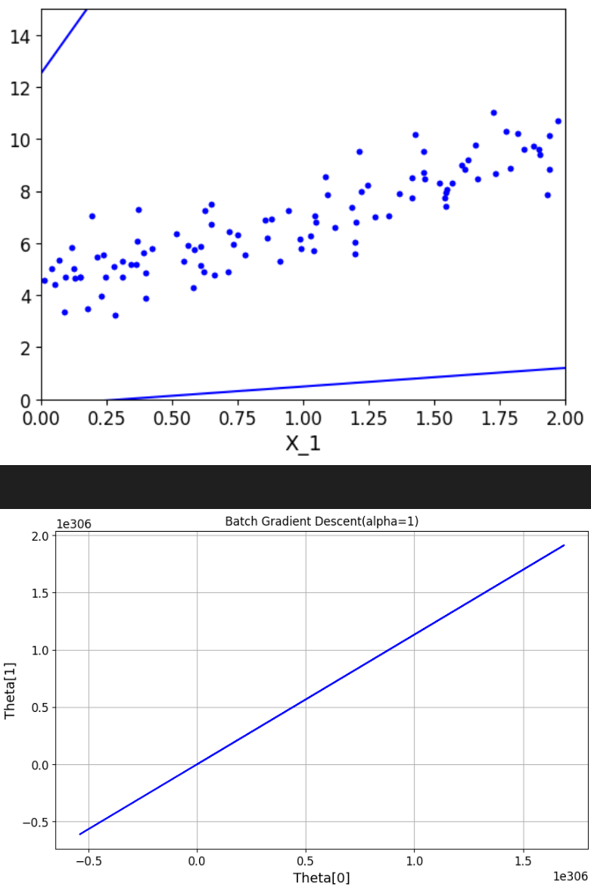

- **过大的学习率**：可能导致模型在最优解附近震荡，或者在极端情况下导致模型发散。
- **过小的学习率**：虽然能够保证模型最终收敛，但是会大大降低模型训练的速度。有时，它甚至可能导致模型陷入**局部最优解**。

## 1.2 SGD随机梯度下降

顾名思义，随机梯度下降是在每次迭代时随机选择m条数据来对参数进行优化，其基本思想和前面介绍的差不多

```python
theta_path_sgd = []
m = len(x_b)
n_epochs = 50
theta = np.random.randn(2,1)
t0 = 5
t1 = 50

def learning_schedule(t):
    # 学习率随着t的增加越来越小
    return t0/(t1+t)


for n_epoch in range(n_epochs):
    # 一个n_epoch为一个循环
    for i in  range(m):
        if n_epoch < 5 and i<10:
            # 选择性绘制n_epoch*i条预测直线
            y_predict = x_new_b.dot(theta)
            plt.plot(x_new,y_predict,'b-')

        # 随机选择一个特征进行梯度下降
        random_index = np.random.randint(m)
        xi = x_b[random_index:random_index+1]
        yi = y[random_index:random_index+1]
        # 一次拿一个数据进行梯度下降
        gradients = 2/1*xi.T.dot(xi.dot(theta)-yi)

        # n_epoch*m+i表示执行次数，随着执行次数增加，学习率下降
        eta = learning_schedule(n_epoch*m+i)
        theta = theta - eta*gradients
        theta_path_sgd.append(theta)
        

# 展示下降结果

# 绘制数据点
plt.plot(x, y, 'b.')
plt.xlabel('X_1')
plt.axis([0, 2, 0, 15])

# 绘制最终的预测直线
y_predict = x_b.dot(theta)
plt.plot(x, y_predict, 'r-')
plt.show()

# 可视化 theta_path_sgd 的结果
theta_path_sgd = np.array(theta_path_sgd)  # 转换为 NumPy 数组
plt.figure(figsize=(10, 6))
plt.plot(theta_path_sgd[:, 0], theta_path_sgd[:, 1], 'b-')
plt.xlabel('Theta[0]')
plt.ylabel('Theta[1]')
plt.title(f'Stochastic Gradient Descent, SGD(alpha={eta})')
plt.grid(True)
plt.show()
```


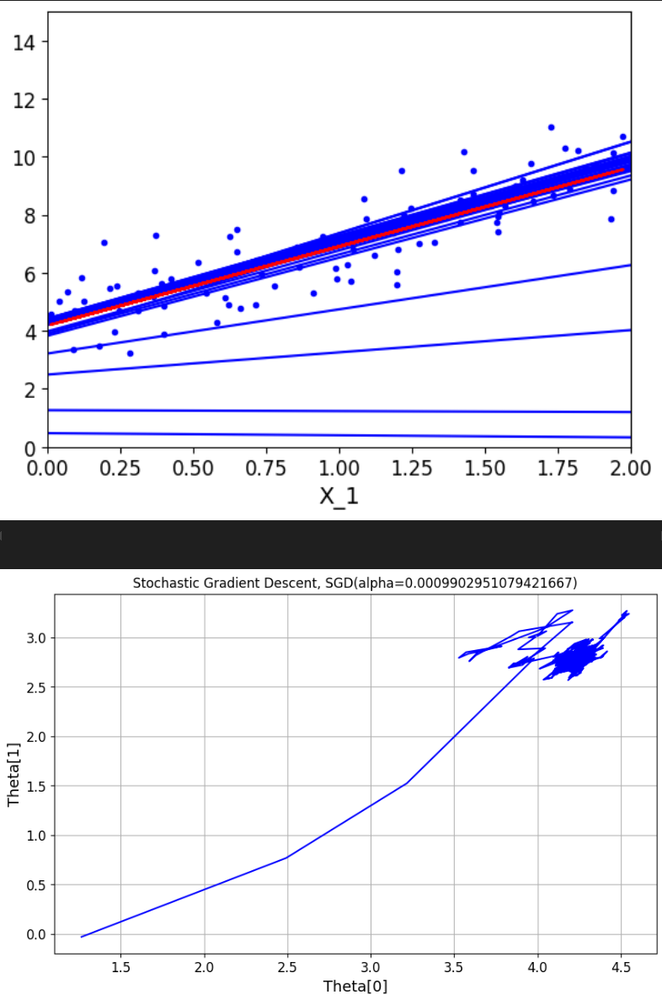

由于是随机选取的数据，所以在下降方向上也完全是随机的，因此参数优化的波动较大 ，注意这里的学习率进行了一个优化，随着迭代次数的增加而减小，这可以帮助我们更加精确的找到极小值点。

## 1.3 MGD小批量梯度下降

当收敛时，我们希望步长小一点，并且在最小值附近小幅摆动，因此我们在SGD的基础上去除了选取样本的随机性，通过滑动窗口来选取minibatch条数据，从而优化参数。

```python
theta_path_mgd = []
n_epochs = 50
minibatch = 16
theta = np.random.randn(2,1)
t = 0
t0 = 5
t1 = 50

def learning_schedule(t):
    # 学习率随着t的增加越来越小
    return t0/(t1+t)

for n_epoch in range(n_epochs):
    
    # 数据洗牌，避免每次取出的minibatch都是一样的
    shuffled_indices = np.random.permutation(m)
    x_b_new = x_b[shuffled_indices]
    y_new = y[shuffled_indices]

    # 提取minibatch个数据
    for i in range(0,m,minibatch):
        t+=1
        xi = x_b_new[i:i+minibatch]
        yi = y_new[i:i+minibatch]
        # 一次拿minibatch个数据进行梯度下降
        gradients = 2/minibatch*xi.T.dot(xi.dot(theta)-yi)

        # n_epoch*m+i表示执行次数，随着执行次数增加，学习率下降
        eta = learning_schedule(t)
        theta = theta - eta*gradients
        theta_path_mgd.append(theta)

# 展示下降结果

# 绘制数据点
plt.plot(x, y, 'b.')
plt.xlabel('X_1')
plt.axis([0, 2, 0, 15])

# 绘制最终的预测直线
y_predict = x_b.dot(theta)
plt.plot(x, y_predict, 'r-')
plt.show()

# 可视化 theta_path_mgd 的结果
theta_path_mgd = np.array(theta_path_mgd)  # 转换为 NumPy 数组
plt.figure(figsize=(10, 6))
plt.plot(theta_path_mgd[:, 0], theta_path_mgd[:, 1], 'b-')
plt.xlabel('Theta[0]')
plt.ylabel('Theta[1]')
plt.title('Mini-batch Gradient Descent: Path of Theta')
plt.grid(True)
plt.show()

        
```


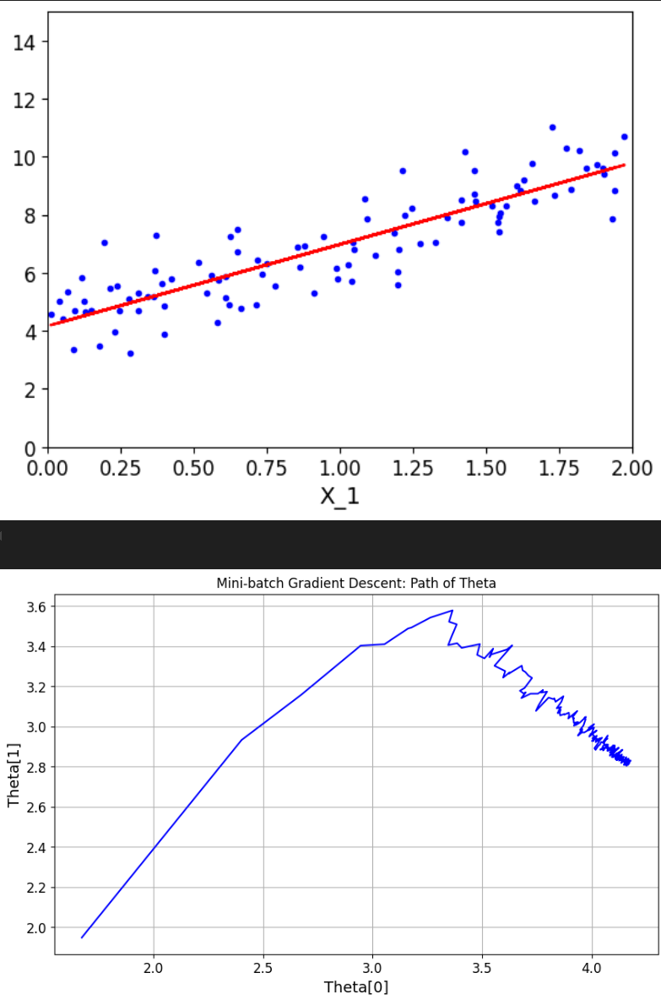

可以看到梯度下降的趋势明显趋于平稳

下面把三种方式放在一个图里对比一下 

```python
theta_path_bgd = []
theta_path_bgd = plot_gradient_descent(theta, eta=0.2)
theta_path_bgd = np.array(theta_path_bgd)
theta_path_sgd = np.array(theta_path_sgd)
theta_path_mgd = np.array(theta_path_mgd)
plt.figure(figsize=(25,12))
plt.plot(theta_path_sgd[:,0],theta_path_sgd[:,1],'r-s',linewidth=1,label='SGD')
plt.plot(theta_path_mgd[:,0],theta_path_mgd[:,1],'g-+',linewidth=2,label='MINIGD')
plt.plot(theta_path_bgd[:,0],theta_path_bgd[:,1],'b-o',linewidth=3,label='BGD')
plt.legend(loc='upper left')
plt.axis([4,4.22,2.7,2.9])
plt.show()
```


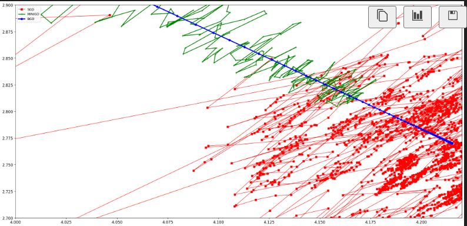

一般我们是选择minibatch来进行梯度下降的，当然还有一些更有效快捷的算法，比如Adagrad-自适应梯度，Adadelta算法，Adam-自适应矩估计等，我们后面会介绍。

#  二、 多项式回归

前面我们在对非线性数据进行线性拟合的时候提到过需要对数据进行非线性变换，也就是将数据从一个空间映射到另一个空间，从而使得数据在新的空间中更容易被处理或分析。

## 2.1 多项式变换

多项式变换是一种将数据映射到高次多项式空间的变换。它通过增加数据的维度来捕捉数据中的非线性关系。假设我们有一个 n 维输入向量 x=[x1,x2,…,xn]，多项式变换可以将每个特征扩展到 d 次多项式

![\phi(\mathbf{x}) = \left[1, x_1, x_2, \ldots, x_n, x_1^2, x_1 x_2, \ldots, x_n^2, \ldots, x_1^d, x_1^{d-1} x_2, \ldots, x_n^d \right]](2025-08-12-线性回归（二）：三种梯度下降法对比以及如何通过正则化解决过拟合问题/right].png)

## 2.2 余弦变换

余弦变换，特别是离散余弦变换（Discrete Cosine Transform, DCT），是一种将信号或数据从时域（或空间域）转换到频域的变换。它在信号处理和图像处理中非常常见，特别是在数据压缩和频谱分析中 

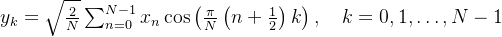

## 2.3 回归拟合

这里我们值考虑经过多项式变换后的数据的拟合

```python
# 数据
m = 100
x = 6*np.random.rand(m,1)-3
# 加上高斯抖动
y = 0.5*x**2+x+np.random.randn(m,1)

# 绘制散点图
plt.scatter(x, y, color="b")  # 使用散点图绘制数据点
plt.xlabel("x_1")  # x轴标签
plt.ylabel("y")  # y轴标签
plt.axis([-3, 3, -5, 15])  # 设置坐标轴范围
plt.show()  # 显示图像
```


 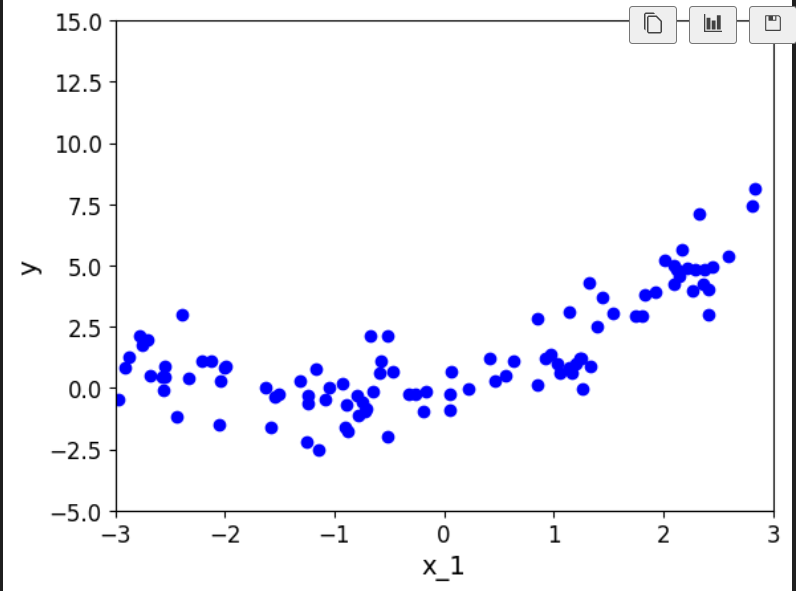

 这样的数据直接进行线性拟合，效果肯定不会乐观，因此观察数据大致走向，我们在原始数据后面加一个平方项，原本的预测函数由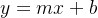，转变成了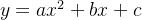，后续的梯度下降不变

打印数据来看一下：

```python
from sklearn.preprocessing import PolynomialFeatures
# 变换自变量数据
ploy_features = PolynomialFeatures(degree=2,include_bias=False)
x_ploy = ploy_features.fit_transform(x)
# 将x平方像加入x_ploy
print("原始数据",x[:10])
print("变换后的数据",x_ploy[:10])
```


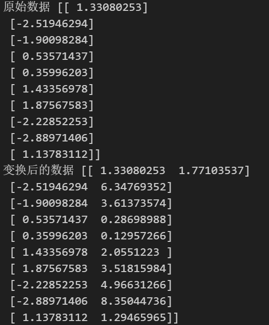

```python
# 导入机器学习包进行回归
from sklearn.linear_model import LinearRegression
lin_reg = LinearRegression()
lin_reg.fit(x_ploy,y)
# 打印theta
print(lin_reg.coef_)
print(lin_reg.intercept_)
```


 **输出参数：**

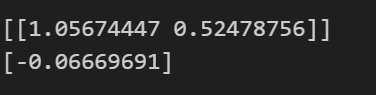

**因此最终拟合的方程为：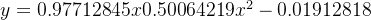**

```python
# 预测数据
x_new = np.linspace(-3,3,100).reshape(100,1)
x_new_ploy = ploy_features.transform(x_new)
y_prediction = lin_reg.predict(x_new_ploy)

plt.plot(x,y,'b.')
plt.plot(x_new,y_prediction,'r--',label='prediction')
plt.axis([-3,3,-5,10])
plt.legend()
plt.show()
```


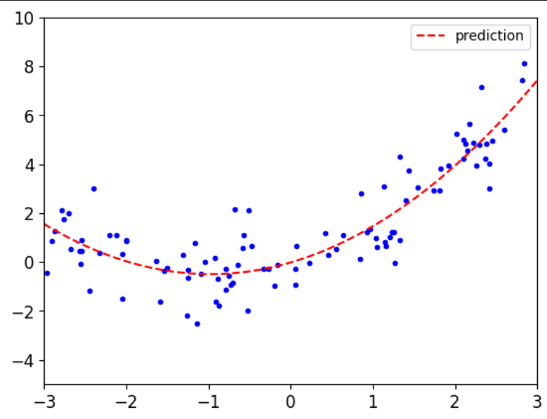

##  2.4 Pipeline函数

Pipeline 的主要功能是将多个步骤（如数据预处理、特征工程、模型训练等）串联起来。

每个步骤可以是一个转换器（Transformer）或一个估计器（Estimator）。

转换器通常用于数据预处理（如标准化、归一化、特征选择等），而估计器用于模型训练和预测

每个步骤的输出会作为下一个步骤的输入，模型的传入需要按照一定的顺序，通常最后一个使用估计器来预测

下面我们使用Pipeline来对进行一个多项式回归中，不同多项式次幂的对比实验（主要学习这个方法）

```python
from sklearn.pipeline import Pipeline
# 将多个数据处理步骤和模型训练步骤组合在一起，形成一个完整的机器学习工作流
from sklearn.preprocessing import StandardScaler
plt.figure(figsize=(12,6))
for style,width,degree in (('g-',1,100),('b--',1,2),('r-+',1,1)):
    poly_features = PolynomialFeatures(degree = degree,include_bias = False)
    std = StandardScaler()
    lin_reg = LinearRegression()
    polynomial_reg = Pipeline([('poly_features',poly_features),
             ('StandardScaler',std),
             ('lin_reg',lin_reg)])
    polynomial_reg.fit(x,y)
    y_prediction = polynomial_reg.predict(x_new)
    plt.plot(x_new,y_prediction,style,label = 'degree   '+str(degree),linewidth = width)
plt.plot(x,y,'b.')
plt.axis([-3,3,-5,10])
plt.legend()
plt.show()
```


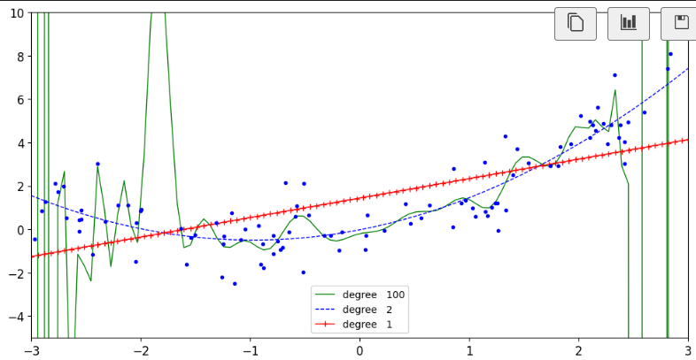

# 三、通过正则化解决过拟合问题 

构建一个机器学习模型并不总是一帆风顺的。可能在初步尝试之后，会发现模型在训练数据上的表现非常好，但在新的、未见过的数据上的表现却非常差。这就是所谓的**过拟合问题** 

下面我们探究样本数量对拟合结果的影响，通过不断增加样本，来记录下训练集与测试集的误差并绘制折线图

```python
from sklearn.metrics import root_mean_squared_error
from sklearn.model_selection import train_test_split
def plot_learning_curves(model,x,y):
    x_train,x_val,y_train,y_val = train_test_split(x,y,test_size=0.2,random_state=42)
    train_errors,val_errors = [],[]
    for m in range(1,len(x_train)):
        model.fit(x_train[:m],y_train[:m])
        y_train_predict = model.predict(x_train[:m])
        y_val_predict = model.predict(x_val)
        train_error = root_mean_squared_error(y_train[:m],y_train_predict[:m])
        val_error = root_mean_squared_error(y_val,y_val_predict)
        train_errors.append(train_error)
        val_errors.append(val_error)
    plt.plot(train_errors,'r-',linewidth = 2,label = 'train_error')
    plt.plot(val_errors,'b-',linewidth = 3,label = 'val_error')
    plt.xlabel('Trainsing set size')
    plt.ylabel('RMSE')
    plt.legend()
# 导入机器学习包进行回归
from sklearn.linear_model import LinearRegression
lin_reg = LinearRegression()
plot_learning_curves(lin_reg,x,y)
        
```


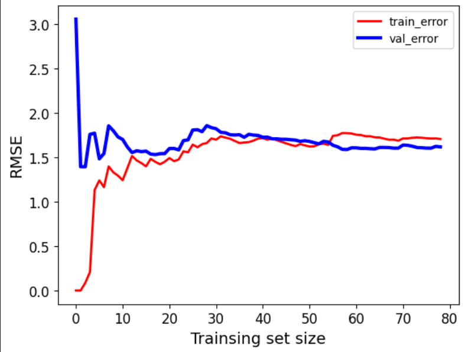

可以看到，最开始数据量很小的时候，训练集误差很小，测试集误差恒大，这就是模型过分学习到训练集的特征，导致模型在新的数据上缺乏泛华能力，既过拟合。随着样本量一点点增加，训练集误差上升，测试集误差下降 ，最终达到基本平衡，模型趋于稳定。

多项式回归也有类似过拟合风险

```python
polynomial_reg = Pipeline([('poly_features',PolynomialFeatures(degree = 2,include_bias = False)),
             ('lin_reg',LinearRegression())])
plot_learning_curves(polynomial_reg,x,y)
plt.show()
```


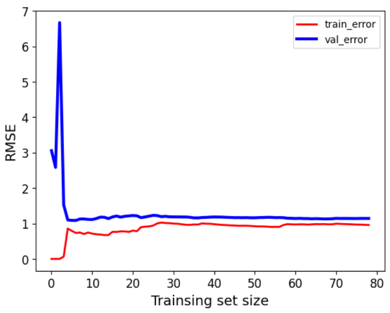

值得一提的是，在多项式回归中，改变非线性变换的阶数，对模型的影响也非常大，由于最开始我们定义随机数据的时候是在二次函数基础上上下震荡，这里也变换到二次项，那么如果我们改为变换到十次项会发生什么呢？

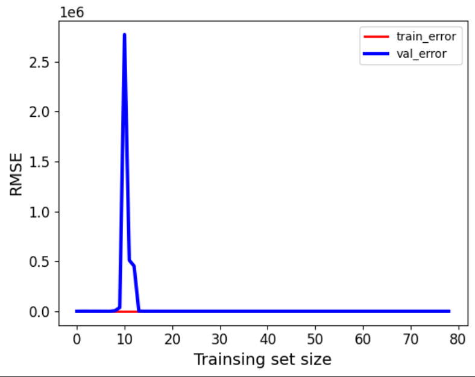

可以看到模型基本不具备预测能力。那么如何解决过拟合问题，使模型在**数据量较小，或者数据存在多重共线性，或者特征较多**时，仍然具备计较好的泛化能力？

# 四、正则化解决过拟合问题

**正则化通过在损失函数中添加一个正则项来限制模型参数的复杂度**。常见的正则项有L1正则项（参数的绝对值之和）和L2正则项（参数的平方和）。这些正则项会惩罚参数的过大值，使得模型在拟合数据时不会过度依赖某些参数。

## 4.1 L1正则化（lasso回归）——特征选择


L1正则化会在损失函数中添加一个**与模型参数权重绝对值成正比的项**。这会导致一些**不重要的特征对应的参数直接压缩为0，从而实现特征选择**。通过去除不重要的特征，模型可以更加专注于重要的特征，提高模型的泛化能力。

## 4.2 L2正则化（岭回归）——处理多重共线性


L2正则化会在损失函数中添加一个**与模型参数权重平方和成正比的项**。这可以**限制参数的大小，从而减少多重共线性的影响**。在存在多重共线性时，普通最小二乘法得到的参数估计可能非常不稳定，对数据的微小变化非常敏感。而**L2正则化可以提高参数估计的稳定性，使模型更加稳健**。

## 4.3 代码演示

还是以上面提到的为数据进行十次幂的非线性转换，这里我们再引入不同的alpha参数（**一个超参数，用于控制正则项的强度。它决定了正则化对模型参数的约束程度，从而影响模型的复杂度和泛化能力**），观察两种正则化方法对alpha值的敏感程度

```python
from sklearn.linear_model import Ridge
from sklearn.linear_model import Lasso
# 数据
m = 100
x = 6*np.random.rand(m,1)-3
# 加上高斯抖动
y = 0.5*x**2+x+np.random.randn(m,1)
X_new = np.linspace(-3,3,100).reshape(100,1)

# alphas是岭回归的参数
def plot_model(model_calss,polynomial,alphas,**model_kargs):
    for alpha,style in zip(alphas,('b-','g--','r:')):
        # 不同的alpha不同的曲线形式
        model = model_calss(alpha,**model_kargs)
        if polynomial:
            model = Pipeline([('poly_features',PolynomialFeatures(degree =10,include_bias = False)),
             ('StandardScaler',StandardScaler()),
             ('lin_reg',model)])
        model.fit(x,y)
        y_new_regul = model.predict(X_new)
        lw = 2
        plt.plot(X_new,y_new_regul,style,linewidth = lw,label = 'alpha = {}'.format(alpha))
    plt.plot(x,y,'b.',linewidth =3)
    plt.legend()
```


**L1正则化**

```python
plt.figure(figsize=(14,6))
plt.subplot(121)
plot_model(Lasso,polynomial=False,alphas = (0,0.1,1))
plt.subplot(122)
plot_model(Lasso,polynomial=True,alphas = (0,0.1,1))
plt.show()
```


 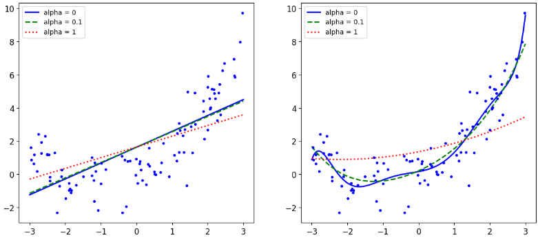

**L2正则化**

```python
plt.figure(figsize=(14,6))
plt.subplot(121)# 单纯的岭回归正则化
plot_model(Ridge,polynomial=False,alphas = (0,10,100))
plt.subplot(122)# 经过多项式变换后的岭回归正则化
plot_model(Ridge,polynomial=True,alphas = (0,10**-5,1))
plt.show()
```


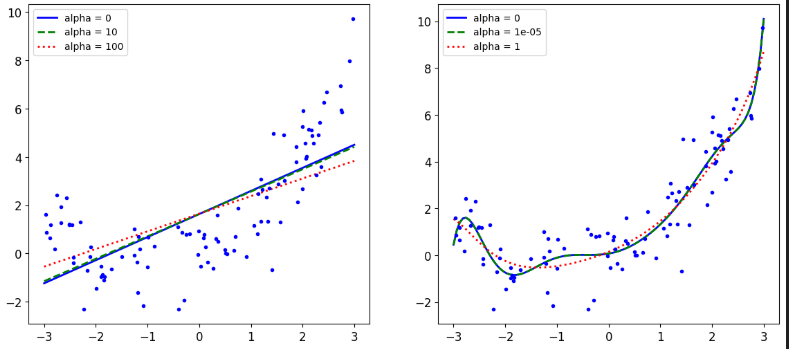

对比两种正则化，可以发现**L1正则化对alpha的变化更加敏感**，实际上，L1正则化通过惩罚参数的绝对值，使得一些参数可以被压缩到0，从而实现特征选择。**当alpha值增大时，更多的特征权重会被压缩为0，模型会变得更加稀疏。**，而L2正则化通过惩罚参数的平方和来限制参数的大小，但不会将参数压缩为0。因此，alpha的变化对模型的影响相对平滑，不会像L1正则化那样导致特征权重的剧烈变化。**L2正则化更倾向于均匀地减小所有参数的值，而不是完全消除某些参数。**

到这里线性回归的内容就差不多了，当然这只是线性回归的冰山一角，机器学习冰山一角的冰山一角。。。
