# 前言

在上一系列文章我们讲了线性回归的相关知识，回归和分类是机器学习中两种核心的任务类型，它们的根本区别在于目标变量的性质。**回归任务**旨在预测一个连续的数值输出，例如预测房价、温度或销售额等，其目标是建立一个模型来拟合输入特征与连续目标值之间的关系。而**分类任务**则是预测离散的类别标签，比如判断邮件是否为垃圾邮件、图像中的人物身份，或者是疾病诊断等，其目的是通过模型将输入数据划分到预定义的类别中。本系列文章主要来讲讲如何应用逻辑回归来对数据进行分类。

# 一、基础理论部分

逻辑回归（Logistic Regression）是一种广泛应用于二分类问题的统计学习方法，通过将系数与自变量的线性计算结果输入到sigmoid函数中，得到概率预测值，从而达到分类的效果。

## 1.1 sigmoid函数

在逻辑回归中，Sigmoid函数用于将线性组合的输出映射到(0, 1)区间，从而将问题转化为概率预测问题

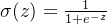

下面是一个对Sigmoid函数解释以及逻辑回归的预测函数推导

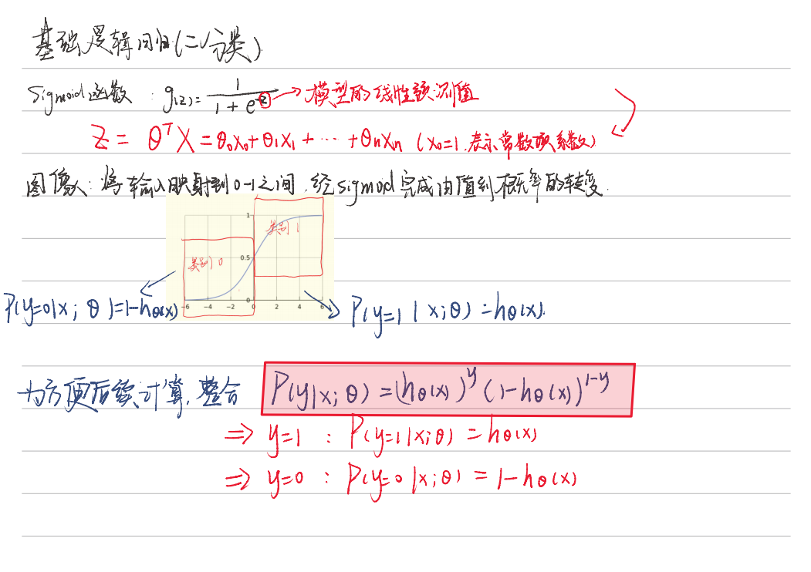

 这里值得注意的是sigmoid函数的输入部分，笔记里写的是线性预测值，实际上是**线性计算值**，意思是并非线性回归得到的参数，**这里的参数theta是基于逻辑回归的梯度下降法优化得到的，而非最小二乘法**

## **1.2 梯度下降**

类比最小二乘法，这里我们为了更好的描述模型的概率分布，引入似然函数，通过最大化似然函数来优化模型参数theta，简单公式推导如下，这里也省略了推导过程，因为我们只需要结论

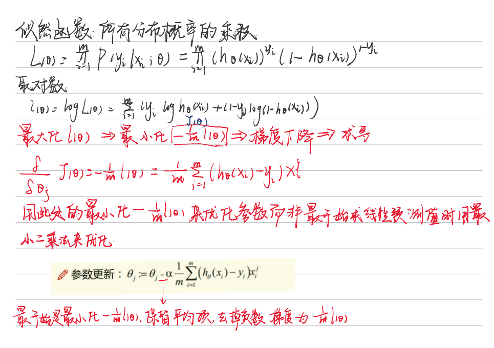

这里通过引入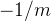来最小化.png)，实际上也可以通过改变参数更新的符号（减改为加）来达到最大化似然函数的目的，这样的方法叫**梯度上升**

##  1.3 softmax函数

softmax函数是一种在机器学习和深度学习中常用的激活函数，特别是在处理多分类问题时。它将一个向量或一组实数转换为一个概率分布，将模型的输出转换为概率预测。使得每个元素的值都在0到1之间，并且所有元素的和为1。

**softmax公式：**

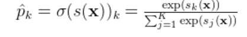

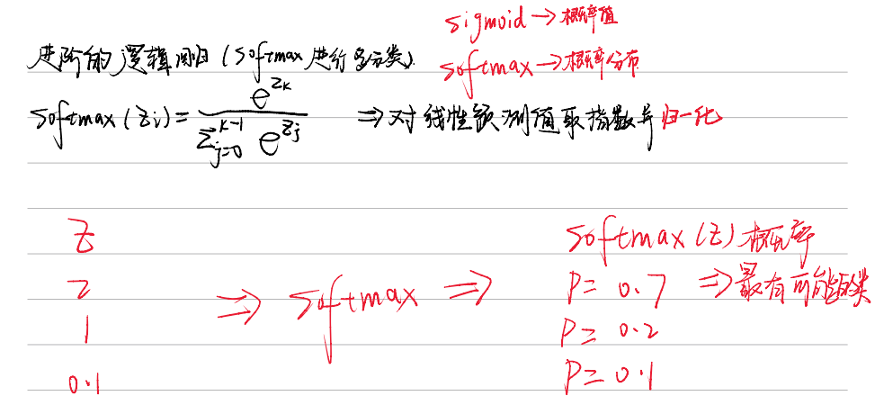

对于softmax函数，我们仍然需要 通过最大似然函数来求得最优参数，**交叉熵相当于多分类任务目标损失函数**，也是我们的梯度下降目标，简单了解就行公式定义如下

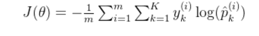

 这个公式计算了模型预测的概率分布与真实标签之间的差异，目标是通过优化参数 θ 来最小化这个损失。

理论部分比较简单，只要知道二分类使用sigmoid函数，多分类使用softmax函数，以及整个分类的流程即可

# 二、sklearn代码复现

逻辑回归的基本形式是使用一个线性函数来预测事件发生的概率，然后通过一个非线性的激活函数（Sigmoid函数）将线性函数的输出映射到0和1之间的概率值。因此对于非线性的数据，我们也可以通过变换来将他转变为线性数据。

## 2.1 初始化

```python
import numpy as np
from scipy.optimize import minimize
from utils.features import prepare_for_training
from utils.hypothesis import sigmoid


class LogisticRegression:
    def __init__(self, data, labels, polynomial_degree=0, sinusoid_degree=0, normalize_data=True):
        """
        1.对数据预处理
        2.得到所有特征个数
        3.得到初始化参数矩阵
        """
        (data_processed,
         features_mean,
         features_deviation) = prepare_for_training(data, polynomial_degree, sinusoid_degree, normalize_data=False)

        self.data = data_processed  # 非线性变化（可选）处理后的特征数据
        self.labels = labels

        # 计算不同的类别labels有多少个
        self.unique_labels = np.unique(labels)

        # 原始特征的均值，通常用于归一化过程
        self.features_mean = features_mean
        # 原始特征的标准差或方差，用于归一化过程
        self.features_deviation = features_deviation

        self.polynomial_degree = polynomial_degree
        # polynomial_degree 大于 1，函数可能会对原始特征进行多项式扩展
        self.sinusoid_degree = sinusoid_degree
        # 如果 sinusoid_degree 大于 0，函数可能会对原始特征进行正弦和余弦变换
        self.normalize_data = normalize_data
        # 如果 normalize_data=True，函数会对数据进行归一化处理

        num_features = self.data.shape[1]  # 特征数即为theta的个数（下标）
        num_unique_labels = np.unique(labels).shape[0]  # 分出来的类别
        self.theta = np.zeros((num_unique_labels, num_features))  # 根据theta个数创建初始化矩阵
```


初始化了一些变量，这里unique_labels代表在数据中一共要分为几个类别，theta参数的个数由数据的特征数决定

## 2.2 train()模块

```python
    @staticmethod
    def hypothesis(data, theta):
        # 这里计算的只是通过sigmoid函数得出的一个概率，并非实际预测值，在二分类中，我们通常将样本类别判定给概率较大的那一个类别
        prob = sigmoid(np.dot(data, theta))
        return prob

    @staticmethod
    def cost_function(data, labels, theta):
        num_examples = data.shape[0]
        predictions = LogisticRegression.hypothesis(data, theta)

        # 目标损失函数
        y_is_set_cost = np.dot(labels[labels == 1].T, np.log(predictions[labels == 1]))
        y_is_not_set_cost = np.dot(1 - labels[labels == 0].T, np.log(1 - predictions[labels == 0]))
        cost = (-1 / num_examples) * (y_is_set_cost + y_is_not_set_cost)

        return cost


    @staticmethod
    def gradient_step(data, labels, theta):
        num_examples = labels.shape[0]
        predictions = LogisticRegression.hypothesis(data, theta)
        label_diff = predictions - labels
        # 负号没有了
        gradients = (1 / num_examples) * np.dot(data.T, label_diff)

        return gradients.T.flatten()

    @staticmethod
    def gradient_descent(data, labels, current_initial_theta, max_iterations):
        """
        from scipy.optimize import minimize
        result = minimize(
            fun,          # 目标函数
            x0,           # 初始参数
            args=(),      # 传递给目标函数的额外参数
            method=None,  # 优化方法
            jac=None,     # 目标函数的梯度（可选）
            hess=None,    # 目标函数的Hessian矩阵（可选）
            constraints=(),  # 约束条件（可选）
            callback=None,   # 每次迭代的回调函数（可选）
            options=None     # 优化选项（如最大迭代次数等）
        )
        """
        cost_history = []
        num_features = data.shape[1]

        # 调用scipy.optimize.minimize进行优化
        result = minimize(

            # 要优化的目标：
            lambda current_theta: LogisticRegression.cost_function(data, labels,
                                                                   current_theta.reshape(num_features, 1)),
            # 初始化的权重参数
            current_initial_theta.flatten(),
            # 选择优化策略
            method='CG',
            # 梯度下降迭代计算公式
            jac=lambda current_theta: LogisticRegression.gradient_step(data, labels,
                                                                       current_theta.reshape(num_features, 1)),
            # 记录结果
            callback=lambda current_theta: cost_history.append(
                LogisticRegression.cost_function(data, labels, current_theta.reshape((num_features, 1)))),
            # 迭代次数
            options={'maxiter': max_iterations}
        )

        if not result.success:
            raise ArithmeticError('Can not minimize cost function' + result.message)
        optimized_theta = result.x.reshape(num_features, 1)
        return optimized_theta, cost_history

    def train(self, max_iterations=1000):
        cost_histories = []
        num_features = self.data.shape[1]
        for label_index, unique_label in enumerate(self.unique_labels):
            # 匹配单个theta值用于后续梯度下降
            current_initial_theta = np.copy(self.theta[label_index].reshape(num_features, 1))
            # 匹配每个theta矩阵对应的分类标签值用于后续梯度下降
            current_lables = (self.labels == unique_label).astype(float)
            # 将每一类的theta和标签值分别用来梯度下降，返回优化后的theta和损失值变化列表
            (current_theta, cost_history) = LogisticRegression.gradient_descent(self.data, current_lables,
                                                                                current_initial_theta, max_iterations)
            # 更新对应标签的theta参数，将损失值添加到总列表中
            self.theta[label_index] = current_theta.T
            cost_histories.append(cost_history)

        return self.theta, cost_histories
```


注意在这里使用了一个**`minimize，`**通常指的是找到一个函数的最小值或最小化某个目标函数的过程。这个过程是许多算法的核心，尤其是在训练模型时，目标是通过调整模型参数来最小化损失函数（或代价函数）

## 2.3 预测模块

```python
    def predict(self, data):
        # 这一步是将类别与对应的索引混合起来进行匹配
        num_examples = data.shape[0]
        data_processed = prepare_for_training(data, self.polynomial_degree, self.sinusoid_degree, self.normalize_data)[
            0]
        # 预测概率矩阵(每一行表示一个样本的预测概率，每一列表示一个类别的预测概率。)
        prob = LogisticRegression.hypothesis(data_processed, self.theta.T)
        # 找到预测矩阵中样本类别预测最大的概率对应的类索引
        max_prob_index = np.argmax(prob, axis=1)
        # 创建一个空数组用于存储最终的类别预测
        class_prediction = np.empty(max_prob_index.shape, dtype=object)
        # 遍历提前分好的类别索引以及对应的类别
        for index, label in enumerate(self.unique_labels):
            # 查找索引归类
            class_prediction[max_prob_index == index] = label
        return class_prediction.reshape((num_examples, 1))
```


可以看到逻辑回归的代码结构和之前我懵线性回归基本相同，需要改变的部分只有梯度下降部分函数以及预测方式

## 2.4 线性数据测试

这里选用鸢尾花数据集来带入模型进行二分类，在分类中结果的可视化中，通常绘制决策边界来可视化分类效果，前面也提到过分类模型的评估指标，这里不再重复叙述

```python
import numpy as np
import pandas as pd
import matplotlib.pyplot as plt
import matplotlib

matplotlib.use('TkAgg')
from logistic_regression import LogisticRegression

data = pd.read_csv(r'data\iris.csv')
iris_types = ['SETOSA', 'VERSICOLOR', 'VIRGINICA']

x_axis = 'petal_length'
y_axis = 'petal_width'

for iris_type in iris_types:
    plt.scatter(data[x_axis][data['class'] == iris_type],
                data[y_axis][data['class'] == iris_type],
                label=iris_type
                )
plt.show()

num_examples = data.shape[0]
x_train = data[[x_axis, y_axis]].values.reshape((num_examples, 2))
y_train = data['class'].values.reshape((num_examples, 1))

max_iterations = 1000
polynomial_degree = 0
sinusoid_degree = 0

logistic_regression = LogisticRegression(x_train, y_train, polynomial_degree, sinusoid_degree)
thetas, cost_histories = logistic_regression.train(max_iterations)
labels = logistic_regression.unique_labels

plt.plot(range(len(cost_histories[0])), cost_histories[0], label=labels[0])
plt.plot(range(len(cost_histories[1])), cost_histories[1], label=labels[1])
plt.plot(range(len(cost_histories[2])), cost_histories[2], label=labels[2])
plt.show()

y_train_prections = logistic_regression.predict(x_train)
# 乘以 100 转换为百分比格式
precision = np.sum(y_train_prections == y_train) / y_train.shape[0] * 100
print('precision:', precision)

x_min = np.min(x_train[:, 0])
x_max = np.max(x_train[:, 0])
y_min = np.min(x_train[:, 1])
y_max = np.max(x_train[:, 1])
samples = 150
X = np.linspace(x_min, x_max, samples)
Y = np.linspace(y_min, y_max, samples)

Z_SETOSA = np.zeros((samples, samples))
Z_VERSICOLOR = np.zeros((samples, samples))
Z_VIRGINICA = np.zeros((samples, samples))

for x_index, x in enumerate(X):
    for y_index, y in enumerate(Y):
        data = np.array([[x, y]])
        prediction = logistic_regression.predict(data)[0][0]
        if prediction == 'SETOSA':
            Z_SETOSA[x_index][y_index] = 1
        elif prediction == 'VERSICOLOR':
            Z_VERSICOLOR[x_index][y_index] = 1
        elif prediction == 'VIRGINICA':
            Z_VIRGINICA[x_index][y_index] = 1

for iris_type in iris_types:
    plt.scatter(
        x_train[(y_train == iris_type).flatten(), 0],
        x_train[(y_train == iris_type).flatten(), 1],
        label=iris_type
    )

plt.contour(X, Y, Z_SETOSA)
plt.contour(X, Y, Z_VERSICOLOR)
plt.contour(X, Y, Z_VIRGINICA)
plt.show()
```


简单展示一下**决策边界** 

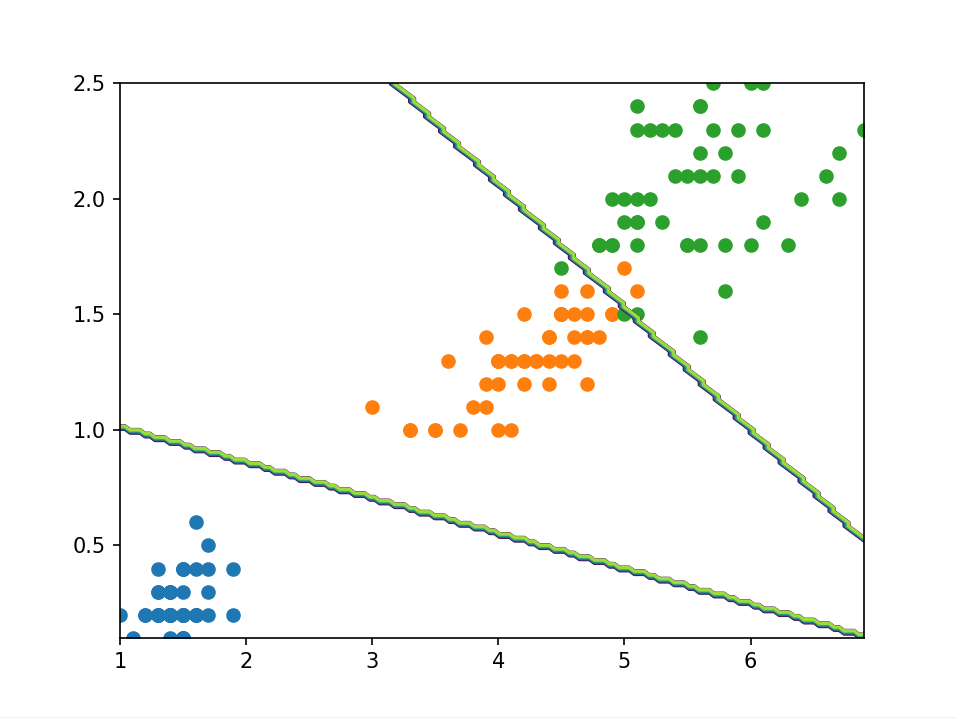

 2.5 非线性数据测试

引入非线性数据进行非线性变换后，模型的分类会更加灵活

```python
import numpy as np
import pandas as pd
import matplotlib.pyplot as plt
import matplotlib

matplotlib.use('TkAgg')
from logistic_regression import LogisticRegression

data = pd.read_csv(r'D:\桌面\华清\机器学习\西瓜书\逻辑回归\data\microchips-tests.csv')

# 类别标签
validities = [0, 1]

# 选择两个特征
x_axis = 'param_1'
y_axis = 'param_2'

# 散点图
for validity in validities:
    plt.scatter(
        data[x_axis][data['validity'] == validity],
        data[y_axis][data['validity'] == validity],
        label=validity
    )

plt.xlabel(x_axis)
plt.ylabel(y_axis)
plt.title('Microchips Tests')
plt.legend()
plt.show()

num_examples = data.shape[0]
x_train = data[[x_axis, y_axis]].values.reshape((num_examples, 2))
y_train = data['validity'].values.reshape((num_examples, 1))

# 训练参数
max_iterations = 100000
regularization_param = 0
polynomial_degree = 5
sinusoid_degree = 2
# 逻辑回归
logistic_regression = LogisticRegression(x_train, y_train, polynomial_degree, sinusoid_degree)

# 训练
(thetas, costs) = logistic_regression.train(max_iterations)

columns = []
for theta_index in range(0, thetas.shape[1]):
    columns.append('Theta ' + str(theta_index));

# 训练结果
labels = logistic_regression.unique_labels

plt.plot(range(len(costs[0])), costs[0], label=labels[0])
plt.plot(range(len(costs[1])), costs[1], label=labels[1])

plt.xlabel('Gradient Steps')
plt.ylabel('Cost')
plt.legend()
plt.show()

# 预测
y_train_predictions = logistic_regression.predict(x_train)

# 准确率
precision = np.sum(y_train_predictions == y_train) / y_train.shape[0] * 100

print('Training Precision: {:5.4f}%'.format(precision))

num_examples = x_train.shape[0]
samples = 150
x_min = np.min(x_train[:, 0])
x_max = np.max(x_train[:, 0])

y_min = np.min(x_train[:, 1])
y_max = np.max(x_train[:, 1])

X = np.linspace(x_min, x_max, samples)
Y = np.linspace(y_min, y_max, samples)
Z = np.zeros((samples, samples))

# 结果展示
for x_index, x in enumerate(X):
    for y_index, y in enumerate(Y):
        data = np.array([[x, y]])
        Z[x_index][y_index] = logistic_regression.predict(data)[0][0]

positives = (y_train == 1).flatten()
negatives = (y_train == 0).flatten()

plt.scatter(x_train[negatives, 0], x_train[negatives, 1], label='0')
plt.scatter(x_train[positives, 0], x_train[positives, 1], label='1')

plt.contour(X, Y, Z)

plt.xlabel('param_1')
plt.ylabel('param_2')
plt.title('Microchips Tests')
plt.legend()

plt.show()
```


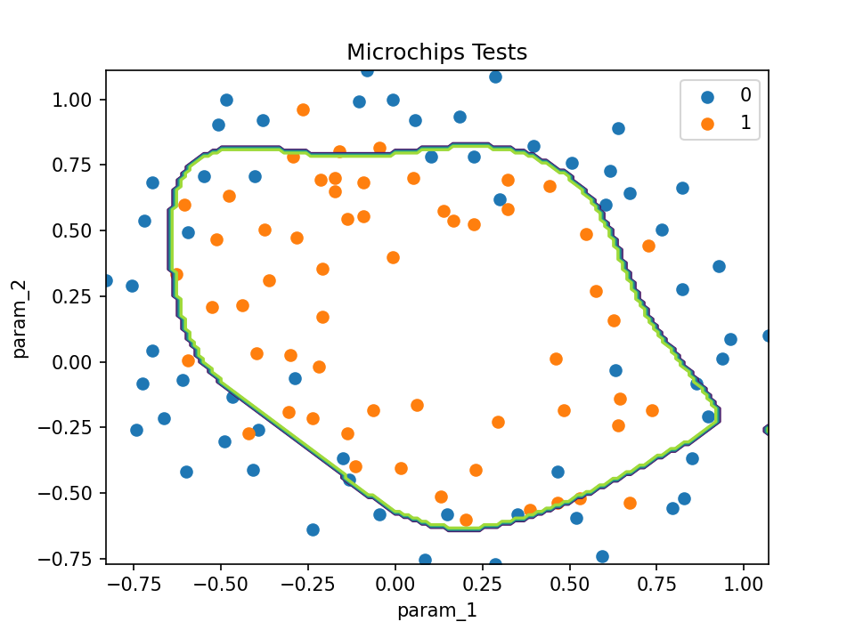

# 三、机器学习LogisticRegression库

在sklearn库中使用LogisticRegression进行逻辑回归比较简单，接下来我们将一一进行演示，并且引入多分类。

## 3.1 二分类

首先导入鸢尾花数据集，并将转换分类标签数目为2，方便后续二分类操作。

```python
from sklearn.datasets import load_iris
iris = load_iris()
# 选取一个特征，花瓣宽度
x = iris["data"][:,3:]
# 布尔值 True 转换为整数 1，布尔值 False 转换为整数 0,构成二分类（类别2和其他）
y = (iris["target"] == 2).astype(int)
y
```


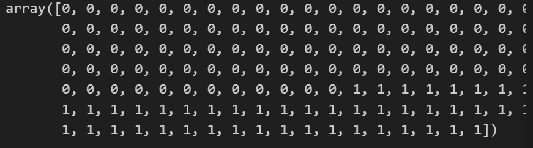

调用LogisticRegression进行回归

```python
from sklearn.linear_model import LogisticRegression
log_res = LogisticRegression()
log_res.fit(x,y)

生成新的数据作为预测输入
x_new = np.linspace(0,3,1000).reshape(-1,1)

# 计算概率值
y_proba = log_res.predict_proba(x_new)
y_proba
```


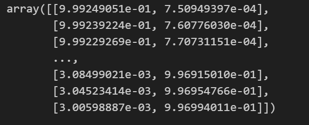

注意这里二分类的概率值有两列，表示模型对输入数据的预测概率，即每个样本属于每个类别的概率，我们可以可视化一下概率情况，不难理解，样本属于A类的概率越大，属于B类的概率就越小

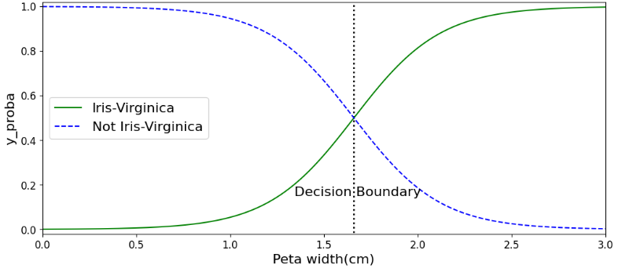

**决策边界**的本质是模型**根据输入特征进行分类的分界线**。对于给定的输入数据，决策边界将特征空间划分为不同的区域，**每个区域对应一个类别**。**模型会根据数据点落在哪个区域来预测其类别**。

下面我们来看看如何绘制**决策边界，**不用背代码，只需要知道套用到自己的模型时怎么更改参数就行了

```python
x = iris["data"][:,(2,3)]
y = (iris["target"]==2).astype(np.int_)

from sklearn.linear_model import LogisticRegression
log_res = LogisticRegression()
log_res.fit(x,y)

import matplotlib.pyplot as plt
%matplotlib inline
from matplotlib.colors import ListedColormap
import numpy as np

def plot_decision_region(X, y, classifier, resolution=0.02):
    markers = ('s', 'x', 'o', '^', 'v')
    colors = ('red', 'blue', 'lightgreen', 'gray', 'cyan')
    cmap = ListedColormap(colors[:len(np.unique(y))])

    # 获取特征范围并扩展边界
    x1_min, x1_max = X[:, 0].min() - 1, X[:, 0].max() + 1
    x2_min, x2_max = X[:, 1].min() - 1, X[:, 1].max() + 1

    # 生成网格点坐标矩阵
    xx1, xx2 = np.meshgrid(np.arange(x1_min, x1_max, resolution),
                           np.arange(x2_min, x2_max, resolution))

    # 计算分类器的预测概率
    Z = classifier.predict_proba(np.array([xx1.ravel(), xx2.ravel()]).T)[:, 1]  # 假设我们关注第2个类别的概率
    Z = Z.reshape(xx1.shape)

    # 绘制等高线概率图
    plt.contourf(xx1, xx2, Z, alpha=0.3, cmap=plt.cm.RdBu, levels=np.linspace(Z.min(), Z.max(), 10))
    plt.colorbar()  # 添加颜色条

    # 绘制决策边界
    plt.contour(xx1, xx2, Z, levels=[0.5], colors='k', linestyles='--')  # 0.5 是决策阈值

    # 绘制样本点
    for idx, cl in enumerate(np.unique(y)):
        plt.scatter(x=X[y == cl, 0],
                    y=X[y == cl, 1],
                    alpha=0.8,
                    c=colors[idx],
                    marker=markers[idx],
                    label=cl,
                    edgecolors='black')

    plt.xlabel('petal length')
    plt.ylabel('petal width')
    plt.legend(loc='upper left')
    plt.show()

# 假设 x, y 和 log_res 是已经定义好的数据和分类器
plot_decision_region(x, y, classifier=log_res, resolution=0.01)
```


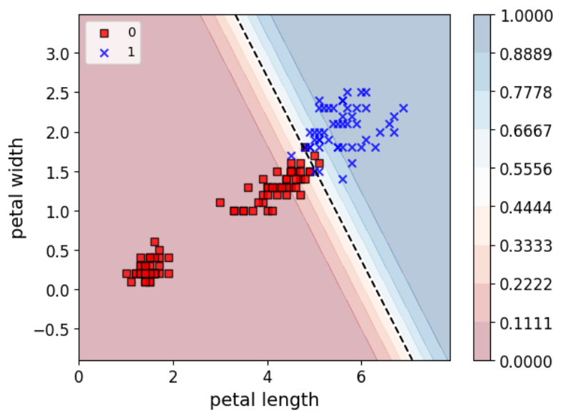

## 3.2 多分类

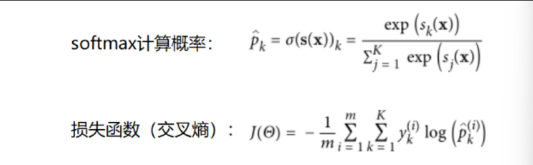

**简单代码示例：** 

```python
X = iris['data'][:,(2,3)]
y = iris['target']

softmax__reg = LogisticRegression(multi_class="multinomial",solver="lbfgs")
softmax__reg.fit(x,y)

plot_decision_region(x, y, classifier=softmax__reg, resolution=0.01)
```


 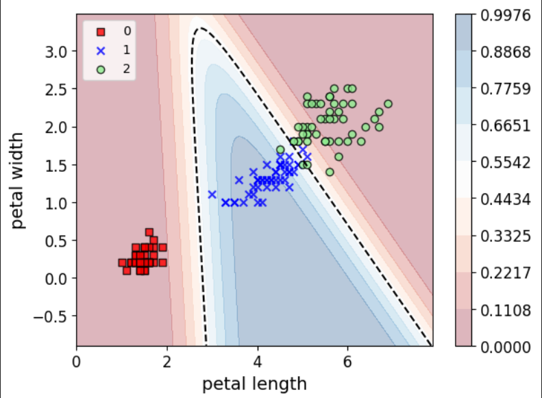

逻辑回归理论以及实操部分到这里基本告一个段落。。。
