# 前言：Gitee学习笔记

# 一、用Git命令行指令上传

创建好自己的Gitee账号后，首先在界面里面创建一个仓库

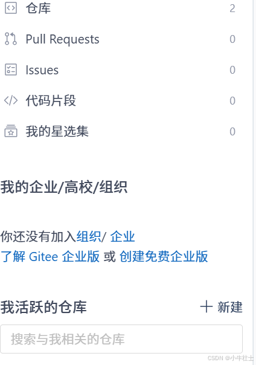

填好仓库的名称，路径和描述信息

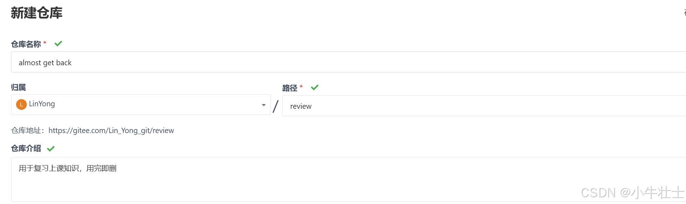

这里可以看到一些基础的教学，先克隆仓库地址，例如[LinYong/almost get back](https://gitee.com/Lin_Yong_git/review.git)

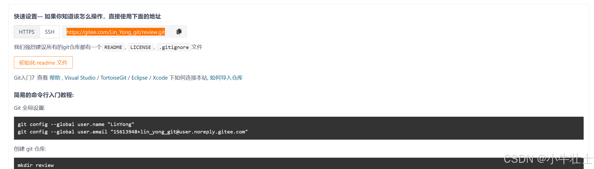

回到需要放置仓库的文件夹，右键更多选项，点击open git bash here，打开终端界面

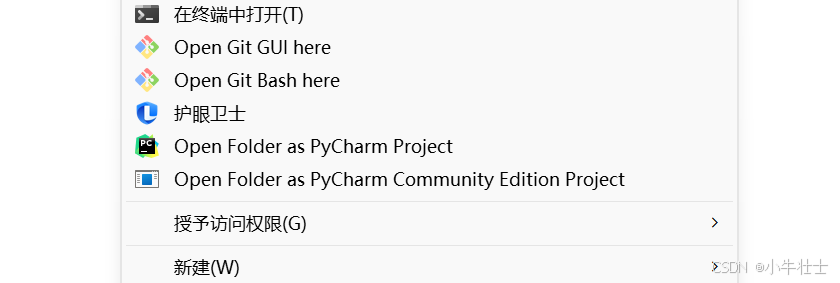

输入git clone ＋ 仓库地址，可以在文件夹中看到新增的仓库文件夹

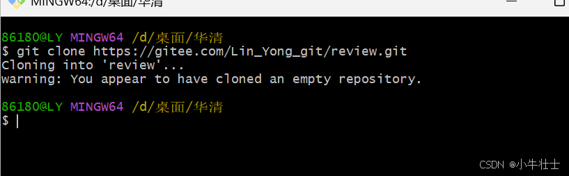

点进去新建文件，这里就是我们放工程文件的地方

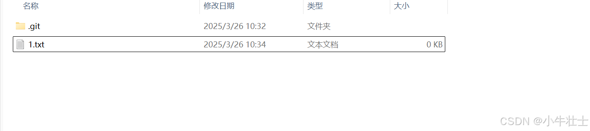

在这里再打开open git bash here界面

依次输入这几条指令:

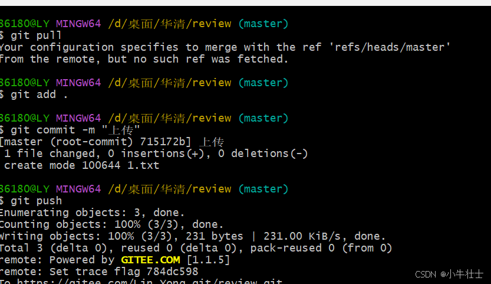

**指令解析：**

git clone + 地址 ==>拉去别人的仓库到本地

git pull ==> 更新整个仓库的所有更改（别人修改的也可以看见），提交前一定要先pull，push之前先pull确保提交时是代码的最新版本
 git add .  ==>将更改过的新修改文件添加到暂存区，这里的 . 代表所有文件
 git commit -m ==>提交本地仓库，添加修改描述
 git push ==> 上传自己的更新，提交云端仓库

然后就可以在Gitee仓库里面看到新上传的文件了

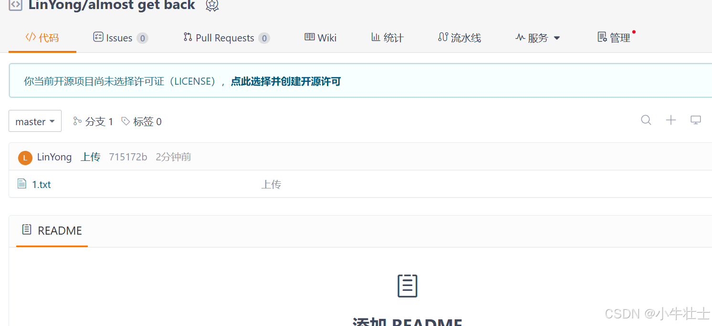

为了支持多人协作开发和多任务处理，同城还需要创建分支，在团队开发中，多个开发者可以同时在不同的分支上工作，互不干扰。例如，一个团队正在开发一个大型软件项目，开发人员 A 可以在 `feature-login` 分支上开发登录功能，开发人员 B 可以在 `feature-payment` 分支上开发支付功能。每个分支独立，避免了代码冲突，提高了开发效率。

即使是一个人开发，也可以通过分支同时处理多个任务。比如，开发者可以在 `main` 分支上维护稳定版本，同时在 `feature-new-ui` 分支上开发新的用户界面，而不会影响主分支的稳定性。

下面是命令行创建分支的示例：

打开open git bash here界面,输入git branch指令查看当前分支，输入git branch linlin指令创建名叫linlin的分支名， git checkout linlin切换到linlin分支，就可以开始向分支里面上传代码了，注意push的时候需要将指令改为git push origin linlin，不然会报错

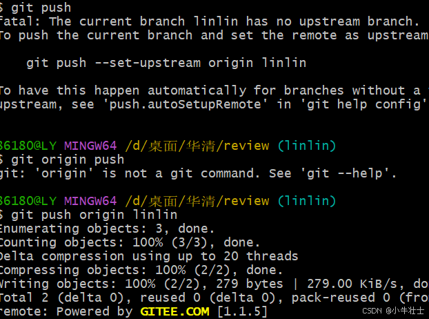

添加成功 

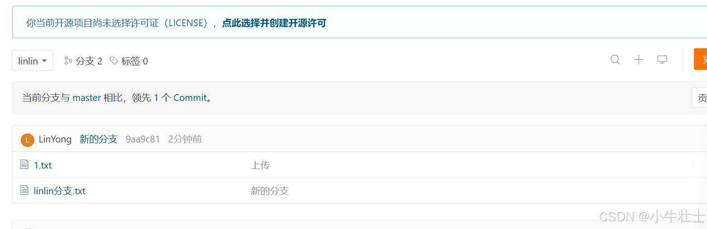

# 二、用vscode可视化界面上传

还是要先clone仓库到本地，使用vscode打开仓库文件夹

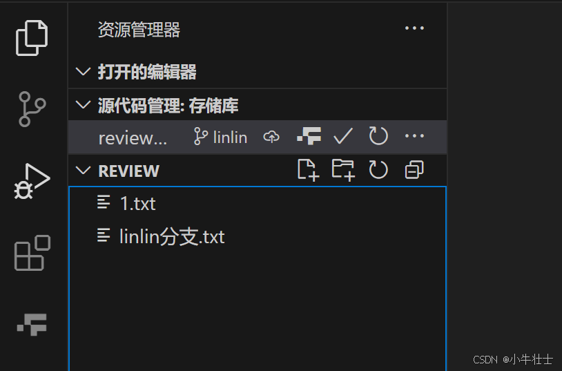

这里不添加新文件，而是在“linlin分支”文件里面修改，vscode会自动检测到修改并且显示

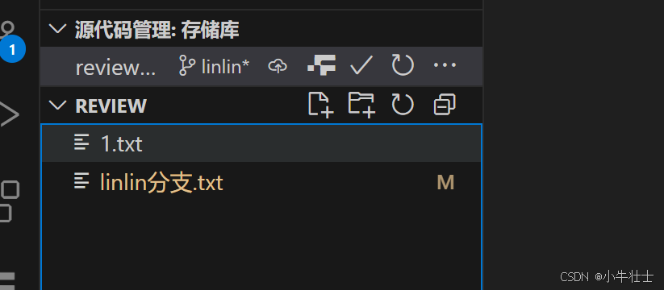

修改后点击提交并添加修改描述，这一步和git commit -m " "类似

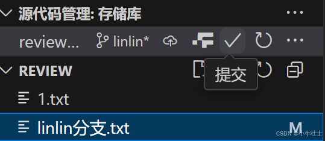

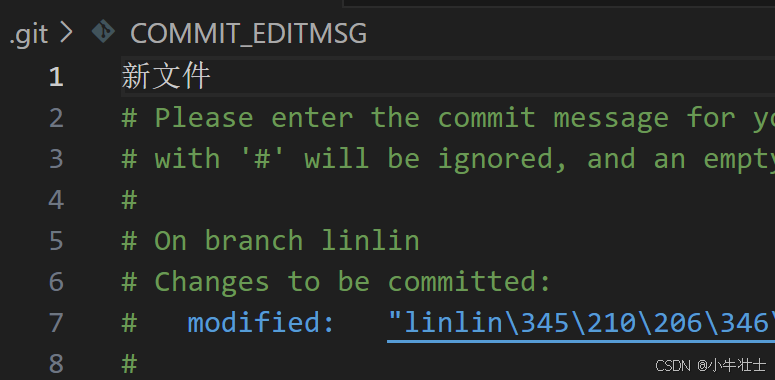

重复步骤修改文件里面内容，可以看到修改的地方

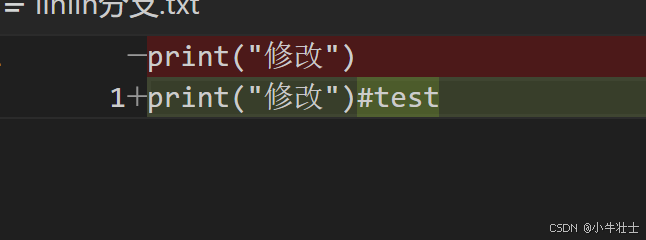

同时也可以在这里创建和选择分支

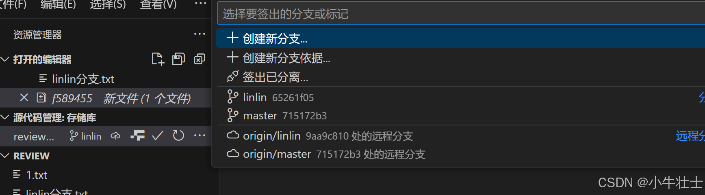

**到这里只是把文件提交到临时存储库！！！还要点击推送才能提交上云仓库**

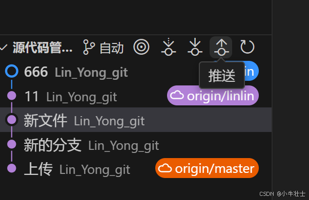

就能在Gitee仓库里面看到上传的文件了

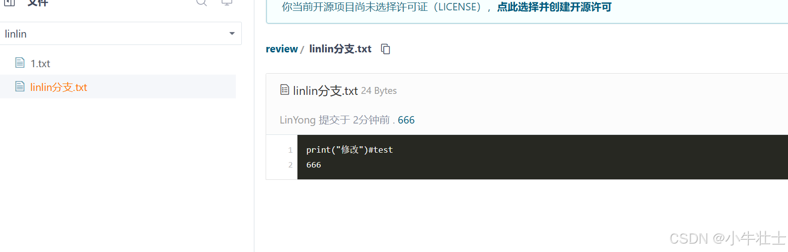

 当然上面操作都是在linlin分支上操作的，当回到master分支就只能看到最开始创建的1.txt文件

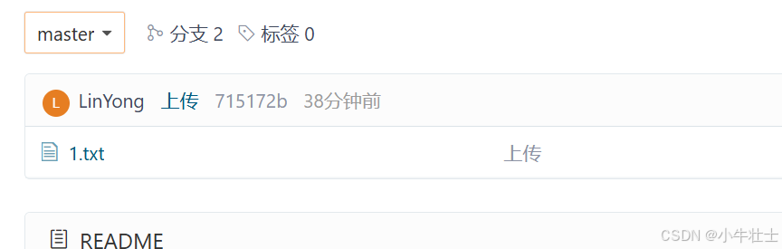

可以在命令行中输入如下指令**合并分支**

**先checkout到master分支**

git merge karen//把karen的分支合并到master分支(此时所处的分支是master分支）

git branch -d karen //删除karen分支(如果此时在karen里,是删除不了的)

git push //合并到master主分后 提交到远程仓库

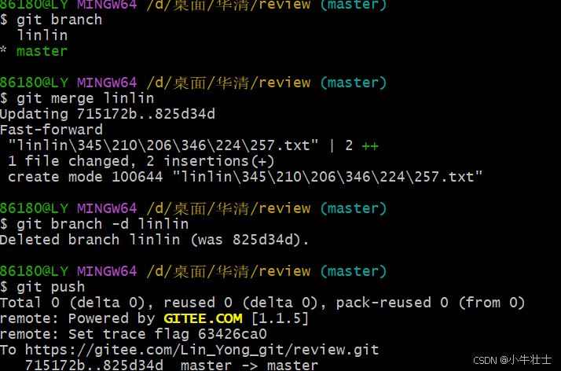

再查看分支就只有master了 

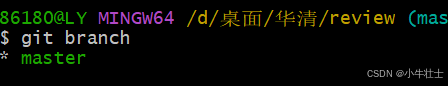

master仓库中实现合并

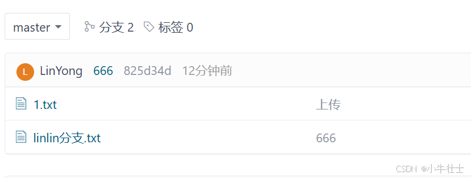

**上班pull 下班push 循环往复 从此走向人生巅峰！**
