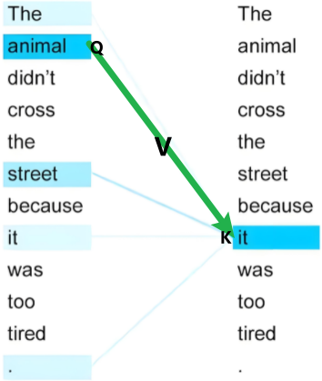
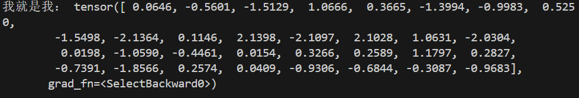
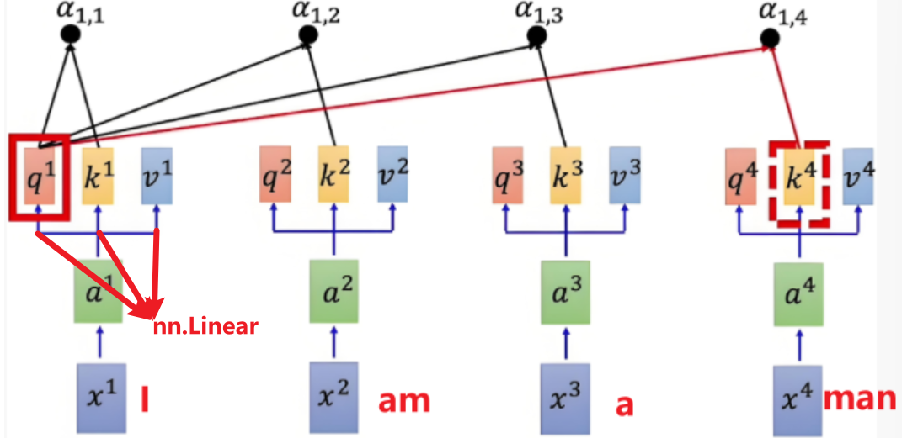
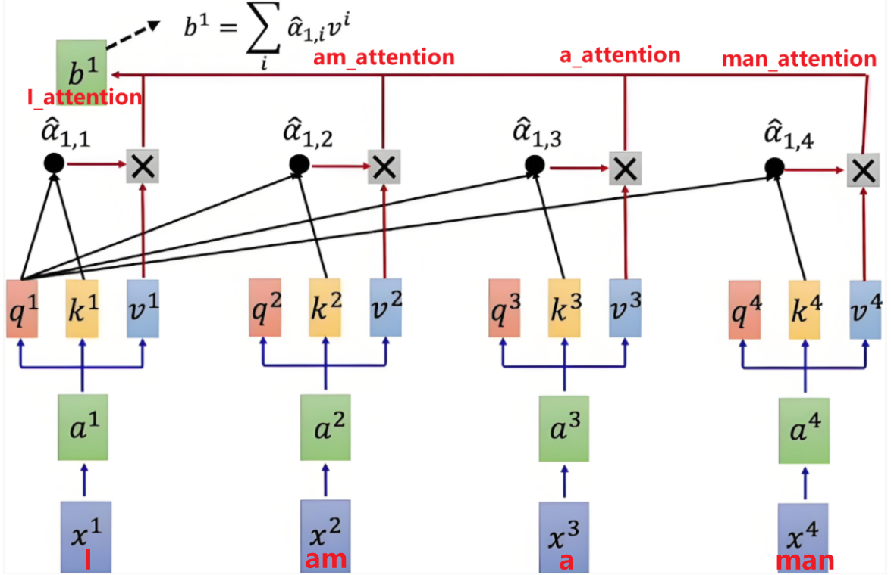
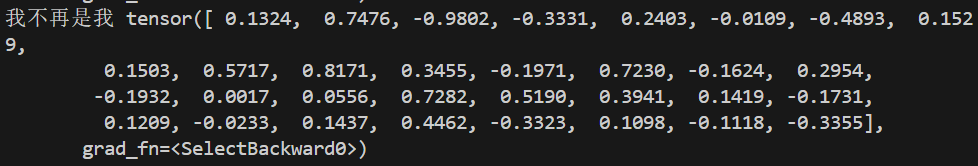
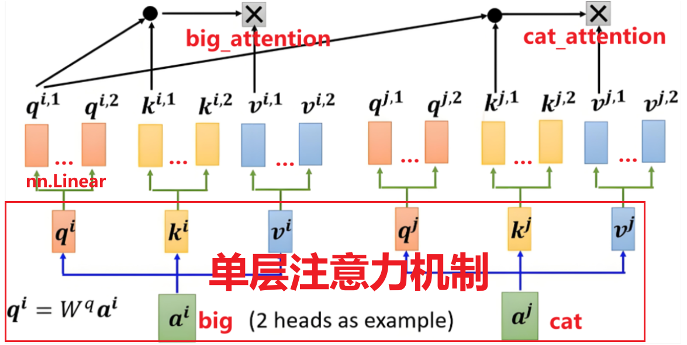
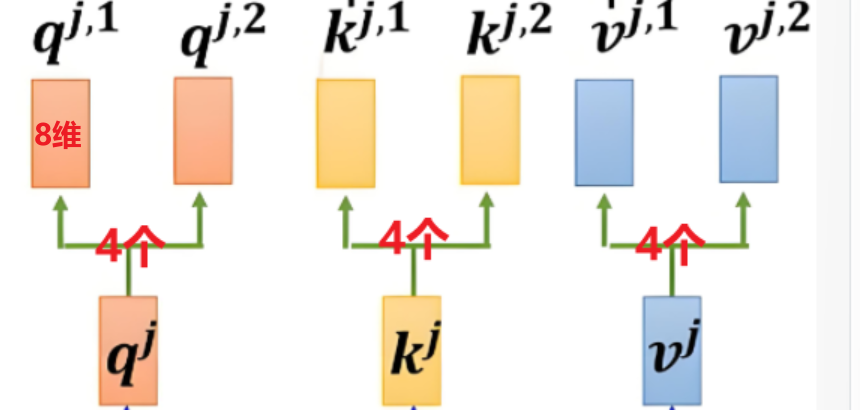
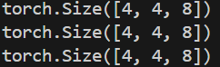
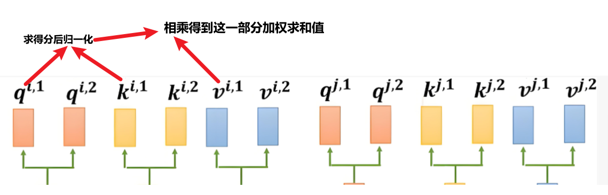
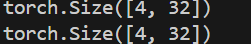

# 前言：什么是注意力机制？

注意力机制是一种模拟人类注意力的神经网络模型机制，它能够让模型在处理信息时集中关注部分重要信息，而忽略其他不重要的信息，从而提高模型的效率和性能。

# 一、Q，K，V

自注意力机制是要回答：“**我（某个位置）应该关注谁（其他位置）？以及关注了之后该怎么融合信息？**”，因此我们先来了解三个关键名词

- **查询向量（Query）**：表示**当前词的“查询需求”**，用于寻找与之相关的上下文信息。
- **键向量（Key）**：作为**每个词的“特征标识”**，与查询向量匹配，判断相关性。
- **值向量（Value）**：包含**每个词的“实际内容”**，匹配成功后从中提取信息，丰富上下文表示。



# 二、单层注意力机制

以4个步长句子“I am a man”作为一个输入，图中X代表每个单词经过嵌入层得到的低维词嵌入矩阵

```python
import torch 
import torch.nn as nn
import math
from torch.nn import functional as F


document = (
    "[UNK] I Love Nature Language Processing and you tell I Looking in my eyes"
)
# 要处理的句子

vocab = {word: i for i, word in enumerate(set(document.split(" ")))}
sentence = "I Love Nature Language Processing"
embedding_dim = 32
embedding = nn.Embedding(num_embeddings=len(vocab), embedding_dim=embedding_dim)

sentence_embedding = embedding(
    torch.tensor([vocab.get(w, 0) for w in sentence.split(" ")])
)
print('我就是我：',sentence_embedding[0])
```

输出：





词嵌入矩阵通过**三个线性变换（神经网络的线性层），分别得到Q，K，V三个矩阵**（这里看似是生成的三个一样的东西，但是在我们下一步定义后他们会有不同的意义），这三个矩阵经过全连接层，捕捉了**词的语义信息**，也就是上述词表中每一个词在整个句子中的关系

```python
fc = nn.ModuleList(nn.Linear(embedding_dim,embedding_dim) for _ in range(3))
Q = fc[0](sentence_embedding)
K = fc[0](sentence_embedding)
V = fc[0](sentence_embedding)
```

## 2.1 注意力机制得分

**核心公式**


**公式解释**

- 分母的Q与转置的K进行点积运算，实际是**反映了两个向量在方向上的一致性**。如果两个向量方向相似（即它们在高维空间中指向相似的方向），那么它们的点积将会较大；如果方向差异较大，则点积较小。
- 分子除以缩放因子 $\sqrt{d_k}$ （表示头中的维度来开方）来避免数值过大，使得梯度稳定更新

```python
score = torch.matmul(Q, K.transpose(-2, -1)) / math.sqrt(embedding_dim)
```

## 2.2 softmax归一化

**为了确保权重归一化、提高模型稳定性和可解释性，以及优化模型训练过程**，需要将注意力得分转换为概率分布


```python
weight = F.softmax(score,dim=-1)
```

## 2.3 加权求和

得到注意力得分的概率分布后，我们需要将它**与V加权求和**，以生成最终的输出表示。

加权求和的结果是一个**与原词向量形状相同的新向量**，它包含了输入序列中所有元素的信息，但每个元素的贡献由注意力权重决定



```Python
output_first = torch.matmul(weight,V)
```

最终输出经过注意力得分加权的词向量：

```
print('我不再是我',output_first[0])
```



总代码

```Python
import torch 
import torch.nn as nn
import math
from torch.nn import functional as F


document = (
    "[UNK] I Love Nature Language Processing and you tell I Looking in my eyes"
)
# 要处理的句子

vocab = {word: i for i, word in enumerate(set(document.split(" ")))}
sentence = "I Love Nature Language Processing"
embedding_dim = 32
embedding = nn.Embedding(num_embeddings=len(vocab), embedding_dim=embedding_dim)

sentence_embedding = embedding(
    torch.tensor([vocab.get(w, 0) for w in sentence.split(" ")])
)
print('我就是我：',sentence_embedding[0])

fc = nn.ModuleList(nn.Linear(embedding_dim,embedding_dim) for _ in range(3))
Q = fc[0](sentence_embedding)
K = fc[0](sentence_embedding)
V = fc[0](sentence_embedding)

score = torch.matmul(Q, K.transpose(-2, -1)) / math.sqrt(embedding_dim)

weight = F.softmax(score,dim=-1)

output_first = torch.matmul(weight,V)

print('我不再是我',output_first[0])
```


# 三、多头注意力机制

**单层注意力机制的一个局限性是它的单一视角可能只能捕捉到一种类型的上下文关系**

多头注意力机制（Multi-Head Attention）是自注意力机制的一个扩展，它**在单层注意力的基础上增加了多个并行的注意力层**。这种设计**使得模型能够同时在不同的表示子空间中捕捉信息，从而提高模型的表达能力和灵活性**

假设我们有一个句子 "The quick brown fox jumps over the lazy dog"，并且我们想要模型理解 "fox" 这个词的上下文。

- **单层注意力**可能会**专注于 "fox" 这个词**，并从整个句子中提取与 "fox" 直接相关的信息，但它可能只能捕捉到一种类型的上下文关系。
- **多头注意力**则可以**并行地从不同的角度理解 "fox"**：
  - 一个头可能专注于 "fox" 作为句子主语的角色。
  - 另一个头可能捕捉 "fox" 与 "quick" 和 "brown" 之间的修饰关系。
  - 还有一个头可能关注 "fox" 与 "jumps over" 这个动作的关系。




实质上就是在单层的基础上，在每个头上加入了一个线性映射，**延伸出来多个头**，在经过同样步骤的加权求和步骤得到输出

## 3.1 确定分头数

```Python
head_num = 4  # 头的数量
head_dim = embedding_dim // head_num  # 每个头维度
```

这里的`head_num`既是第一层的Q，K，V分别能在延伸出来第二层的头

`head_dim`表示第二层中每个头的维度，是从第一层对应头的总维度拆分出来的，例如第一层`q`的维度为32（其实这也是最初词向量的维度），而`head_num`=4，那么第二层第一个头q1中的维度就是32//4=8



## 3.2 线性变换

确定好头数和维度后，仿照之前的方法对第一层的Q，K，V分别进行线性层的映射，此时输出向量维度为`head_dim`

```Python
multi_head_Q = torch.stack([multi_head_Q_fc[i](Q) for i in range(head_num)])
print(multi_head_Q.shape)

multi_head_K = torch.stack([multi_head_K_fc[i](K) for i in range(head_num)])
print(multi_head_K.shape)

multi_head_V = torch.stack([multi_head_V_fc[i](V) for i in range(head_num)])
print(multi_head_V.shape)
```

输出维度为（步长，head_num，head_dim）



## 3.3 加权求和

根据注意力机制得分公式对**每个对应的`q`，`k`求得分数，经过归一化后与对应`v`加权求和**

注意这里的归一化是对所有`q·k`的结果来整体做的归一化，所以会有一个拼接过程



```Python
score_list = [
    torch.matmul(multi_head_Q[i], multi_head_K[i].transpose(-2, -1))
    / math.sqrt(head_dim)
    for i in range(head_num)
]
# 注意力得分进行拼接
score = torch.stack(score_list, dim=0)
# 注意力原始得分进行归一化操作
score = F.softmax(score, dim=-1)
print(score.shape)# torch.Size([4, 4, 4])
# 与对应v相乘，计算每个头的输出
output_list = [torch.matmul(score[i], multi_head_V[i]) for i in range(head_num)]
```

## 3.4 输出微调

最终把每个头的输出进行拼接操作，并且使用**线性变换对拼接之后的结果做一个微调**

**线性变换在多头注意力机制中通过整合和调整特征，增强模型对复杂信息的处理能力，提升任务性能。**

```Python
output = torch.cat(output_list, dim=-1)
print(output.shape)
# 微调
output = nn.Linear(embedding_dim, embedding_dim)(output)
print(output.shape)
```


