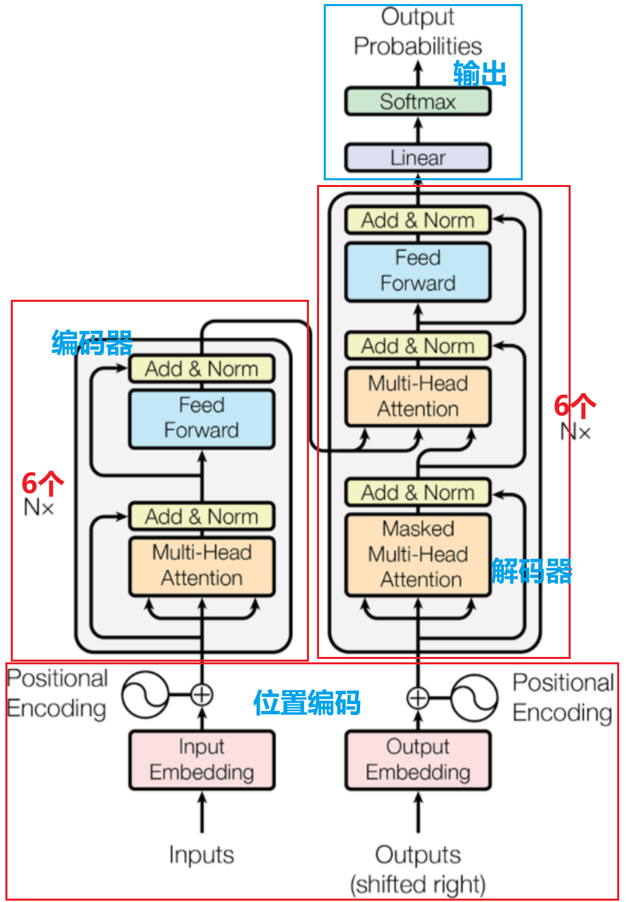
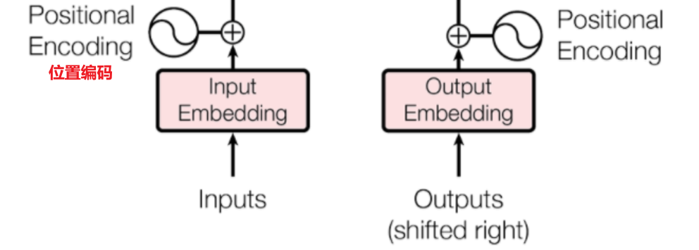
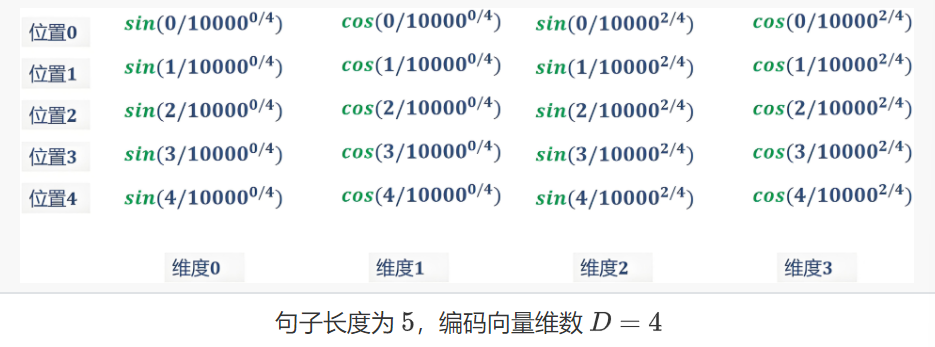
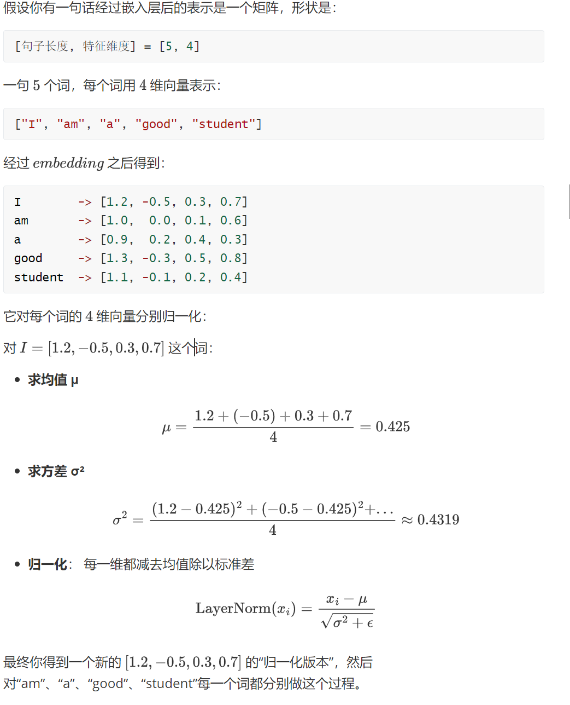
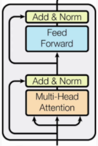
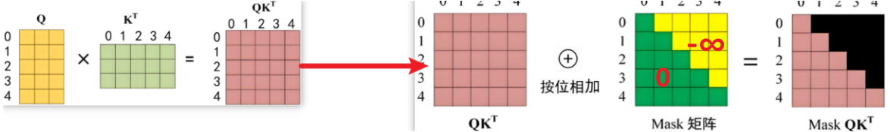
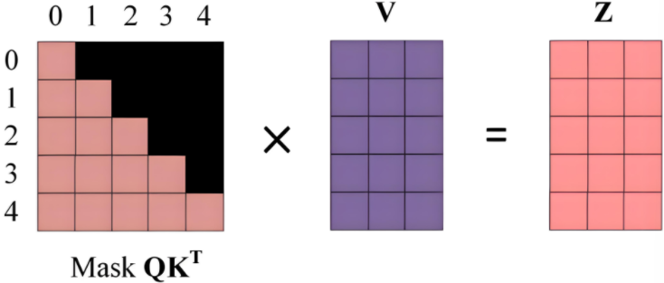
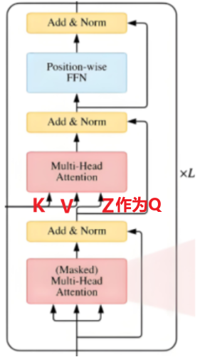
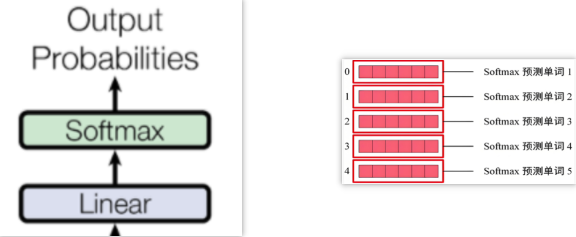

# 前言

Transformer 广泛应用于自然语言处理（如机器翻译、文本生成）等领域，是BERT、GPT等大模型的基础架构

- 以自注意力机制为核心：**让模型关注输入序列中不同位置的关联**
- 具备强并行化能力：**彻底摆脱了RNN等模型的序列依赖，能并行处理输入数据**
- 采用编码器 - 解码器架构：**分别负责处理输入序列为上下文表示及据此生成输出序列。**

# 一、位置编码Position Encoding

## 1.1 因

自注意力机制在计算关联时，本质上是对序列中所有元素进行 “全局配对” 计算，**没有办法考虑到元素的输入顺序**，因此在输入之前我们需**要使用位置编码**来**使自注意力机制区分序列中不同位置的元素**

## 1.2 果

在输入到 Transformer 模型之前，每个词的词嵌入向量（包含语义信息的原始维度数据）会与对应的位置编码向量（**模型根据这个编码来区分输入特征的前后位置**）进行**逐元素相加**，形成一个新的向量。这个新向量**同时包含了词的语义信息和它在序列中的位置信息。**

## 1.2.1 固定函数生成位置编码

对于一个长度为N，词向量维度为d的句子，他在长度索引为`i`，维度索引为`j`的位置编码计算公式如下

例如步长为5的句子“I am a handsome boy”，经过嵌入层得到5个维度的词向量，那么对应的位置编码为：

**最终得到的位置编码与词嵌入向量逐元素相加，得到最终输入模型的矩阵**

# 二、层归一化

与批归一化不同，层归一化是对**神经网络某一层**的**所有输入特征按样本计算均值和方差，再进行标准化**以稳定训练的技术，他的范围是一个输入词向量在神经网络中的某一层的所有特征维度。

相当于**对句子中每一个词对应的行向量求归一化**，可以看看这个案例：

# 三、编码器Encoder

编码器主要负责**对输入序列进行深度处理和信息提取**，将原始输入（如一句话、一段文本）转换为包含丰富上下文信息的向量表示

模块组成部分：

- Multi-Head Attention：多头注意力机制
- Feed Forward：前馈神经网络，就是一个线性层
- Add&Norm：残差连接和归一化（经过注意力机制和归一化后的输出和最初输入进行逐元素相加，**输入→处理→输出 + 输入**）

# 四、掩蔽多头自注意力Masked Multi-Head

## 4.1、掩码Mask

在文本生成任务中，由于模型需按顺序生成内容且遵循“**仅基于历史内容预测下一个词”的自回归逻辑，**即**生成第n个词时只能受前n-1个词影响**，因此需引入掩码来**限制模型对后续未生成内容的关注**。

**掩码操作是加在`Q`与`K转置`相乘后的原始注意力得分矩阵（每个元素表示 “查询向量 Q 对键向量 K 的关联强度”），从而限制模型关注范围**，下图所示的掩码矩阵中绿色部分值为0，按位相加后原得分矩阵值不变，表示模型需要关注的范围，黄色部分为-∞，按位相加后仍为-∞，模型不关注这部分

- **第一步**

**最终得到的掩码得分矩阵再与V进行加权求和，得到最后Z矩阵，他 “融合了上下文的语义向量”（比如第 0 行 Z 融合了第 0 个位置能关注到的信息）**

- **第二步**

以第0行为例，掩码得分矩阵只显现了第一个词的语义信息，那么**当Z处理第 0 个位置的词时，模型只能看到自己的语义，然后把‘自己的语义’作为输出**

而对比第1行，**Z处理第 1 个词时，模型可以参考‘第 0 个词（历史）’和‘自己（第 1 个词）’的语义，融合后输出**

# 五、解码器Decoder

**Transformer 通过编码器输出的全局语义信息结合自回归机制（通过掩码限制仅关注历史生成内容），逐词生成目标序列**

注意在解码器的**第二个多头注意力机制上融合了编码器的信息**，**依据 Encoder 输出 \( C \) 得到 \( K \)、\( V \)，并以上一个 Decoder block 输出 \( Z \)作为（Q）**，构建注意力交互基础 。

# 六、预测输出

始终通过前一个词来预测后一个词，保持模型的自回归属性

