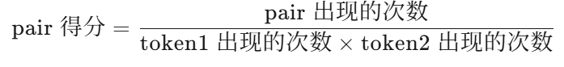

# 前言

**Tokenizer（分词器）** 的作用是将一段文本分割成一个个有意义的单元，每个单元在词向量表中对应一个的索引，根据这个索引我们能得到词向量，例如**jieba**就是非常流行的中文分词器Transformers的**AutoTokenizer**可以用于英文的分词，各个模型使用的分词逻辑也有不同，对于输入的一串文本，Tokenizer会如何处理，下面介绍了一系列算法


# 一、Tokenizer的三种颗粒度实现

- **Word-based 分词**：直接**从词汇表中查找**文本中的单词进行分词。
  - **示例 1**：词汇表 `["hello", "how", "are", "you"]`，句子 `"how are you"` → 分词结果：`["how", "are", "you"]`。
  - **示例 2**：句子 `"how are you today"` → 分词结果：`["how", "are", "you", "<unk>"]`（“today”为未知单词）。
- **Character-based 分词**：将文本**分割成单个字符**，不依赖词汇表。
  - **示例**：句子 `"how are you ?"` → 分词结果：`["h", "o", "w", " ", "a", "r", "e", " ", "y", "o", "u", "?"]`。
- **Subword-based 分词**：将单词**分解为子词单元**。
  - **示例**：句子 `"playing games is fun"` → 分词结果：`["play", "##ing", "games", "is", "fun"]`（“playing”被分解为“play”和“##ing”）。**##表示一个词的结尾**

上述三种方式**分出的字词进入到字典`{Word:index}`中被转换为索引，最终在词向量表中映射成为词向量**

# 二、Subword的不同算法

下面我们讨论如何将一个句子分成一串字词

## 2.1 BPE（Byte-Pair Encoding，字节对编码）

直接用一个句子来演示BPE是怎么进行分词的：`"the cat sat on the mat"`

①：初始化词汇表：`['t', 'h', 'e', ' ', 'c', 'a', 't', 's', 'o', 'n', 'm']`，**包括空格**

②：统计相邻字符对频率：`'th': 2, 'he': 2, 'e ': 2, ' c': 1, 'ca': 1, 'at': 3, ' s': 1, 'sa': 1, ' o': 1, 'on': 1, 'n ': 1, ' m': 1, 'ma': 1`

③：词汇表中合并频率最高的字符对：这里最高的是3次的`"at"`，['t', 'h', 'e', ' ', 'c', **'at' ** , 's', 'o', 'n', 'm']

④：更新相邻字符对频率`'th': 2, 'he': 2, 'e ': 2, ' c': 1, 'cat': 1, ' s': 1, 'sat': 1, ' o': 1, 'on': 1, 'n ': 1, ' m': 1, 'mat': 1`

⑤：选中频率最高的`“th”`，重复③

**当所有字符对的频率都为 1 时，停止合并操作**，最终分词结果`"the" "cat" "sat" "on" "the" "mat"`

**缺陷：这一过程中，词汇表需要涵盖句子中的所有字符，可能会相当大**

## 2.2 BBPE（Byte-Level Byte-Pair Encoding，BPE的字节级扩展版本）

**原理和BPE一致**，只是使用字节（byte）作为初始token，适用于任何文本。

还是以`"the cat sat on the mat"`为例，**将其中的每个字母和符号转换为字节**，

```
[116, 104, 101, 32, 99, 97, 116, 32, 115, 97, 116, 32, 111, 110, 32, 116, 104, 101, 32, 109, 97, 116]
```

（这里，每个数字代表一个字节，例如 `116` 是 `t` 的 ASCII 码），当第③步进行合并后，将合并成的字符串赋予新的ASCII 码，例如`"at"`——>97_116——>256，

然后按照和BPE一样的处理逻辑进行分词，**不会出现OOV问题**

## 2.3 WordPiece （★）

WordPiece 是一种基于统计的子词分词算法，它通过训练数据动态学习词汇表，**将罕见词分解为更小的已知子词单元**，同时**保留常见词作为完整单元**。

在经过和BPE中②一样的步骤得到相邻字符对频率后`'th': 2, 'he': 2, 'e ': 2, ' c': 1, 'ca': 1, 'at': 2, ' s': 1, 'sa': 1, 'at': 2, ' o': 1, 'on': 1, 'n ': 1, ' m': 1, 'ma': 1`

根据WordPiece 得分公式来计算`pair得分`



例如出现3次的`"at"`的token1为`"a"`，出现了3次，token2为`"t"`，出现了5次，最终pair得分为0.2

**最终计算出全部pair得分，合并对应字符**

### 三、token过程——贪婪最长匹配优先算法

上述已经讲解了几种分词的流程，那么对于一个复杂的单词`running`，是如何对他进行拆解的呢

首先给定词汇表如下

`["un", "##able", "##ing", "##e", "##d", "re", "##run", "##runing", "run"]`

分词 $unrunning$ 的过程：

- 匹配最长前缀 $un$，剩余 $running$ 。
- 匹配最长前缀 $run$，剩余 $ning$。
- 无法匹配 $ning$，回退到字符级：
  - 匹配 $n$ + $ing$ 

最终分词结果：

```css
["un", "run", "##n", "##ing"]
```

