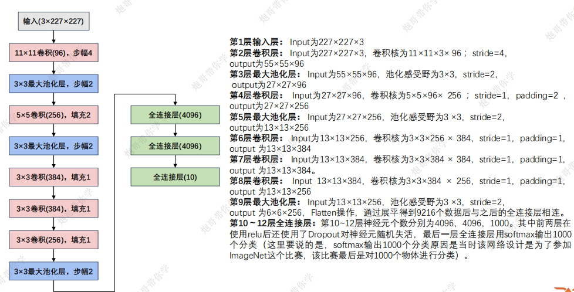
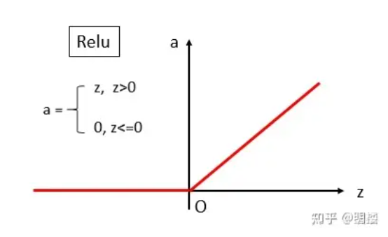

# 前言

AlexNet和LetNet的网络结构大差不差，主干都是**卷积层与池化层的线性排列**，但是AlexNet比LetNet深很多，主要是**五个卷积层、两个全连接隐藏层和一个全连接输出层**

# 一、整体结构

AlexNet输入为RGB三通道的227 × 227 × 3大小的图像，通过增加网络深度，AlexNet 能够更好地学习数据集的特征，从而提高了图像分类的精度



# 二、ReLU函数

在进行激活时，AlexNet使用了RELU激活函数， 相比 sigmoid 和 tanh 函数，**能有效缓解梯度消失问题，加速收敛，且计算简单高效。其稀疏激活特性还能减少冗余信息，提升特征提取效率**。



# 三、数据增强和Dropout

**数据增强可以通过对图像进行旋转、翻转、裁剪等变换，增加训练数据的多样性，提高模型的泛化能力**

**Dropout 则是在训练过程中随机删除一定比例的神经元，强制网络学习多个互不相同的子网络，从而提高网络的泛化能力**

共同的目的都是提高网络的泛化能力

**注意Dropout在随机删除神经元时不是直接删除，而是随着神经元的删除而改变**

例如将Dropout 概率 *p*=0.5为了**保持期望值不变**，**未被置为 0 的神经元的输出值会被乘以 2**

# 四、模型代码

这里只给出模型结构部分，训练和测试部分的代码和LetNet是一样的

```Python
import torch
from torch import nn
from torchsummary import summary


import torch.nn as nn

class AlexNet(nn.Module):
    def __init__(self, num_classes=10):
        super(AlexNet, self).__init__()
        # 特征提取
        self.features = nn.Sequential(
            nn.Conv2d(in_channels=1, out_channels=96, kernel_size=11, stride=4),
            nn.ReLU(inplace=True),
            nn.MaxPool2d(kernel_size=3, stride=2),
            nn.Conv2d(in_channels=96, out_channels=256, kernel_size=5, stride=1, padding=2),
            nn.ReLU(inplace=True),
            nn.MaxPool2d(kernel_size=3, stride=2),
            nn.Conv2d(in_channels=256, out_channels=384, kernel_size=3, stride=1, padding=1),
            nn.ReLU(inplace=True),
            nn.Conv2d(in_channels=384, out_channels=384, kernel_size=3, stride=1, padding=1),
            nn.ReLU(inplace=True),
            nn.Conv2d(in_channels=384, out_channels=256, kernel_size=3, stride=1, padding=1),
            nn.ReLU(inplace=True),
            nn.MaxPool2d(kernel_size=3, stride=2),
        )

        # 自适应平均池化层，将输入的特征图自适应地调整为指定的输出尺寸，这里是 6×6。
        self.avgpool = nn.AdaptiveAvgPool2d((6, 6))

        # 分类部分
        self.classifier = nn.Sequential(
            # 随机失活50%神经元
            nn.Dropout(0.5),
            nn.Linear(256 * 6 * 6, 4096),
            nn.ReLU(inplace=True),
            nn.Dropout(0.5),
            nn.Linear(4096, 4096),
            nn.ReLU(inplace=True),
            nn.Linear(4096, num_classes),
        )

    def forward(self, x):
        x = self.features(x)
        x = self.avgpool(x)
        # 将特征图 x 从多维张量重新塑形（reshape）为二维张量
        x = x.view(x.size(0), 256 * 6 * 6)
        x = self.classifier(x)
        return x
    
if __name__ == "__main__":
    device_choose = torch.device("cuda" if torch.cuda.is_available() else "cpu")

    model = AlexNet().to(device=device_choose)

    # 控制台打印模型详细参数
    print(summary(model,input_size=(1,227,227),batch_size=32))

    torch.manual_seed(42)
    input = torch.randn((32,1,227,227))
    # print(input)
    output = model(input)
    print(output.shape)
```

