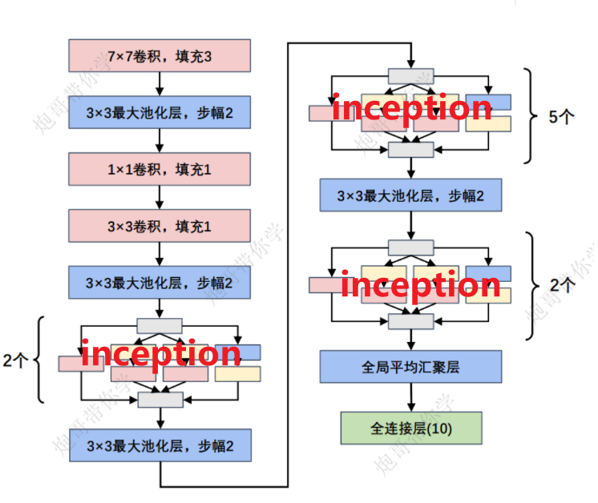
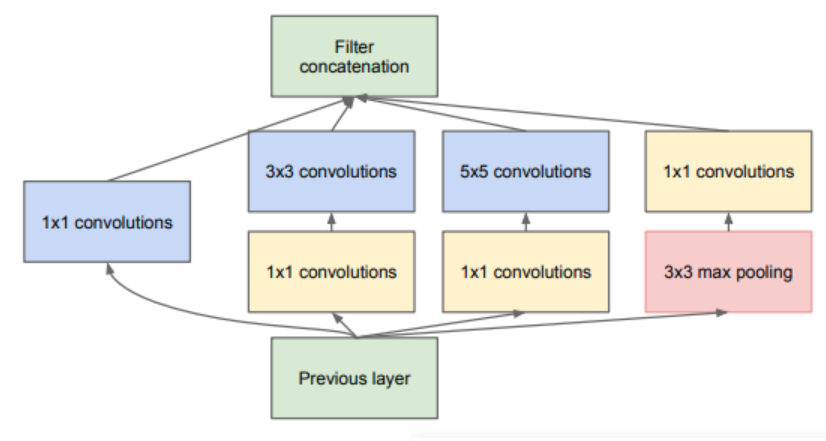
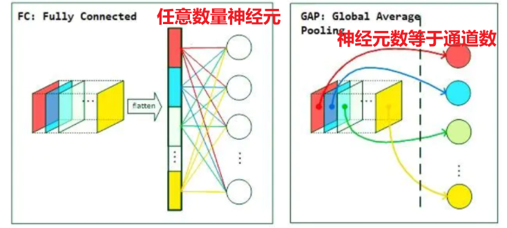

# 前言

GoogLeNet 于 2014 年由 Google 团队提出，凭借其创新的 **Inception** 结构（融合多尺度特征）、**1×1 卷积核**降维以及用平均池化层替代全连接层（大幅减少参数）等设计，斩获当年 ImageNet 分类任务第一名。



# 一、inception结构

和之前提到的线性排列的网络结构不同，inception模块采用**并联结构**，将特征同时输入多个分支，最后将每个分支得到的等宽等高的输出进行拼接



**这里大小为1x1的卷积层，目的是为了降维（使用通道数更小的卷积核来改变原结构通道数），减少模型训练参数，减少计算量**

# 二、全局平均池化层GAP

平均池化层**通过计算特征图的平均值将其压缩为全局特征表示**，减少参数量和计算量，避免过拟合，提升泛化能力和训练效率，从而可替代全连接层。



在大多数实际应用中，**特征图的通道数 \( C \) 与类别数 \( N \) 不同**。因此，全局池化后的输出 \( (1, 1, C) \) 通常需要通过一个**全连接层**将其映射到类别数 \( N \)。**全连接层的作用是将特征向量 \( C \) 映射到类别数 \( N \)。**

# 三、模型代码（训练自己的数据集）

# 3.1 模型结构代码

**代码添加了用于初始化神经网络模型中参数的代码，这种初始化方法有助于加速模型的收敛并提高训练的稳定性。**

```Python
import torch
from torch import nn
from torchsummary import summary


class Inception(nn.Module):
    def __init__(self, in_channels, c1, c2, c3, c4):
        super(Inception, self).__init__()
        self.ReLU = nn.ReLU()

        # 路线1，单1×1卷积层
        self.p1_1 = nn.Conv2d(in_channels=in_channels, out_channels=c1, kernel_size=1)

        # 路线2，1×1卷积层, 3×3的卷积
        self.p2_1 = nn.Conv2d(in_channels=in_channels, out_channels=c2[0], kernel_size=1)
        self.p2_2 = nn.Conv2d(in_channels=c2[0], out_channels=c2[1], kernel_size=3, padding=1)

        # 路线3，1×1卷积层, 5×5的卷积
        self.p3_1 = nn.Conv2d(in_channels=in_channels, out_channels=c3[0], kernel_size=1)
        self.p3_2 = nn.Conv2d(in_channels=c3[0], out_channels=c3[1], kernel_size=5, padding=2)

        # 路线4，3×3的最大池化, 1×1的卷积
        self.p4_1 = nn.MaxPool2d(kernel_size=3, padding=1, stride=1)
        self.p4_2 = nn.Conv2d(in_channels=in_channels, out_channels=c4, kernel_size=1)


    def forward(self, x):
        p1 = self.ReLU(self.p1_1(x))
        p2 = self.ReLU(self.p2_2(self.ReLU(self.p2_1(x))))
        p3 = self.ReLU(self.p3_2(self.ReLU(self.p3_1(x))))
        p4 = self.ReLU(self.p4_2(self.p4_1(x)))
        return torch.cat((p1, p2, p3, p4), dim=1)

    

class GoogLeNet(nn.Module):
    def __init__(self, Inception):
        super(GoogLeNet, self).__init__()
        self.b1 = nn.Sequential(
            nn.Conv2d(in_channels=3, out_channels=64, kernel_size=7, stride=2, padding=3),
            nn.ReLU(),
            nn.MaxPool2d(kernel_size=3, stride=2, padding=1))

        self.b2 = nn.Sequential(
            nn.Conv2d(in_channels=64, out_channels=64, kernel_size=1),
            nn.ReLU(),
            nn.Conv2d(in_channels=64, out_channels=192, kernel_size=3, padding=1),
            nn.ReLU(),
            nn.MaxPool2d(kernel_size=3, stride=2, padding=1))

        self.b3 = nn.Sequential(
            Inception(192, 64, (96, 128), (16, 32), 32),
            Inception(256, 128, (128, 192), (32, 96), 64),
            nn.MaxPool2d(kernel_size=3, stride=2, padding=1))

        self.b4 = nn.Sequential(
            Inception(480, 192, (96, 208), (16, 48), 64),
            Inception(512, 160, (112, 224), (24, 64), 64),
            Inception(512, 128, (128, 256), (24, 64), 64),
            Inception(512, 112, (128, 288), (32, 64), 64),
            Inception(528, 256, (160, 320), (32, 128), 128),
            nn.MaxPool2d(kernel_size=3, stride=2, padding=1))

        self.b5 = nn.Sequential(
            Inception(832, 256, (160, 320), (32, 128), 128),
            Inception(832, 384, (192, 384), (48, 128), 128),
            # 全局平均池化
            nn.AdaptiveAvgPool2d((1, 1)),
            nn.Flatten(),
            nn.Linear(1024, 2))

        # 初始化参数以及详细注释
        # 遍历模型中的所有模块
        for m in self.modules():
            # 如果当前模块是二维卷积层（nn.Conv2d）
            if isinstance(m, nn.Conv2d):
                # 使用 Kaiming 正态初始化方法初始化卷积层的权重
                # mode="fan_out" 表示按照输出特征的数量来计算标准差
                # nonlinearity='relu' 表示激活函数是 ReLU
                nn.init.kaiming_normal_(m.weight, mode="fan_out", nonlinearity='relu')
                # 如果卷积层有偏置参数，则将偏置初始化为 0
                if m.bias is not None:
                    nn.init.constant_(m.bias, 0)

            # 如果当前模块是全连接层（nn.Linear）
            elif isinstance(m, nn.Linear):
                # 使用正态分布初始化全连接层的权重
                # 均值为 0，标准差为 0.01
                nn.init.normal_(m.weight, 0, 0.01)
                # 如果全连接层有偏置参数，则将偏置初始化为 0
                if m.bias is not None:
                    nn.init.constant_(m.bias, 0)

    def forward(self, x):
        x = self.b1(x)
        x = self.b2(x)
        x = self.b3(x)
        x = self.b4(x)
        x = self.b5(x)
        return x


if __name__ == "__main__":
    device = torch.device("cuda" if torch.cuda.is_available() else "cpu")
    model = GoogLeNet(Inception).to(device)
    print(summary(model, (1, 224, 224)))
```

# 3.2 划分数据集

这段代码用于将一个数据集按照指定比例（如 9:1）划分为训练集和测试集，并将图像文件分别复制到对应的训练集和测试集目录中

```Python
import os
from shutil import copy
import random


def mkfile(file):
    if not os.path.exists(file):
        os.makedirs(file)


# 获取data文件夹下所有文件夹名（即需要分类的类名）
file_path = r"GoogLeNet\data\smoke"
flower_class = [cla for cla in os.listdir(file_path)]

# 创建 训练集train 文件夹，并由类名在其目录下创建5个子目录
mkfile('GoogLeNet/data_self/train')
for cla in flower_class:
    mkfile('GoogLeNet/data_self/train/' + cla)

# 创建 验证集val 文件夹，并由类名在其目录下创建子目录
mkfile('GoogLeNet/data_self/test')
for cla in flower_class:
    mkfile('GoogLeNet/data_self/test/' + cla)

# 划分比例，训练集 : 测试集 = 9 : 1
split_rate = 0.1

# 遍历所有类别的全部图像并按比例分成训练集和验证集
for cla in flower_class:
    cla_path = file_path + '/' + cla + '/'  # 某一类别的子目录
    images = os.listdir(cla_path)  # iamges 列表存储了该目录下所有图像的名称
    num = len(images)
    eval_index = random.sample(images, k=int(num * split_rate))  # 从images列表中随机抽取 k 个图像名称
    for index, image in enumerate(images):
        # eval_index 中保存验证集val的图像名称
        if image in eval_index:
            image_path = cla_path + image
            new_path = 'GoogLeNet/data_self/test/' + cla
            copy(image_path, new_path)  # 将选中的图像复制到新路径

        # 其余的图像保存在训练集train中
        else:
            image_path = cla_path + image
            new_path = 'GoogLeNet/data_self/train/' + cla
            copy(image_path, new_path)
        print("\r[{}] processing [{}/{}]".format(cla, index + 1, num), end="")  # processing bar
    print()

print("processing done!")
```

## 3.3 计算均值和方差

**这段代码用于计算指定文件夹中所有图像的像素均值和方差。用于构建数据集时图像标准化操作。**

在train.py中导入数据集使用代码

```Python
train_data = ImageFolder(ROOT_TRAIN,transform=transform)
```

```Python
from PIL import Image
import os
import numpy as np

# 文件夹路径，包含所有图片文件
folder_path = r'GoogLeNet\data_self\train'

# 初始化累积变量
total_pixels = 0
sum_normalized_pixel_values = np.zeros(3)  # 如果是RGB图像，需要三个通道的均值和方差

# 遍历文件夹中的图片文件
for root, dirs, files in os.walk(folder_path):
    for filename in files:
        if filename.endswith(('.jpg', '.jpeg', '.png', '.bmp')):  # 可根据实际情况添加其他格式
            image_path = os.path.join(root, filename)
            image = Image.open(image_path)
            image_array = np.array(image)

            # 归一化像素值到0-1之间
            normalized_image_array = image_array / 255.0

            # print(image_path)
            # print(normalized_image_array.shape)
            # 累积归一化后的像素值和像素数量
            total_pixels += normalized_image_array.size
            sum_normalized_pixel_values += np.sum(normalized_image_array, axis=(0, 1))

# 计算均值和方差
mean = sum_normalized_pixel_values / total_pixels


sum_squared_diff = np.zeros(3)
for root, dirs, files in os.walk(folder_path):
    for filename in files:
        if filename.endswith(('.jpg', '.jpeg', '.png', '.bmp')):
            image_path = os.path.join(root, filename)
            image = Image.open(image_path)
            image_array = np.array(image)
            # 归一化像素值到0-1之间
            normalized_image_array = image_array / 255.0
            # print(normalized_image_array.shape)
            # print(mean.shape)
            # print(image_path)

            try:
                diff = (normalized_image_array - mean) ** 2
                sum_squared_diff += np.sum(diff, axis=(0, 1))
            except:
                print(f"捕获到自定义异常")
            # diff = (normalized_image_array - mean) ** 2
            # sum_squared_diff += np.sum(diff, axis=(0, 1))

variance = sum_squared_diff / total_pixels

print("Mean:", mean)
print("Variance:", variance)
```

