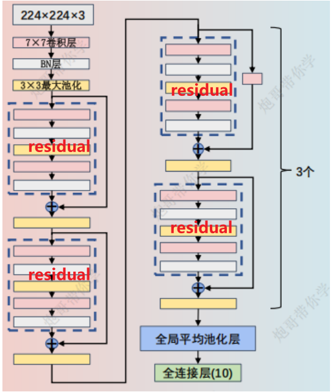
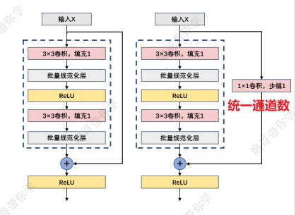

# 前言

ResNet通过引入残差结构**解决了深层网络中的梯度消失、梯度爆炸及退化问题**，借助Batch Normalization加速训练，成功搭建了超深网络（突破1000层）。



# 一、残差结构（residual）（★）

ResNet中的残差块（Residual Block）是其核心组件，用于解决深层网络训练中的梯度消失和退化问题，**让实现更深层的网络成为可能**。

残差块包含两条路径：

- 一条是**主路径**，用于学习输入和输出之间的残差（即差异）
- 另一条是**捷径路径**，**直接将输入添加到主路径的输出上**，这里的添加是对应元素进行**数值相加**



# 二、批量归一化（Batch Normalization）（★）

Batch Normalization（批量归一化）用于**加速神经网络的训练过程并提高其稳定性。**

它通过在**每个小批量（Batch）上对输入数据进行归一化处理**，使每层的输入数据具有均值为0、标准差为1的分布。

# 三、模型代码

```Python
import torch
from torch import nn
from torchsummary import summary

# 构建残差块
class Residual(nn.Module):
    def __init__(self, input_channels, num_channels, use_1conv=False, strides=1):
        super(Residual, self).__init__()
        self.ReLu = nn.ReLU()
        self.conv1 = nn.Conv2d(in_channels=input_channels, out_channels=num_channels, kernel_size=3, padding=1, stride=strides)
        self.conv2 = nn.Conv2d(in_channels=num_channels,  out_channels=num_channels, kernel_size=3, padding=1)
        self.bn1 = nn.BatchNorm2d(num_channels)
        self.bn2 = nn.BatchNorm2d(num_channels)
        if use_1conv:
            self.conv3 = nn.Conv2d(in_channels=input_channels, out_channels=num_channels, kernel_size=1, stride=strides)
        else:
            self.conv3 = None

    def forward(self, x):
        # 第一步：卷积操作
        conv1_output = self.conv1(x)
        # 第二步：批量归一化操作
        bn1_output = self.bn1(conv1_output)
        # 第三步：ReLU激活函数操作
        relu_output = self.ReLu(bn1_output)
        # 第四步：第二层卷积操作
        conv2_output = self.conv2(relu_output)
        # 第五步：第二层批量归一化操作
        y = self.bn2(conv2_output)
        # 如果存在1×1卷积，改变输入特征图x的维度
        if self.conv3:
            x = self.conv3(x)
        # 将经过卷积和归一化的输出y与输入x进行相加操作
        y = self.ReLu(y + x)
        # 返回最终的输出
        return y
    
class ResNet18(nn.Module):
    def __init__(self,Residual):
        super(ResNet18,self).__init__()
        self.b1 = nn.Sequential(
            nn.Conv2d(in_channels=3,out_channels=64,kernel_size=7,stride=2,padding=3),
            nn.ReLU(),
            nn.BatchNorm2d(64),
            nn.MaxPool2d(kernel_size=3,stride=2,padding=1)
        )

        self.b2 = nn.Sequential(Residual(64, 64, use_1conv=False, strides=1),
                                Residual(64, 64, use_1conv=False, strides=1))

        self.b3 = nn.Sequential(Residual(64, 128, use_1conv=True, strides=2),
                                Residual(128, 128, use_1conv=False, strides=1))

        self.b4 = nn.Sequential(Residual(128, 256, use_1conv=True, strides=2),
                                Residual(256, 256, use_1conv=False, strides=1))

        self.b5 = nn.Sequential(Residual(256, 512, use_1conv=True, strides=2),
                                Residual(512, 512, use_1conv=False, strides=1))

        self.b6 = nn.Sequential(nn.AdaptiveAvgPool2d((1, 1)),
                                nn.Flatten(),
                                nn.Linear(512, 38))# 这里是对38个例子进行分类
    def forward(self, x):
        x = self.b1(x)
        x = self.b2(x)
        x = self.b3(x)
        x = self.b4(x)
        x = self.b5(x)
        x = self.b6(x)
        return x

if __name__ == "__main__":
    device = torch.device("cuda" if torch.cuda.is_available() else "cpu")
    model = ResNet18(Residual).to(device)
    print(summary(model, (3, 224, 224)))
```

