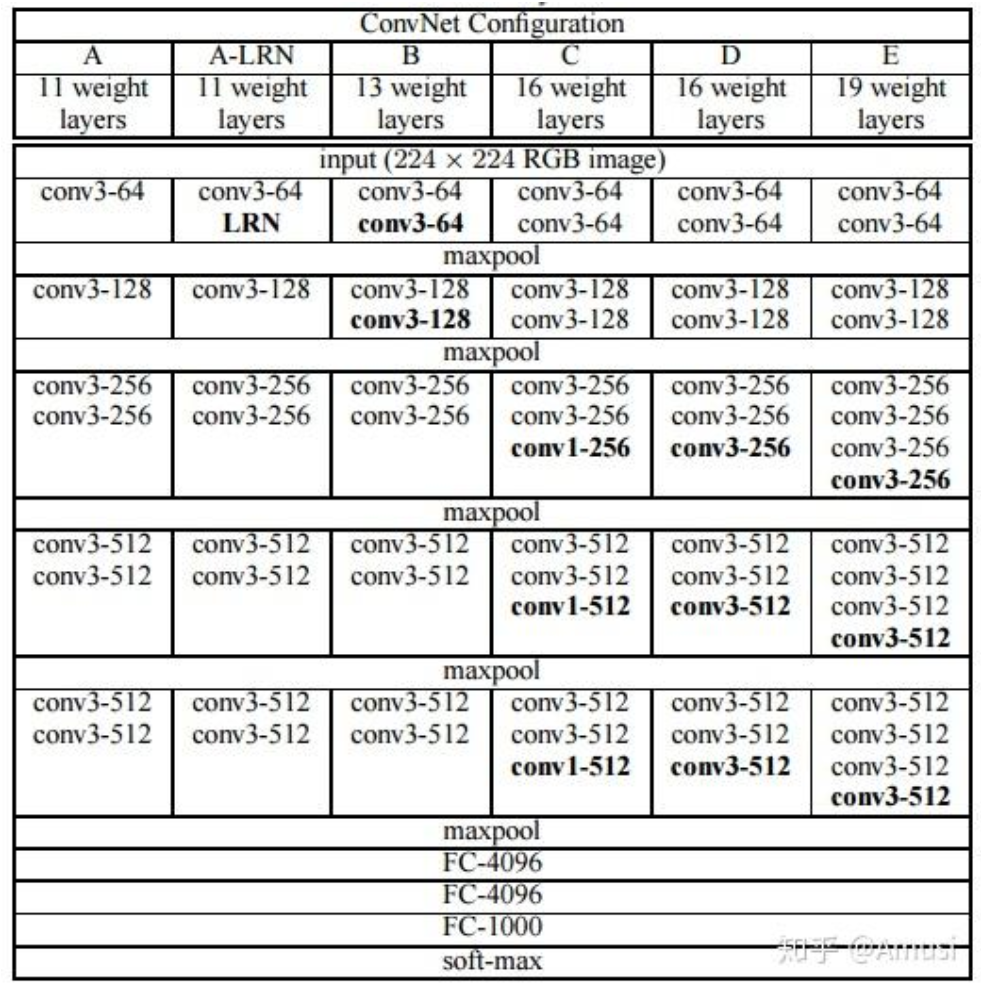
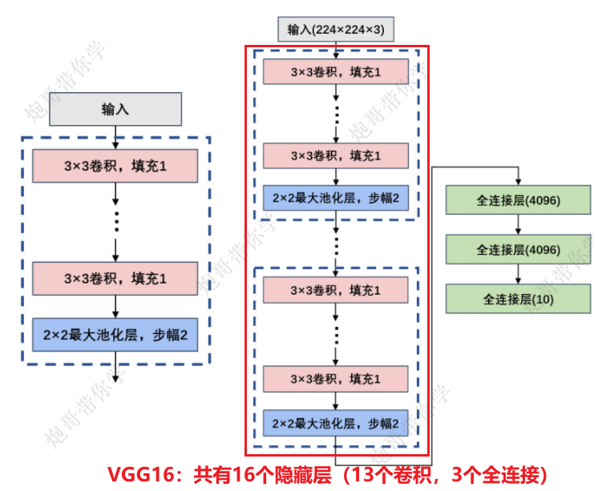

# 前言

VGG16相比AlexNet采用**多个小卷积核**（如3个3×3代替7×7）来增加网络深度，减少参数量，同时保持较大感受野，提升模型性能，且小卷积核更利于保持图像特征。

# 一、整体结构

VGG系列更像是一个定式的网络，通过隐藏层的数量来进行编号



- 优点是**结构简洁**，使用统一的3×3卷积核和2×2最大池化，通过加深网络结构提升性能；
- 缺点是**计算资源耗费大**，参数多（主要集中在全连接层），模型大（约500M），训练时间长，但有公开的预训练模型可供使用。



# 二、模型代码

```Python
import torch
from torch import nn
from torchsummary import summary


class VGG16(nn.Module):
    def __init__(self):
        super(VGG16, self).__init__()
        self.block1 = nn.Sequential(
            nn.Conv2d(in_channels=1, out_channels=64, kernel_size=3, padding=1),
            nn.ReLU(),
            nn.Conv2d(in_channels=64, out_channels=64, kernel_size=3, padding=1),
            nn.ReLU(),
            nn.MaxPool2d(kernel_size=2, stride=2)
        )
        self.block2 = nn.Sequential(
            nn.Conv2d(in_channels=64, out_channels=128, kernel_size=3, padding=1),
            nn.ReLU(),
            nn.Conv2d(in_channels=128, out_channels=128, kernel_size=3, padding=1),
            nn.ReLU(),
            nn.MaxPool2d(kernel_size=2, stride=2)
        )
        self.block3 = nn.Sequential(
            nn.Conv2d(in_channels=128, out_channels=256, kernel_size=3, padding=1),
            nn.ReLU(),
            nn.Conv2d(in_channels=256, out_channels=256, kernel_size=3, padding=1),
            nn.ReLU(),
            nn.Conv2d(in_channels=256, out_channels=256, kernel_size=3, padding=1),
            nn.ReLU(),
            nn.MaxPool2d(kernel_size=2, stride=2)
        )
        self.block4 = nn.Sequential(
            nn.Conv2d(in_channels=256, out_channels=512, kernel_size=3, padding=1),
            nn.ReLU(),
            nn.Conv2d(in_channels=512, out_channels=512, kernel_size=3, padding=1),
            nn.ReLU(),
            nn.Conv2d(in_channels=512, out_channels=512, kernel_size=3, padding=1),
            nn.ReLU(),
            nn.MaxPool2d(kernel_size=2, stride=2)
        )
        self.block5 = nn.Sequential(
            nn.Conv2d(in_channels=512, out_channels=512, kernel_size=3, padding=1),
            nn.ReLU(),
            nn.Conv2d(in_channels=512, out_channels=512, kernel_size=3, padding=1),
            nn.ReLU(),
            nn.Conv2d(in_channels=512, out_channels=512, kernel_size=3, padding=1),
            nn.ReLU(),
            nn.MaxPool2d(kernel_size=2, stride=2)
        )

        self.block6 = nn.Sequential(
            nn.Flatten(),
            nn.Linear(7*7*512, 256),
            nn.ReLU(),
            nn.Linear(256, 128),
            nn.ReLU(),
            nn.Linear(128, 10)
        )
  
        # 初始化神经网络模型中卷积层和全连接层的权重和偏置的。
        # 这种初始化方法可以帮助模型在训练初期更好地收敛。
        for m in self.modules():
            # 对带参数的卷积层和全连接层进行初始化
            if isinstance(m, nn.Conv2d):
                # 凯明初始化
                nn.init.kaiming_normal_(m.weight, nonlinearity='relu')
                if m.bias is not None:
                    nn.init.constant_(m.bias, 0)
            elif isinstance(m, nn.Linear):
                # 正态分布初始化
                nn.init.normal_(m.weight, 0, 0.01)
                if m.bias is not None:
                    nn.init.constant_(m.bias, 0)
        # w = torch.empty(3, 5)
        # nn.init.kaiming_normal_(w, mode='fan_out', nonlinearity='relu')
        # print(w)

    def forward(self, x):
        x = self.block1(x)
        x = self.block2(x)
        x = self.block3(x)
        x = self.block4(x)
        x = self.block5(x)
        x = self.block6(x)
        return x
    
if __name__ == "__main__":
    device_choose = torch.device("cuda" if torch.cuda.is_available() else "cpu")

    model = VGG16().to(device=device_choose)

    print(model)

```

