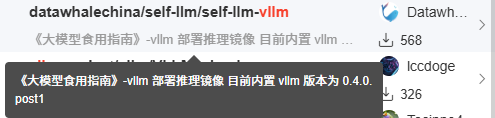
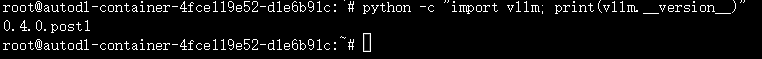
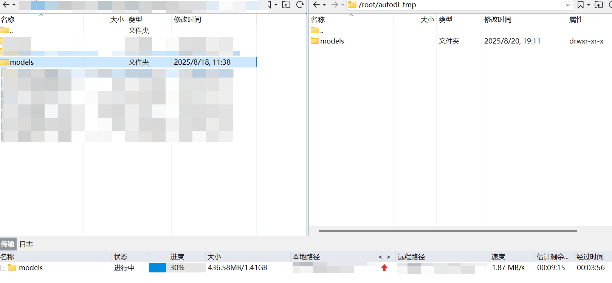
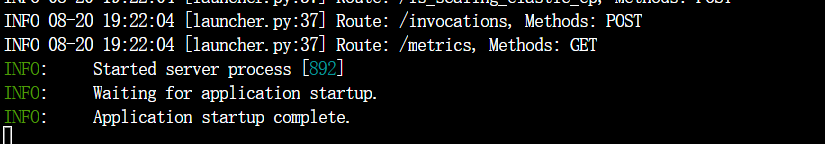
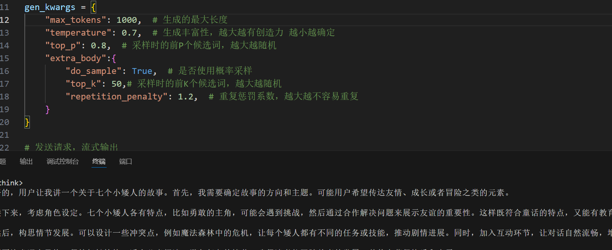
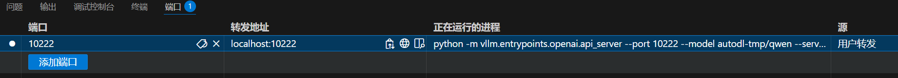
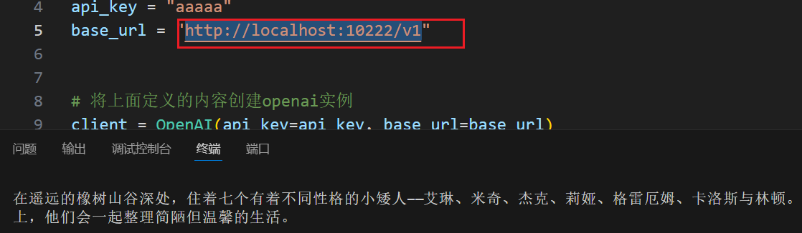

# 前言

**vLLM** 是一个专注于大语言模型（LLM）的高速推理框架。它的核心目标是通过优化技术，显著提升语言模型在实时场景下的服务吞吐量和内存使用效率。适合大规模大语言模型部署，实现CUDA的加速

部署需求：

AutoDL算力云平台租用一台GPU（本文租用3080），良好的网络环境（需要下载超过10G的内容）

# 一、VLLM安装与验证

这一步其实在云服务器上可以省略，因为选择镜像的时候我们可以选择一个带有VLLM的镜像



如果需要自行下载，在终端运行如下命令，下载过程比较漫长，耐心等待

```python
# 安装最新版vLLM（耗时较长）
pip install vllm -i https://pypi.tuna.tsinghua.edu.cn/simple

# 验证安装
python -c "import vllm; print(vllm.__version__)"
```

选择无卡模式开机后进入终端查看VLLM版本号，这里是0.4.0.post1



接下来我们就可以开始模型部署了

# 二、模型部署

## 2.1 启动模型

然后把自己的模型传输到服务器上，这里我使用Xftp传输提前在HuggingFace上下载好的Qwen3:0.6b来进行测试



这一步过后我们需要把GPU打开，传入指令在服务器上激活模型

输入如下的指令

```
python -m vllm.entrypoints.openai.api_server --port 10222 --model autodl-tmp/models --served-model-name 111 --gpu-memory-utilization 0.5 --max-model-len 10000
```

得到这个页面后说明我们的模型启动成功了



## 2.2 调用模型

为了模拟服务器与客户端分离的场景，我们在VScode上完成模型调用工作

我们首先再VScode连接上AutoDL的服务器，运行如下代码

```python
# Please install OpenAI SDK first: `pip3 install openai`
from openai import OpenAI

api_key = "aaaaa"
base_url = "http://0.0.0.0:10222/v1"

client = OpenAI(
    api_key
    base_url
)

# 二：设置生成参数和输入消息
gen_kwargs = {
    "max_tokens": 512,  # 生成的最大长度
    "temperature": 0.7,  # 生成丰富性，越大越有创造力 越小越确定
    "top_p": 0.8,  # 采样时的前P个候选词，越大越随机
    "extra_body":{
        "do_sample": True,  # 是否使用概率采样
        "top_k": 50,# 采样时的前K个候选词，越大越随机
        "repetition_penalty": 1.2,  # 重复惩罚系数，越大越不容易重复
    }
}

# 面向对象的模块化编程
response = client.chat.completions.create(
    model="111",  # 使用的模型：可以是模型名称 或者 模型路径
    messages=[
        {"role": "system", "content": "你是一个有用的助手。"},
        {"role": "user", "content": "讲一个七个小矮人的故事。"}
    ],
    stream=False,
    **gen_kwargs,
)
# Python里面的数据类型的知识点
print(response.choices[0].message.content)

```

可以看到模型已经成功输出内容



## 2.3 本地调用

这是在服务器上调用的模型，但是实际上我们需要在外部去调用模型来满足生产需求，这就需要服务器暴露出端口来供外界访问，在控制台的端口输入之前设置的端口号10222，便可以得到转发地址localhost:10222，我们可以在本地使用这个端口去访问云服务器



重开一个新的VScode窗口，这个窗口**不连接服务器**，运行与上述相同的代码，不过端口号改为http://localhost:10222/v1



可以看到同样可以调用模型生成内容，到这里我们的模型就部署成功了，通过这个方式，我们可以更加便捷的租用更高的算力来部署我们的模型
