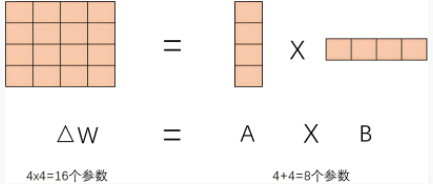
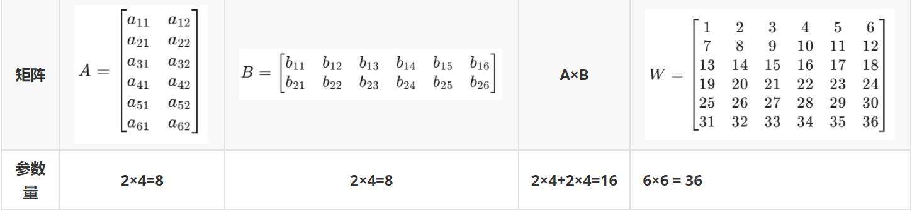
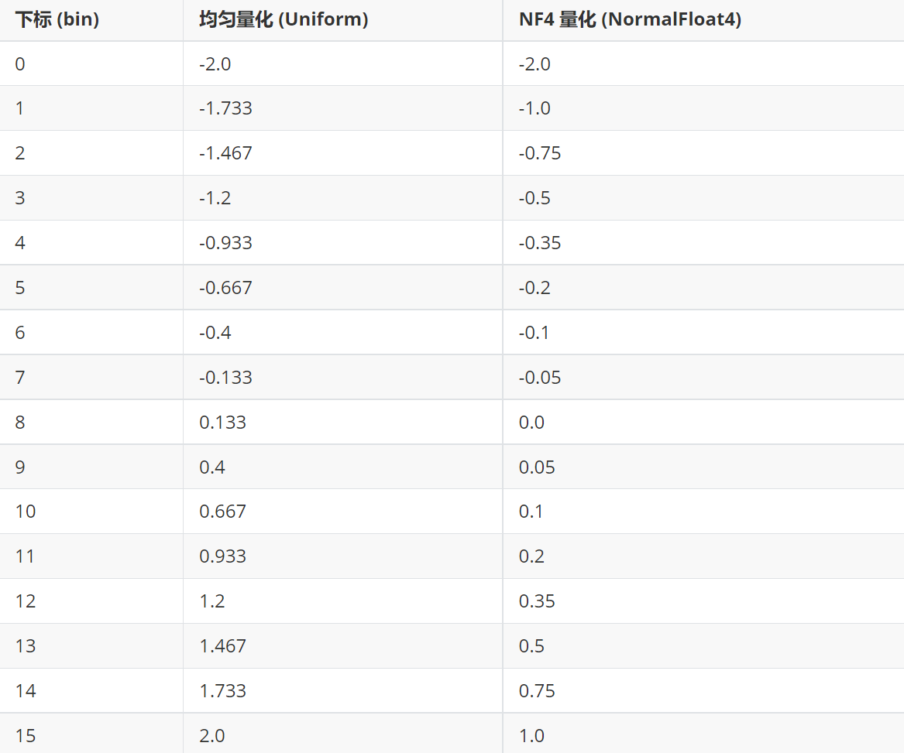
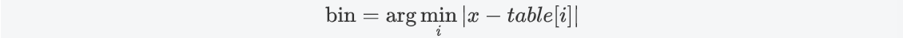
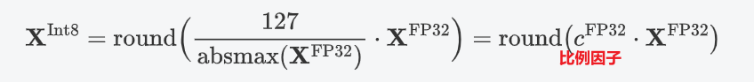
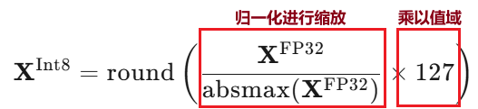
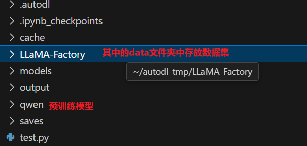
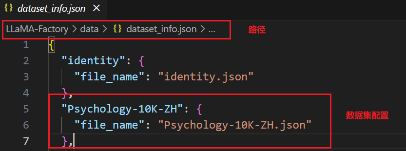
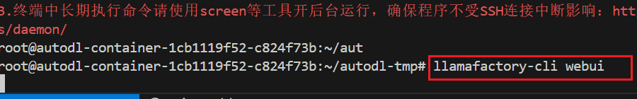
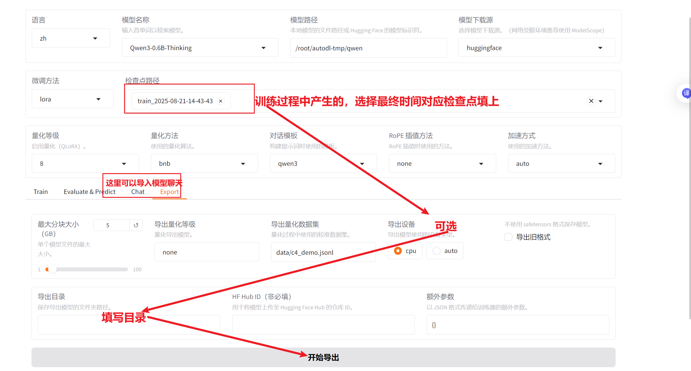

# 前言

大模型微调是指在**预训练好的大型语言模型**（如GPT、文心一言等）的基础上，**针对特定的任务或领域数据**，**对模型的参数进行进一步的调整和优化**，使其更好地适应特定的应用场景，提高模型在特定任务上的性能和准确性。

大模型微调是实现行业落地、提升性能精度、满足个性化需求、节省算力资源并保障数据安全的关键路径，是**大模型走向实际应用**的“最后一公里”。

NLP的三个分支 **★**

- **NLU（Natural Language Understanding）**：自然语言理解，是让机器理解人类语言的过程，包括意图识别、实体抽取等。
- **NLG（Natural Language Generation）**：自然语言生成，是让机器生成人类语言的过程，用于撰写文本、生成描述等。
- **NLI（Natural Language Inference）**：自然语言推理，是判断两个句子之间逻辑关系的过程，用于文本分析和语义理解。

# 一、LoRA基础知识

大模型微调分类包括：

- **全量微调**：对大模型的所有参数进行**全面调整**，精度高但计算成本大。
- **高效微调**：采用轻量化方法（如**LoRA**、Adapter）仅调整**部分参数**，计算效率高且资源消耗少。
- **强化学习微调**：通过**奖励机制优化模型行为**，使其在特定任务中表现更优，适应性强。

LoRA（Low-Rank Adaptation，低秩适应）通过在模型的关键层中插入**低秩矩阵**来调整参数，能够在保持模型性能的同时显著降低计算成本和资源消耗。


## 1.1 低秩矩阵

我们将预训练大模型的整体参数看做一个d×d的大矩阵，这里我们引申出两个问题

### 问：LoRA调整的是哪部分的参数

答：LoRa微调**主要调整Transformer架构中的关键权重矩阵**

- 自注意力机制中的**查询（Query）、键（Key）、值（Value）矩阵**，
- **前馈神经网络中的线性层**权重矩阵，
- **输出层**的权重矩阵

直观的在图像上表明


### 问：为什么是d×d

答：**LoRA调整的参数都属于线性层的参数**，线性层**将m×d的输入的向量**（可能是经过Tokenizer映射的词向量，也可能是第一层注意力机制映射到底二层的向量）**映射为d×n的输出向量**，那么线性层的参数维度必定是d×d的方阵

我们把这个方阵拆分成**d×r**和**r×d**的A，B两个**低秩矩阵**，其中r为低秩矩阵的秩，可见**A×B的结果矩阵和原来大模型的W参数矩阵形状是一样的**




### 问：大模型微调为什么要引入低秩矩阵？

答：引入低秩矩阵是为了在微调时**减少可训练参数数量**，降低计算成本和内存占用，同时保留模型性能，高效地适应新任务。

大模型为了捕捉复杂的数据模式、提升泛化能力、适应多种任务以及满足深度学习的表达需求，轻松能到达上百亿参数量，我们在进行微调的时候不可能把这些参数都进行调整，因此低秩矩阵就是为了减少可训练的参数

假设原始矩阵W和低秩矩阵A，B如图所示



可以看到A×B的参数比相同维度的W减少了，拓展到更高维的情况，可以得到一个参数减少的比例：


## 1.2 微调过程


在LoRa微调中，**调整低秩矩阵 \( A \) 和 \( B \) 而保持原始权重 \( W \) 不变，最后将A，B相乘得到的矩阵与W逐元素相加**，从而减少计算和存储开销，灵活适应新任务。


## 1.3 损失计算


# 二、QLoRA原理 ★ 牺牲内存换显存

## 2.1 量化 FP32→Int4

### 问：模型量化有什么意义

答：牺牲部分模型精度来换取显存大大降低

- **降低存储成本**

- **提升推理速度**
- **使模型更易存储**
- **拓展应用场景**

下面介绍两种量化方式，再次之前先明确几个概念

**bin**：映射到量化空间中的下标

**scale**：相邻两个下标对应的数值步长

**FP32（单精度浮点数）**：范围大约是从**±1.18×10⁻³⁸**到**±3.4×10³⁸**

**Int4（4位整数）**：范围是 **-8** 到 **7**

**Int8（8位整数）**：范围是 **-128** 到 **127**，精度更高

**量化的目的是要把FP32范围的参数映射到Int4范围的下标中**



### 2.1.1 均值量化

这个比较简单，总的俩说就是**通过计算一组数据的均值，将数据映射到更小的数值范围**

均值量化的步长由最大最小值的**值域除以间隔**


得到步长后我们要计算实际值到最小值的距离是**多少个步长**


均值量化的量化表实际上就是从最小值开始，每次增加一个scale，直到最大值，此时步长为对应总量化步长

**举个栗子**

```
b=4,max=2,min=-2,量化到Int4====>scale=0.2267,总步长为16
x=-1.8....====>bin(0.75)=1(量化表中的下标)====>对应数值min+bin×scale=-1.733
```

### 2.2.2 NF4量化

**NF4量化思想和均值量化一样，但是bin的计算方式不同，而且是直接指定下标，不需要计算scale**

根据数据的分布，我们选取最合适的Int4中范围内[-8,7]的数值作为量化表中的max和min来总体涵盖参数范围，**这里不一定是参数的最大值和最小值**

在[min,max]中构建正态分布序列，**尾部稀疏，0 附近密集**，保留0附近的精度

然后直接计算bin，**NF 4中是找与对应参数距离最近的量化表元素下标**



**举个栗子**

```
原参数矩阵 W = [0.12, -0.95, 0.33, 1.24, -0.44]
选取量化表max=1.0(对应下标15) min=-0.95(对应下标0)
x=-0.44....===>距离最近数值对应下标为11===>bin=11====>对应数值为-0.44
```

## 2.2 反量化 Int4→FP32

**我们量化的目的主要是为了节约显存，但是在实际数值运算的时候并不是直接拿下标去进行前向传播**

反量化是为了将量化后的数据恢复到接近原始数据的精度（**量化时参数的小数数位减少，丢失了一部分精度，反量化不能将参数还原到原来精度，这也就是出现精度损失的直接原因**），以便在需要高精度计算的场景中使用，平衡量化带来的效率提升和精度损失。

方法上述也提到了，就是**根据下标在量化表中找到对应元素来替换**

## 2.3 QLoRA FP32→INT8

**QLoRA = 量化＋LoRA**

### 2.3.1 QLoRA量化

量化引入了一个**比例因子**来对参数范围进行缩放



可能看这个公式看得不是很清晰，但是我们只需要稍微移项就可以看得很清晰了



### 2.3.2 QLoRA反向量化

**直接Int8来除以比例因子**（比例因子是个定值）


## 2.4 4-Normal Distribution

上述讲解了FP32→Int8的过程，但是为什么不是FP32→Int4 呢？

**通过下标反量化的参数可能会有很多相等的值，这取决于量化精度。量化精度越低，相等值越多；量化精度越高，相等值越少**

而权重参数通常服从正态分布，多数权重接近 0，少量分布在尾部，因此经过量化接近0的参数都被置为0了

```
w = [-0.05, 0.01, 0.02, 0.03, 0.07, 0.5, 2.5, 4.0] ===> w_int4 = [0, 0, 0, 0, 0, 1, 4, 7] ===> 相同参数多，精度低
```

**解决方案：在 0 附近划分得更密集，远离 0 的区域划分得更稀疏**

## 2.5 双重量化（Double Quantization）FP32→Int4 ★ 

### 问：量化后的参数量得到了大大降低，但是计算过程中产生的scale依旧是FP32的浮点数，依旧占据了很大的显存，还有没有什么更优的方法？

答：使用双重量化。

第一重：**将原始的FP32权重量化为int4**，得到量化后的权重`w_int4`和对应的缩放因子`scale`。

第二重：**对这些`scale`进行第二次量化，将其存储为更低精度的整数（如int8）**，而不是使用FP16或FP32。

**举个栗子**

- **第1步**：
  - **权重**：`w = [-2.1, -0.5, 0.0, 1.2, 3.5]`
  - **最大绝对值**：3.5
  - **缩放因子**：`scale1 = 3.5 / 7 ≈ 0.5`
  - **量化后权重**：`w_int4 = [-4, -1, 0, 2, 7]`
- **第2步**：
  - **所有`scale1`的值范围**：`[0.01, 1.0]`
  - **对`scale1`进行`int8`量化**：假设`0.5`被量化为`int8`值`64`
  - **存储**：`int4`权重 + `int8(64)`

## 2.6 分页机制

大模型参数过多可能会导致**无法将所有参数一次性加载**到GPU显存中，**分页机制在训练过程中将模型参数分块存储到CPU中，通过动态加载和卸载这些页面来管理显存，**从而在有限的显存资源下进行高效的微调。

# 三、LLaMA-Factory部署LoRA进行大模型微调

LLaMA-Factory是一个专注于创建和优化大型语言模型（LLMs）的**框架或平台**，旨在**提供工具和资源以支持语言模型的开发和微调。**我们将LoRA部署在LLaMA-Factory可以实现可视化界面进行调参，非常方便

网址：https://github.com/hiyouga/LLaMA-Factory

## 2.1 前期准备

首先我们得租一个**算力**，如果在自己电脑上跑估计配置不太够用

在连接算力前先在本地下载好**LLaMA-Factory**再传到服务器上（我使用的是Xftp软件上传的），当然也可以在服务器命令行用指令去下

```
git clone --depth 1 https://github.com/hiyouga/LLaMA-Factory.git
```


既然是大模型微调任务，那么**预训练大模型**以及**预训练数据**也是必要的，这里只做演示，所以选择的模型和数据都比较简单，但是原理和流程是一样的

预训练大模型地址：[Qwen/Qwen3-0.6B · Hugging Face](https://huggingface.co/Qwen/Qwen3-0.6B)

数据集地址：[Kedreamix/psychology-10k-Deepseek-R1-zh · Datasets at Hugging Face](https://huggingface.co/datasets/Kedreamix/psychology-10k-Deepseek-R1-zh)

**注意找的数据集应该是下面这种格式**

```json
[
  {
    "instruction": "将下面这段英文翻译成中文：The future of AI is full of possibilities.",
    "input": "",
    "output": "人工智能的未来充满了无限可能。"
  }
]
```

此时LLaMa，数据集，与预训练模型都已经上传到服务器上



在命令行中输入如下指令对LLaMa进行配置

```
cd LLaMA-Factory
pip install -e ".[metrics]"
```

安装测试指令（只要是看版本）

```
llamafactory-cli version
```

最后配置好数据集，就可以开始模型微调了



## 2.2 开始微调

**接入GPU**，命令行输入下面指令，LLaMa，启动！

```
llamafactory-cli webui
```



进入界面选择中文模式，需要调节什么配置都自己操作了，如果模型比较大，记得选择量化，配置完成即可开始训练

**训练完成后，需要将微调模型导出**，导出后的模型和与训练模型调用方法一致（**LLM**）



