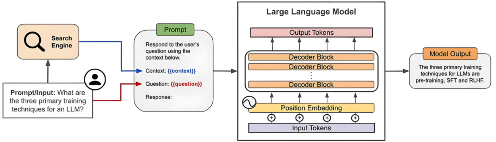
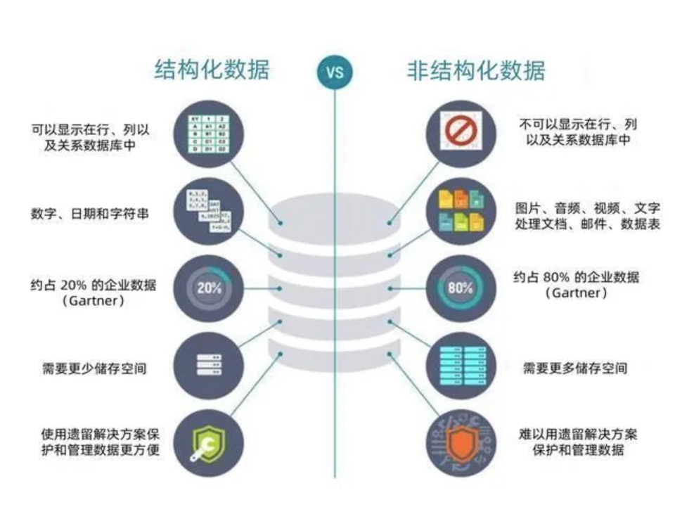
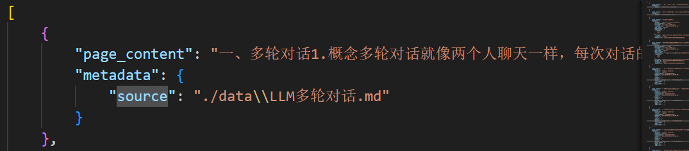
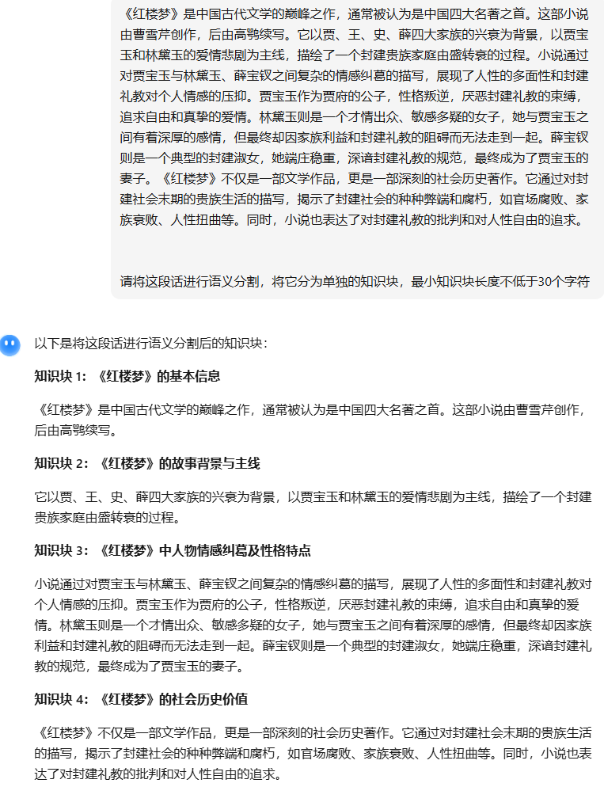
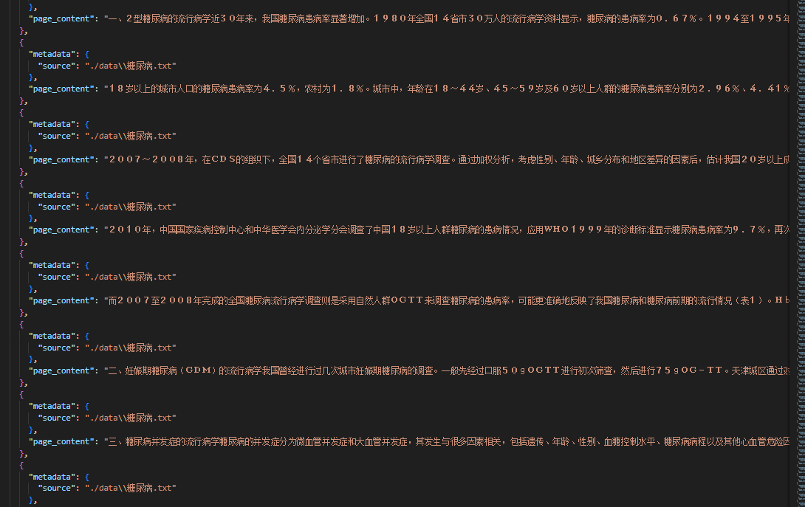
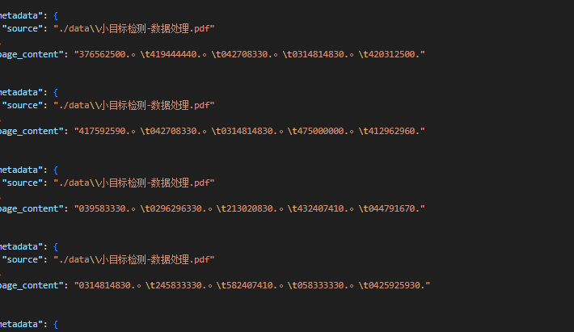

# 前言：

大模型在生成回答的时候，有时总是会词不达意，甚至毫无根据的乱说一通，我们把这种现象称为**大模型的幻觉**

**产生幻觉问题主要是因为其基于大量数据和复杂算法进行概率性预测来生成内容，当遇到训练数据中未充分覆盖或模糊不清的情境时，容易生成看似合理但实际错误或无根据的信息，且难以自我验证内容的真实性**，**然而大模型的生成机制是计算出下一个最有可能出现的词或短语。这种概率生成的方式本身没有绝对的对错判断机制**。**

另外，在实际生产中，还需要面临时效性和可解释性的问题，更具具体业务来生成有针对性的回答，实现这个功能似乎微调能够办到，但是不可能每次有需要更新的内容都微调一次，这样成本太高了

因此我们在大模型中引入**RAG技术**，通过丰富大模型上下文来大幅提高模型输出质量

# 一、什么是RAG？

**通俗点来讲，就是相当于给大模型提供了一个专属图书馆，前期通过数据预处理，把原始文档（PDF、Word、图片等）处理成机器能理解的 “知识片段”，并存储到向量数据库中，在客户向大模型提问（Query）时，大模型通过分析Query，在数据库中检索到与之相关的知识块添加到上下文一起作为prompt传入大模型**

- **R：** Retrieval，检索。从外部知识库中检索与当前输入相关的上下文信息
- **A：** Augmented，增强。将检索到的上下文信息与模型的内部知识相结合
- **G：** Generation，生成。基于增强后的上下文信息生成最终的回答。

**精髓在于检索和生成**



# 二、RAG实现流程

## 2.1 构建知识库

### 2.1.1 读取非结构化数据

实际生产中，会产生一些私有的数据，比如某某公司第一季度财务报表.xlsx、某某产品使用说明书.pdf、员工健康状况分析汇报.png等，这些不像存储在MySQL数据库中的数据那样可以用指令轻易查询修改，他们属于非结构化数据，而RAG主要处理的也就是非结构化数据，将这些各种格式的文档处理成机器可读的文本格式（JSON）



下面这串代码基于langchain，可以处理市面上大多的文档，但是像图片和PDF还需要下载[Tesseract-OCR](https://blog.csdn.net/qq_38463737/article/details/109679007)后才能处理

```python

import os
import json
from langchain_community.document_loaders import (
    TextLoader,
    CSVLoader,
    UnstructuredFileLoader,
    UnstructuredExcelLoader,
    PyPDFLoader,
)
from PIL import Image
import pytesseract
from langchain.schema import Document
from tqdm import tqdm   # 进度条库


def clean_content(text: str) -> str:
    """清理文本内容，去掉空格和换行"""
    return text.replace(" ", "").replace("\n", "").strip()


def load_documents_from_data_dir(data_dir="./data"):
    knowledges = []
    all_files = []
    for root, _, files in os.walk(data_dir):
        for file in files:
            all_files.append(os.path.join(root, file))

    for file_path in tqdm(all_files, desc="读取文件进度", unit="file"):
        ext = os.path.splitext(file_path)[1].lower()

        try:
            if ext == ".txt":
                loader = TextLoader(file_path, encoding="utf-8")
                new_docs = loader.load()
            elif ext == ".csv":
                loader = CSVLoader(file_path)
                new_docs = loader.load()
            elif ext in [".xls", ".xlsx"]:
                loader = UnstructuredExcelLoader(file_path, mode="elements")
                new_docs = loader.load()
            elif ext == ".pdf":
                loader = PyPDFLoader(file_path)
                new_docs = loader.load()
            elif ext == ".md":
                loader = UnstructuredFileLoader(file_path)
                new_docs = loader.load()
            elif ext in [".png", ".jpg", ".jpeg", ".bmp"]:
                # 调用系统OCR
                text = pytesseract.image_to_string(Image.open(file_path), lang="chi_sim")
                new_docs = []
                if text.strip():
                    new_docs.append(Document(page_content=text, metadata={"source": file_path}))
            else:
                print(f"不支持的文件类型: {file_path}")
                continue

            # 清理文本,添加到knowledges列表中
            for doc in new_docs:
                doc.page_content = clean_content(doc.page_content)
                if doc.page_content:  # 只添加非空内容
                    knowledges.append({"page_content": doc.page_content, "metadata": doc.metadata})

        except Exception as e:
            print(f"读取 {file_path} 失败: {e}")

    return knowledges


if __name__ == "__main__":
    knowledges = load_documents_from_data_dir("./data")
    print(f"总共读取了 {len(knowledges)} 条知识")
    # 存储为json文件
    with open("knowledges.json", "w", encoding="utf-8") as f:
        json.dump(knowledges, f, ensure_ascii=False, indent=4)
        print("存储完成")
```

处理后的json文档格式如下图：



那是不是到这里知识库就结束了呢？非也非也

在page_content中存储的是一整个文档的内容，比如一本红楼梦，加入当我想大模型提问“红楼梦的作者是谁”，大模型找到（怎么找到的后面会介绍）这一个知识块传入模型，那就是传了一整本红楼梦进去，这无疑是对大模型上下文推理能力的巨大挑战且没有必要，因为我要的只是“红楼梦的作者是谁”，所以我们还得**对知识进行切分**

### 2.1.2 语义分割

这一部分需要一个专门的语义分割大模型（常规大模型也可以，但是没有那么专精），将一个长序列文本切割成一系列独立的知识块



```python
from modelscope.outputs import OutputKeys
from modelscope.pipelines import pipeline
from modelscope.utils.constant import Tasks
import json

# 初始化语义分割pipeline


# ++++++++++这里模型不需要vllm启动，直接调用+++++++++
p = pipeline(
    task=Tasks.document_segmentation,
    # 指定模型名称为RAG检索增强生成/sentence_cut，模型版本为master
    model='RAG检索增强生成/sentence_cut',
    model_revision='master'
)

MIN_LEN = 50  # 最小知识块长度，单位字符

# 读取原始知识库
with open('RAG检索增强生成/knowledges.json', 'r', encoding='utf-8') as f:
    knowledge = json.load(f)

segmented_data = []

for k in knowledge:
    source = k['metadata'].get("source", "")
    text = k['page_content'].strip()
    
    # 语义分割：直接传字符串，而不是列表
    result = p(text)
    seg_text = result[OutputKeys.TEXT].strip()
    
    # 如果模型没有输出换行，则人工按句号或换行拆分
    if '\n' in seg_text:
        segments = seg_text.split('\n')
    else:
        # 简单按句号拆分
        segments = [s.strip() for s in seg_text.split('。') if s.strip()]
    
    # 合并短块
    merged_segments = []
    buffer = ""
    for seg in segments:
        if len(buffer) < MIN_LEN:
            buffer = buffer + "。" + seg if buffer else seg
        else:
            merged_segments.append(buffer)
            buffer = seg
    if buffer:
        merged_segments.append(buffer)
    
    # 保存
    out = {
        'metadata': source,
        'page_content': "\n".join(merged_segments)
    }
    segmented_data.append(out)

    # 打印调试信息
    print("=="*20)
    print(source)
    print(f"分割前段数: {len(segments)}, 合并后段数: {len(merged_segments)}")
    print("示例段:", merged_segments[:1])


# 现在我要把分割后的知识库保存到新的json文件，每个知识块作为一个独立的条目
output_knowledge = []
for item in segmented_data:
    source = item['metadata']
    segments = item['page_content'].split('\n')
    for seg in segments:
        output_knowledge.append({
            'metadata': {'source': source},
            'page_content': seg.strip()
        })
# 保存到新的json文件
with open('RAG检索增强生成/knowledges_segmented.json', 'w', encoding='utf-8') as f:
    json.dump(output_knowledge, f, ensure_ascii=False, indent=2)
```

切割后的结果示例：



这样做不仅能够将长文本切块，还能避免很多在进行数据读取是产生的乱码，这部分就不容易被检索到



## 2.2 向量数据库存储

向量数据库用于存储文档的向量表示，支持高效的相似度搜索，它的优势就在于检索便捷

- 提供特定的存储结构和索引算法；
- 能够高效地存储、查询和处理向量数据

**切割的知识块通过词嵌入模型转换为词向量存储到向量数据库，当用户的问题也转化到词向量后，根据余弦相似度等方法来在向量数据库中搜索相关性较大的知识块**

常见的三种向量数据库，本质都是一样的，这里我们用Chroma

|        |                            |                              |                            |
| ------ | -------------------------- | ---------------------------- | -------------------------- |
| 数据库 | 优势                       | 劣势                         | 适用场景                   |
| FAISS  | 轻量、开源、检索速度快     | 无完整数据管理功能（如权限） | 本地测试、小规模项目       |
| Milvus | 支持大规模数据、**分布式** | 部署复杂、需要一定运维成本   | 企业级项目、海量数据       |
| Chroma | 轻量、**支持多模态数据**   | 性能略逊于 Milvus            | 快速原型开发、中小规模项目 |

接着上面的知识块来处理

**添加：**

```python
import chromadb
import json
import hashlib
from modelscope.outputs import OutputKeys
from modelscope.pipelines import pipeline
from modelscope.utils.constant import Tasks
from chromadb.utils import embedding_functions

# ==========================
# 1️⃣ 初始化 ChromaDB 客户端
# ==========================
chroma_client = chromadb.HttpClient(host="127.0.0.1", port=10221)
print("Chroma client:", chroma_client)

# ==========================
# 2️⃣ 定义向量化模型
# ==========================
model_name = "/root/autodl-tmp/RAG检索增强生成/BAAI-bge-base-zh-v1.5"
emb_fn = embedding_functions.SentenceTransformerEmbeddingFunction(model_name=model_name)

# ==========================
# 3️⃣ 创建或获取 Collection
# ==========================
collection = chroma_client.get_or_create_collection(
    name="my-collection-decimal",
    embedding_function=emb_fn,
    metadata={"description": "about company's administration and travel, subsidy, etc."},
)

# ==========================
# 4️⃣ 文档分割 & 知识块处理
# ==========================
if __name__ == "__main__":
    # 查看现有 collections
    print("Collections:", chroma_client.list_collections())

    # 分割文档的 Pipeline
    chunk_min_len = 100  # 每个知识块最小长度
    segmenter = pipeline(
        task=Tasks.document_segmentation,
        model="RAG检索增强生成/sentence_cut",
        model_revision="master",
    )

    # 读取知识库 JSON 文件
    knowledge_path = "RAG检索增强生成/knowledges.json"
    with open(knowledge_path, "r", encoding="utf-8") as f:
        knowledge = json.load(f)

    # ==========================
    # 5️⃣ 初始化缓存
    # ==========================
    ids, documents, metadatas = [], [], []

    for k in knowledge:
        print("=" * 60)
        source_value = k.get("metadata", {}).get("source", "")
        print(f"Source: {source_value}")

        # 文档分割
        result = segmenter(documents=k["page_content"])
        chunks = [c.strip() for c in result[OutputKeys.TEXT].strip().split("\n") if c.strip()]

        tmp = ""
        for chunk in chunks:
            tmp += chunk
            if len(tmp) >= chunk_min_len:
                doc_id = hashlib.md5(tmp.encode("utf-8")).hexdigest()

                # 去重判断
                existing = collection.get(ids=[doc_id])
                if existing["ids"] or doc_id in ids:
                    tmp = ""
                    continue

                # 保存知识块
                ids.append(doc_id)
                documents.append(tmp)
                metadatas.append({"source": source_value})
                tmp = ""

        # 处理剩余未达到最小长度的文本
        if tmp:
            doc_id = hashlib.md5(tmp.encode("utf-8")).hexdigest()
            existing = collection.get(ids=[doc_id])
            if not existing["ids"] and doc_id not in ids:
                ids.append(doc_id)
                documents.append(tmp)
                metadatas.append({"source": source_value})

    # ==========================
    # 6️⃣ 添加知识块到 Collection
    # ==========================
    collection.add(ids=ids, documents=documents, metadatas=metadatas)
    print("知识块添加成功，总数量:", collection.count())

```

## 2.3 查询相关知识块

这一步主要是进行一轮初筛，把相关的都拿出来

```python
import chromadb


# 连接远程 ChromaDB
chroma_client = chromadb.HttpClient(host="127.0.0.1", port=10221)

# 查看所有 collections
collections = chroma_client.list_collections()


# 获取某个 collection
collection = chroma_client.get_collection(name="my-collection-decimal")


# 或者按文本向量查询（k近邻搜索）
results =collection.query(
    query_texts=["孙悟空有几条命"],
    n_results=5
    )

print("="*50)
print('搜索到的知识块：', results['documents'])
print("="*50)
print('搜索到的知识块的向量距离：', results['distances'])
print("="*50)
print('搜索到的知识块的id：', results['ids'])
print("="*50)
print('搜索到的知识块的元数据：', results['metadatas'])
```

## 2.4 重排序Rerank

这一步是使用重排序的rerank模型对检索到的知识块进行一个相关性排序，把相关性高的放前面，这样大模型在分析上下文的时候更容易捕捉到细节

```python
import chromadb
import requests

# 连接远程 ChromaDB
chroma_client = chromadb.HttpClient(host="127.0.0.1", port=10221)
# 大模型命令
# python -m vllm.entrypoints.openai.api_server --port 10220 --model /root/autodl-tmp/RAG检索增强生成/bge-reranker-base  --gpu-memory-utilization 0.5 --max-model-len 512

# 查看所有 collections
collections = chroma_client.list_collections()


# 获取某个 collection
collection = chroma_client.get_collection(name="my-collection-decimal")


# 或者按文本向量查询（k近邻搜索）
Question = "孙悟空有几条命"
results =collection.query(
    query_texts=[Question],
    n_results=5
    )

# 做二次精排
url = "http://127.0.0.1:10220/rerank"
data = {
    "model":"/root/autodl-tmp/RAG检索增强生成/bge-reranker-base",
    "query":Question,
    "documents":results['documents'][0]
}

# 发送请求
response = requests.post(url, json=data)
# 打印结果
print(response.json())
```

**最后把检索重排序到的参考文献添加到prompt中，大模型就可以有依据的生成内容了**
