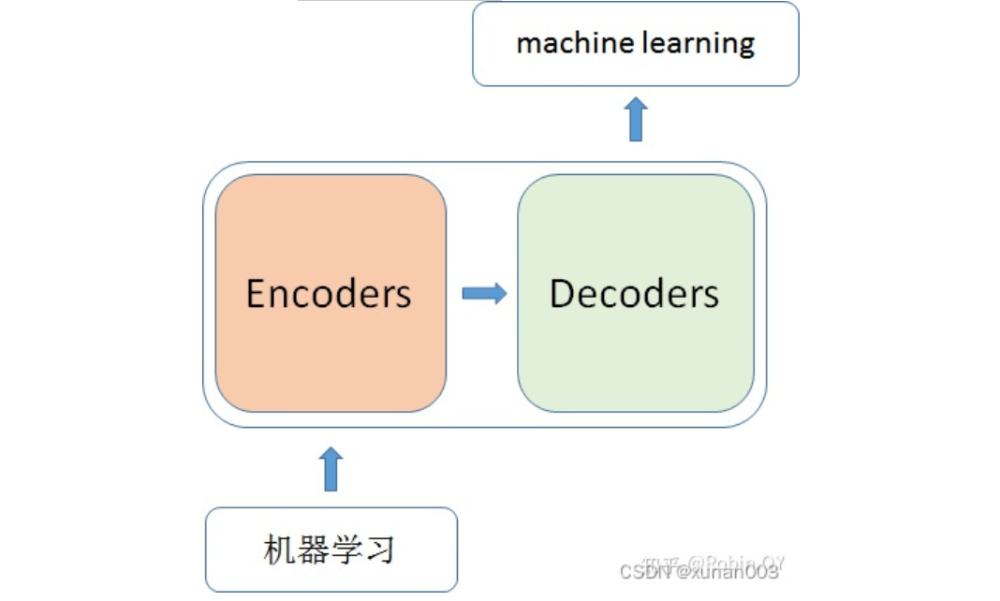
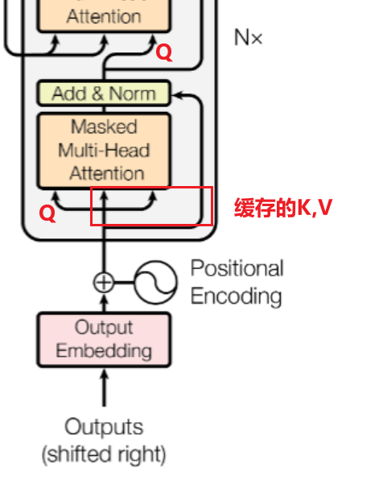
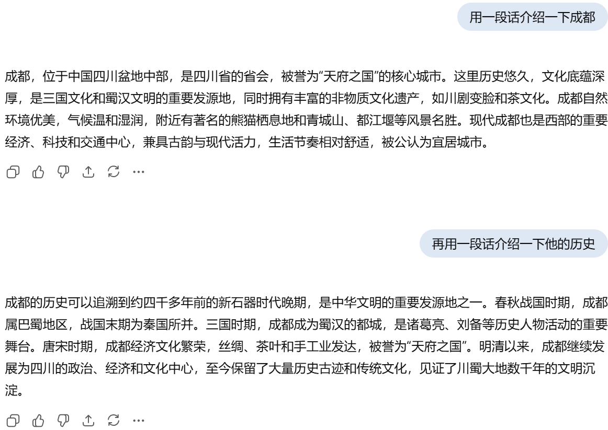
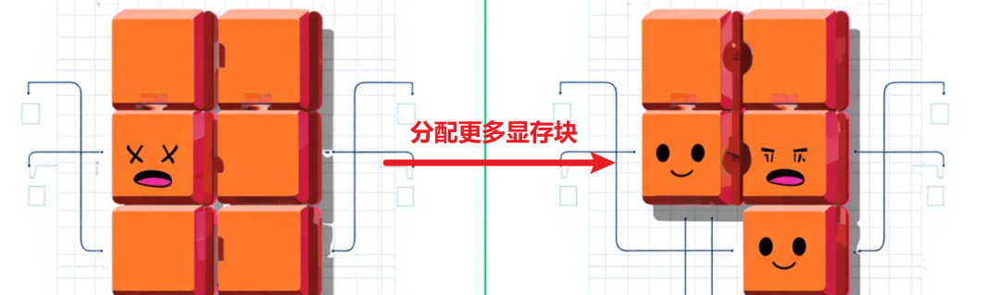

# 前言

**参考文章：**

[(19 封私信) 长篇白话解读vLLM：让大模型推理快得飞起的“黑魔法” - 知乎](https://zhuanlan.zhihu.com/p/1891089721192599865)

[(19 封私信) 一文详解八款主流大模型推理框架 - 知乎](https://zhuanlan.zhihu.com/p/32055623013)

训练好的大模型本质上就是一堆**参数文件（权重）+ 结构定义**，它自己不能直接对外服务。要真正让别人（前端、业务系统、APP 用户）用起来，就必须把它**部署**成一个可调用的系统。

理解为：

- **训练完的模型** = 一本厚厚的书，放在你电脑里，别人看不到。
- **部署好的模型服务** = 建了一个图书馆窗口，别人能来借书、问问题。

目前主流的大模型推理框架有Hugging Face（国外），ModelScope（国内），Ollama，以及本篇文章要着重介绍的vLLM。

对于获取句子嵌入向量的大模型，可以使用更加便捷的Sentence Transformers库，我们在后面的文章中会介绍。

# 一、Hugging Face/ModelScope（魔塔社区）

这两个平台本质都差不多，都是**通过调用 API 或 SDK 来下载、加载和推理模型，适合用来下载到本地部署和运行推理，只是 Hugging Face 更国际化、生态更全，而 ModelScope 在中文和国内部署上更有优势**

- API 是一组“**接口规范**”，告诉你能调用什么，写好请求数据后直接调用 HTTP POST请求
- SDK 是一个“**工具包**”，在 API 基础上封装好代码和工具，让你更方便地调用和开发，用pipeline实现。

分别提供一个示例：

**API：**

```python
import requests

# 模型推理 API 地址
url = "https://api.example.com/v1/text-generation"

# 请求数据
payload = {
    "model": "gpt2",
    "prompt": "今天天气很好，",
    "max_tokens": 50
}

# 直接调用 HTTP POST
response = requests.post(url, json=payload)

# 返回结果
print(response.json())

```

**SDK：**

```python
from transformers import pipeline

# 一行代码创建文本生成器

generator = pipeline("text-generation", model="gpt2")

# 调用推理

result = generator("今天天气很好，", max_length=50)

# 返回结果

print(result)
```

# 二、Ollama

Ollama 目标在于简化在 [Docker](https://zhida.zhihu.com/search?content_id=242434953&content_type=Article&match_order=1&q=Docker&zhida_source=entity) 容器中部署大型语言模型的过程，使得非专业用户也能方便地管理和运行这些复杂的模型，并且能够**离线使用**，但是只适合部署在本地。

# 三、vLLM

前两种模型虽然的确能够部署一些中小型的模型，但是当参数量来到千亿级别，就会出现**显存瓶颈、计算延迟和高成本（硬件资源消耗大和时间成本高）**的问题，这个时候就要请出我们的真神——**vLLM**

## 3.1 LLM Inference面临的问题

### 3.1.1 自回归生成模式的隐患

LLM（尤其是GPT类）的自回归生成方式是“**一个字一个字往外蹦**”：模型**先一次性处理初始输入，然后基于输入预测第一个token，接着把第一个token拼接到输入后形成新序列，再基于新序列预测第二个token**，如此循环，直到生成结束符或达到最大长度限制。

这种模式下，每生成一个新token都要进行一次完整的前向计算，虽然每次只生成一个token，但因需回顾前面所有内容，计算量依然很大。

### 3.1.2 KV Cache的局限

既然每次生成一个token都需要计算前面的所有内容，那我能不能把前面的内容缓存起来，当**生成新的token时，只需要计算这个新token的QKV**，这样就可以极大的减少重复的运算了

首先我们来回顾一下Transformer的整套流程，大致分为Encoder 和 Decoder两部分，前面文章都有详细结构解析，这里只是补充一下当我们输入文本时，Transformers会如何处理。

**总的来说**，当我输入一个文本，该文本数据会先 经过一个叫Encoders的模块，对该文本进行编码，然后将编码后的数据再传入一个叫Decoders的模块进行解码，解码后就得到了翻译后的文本，对应的我们称Encoder为编码器，Decoder为解码器。




**详细拆解，**在Transformer模型中，编码器通过嵌入层和位置编码将输入序列的每个token（**初始状态下，一个token就是嵌入矩阵的一行**）转换为向量表示，并输入到由多层编码器层堆叠而成的编码器中。每个编码器层包含多头自注意力和前馈神经网络两个子层，多头自注意力通过Q、K、V的点积计算注意力得分并加权求和，随后应用残差连接和层归一化，再传递给前馈神经网络进行进一步处理。经过所有编码器层后，生成包含输入序列语义和句法信息的上下文表示。

解码器以目标序列的初始token（如BOS）为输入，由多层解码器层堆叠而成，每层包含掩码多头自注意力、编码器-解码器注意力和前馈神经网络三个子层。掩码多头自注意力屏蔽未来token，编码器-解码器注意力结合编码器的上下文信息，同样应用残差连接和层归一化。解码器逐个生成目标序列的token，每次生成后更新输入和KV缓存，KV缓存存储已计算的K和V（**生成下一个token的第一轮计算**），提高生成效率。最终，解码器通过线性层和softmax层输出概率分布，生成下一个token。

**（上面这段话很重要）**




**下面贴了一个对话我们以这个对话来探究** ★★



**“用一段话介绍一下成都”**：

把这句话用**Tokenizer和Word2Vec**分成多个tokens的词嵌入向量，经过位置编码后进入编码器，生成上下文表示并把其中的K和V转递给解码器，由于是生成的第一个token，所以初始化一个BOS，在经过第一个注意力机制计算得到的K,V缓存到KV Cache中，再经过编码器传递过来的K和V输出第一个token，以此类推，输出第一个问题的所有回答。

**“再用一段话介绍一下它的历史”**：

明明已经是第二个问题了，大模型是怎么知道"他"是谁呢？

这是因为我们将大模型在上一个问题的回答添加进入了上下文中一起提交给大模型，所以别看你只是提了一个简短的问题，实际上输入大模型的内容还有他上一轮的回答以及其他检索到的知识点，输入的上下文在经过同样的流程生成这个问题的所有tokens

**但是，KV缓存是有代价的**

当对话的tokens足够多时， KV Cache 非常**占用显存**，一个稍微大点的 Batch Size（每次处理句子数量），或者长一点的序列，KV Cache 就能轻松吃掉几十 GB 甚至上百 GB 的显存

### 3.1.3 显存加载的瓶颈

**Decoder主要分为两个阶段**

- Prefill阶段：
  - 主要**处理输入Prompt，**涉及大量矩阵乘法（如Attention计算和Feed Forward网络），计算量密集，能够较好地利用GPU的计算能力。
- Decoding阶段：
  - 逐个生成Token，每次只处理一个新token，计算量相对较小。
  - 但每次计算都需要从显存中读取巨大的模型权重（几十GB）和不断增长的KV Cache（几GB到几十GB）。
  - 在这个阶段，GPU大部分时间都在等待数据从显存加载到计算单元。

**Decoding阶段的GPU无法充分利用其强大的计算能力，就像一个干活快的“牛马”因“搬砖”速度慢而闲置。**

★  **并且，在显存中采用预先分配内存的方式，导致大量空间浪费（内部碎片），每次都按照最大序列长度来分配一块显存空间，根本不考虑实际输入的文本长度，导致大量的空间没有被填满造成处理效率低下**

## 3.2 vLLM的破局之法——PageAttention

上述的问题总结下来都是一个问题——显存不够，那么在有限的资源下，怎么才能更好地利用显存呢？

PagedAttention 不再为每个序列预分配一个巨大的、连续的显存块来存储 KV Cache,而是把它切分成小块，**需要就加，不够就补**，用一个个小的显存块为不断增大的KV Cache提供存储空间

**举个例子：**

**假设每个物理块大小为64KB，显存被划分为多个这样的物理块。**当用户输入一个Prompt时，模型开始处理，此时仅需要64KB的KV Cache，于是从空闲物理块池中分配**1个物理块**（假设是块1），并在块表中记录逻辑块1映射到物理块1。随后，模**型开始生成后续Token，KV Cache需要更多空间，超出当前已分配的物理块时，就从空闲物理块池中再分配1个物理块（假设是块2）**，并在块表中记录逻辑块2映射到物理块2。随着模型继续生成更多Token，需要更多空间时，继续分配新的物理块（假设是块3），并更新块表记录逻辑块3映射到物理块3。

PagedAttention通过这种“需要就加，不够就补”的机制，将KV Cache分成一个个小的物理块进行动态管理，避免了预分配大块显存的浪费，同时灵活地支持KV Cache的动态增长。


