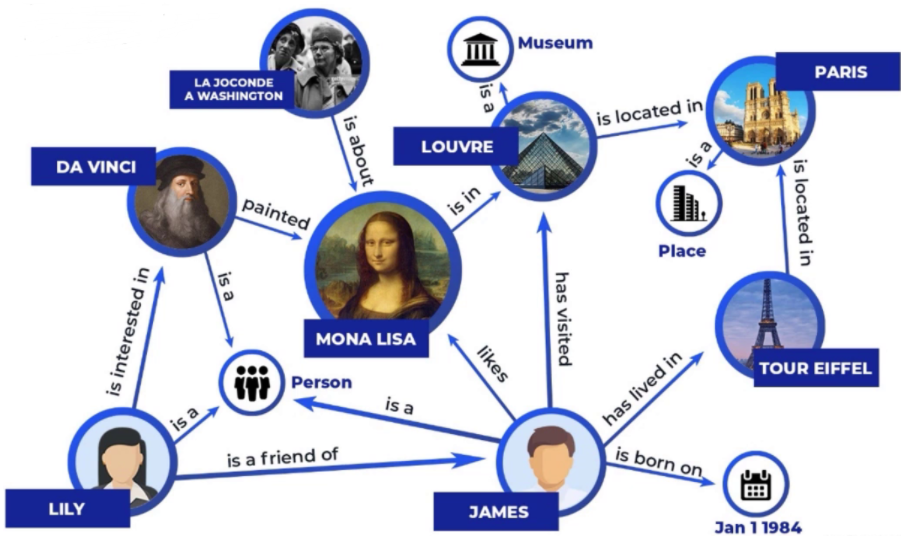
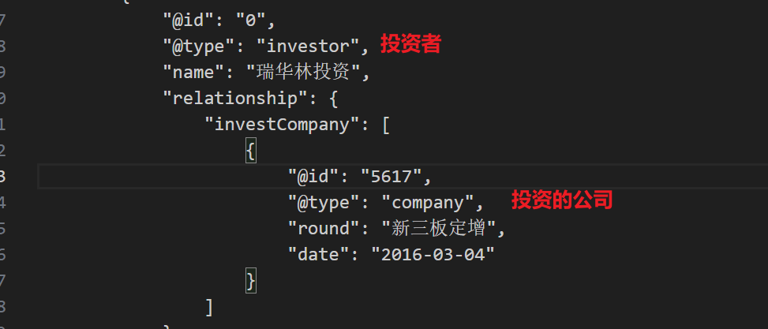

# 前言：

经典RAG应用的范式与架构已经非常流行，我们可以在很短的时间内借助成熟框架开发一个简单能用的RAG应用。

但是传统RAG需要对文本进行分块，然后进行向量化存储，这种处理模式就会天然导致RAG在**全局查询或总结**上的表现不会太好。比如面对这样的问题，“《跨越鸿沟》这本书整体上讲了什么？请撰写一份2000字的总结”，传统RAG大概率会表现不及格。并且在对文本分块之后，可能会丢失一些信息之间的关系和因果性

这正是知识图谱和GraphRAG可以发挥作用的场景

# 一、neo4j的搭建

[Neo4j安装与配置以及JDK安装与配置教程（超详细）-CSDN博客](https://blog.csdn.net/2301_77554343/article/details/135692019)

# 二、积累一些专用名词

**实体（Entity）**
 知识图谱中的“点”，代表现实世界中的事物，例如“华为”“张三”“北京大学”。

**关系（Relation / Edge）**
 实体之间的联系，图中的“边”，例如“张三–就读于–北京大学”。

**属性（Attribute / Property）**
 实体或关系的特征值，例如“张三–年龄–25岁”。

**三元组（Triple）**
 知识图谱的基本单元，形式为 *(头实体, 关系, 尾实体)*，如 *(张三, 就读于, 北京大学)*。

**知识抽取（Knowledge Extraction）**
 从文本、数据库等数据源中识别并抽取实体、关系和属性的过程。

**实体对齐（Entity Alignment / Linking）**
 不同知识图谱或数据源中的同一实体建立映射，例如“IBM”=“国际商业机器公司”。



# 三、GraphRAG的构建流程

## 3.1 数据处理大致流程（如果可以再网站上找到现成的知识图谱就可以省略这繁琐的一步）

**第一步**：在与下面相似内容的事件JSON文档中**提取实体**（所有出现的公司名字）

`{"title": "天翔环境：公司目前资不抵债公司目前资不抵债", "content": "同花顺（300033）金融研究中心5月27日讯，有投资者向天翔环境（300362）提问， 公司资不抵债对于计提5000万元的投资者被虚假陈述产生的损失，意味着投资者即便胜诉投资者也存在拿不到赔偿的风险？ 公司回答表示，公司目前资不抵债，没有能力支付赔偿。公司正积极推进进入司法重整程序，引入产业战略投资者完成控股权转让、化解公司的债务风险，通过一揽子方案解决控股股东资金占用问题，尽快恢复公司盈利能力。 关注同花顺财经（ths518），获取更多机会", "label": [{"event_type": "净资产减少", "arguments": [{"主体": "天翔环境"}]}]}`

**第二步**：在公司及投资数据文件中**提取所有被投资公司**名称



**第三步**：

构建事件节点和公司-事件关系

构建投资公司与被投资公司关系，以及专利**关系**

**第四步：**

把相关数据存入csv文件，**上传**到neo4j

## 3.2 实际应用的一个简单demo

### 3.2.1 写一个类调用大模型，修改提示词来做三元组信息抽取

**Query**：`小米投资了多家初创公司，并计划上市。`

**结果**：提取出的实体和关系: ['小米', '初创公司', '上市']

```python 
import os
from openai import OpenAI
# LangChain用于构建可填充的提示模板
from langchain_core.prompts import PromptTemplate

# ======================================================
# KG_LLM类：用于从文本中提取知识图谱相关关键词或三元组
# ======================================================
class KG_LLM:
    def __init__(self, model="kimi-k2-0905-preview"):
        """
        初始化KG_LLM实例
        参数:
            model (str): 使用的模型名称
        功能:
            1. 初始化OpenAI客户端
            2. 保存模型名称
        """
        # 初始化OpenAI客户端，连接自定义API
        self.client = OpenAI(
            api_key="sk-####",  # 替换为你的API Key
            base_url="https://api.moonshot.cn/v1",  # 自定义OpenAI接口
        )
        self.model = model

    def query(self, query, max_keywords=2):
        """
        从输入文本中提取知识图谱关键词
        参数:
            query (str): 待分析的文本
            max_keywords (int): 最多提取的关键词数量
        返回:
            List[str]: 提取出的关键词列表
        """

        # ============================
        # 1. 构建提示模板
        # ============================
        # 使用PromptTemplate可以动态填充参数
        prompt_template = """
        给定一些初始查询，提取最多{max_keywords}个相关关键词，一定不要超过{max_keywords}个，
        考虑大小写、复数形式、常见表达等，
        用'|'符号分隔所有同义词/关键词：'关键词1|关键词2|关键词3|...'
        直接提取，不要有其他的输出。
        句子：{text}
        结果：
        """

        # 构建LangChain模板对象
        finally_template = PromptTemplate(
            input_variables=["text", "max_keywords"],  # 模板中需要填充的变量
            template=prompt_template,
        )

        # 使用format方法填充模板，生成最终提示
        prompt = finally_template.format(text=query, max_keywords=max_keywords)

        # ============================
        # 2. 调用OpenAI模型生成关键词
        # ============================
        # 通过chat completion接口调用模型
        completion = self.client.chat.completions.create(
            model=self.model,
            messages=[
                # 系统角色：告诉模型它的身份
                {"role": "system", "content": "你是一位知识图谱专家，擅长从一句话里面提取知识三元组"},
                # 用户角色：提供需要处理的文本和提示
                {"role": "user", "content": prompt},
            ],
        )

        # ============================
        # 3. 处理模型输出
        # ============================
        # completion.choices[0].message.content 是模型输出文本
        # 使用'|'分隔符将多个关键词分开
        keywords = completion.choices[0].message.content.split('|')

        return keywords


# ============================
# 示例使用
# ============================
if __name__ == "__main__":
    kg_extractor = KG_LLM(model="kimi-k2-0905-preview")
    text = "小米投资了多家初创公司，并计划上市。"
    keywords = kg_extractor.query(text, max_keywords=3)
    print("提取出的关键词:", keywords)

```

### 3.2.2 cypher语句**使用**模糊搜索遍历上述实体和关系，在图数据库中进行检索

```
问题: 小米是什么类型的公司，并且有没有上市？

已知知识如下:
小米 --是--> 初创公司
小米 --进行了--> 上市

请根据这些知识回答问题。
```

### 3.3.3 拼接返回

将检索到的 `小米 --是--> 初创公司     小米 --进行了--> 上市`再返回给大模型，让他组成一个完整的句子

### 3.3.4 重排组装

把组成的句子使用Rerank大模型进行二次精排后加入上下文

组装上下文的prompt方法：

```
历史对话:===>这里也可以返还给大模型进行一个summary，以较少上下文tokens
User: 小米是什么类型的公司？
Ai: 小米是一家初创公司。

当前问题: 它什么时候上市的？
已知知识:
小米是一家初创公司，并且已经进行了上市。

请回答用户的当前问题。
```

# 四、vLLM or Sentence Transformers?

### 1️⃣ 大模型 vs 小模型的职责分工

| 模型类型                               | 参数量               | 典型用途                                    | 备注                                        |
| -------------------------------------- | -------------------- | ------------------------------------------- | ------------------------------------------- |
| **大模型（LLM）**                      | 大（几十亿到千亿级） | 文本生成、复杂推理、对话                    | 推理资源消耗大，通常需要 GPU 或专门推理服务 |
| **小模型（Sentence Transformers 等）** | 小（几十到几百M）    | 文本向量化（Embedding）、相似度计算、Rerank | 推理快、CPU/GPU 均可部署，适合实时检索      |

------

### 2️⃣ 在完整部署案例中的应用场景

假设你做一个 **RAG 系统**：

1. **用户输入问题（Query）**
   - 先通过 **Sentence Transformers** 将 Query 向量化。
2. **知识库检索（Vector Search）**
   - 用 Query 向量在知识库（FAISS/Milvus/Weaviate）里找 Top-K 文档。
   - 这里也可以用 Sentence Transformers 对文档向量做 **Rerank**。
3. **文档上下文整合**
   - 选出最相关的文档作为上下文。
4. **大模型生成**
   - 将 Query + 精排文档输入 **Docker 部署的推理大模型**（如 LLaMA-7B/ChatGPT 类模型）。
   - 大模型生成自然语言回答。

> 核心思路：**大模型只负责生成，检索/向量计算/精排用小模型即可**，既节省资源，又提高整体系统效率。

------

### 3️⃣ 为什么这样设计合理

1. **资源优化**：
   - 大模型推理消耗显著，不能频繁做向量搜索或相似度计算。
   - 小模型轻量，CPU/GPU 都能快速完成向量化和 Rerank。
2. **系统可扩展性**：
   - 小模型模块可以单独水平扩展（Vector DB + Sentence Transformers）。
   - 大模型模块可以通过 Docker/K8s 做 GPU 扩容。
3. **响应速度优化**：
   - 向量搜索和 Rerank 都在几毫秒到几十毫秒完成。
   - 大模型只处理精排后的少量上下文，显著缩短响应时间。

------

💡 **一句话总结**：
 在 RAG 系统中，**Sentence Transformers 负责语义检索和 Rerank，小模型快速高效**，而 **大模型专注于生成高质量回答**，两者协同才能既节省算力又保证回答质量。
