# 前言：

评估RAG有效性主要采用两种方法：独立评估和端到端评估。这两种方法从不同角度检验RAG系统的效能，确保其在各个组成部分均表现出色。

# 一、独立评估

独立评估侧重于对RAG系统中检索模块和生成模块的单独评估，以确保每个模块都能有效地完成其任务

## 1.1 检索模块评估

检索模块**能够从知识库中检索到与输入查询最相关的内容的能力**，这些指标衡量了系统在给定查询或任务下的项目排名效能，包括**命中率（Hit Rate）、平均排名倒数（MRR）、归一化折损累积增益（NDCG）、精度（Precision）**等。

### 1.1.1 命中率（Hit Rate）

很好理解，就是看总**的查询里面有几次查到了文档**

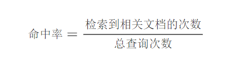

举例：

- **检索系统命中率计算示例**：

  假设我们有一个简单的检索系统和以下的查询记录：

  - 总共有10次查询。

  - 在这10次查询中，有7次查询检索到了至少一个相关的文档。


- **命中率计算公式**：

  

  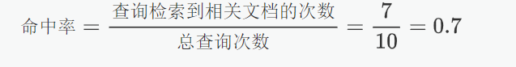

  

- **结果解释**：在所有查询中，有 $70\%$ 的查询至少检索到了一个相关文档，显示出检索系统对用户查询有较好的响应能力。

### 1.1.2 平均排名倒数（MRR）

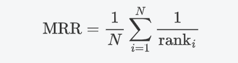

在文档A、文档B、文档C、文档D中，我们人工标注**文档C**为目标文档，然后使用RAG进行查询

**查询1**：

- 检索结果：文档A、文档B、文档C、文档D
- 正确答案：文档C
- 正确答案的排名：2

那么总共查询了一轮，当前MRR = 1/2,进行多次查询后累计的N和累加的rank就是MRR

## 1.2 生成模块评估

生成模块的评估关注于检索到的文档如何增强输入，以形成对查询的响应。与端到端评估中的最终答案/响应生成不同，这里更注重于评估过程中的**上下文相关性**。评估指标主要包括**BLEU、ROUGE**等。

### 1.2.1 BLEU

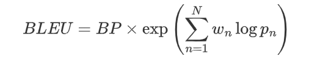

评估步骤：

1. **n-gram精度计算**：

   计算生成文本和参考文本中各个 n-gram 的匹配度。

2. **长度惩罚**：

   设置乘法参数BP若生成文本长度比参考文本短，则会受到惩罚，避免模型生成过短的文本。

   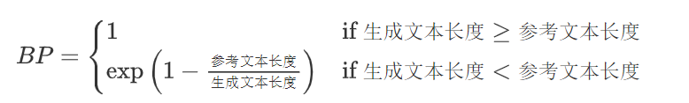

3. **加权平均**：

   对每个 n-gram 精度取对数并加权平均，得到最终的 BLEU 值。

   **案例：**

用户问题：巴黎的埃菲尔铁塔有多高？

人工标注的真实答案：埃菲尔铁塔的高度为330米

模型输出：埃菲尔铁塔的高度是330米

**计算 n-gram 匹配：** 从生成答案和参考答案中提取不同长度的 n-gram（假设计算 1-gram 和 2-gram）

- 1-gram：单个词

  - 参考答案的 1-gram：["埃菲尔铁塔", "的", "高度", "为", "330", "米"]
  - 生成答案的 1-gram：["埃菲尔铁塔", "的", "高度", "是", "330", "米"]
  - 匹配的 1-gram 有：["埃菲尔铁塔", "的", "高度", "330", "米"]
  - 共有 5 个匹配的 1-gram（参考答案有 6 个，生成答案有 6 个）。

  **1-gram 精度**：
  $$
  p_1 = \frac{5}{6} = 0.8333
  $$

- 2-gram：连续的两个词

  - 参考答案的 2-gram：["埃菲尔铁塔 的", "的 高度", "高度 为", "为 330", "330 米"]
  - 生成答案的 2-gram：["埃菲尔铁塔 的", "的 高度", "高度 是", "是 330", "330 米"]
  - 匹配的 2-gram 有：["埃菲尔铁塔 的", "的 高度", "330 米"]
  - 共有 3 个匹配的 2-gram（参考答案有 5 个，生成答案有 5 个）。

  **2-gram 精度**：
  $$
  p_2 = \frac{3}{5} = 0.6
  $$

长度惩罚：生成答案的长度为 6，参考答案的长度也是 6，长度惩罚为 1：
$$
BP = 1 \quad (\text{因为生成文本长度不小于参考文本长度})
$$
BLEU 计算：假设只计算 1-gram 和 2-gram 的精度，且每个 n-gram 的权重为 0.5
$$
BLEU = BP \times \exp \left( 0.5 \log p_1 + 0.5 \log p_2 \right)
\\
BLEU = 1 \times \exp \left( 0.5 \log 0.8333 + 0.5 \log 0.6 \right)
$$
计算结果为：
$$
BLEU \approx 1 \times \exp \left( 0.5 \times (-0.1823) + 0.5 \times (-0.2218) \right)
\\
BLEU \approx 1 \times \exp \left( -0.20205 \right) \approx 0.817
$$
因此，BLEU 分数为 **0.817**，说明生成的答案与参考答案在 n-gram 匹配上有一定的相似度，生成文本的质量较好。

# 二、RAGAS

专为RAG系统设计，用于无需参考答案的情况下评估系统性能。**它通过自动化的方式评估生成文本在三个质量维度上的表现：忠实度、答案相关性、上下文相关性。**

**NLI：自然语言推理**	NLU：自然语言理解	NLG：自然语言生成

## 2.1 忠实度

**判断原子化的答案能够从上下文中推断出来**

**案例：**

Query:

`乔布斯是做什么的？他什么时候去世的？`

answer:

`乔布斯是苹果公司的联合创始人，同时也是皮克斯动画工作室的前CEO。他于2011年10月5日因胰腺癌去世。`

RAG检索到的上下文：

`乔布斯是苹果公司的联合创始人。他推动了iPhone、iPod和Mac的发展。乔布斯曾是皮克斯动画公司的CEO，后来被迪士尼收购。他于2011年10月5日去世，死因为胰腺神经内分泌肿瘤。`

**第一步**：将生成的答案中提取声明（原子化的答案）

| 序号 | 声明 $s_i$                        |
| ---- | --------------------------------- |
| s₁   | 乔布斯是苹果公司的联合创始人。    |
| s₂   | 乔布斯是皮克斯动画工作室的前CEO。 |
| s₃   | 乔布斯于2011年10月5日去世。       |
| s₄   | 他因胰腺癌去世。                  |

因此，S=4

**第二步**：验证每个声明 $v(s_i, c(q))$：使用 LLM/NLI 判断每个 $s_i$ 是否可以从 $c(q)$ 推断出来

| 声明 | 上下文中是否支持？ | 说明                                                         |
| ---- | ------------------ | ------------------------------------------------------------ |
| s₁   | ✅ 是               | “乔布斯是苹果公司的联合创始人。” → 直接支持                  |
| s₂   | ✅ 是               | “乔布斯曾是皮克斯动画公司的CEO” → 表述略有不同但语义等价     |
| s₃   | ✅ 是               | “他于2011年10月5日去世。” → 直接支持                         |
| s₄   | ❌ 否               | 上下文说的是“胰腺神经内分泌肿瘤”，不是“胰腺癌”，细节不完全一致 |

所以，V=3

**第三步**：计算忠实度得分F = V/F = 0.75

## 2.2 答案相关性

**这是基于大模型的回答，反向来验证解决用户提问的相关性**

**案例：**

Query:

`量子计算的主要优势是什么？？`

answer:

`量子计算的主要优势包括并行性、解决复杂问题的速度远超经典计算机，以及在密码学和药物研发等领域的潜在应用。`

**第一步：**

基于大模型提出的回答生成用户可能询问的问题

`Q1: 量子计算相比经典计算机有哪些优势？   `

 `Q2: 为什么量子计算在密码学中有应用潜力？`

 `  Q3: 量子计算的并行性如何提升计算速度？   `

**第二步：**

使用词向量模型计算生成的问题与用户的提问的相关性，取平均

- 首先，计算嵌入相似度

  对原始问题 $q$ 和生成问题 $q_i$ 进行嵌入，并计算余弦相似度：  

  - $\text{sim}(q, q_1) = 0.92$（高度相关）  

  - $\text{sim}(q, q_2) = 0.75$（部分相关，聚焦子领域）  

  - $\text{sim}(q, q_3) = 0.85$（较强相关）  


- 然后，计算答案相关性得分 

$$
AR = \frac{0.92 + 0.75 + 0.85}{3} = 0.84  
$$

该答案相关性得分为 **0.84**（满分 1.0），表明答案与问题高度相关。  

## 2.3 上下文相关性

**根据通过用户的回答检索到的上下文，再次提交到大模型中来评测与问题的相关性**

**案例：**

Query:

`量子计算的主要优势是什么？？`

上下文：

1. `量子计算机利用量子比特进行计算。`
2. `传统计算机使用二进制位0和1。`
3. `量子比特可以同时处于叠加态。`
4. `北京是中国的首都。`
5. `量子纠缠是实现量子计算的关键特性之一。`

**第一步**：将上下文和用户问题加入提示词，让大模型评判有哪些是相关的

`请从提供的上下文中提取可能有助于回答"量子计算机的工作原理是什么？"的相关句子。如果没有找到相关句子，请返回"信息不足"。`

**第二步**：计算指标：

- 提取的相关句子数：3
- 上下文总句子数：5


# 三、代码参考（在metrics中选择自己想要的指标）：

```python 
import os
from ragas.evaluation import evaluate
from datasets import Dataset
from ragas.metrics._aspect_critic import (
    harmfulness,
    maliciousness,
    coherence,
    correctness,
    conciseness,
)

from langchain_openai import ChatOpenAI

critic_llm = ChatOpenAI(
    model=base_model_name,
    temperature=0,
    max_tokens=1024,
    api_key=os.getenv("OPENAI_API_KEY"),
    base_url=os.getenv("OPENAI_API_BASE"),
    streaming=False,
)
if __name__ == "__main__":
    data_samples = {
        "user_input": [
            "人工智能的三个主要分支是什么？",
            "什么是向量数据库？它在RAG系统中有什么作用？",
            "解释一下大语言模型的微调过程",
        ],
        "response": [
            "人工智能的三个主要分支是机器学习、深度学习和自然语言处理。",
            "向量数据库是专门存储和检索向量嵌入的数据库系统，在RAG系统中用于高效地检索语义相似的文档。",
            "大语言模型的微调是在预训练模型的基础上，使用特定任务的数据进一步训练模型的过程。",
        ],
        "reference": [
            "人工智能的三个主要分支是机器学习、自然语言处理和计算机视觉。",
            "向量数据库是专门设计用于存储和检索向量嵌入的数据库系统。在RAG系统中，它用于存储文档的向量表示，并通过相似性搜索快速检索与查询最相关的文档。",
            "大语言模型的微调是一个过程，其中预训练的基础模型使用特定领域或任务的数据进行额外训练，以优化其在特定应用场景的性能。",
        ],
        "ground_truth": [
            "人工智能的三个主要分支是机器学习、自然语言处理和计算机视觉。",
            "向量数据库是专门设计用于存储和检索向量嵌入的数据库系统。在RAG系统中，它用于存储文档的向量表示，并通过相似性搜索快速检索与查询最相关的文档。",
            "大语言模型的微调是一个过程，其中预训练的基础模型使用特定领域或任务的数据进行额外训练，以优化其在特定应用场景的性能。",
        ],
        "retrieved_contexts": [
            ["人工智能主要包括机器学习、深度学习、自然语言处理和计算机视觉等领域。"],
            [
                "向量数据库是专门用于向量数据存储和检索的系统。在RAG应用中，向量数据库存储文档嵌入，通过计算相似度快速找到匹配查询的文档。"
            ],
            [
                "大语言模型微调是在已预训练的模型基础上，使用特定数据集进行额外训练的过程，目的是使模型适应特定任务或领域。"
            ],
        ],
    }

    dataset = Dataset.from_dict(data_samples)

    result = evaluate(
        dataset,
        metrics=[harmfulness, maliciousness, coherence, correctness, conciseness],
        llm=critic_llm,
    )
    print(result)
```

# 四、RAG性能提升

主要提升点在于**prompt和检索的优化**

## 4.1 查询增强

查询增强常见方法： **prompt + LLM**，把用户的输入丢给大模型再进行一轮优化

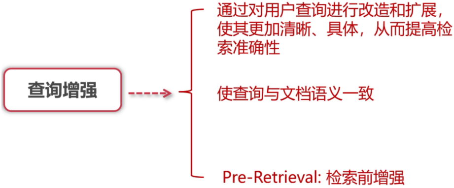

### 4.1.1 Query2Doc

把用户原始查询转化为更适合检索的文档式表达，从而提升召回的相关性和丰富度。

**如何写好提示词：角色扮演+思维链（CoT）**

**提示词模板：**

```txt
请将用户提出的简短查询，扩展为一段详细的文档式检索请求。请尽可能补充背景信息、应用场景、相关细节和可能涉及的子问题，目标是生成一段结构化且信息丰富的检索文本，以便后续检索到更加全面和高质量的文档。用户查询为：**{用户Query}**
```

**示例模板：**

```text
你是检索增强生成（RAG）系统中的查询扩展专家。请将以下简短查询转化为详细、信息丰富的文档式检索请求，目标是：
- 扩展背景信息
- 提出相关子问题
- 提供应用场景
- 包含技术细节或历史沿革（如适用）

请扩展的内容尽量包含：
- 定义或基本解释
- 相关领域应用
- 可能的争议或不同观点
- 关键人物、组织或事件（如适用）
- 具体实例或案例（如适用）

用户查询：{用户Query}

请输出详细的检索请求，不要生成答案，仅生成扩展后的检索描述。
```

### 4.1.2 HyDE

**先把用户的问题丢给大模型生成一个假设性文档，根据这个文档来检索知识块**

`你现在是一名知识检索助手，请根据用户的问题生成一段关于该问题的详细描述，用于向量检索，不用回答问题，只需要生成假设性的答案文本。`

`用户问题：{query}`

`假设文档`：

Query

```txt
"什么是量子计算？"
```

**第一步**：**使用 LLM 生成一个可能的答案（假设文档）：**

```txt
"量子计算是一种利用量子比特进行并行计算的新型计算模式，它通过量子叠加和量子纠缠..."
```

**第二步**：将这段生成的假设文档向量化。

**第三步**：用这个假设文档的向量去检索数据库，找到与这个“答案”最相似的真实文档。

## 4.2 多索引检索增强

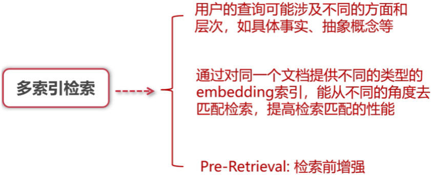

### 4.2.1 父子文档 small2big

把大的知识块切割成小块后放到词向量数据库中，用户输入问题后在数据库中和小块进行匹配，返回输出小块对应的大块

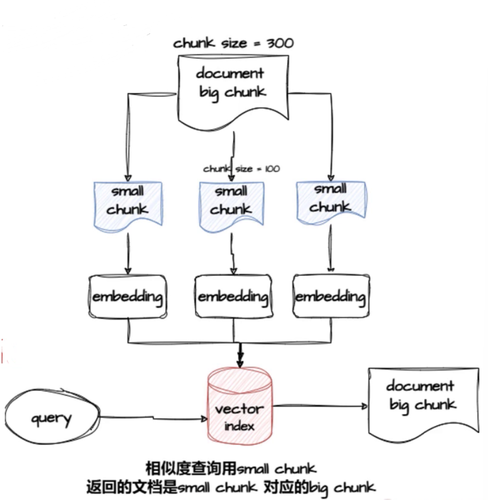

### 4.2.2 诸如此类

**总结索引：**

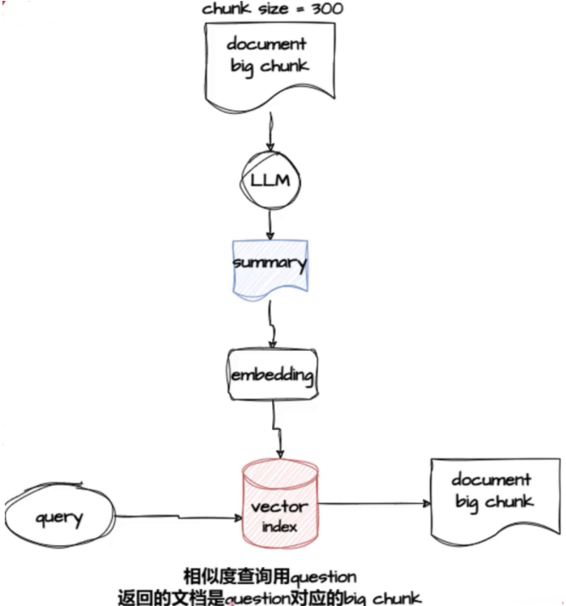

**文档假设问题**：

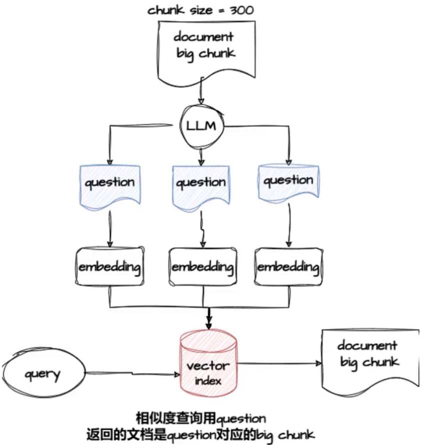

## 4.3 融合检索

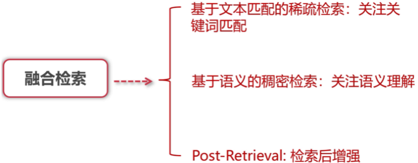

**架构如下：BM25+embedding**

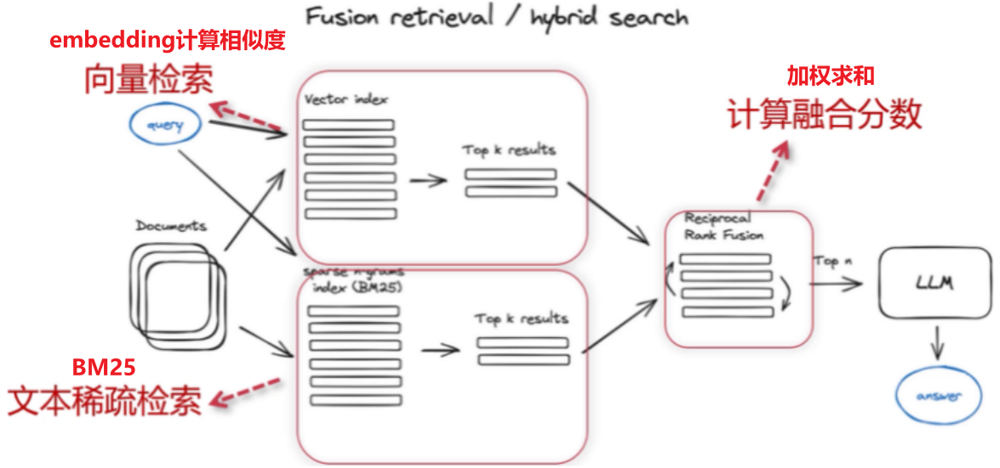

# 4.4 Rerank

使用Rerank大模型对检索结果进行再次排序

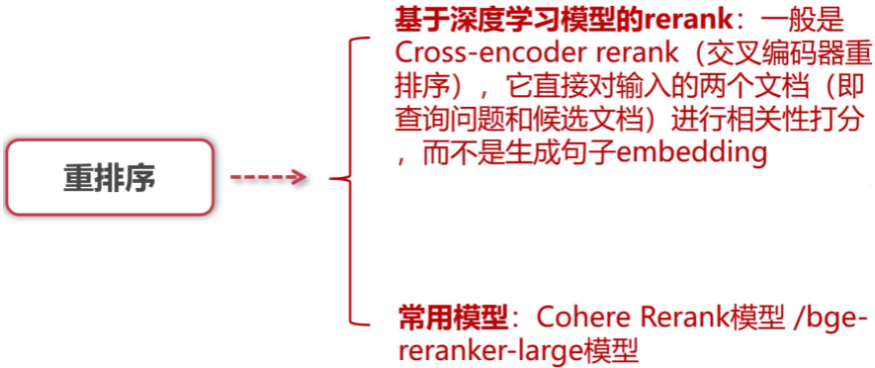
