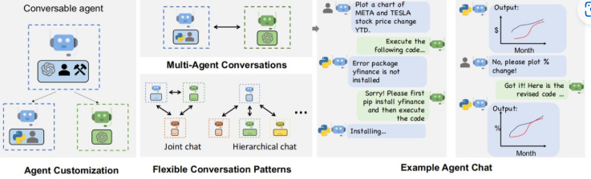
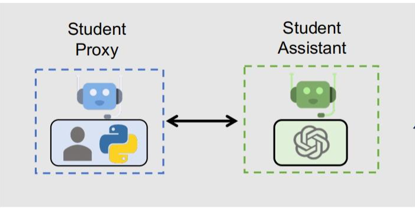

# AutoAgent 与传统工具函数 Agent 的对比笔记

> **最后更新：2025年10月31日**  
> 本笔记系统梳理了 AutoAgent（以 Microsoft AutoGen 为代表）与传统“大模型 + 工具函数”实现的 Agent 之间的核心区别、协作机制、底层原理，并对比了 Dify 等低代码平台的定位。

## 一、核心思想对比

### 1. 传统工具函数 Agent（单智能体 ReAct 模式）

- **本质**：一个大模型 + 一组预定义工具函数。
- **工作方式**：
  - 用户输入任务 → 大模型判断是否需要调用工具 → 调用 → 获取结果 → 继续推理。
  - 循环执行 **Reason → Act → Observe**（即 ReAct 范式）。
- **特点**：
  - 单一“大脑”，线性或简单分支逻辑。
  - 工具调用由模型自主决定，但**无协作能力**。
  - 开发简单，适合中低复杂度任务（如查天气、数据查询）。

### 2. AutoAgent（多智能体协作框架）

- **本质**：多个独立 Agent 组成的协作系统，每个 Agent 可绑定专属工具。
- **工作方式**：
  - 开发者预先定义多个 Agent（如 Coder、Tester、Reviewer）。
  - Agent 之间通过**消息传递**自主协作，无中心控制器。
  - 每个 Agent 内部仍基于 ReAct 机制调用工具。
- **特点**：
  - **去中心化**：无“中心 Agent”调度，协作靠对话驱动。
  - **角色专业化**：工具按功能分类，由对应 Agent 管理。
  - 适合高复杂度、多步骤、需反思与纠错的任务（如自动编程、渗透测试）。

## 二、关键区别详解

| 维度           | 传统工具函数 Agent        | AutoAgent                               |
| -------------- | ------------------------- | --------------------------------------- |
| **智能体数量** | 1 个                      | 多个（可任意扩展）                      |
| **协作方式**   | 无协作，单打独斗          | 消息驱动，平等对话                      |
| **工具管理**   | 所有工具暴露给同一个模型  | 工具按角色分类，专人专用                |
| **任务流程**   | 线性或简单循环            | 动态、可回溯、可协商                    |
| **错误处理**   | 依赖模型自我修正          | 可由其他 Agent 指出并推动修复           |
| **开发方式**   | 手写 ReAct 循环或简单封装 | 使用框架（如 AutoGen）定义 Agent 和群聊 |
| **适用场景**   | 简单自动化任务            | 复杂、开放、多角色任务                  |

## 三、AutoAgent 的协作机制（澄清误区）

### 常见误解：

> “有一个中心 Agent 负责调用其他辅助 Agent。”

### 正确理解：

- **所有 Agent 由开发者在程序启动前显式创建**，不存在“运行时动态生成”。
- **没有中心控制者**。协作通过以下方式实现：
  1. **系统提示词引导**：例如 Coder 的提示词中写明“写完代码后请主动联系 Tester”。
  2. **消息内容触发**：Agent 根据收到的消息内容，自主决定回复谁。
  3. **群聊管理器（GroupChatManager）**：在多 Agent 群聊中，可配置自动选择下一个发言者（基于规则或 LLM 判断），但仍非“中心调度”。

### 比喻：

> AutoAgent 不是“一个老板指挥一群员工”，而是“一群专家围坐开会，谁该发言谁就上，谁有工具谁就用”。

## 四、底层原理：ReAct 仍是基础

- **每个能调用工具的 Agent，内部都基于 ReAct 机制**：
  - Reason（思考）→ Act（调用工具）→ Observe（获取结果）→ 继续推理。
- **AutoGen 的价值在于工程化封装**：
  - 自动解析函数调用请求。
  - 自动执行工具并将结果反馈。
  - 支持多轮对话状态管理、日志记录、超时控制等。
- **多 Agent 协作 = 多层 ReAct + 消息传递**：
  - 每个 Agent 自己走 ReAct。
  - Agent 之间的消息传递，构成更高层的“协作式推理”。

## 五、与 Dify 等低代码平台的对比

| 维度              | Dify                          | AutoGen（AutoAgent）             |
| ----------------- | ----------------------------- | -------------------------------- |
| **定位**          | 低代码 AI 应用平台            | 开发者级多 Agent 编程框架        |
| **多 Agent 支持** | 有限（工作流节点 ≠ 真 Agent） | 原生支持（独立、可对话、可反思） |
| **协作机制**      | 中心化工作流引擎（线性/分支） | 去中心化消息驱动（动态、可回溯） |
| **灵活性**        | 高（可视化），但定制能力弱    | 极高（全代码控制）               |
| **适用人群**      | 产品经理、运营、非程序员      | AI 工程师、研究人员              |
| **开源情况**      | 社区版部分开源                | 完全开源（Apache 2.0）           |

> **结论**：  
>
> - Dify 的 Agent ≈ 单智能体 ReAct 实现。  
> - AutoGen 的 Agent = 多专家协作团队。  
> - 两者适用于不同阶段：Dify 快速验证，AutoGen 深度开发。

## 六、何时选择哪种方案？

| 需求场景                             | 推荐方案                   |
| ------------------------------------ | -------------------------- |
| 快速搭建客服机器人、数据查询助手     | 传统工具函数 Agent 或 Dify |
| 任务简单、流程固定、无需协作         | 传统工具函数 Agent         |
| 需要多角色分工（如开发+测试+审核）   | AutoAgent                  |
| 任务复杂、可能出错、需动态调整       | AutoAgent                  |
| 团队有 Python 开发能力，追求可维护性 | AutoAgent                  |
| 无编程能力，希望拖拽式开发           | Dify                       |

## 七、总结金句

- **“AutoAgent 不是魔法，而是把 ReAct 思想工程化、规模化、协作化的结果。”**
- **“传统 Agent 是听话的工人，AutoAgent 是会开会的专家团队。”**
- **“Dify 让你快速做出原型，AutoGen 让你构建真正的智能体系统。”**

💡 **提示**：理解 AutoAgent 的关键，不是“谁控制谁”，而是“如何通过对话实现去中心化协作”。  
掌握这一思想，就能在合适场景选择合适工具，避免“杀鸡用牛刀”或“小马拉大车”。
