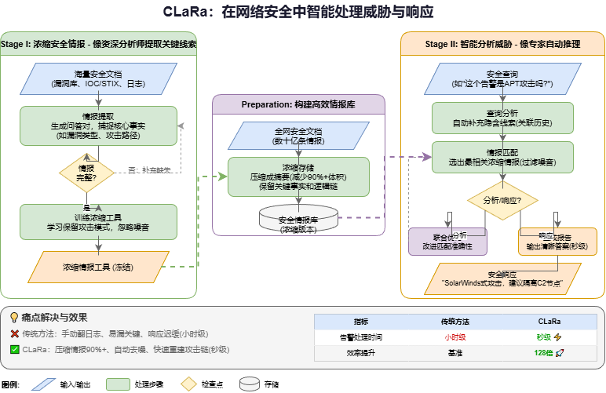

# CLaRa 调研报告

## 前言

在网络安全领域，RAG 系统（Retrieval-Augmented Generation，检索增强生成）作为一种智能工具，将外部的安全知识库（如漏洞数据库、威胁情报和合规文档）与大型语言模型结合在一起，从而为安全相关的问题提供准确、可追踪的回答。

这种系统主要帮助安全分析人员面对海量、分散且高度专业的安全信息，手动查找效率低下、响应缓慢、知识更新不及时，以及容易忽略关键细节。通过 RAG，系统可以提升威胁评估、事件响应、合规咨询和漏洞管理的自动化水平和准确性。它还能有效减少大型模型在回答专业问题时出现的“幻觉”问题（即模型生成不准确或虚构的信息）。

在RAG系统中，**检索器**负责从外部知识库中查找与输入问题相关的文档或片段，而**压缩器**则对检索到的内容进行筛选、精简或重排，以保留最相关的信息并减少噪声，从而提升生成质量与效率。

## 传统 RAG 系统的局限性

尽管传统 RAG 系统通过外部知识增强 LLM，但仍存在两大主要问题：

1. **效率问题**：RAG 系统在检索信息时，会将文本转换为低维稠密向量（通常为 256、512 或 1024 维的数字表示，用于语义匹配）。然而，当模型生成内容时，它不能直接使用这些向量作为输入，而是需要重新读取检索到的原始文本，并将其编码成新的向量。这导致三个具体问题：
   - 检索和生成的语义表示不在同一维度，导致不一致。
   - 模型在处理检索到的文档时，可能因上下文过长而“爆炸”（即超出模型处理能力的长度限制）。
   - 重复编码文本，浪费计算资源。

2. **优化分离问题**：检索器仅根据向量相似度选择相关文档，但生成器有时会发现这些文档无法回答问题，却无法将此反馈传递给检索器。这是因为检索过程是一个离散的选择操作（top-k 或 top-p，选择或不选择，没有中间状态），数学上梯度几乎为零，无法通过梯度回传优化。结果是检索器和生成器无法协同工作，检索质量难以满足生成器的实际需求。

## 苹果公司的 CLaRa 框架介绍

苹果公司最近推出了一种名为 CLaRa 的框架（Compressible Latent Retrieval-Augmented Generation，可压缩潜在检索增强生成）。它构建了一个高效、可微分的 RAG 框架，将检索和生成步骤融合在一起，只使用一个简单的 next-token prediction 损失函数（即预测下一个词的语言建模损失），实现压缩、检索和生成的端到端优化。

CLaRa 的关键创新包括：

- **SCP 预训练**：将文档压缩为连续的 memory tokens（记忆令牌，一种浓缩的表示形式），解决表示空间不一致和冗余编码的问题。
- **Straight-Through 软 top-k 机制**：打破梯度回传障碍，让生成器直接优化检索器。

### 一、压缩器预训练——教模型识别关键事实和推理链

这一步的目的是让模型学会提取文档中的核心信息，包括事实和多步推理。

#### 1.1 数据

数据使用 Qwen-32B 模型在 200 万篇 Wikipedia 文章上自动生成，包括两种类型：

- **简单 QA**：每个问题-答案对只涉及一个事件，例如：“Trichocladus crinitus 属于哪个科？”答案：“Hamamelidaceae”。这训练模型记住细粒度事实。
- **复杂 QA**：问题-答案对跨越多个事件，需要多步推理，例如：“2014 年 10 月 2 日加入 Newport County、10 月 4 日替补上场输给 Oxford United 的球员是谁？”答案：“James Loveridge”。这训练模型学会连接多跳关系。

#### 1.2 模型

CLaRa 系统基于一个 LLM，加上三个 LoRA（Low-Rank Adaptation，低秩适配，一种高效的模型微调方法）模块：

- **压缩**：将所有文档（如维基百科、威胁情报、日志等）输入模型，每篇文档前拼接一段固定长度的压缩向量。压缩后，所有向量存入数据库。
- **查询**：将用户问题也压缩成相同维度的查询向量，然后根据此向量，从数据库中检索 top-k 个文档压缩向量，并将它们拼接成一个长序列。
- **回答**：使用这个长序列进行自回归生成（即逐步预测下一个词），输出答案。

### 二、端到端训练——融合检索和生成

在这一阶段，冻结压缩部分的参数，只训练查询和回答部分。

- **损失函数**：使用标准的 next-token prediction 交叉熵损失（衡量预测准确度的指标）。
- **反向传播**：将传统的 top-k 选择改为 Straight-Through Estimator，允许梯度传播。
- **多跳推理**：通过端到端梯度回传，查询步骤学会主动补充缺失的中间环节。

最终效果：生成器像“老师”一样，通过计算损失和梯度下降，指导检索器改进检索质量。

### 三、效果

压缩率定义为：原始文档 token 数 ÷ 压缩后 memory tokens 数。CLaRa 的优势在于，传统 RAG 需要阅读大量文本才能准确回答问题，而 CLaRa 只需少量 memory tokens 即可达到类似效果。

以下是 CLaRa（128 倍压缩率）与传统全文档 RAG 在数据集上的性能比较：

| 数据集            | 传统全文档 RAG | CLaRa 128 压缩 | 提升幅度 |
| ----------------- | -------------- | -------------- | -------- |
| Natural Questions | 54.58          | 53.36          | 几乎持平 |
| HotpotQA          | 42.94          | 41.37          | 几乎持平 |
| MuSiQue           | 44.24          | 46.40          | +2.16    |
| 2Wiki             | 37.67          | 37.85          | 基本持平 |
| 平均              | 44.86          | 44.75          | 基本持平 |

### 四、应用场景

在网络安全场景中，CLaRa 相比传统 RAG 表现出显著优势：

| 安全场景           | 传统 RAG                                       | CLaRa                                                        |
| ------------------ | ---------------------------------------------- | ------------------------------------------------------------ |
| 威胁情报结构化解析 | 依赖规则和人工标注，容易出现漏报或误报。       | 离线将全网数十亿条 IOC、STIX、MISP、OTX 等情报压缩成浓缩包，查询时自动补充缺失字段，提升结构化准确率。 |
| 攻击链多跳重建     | 手动翻阅 EDR、防火墙和威胁情报的数十万条日志。 | 128 倍压缩后上下文仅几百 token，7B 模型可在秒级重建完整 攻击链，并主动补充缺失的 C2 或横移节点。 |
| 告警关联与去噪     | 每天几万条告警，90% 是噪音，分析成本极高。     | 端到端训练让模型只关注真正影响答案的线索，噪音自动被排除。   |
| APT 未知威胁研判   | 完全依赖人工经验，响应时间从几小时到几天。     | 查询学会隐式推理，能像资深分析师一样自动关联线索，例如“这个行为像 2021 年 SolarWinds 攻击”。 |

