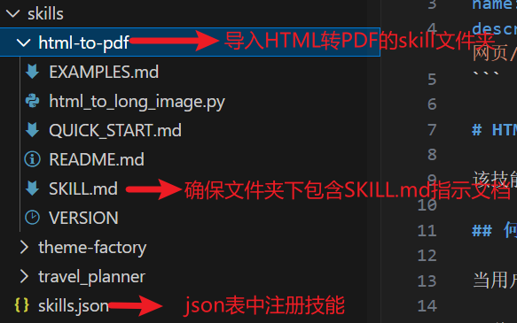
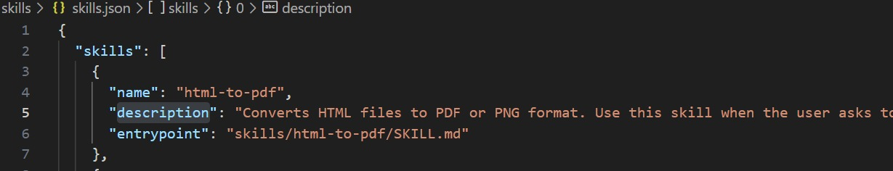
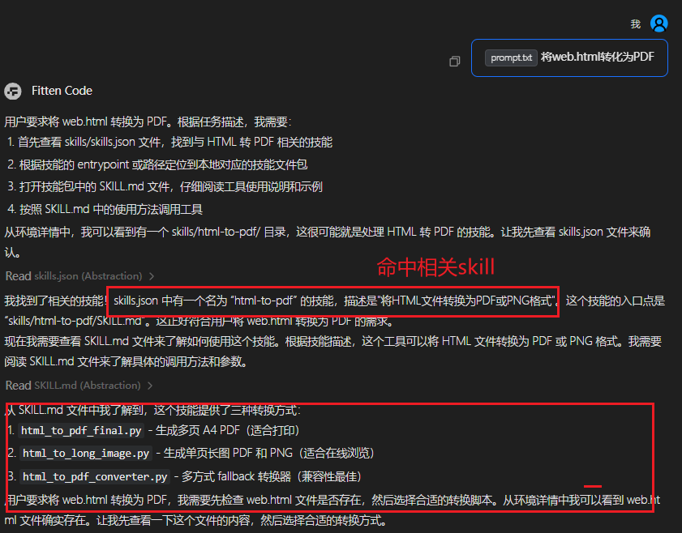
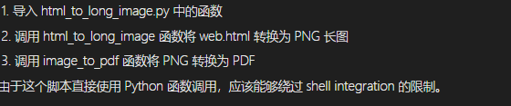
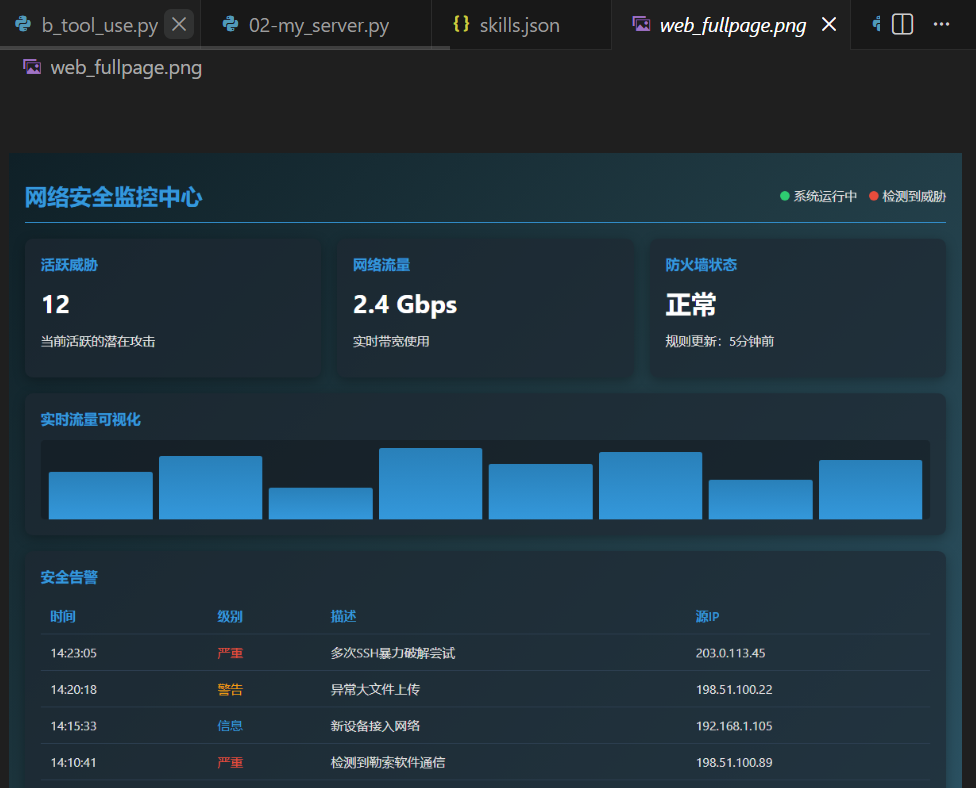

# **前言（网络安全 × Skill 能力）**

**适配场景**：在网络安全垂直领域中，安全团队需要处理海量而杂乱的内容：从威胁情报、漏洞公告，到攻击链分析、日志告警、取证记录，各类文档格式结构不一，**导致信息提炼缓慢、分析效率难以提升**。传统依赖大模型的做法虽能辅助阅读和理解，但在应对多文档、多格式、持续高频的安全输入时，仍面临成本高、结果不稳定等问题。

**核心功能**：Claude 推出的 Skill 机制让这些场景首次可以实现**“规则化、模板化、标准化”**的自动处理：如自动解析威胁情报、自动对公告进行结构化提取、自动拆解攻击链、自动识别关键实体与风险点，并能**长期保持一致的分析口径。**

# 一、什么是skill

## 一种**模块化工具调用框架**，核心思想是“**给大模型喂预制菜**”

- 提前将可复用的能力封装为 **skill 模块**；  
- 通过 JSON 文件注册每个 skill 的名称和描述，并注入到 system prompt 中，让大模型知晓可用工具；  
- 大模型根据用户问题**自动选择合适 skill**；  
- 系统据此查找**对应 `skill.md` 说明文件**；  
- 最终按 `skill.md` 的指示**执行脚本或调用程序**，完成任务。  

## mapping策略

| 用户输入 / 模型决策       | →    | 系统中的具体资源                    |
| ------------------------- | ---- | ----------------------------------- |
| 模型选择的 **skill 名称** | →    | `skills/{skill_name}/skill.md` 文件 |
| skill 名称 + 描述（JSON） | →    | 注入 prompt 的工具列表              |
| `skill.md` 中的指令       | →    | 实际执行的脚本/程序/工作流          |

```Mermaid
graph LR
    A[用户请求任务] --> B[任务类型识别]
    B --> C[技能匹配]
    C --> D[加载资源]
    D --> E[执行并返回结果]
    
    style A fill:#f9f,stroke:#333
    style E fill:#bbf,stroke:#333
```

# 二、skill与MCP

**Skill 就像“功能说明书”，写清楚某个功能是干什么的；MCP 则像“遥控器和接口”，让大模型真的能找到这些功能、并把它们跑起来。Skill 负责描述，MCP 负责执行。**把两者结合起来，就是让模型既“知道能力”，又“能调用能力”。

Skill 用来把安全能力写成清晰的功能说明书，例如“解析威胁情报”“提取IOC”“分析日志”“匹配ATT&CK 技术”“查询资产漏洞”，模型一读就知道这项能力是干什么的、输入是什么、输出长什么样。MCP 则负责把这些能力真正连到后台系统上，让模型可以实时调用安全脚本、情报查询接口、扫描工具、资产数据库、日志平台等。

# 三、项目框架

第一步：首先需要准备好技能包，包含SKILL.md文档以及文档中所需的功能性脚本



第二步：在skills.json中注册好技能名称，描述和对应SKILL.md文档



第三步：如果是在本地运行，需要定义支持工具，例如

**文件读写**

```python
@tool
def read_file(file_path: str):
    """
    读取指定文件内容
    """
    try:
        with open(file_path, "r", encoding="utf-8") as f:
            return f.read()
    except Exception as e:
        return f"Error: {str(e)}"

@tool
def write_file(file_path: str, content: str):
    """
    将内容写入指定文件
    """
    try:
        with open(file_path, "w", encoding="utf-8") as f:
            f.write(content)
        return f"文件已写入: {file_path}"
    except Exception as e:
        return f"Error: {str(e)}"

```

**执行代码/shell指令**

```python
@tool
def execute_python_code(code: str):
    """
    执行一段 Python 代码，并返回结果或错误信息
    """
    try:
        local_vars = {}
        exec(code, {}, local_vars)
        return local_vars
    except Exception as e:
        return f"Error: {str(e)}"
    
@tool
def execute_shell_command(command: str) -> str:
    """
    在新的 cmd 窗口中执行命令（仅限 Windows 系统）。
    """
    os_type = platform.system()

    try:
        if os_type == "Windows":
            # 使用 'start' 指令打开新的 cmd 窗口，/k 表示执行后窗口保持
            subprocess.Popen(["cmd.exe", "/c", f"start cmd.exe /k {command}"])
            return f"在新的 cmd 窗口中启动命令: {command}"

        else:
            return "仅支持 Windows 系统。"

    except Exception as e:
        return f"错误: {str(e)}"
```

**提示词：**

```python
# 这里是在加载技能注册表.json
def load_skills():
    if not os.path.exists(SKILLS_PATH):
        return []
    with open(SKILLS_PATH, "r", encoding="utf-8") as f:
        skills = json.load(f)
    return skills


skills_text = load_skills()


SYSTEM_PROMPT = f"""
你是一个智能代理，具备执行多种技能的能力。请根据以下步骤提供准确的答案：

系统除了内置工具外，还提供以下技能（来自 skills/skills.json）：
{skills_text}

当用户提出需求时，按照以下流程处理：
a. 从 skills.json 中检索最匹配的技能；
b. 根据技能路径定位到本地相应技能包；
c. 打开并阅读 SKILL.md 文件，了解工具使用方法和示例；
d. 确保理解技能的操作方式和所需输入。

执行时：

按照 SKILL.md 中的要求，正确调用工具，确保输入和输出一致；

Action 名称与技能名称需完全匹配，输入字段填写准确无误。

回答时，结合执行结果，提供完整的推理过程和清晰的解释，确保用户理解。

注意事项：
系统提供以下四个内置工具：

execute_python_code(code: str)：执行 Python 代码并返回结果或错误；

read_file(file_path: str)：读取文件内容；

write_file(file_path: str, content: str)：写入内容到文件；

execute_shell_command(command: str)：在新的命令行窗口中执行命令并实时输出结果。
"""
```

**示例：**



脚本实施成功：



结果：



# 四、应用前景/优势/缺陷

## 4.1 前景

**安全文档解析标准化**
 通过 Skill 将威胁情报、漏洞公告、攻防报告等解析流程模块化，**自动输出统一格式的结构化数据**，显著提升信息摄取效率。

**自动化安全分析流程（轻量 SOAR）**
 结合 MCP，Skill 能驱动实时调用漏洞扫描、情报查询、日志检索等内部系统，实现高性价比的自动化安全分析工作流。

**构建企业 AI 安全工作流**
 通过 Skill 封装企业内部多系统能力，使 LLM 能作为“统一的安全入口”，实现资产查询、情报关联、风险评估的自动链路化处理。

**多技能协同形成完整的分析流水线**
 多个 Skill 可以像插件链一样组合，完成“解析 → 抽取 → 关联 → 判断 → 处置”全流程，从而打造新一代智能化 SOC 分析体系。

## 4.2 优势

**支持多技能协同，适合构建自动化流水线**
 多个 Skill 可组合为端到端流程，如“文档解析 → IOC 抽取 → 关联分析 → 风险评估”，形成类 SOAR 的智能工作流。

**复用强、易维护、可迭代**
 安全流程、解析逻辑、字段规范等都可以以 Skill 的方式沉淀下来，后续只需**修改 skill.md 或脚本即可**，维护成本低。

**输出稳定、格式统一**
 Skill 使用预定义的输入/输出规范，使模型生成的 JSON、结构化字段和分析结果高度一致，特别适合网络安全场景的标准化需求。

## 4.3 缺陷

**Skill 调用依赖模型对自然语言的理解**
 Skill 匹配基于描述文本，容易在技能较多时出现误选或冲突，需要大量调优。

# 四、自定义技能包

**目前Claude在GitHub上开源了以下skills技能包**

| `algorithmic-art`   | 使用 p5.js 创建生成式艺术（如流场、粒子系统）                |
| ------------------- | ------------------------------------------------------------ |
| `canvas-design`     | 使用设计原则生成 .png / .pdf 格式的视觉艺术                  |
| `slack-gif-creator` | 创建符合 Slack 尺寸限制的动画 GIF                            |
| `artifacts-builder` | 使用 React + Tailwind CSS + shadcn/ui 构建 claude.ai HTML artifacts |
| `mcp-server`        | **指导如何创建高质量 MCP 服务器**，用于集成外部 API 和服务   |
| `webapp-testing`    | 使用 Playwright 测试本地 Web 应用的 UI                       |
| `brand-guidelines`  | 应用 Anthropic 官方品牌色和排版规范                          |
| `internal-comms`    | 撰写内部沟通材料（如状态报告、新闻简报、FAQ）                |
| `theme-factory`     | 为 artifacts 提供 10 种预设专业主题，或动态生成新主题        |
| `skill-creator`     | 指导如何创建有效的技能以扩展 Claude 能                       |

**示例简单SKILL.md**

```markdown
## 指令

当用户请求与 **数据转换、自动化报告、文件处理** 相关的任务时，主动使用本技能。

### 能力说明
- 支持输入：CSV、JSON、纯文本
- 输出格式：XLSX、PDF、HTML
- 可配置模板（见 resources/templates/）

### 使用规则
1. **永远先确认输入文件路径是否存在**
2. **输出文件必须保存到用户指定目录**
3. **不要假设默认路径，必须让用户明确提供**

### 示例工作流
1. 用户说：“把 sales.csv 转成带图表的 Excel”
2. 你调用 `scripts/convert.py sales.csv --format xlsx --chart`
3. 返回结果文件路径：`./output/sales.xlsx`
```

