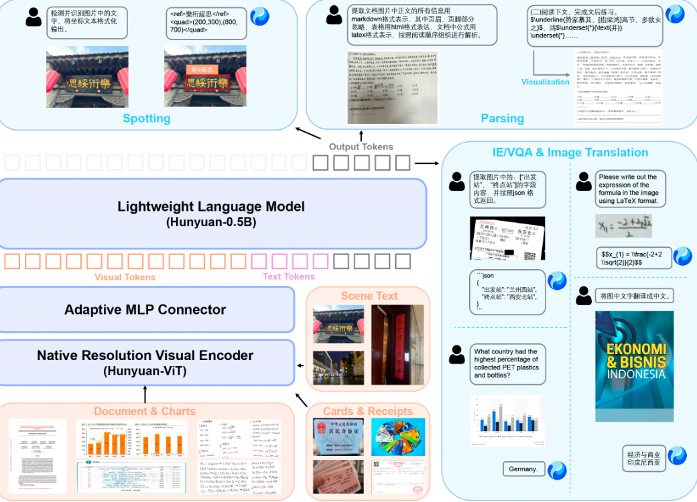
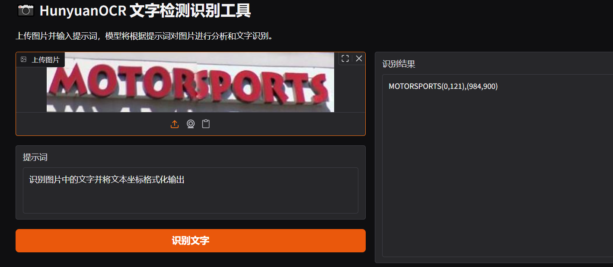
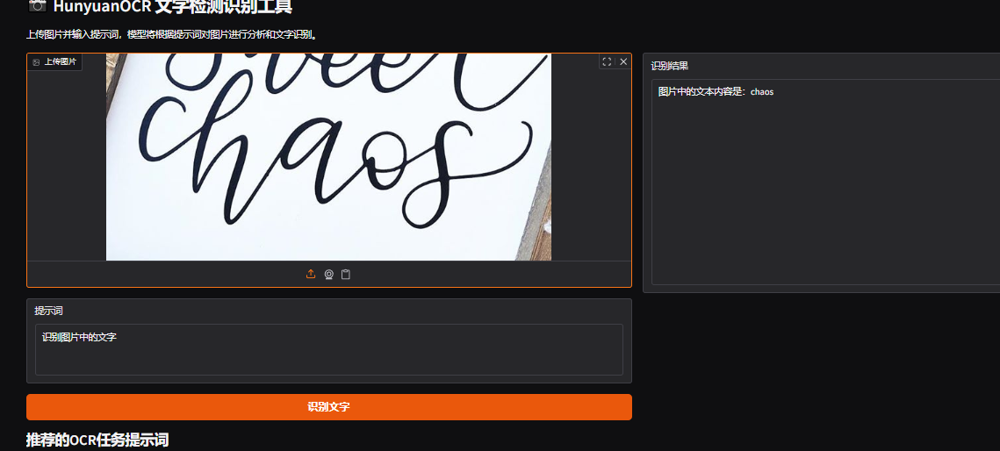
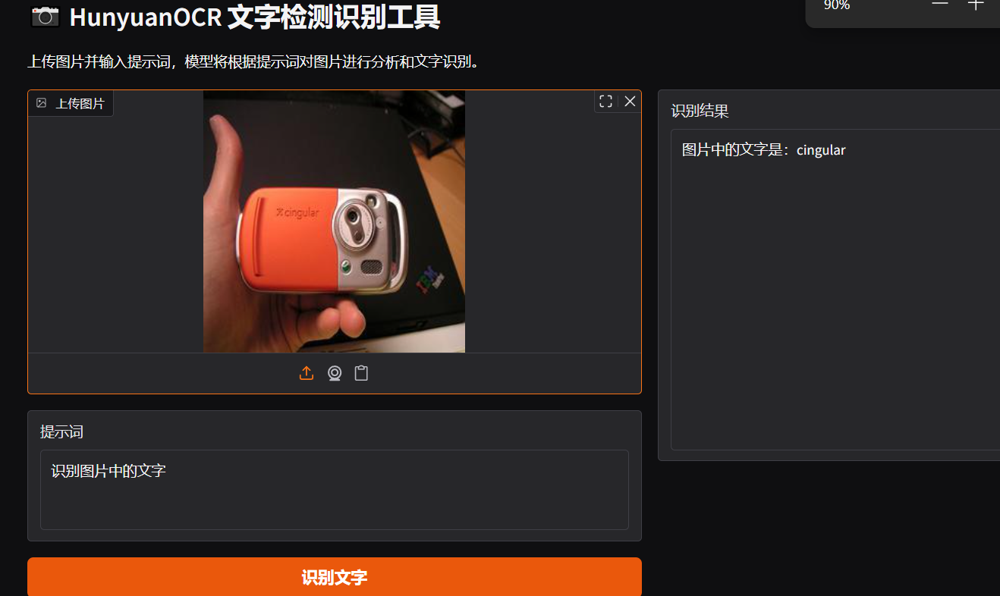
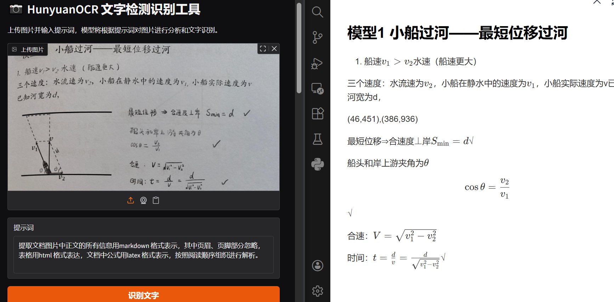
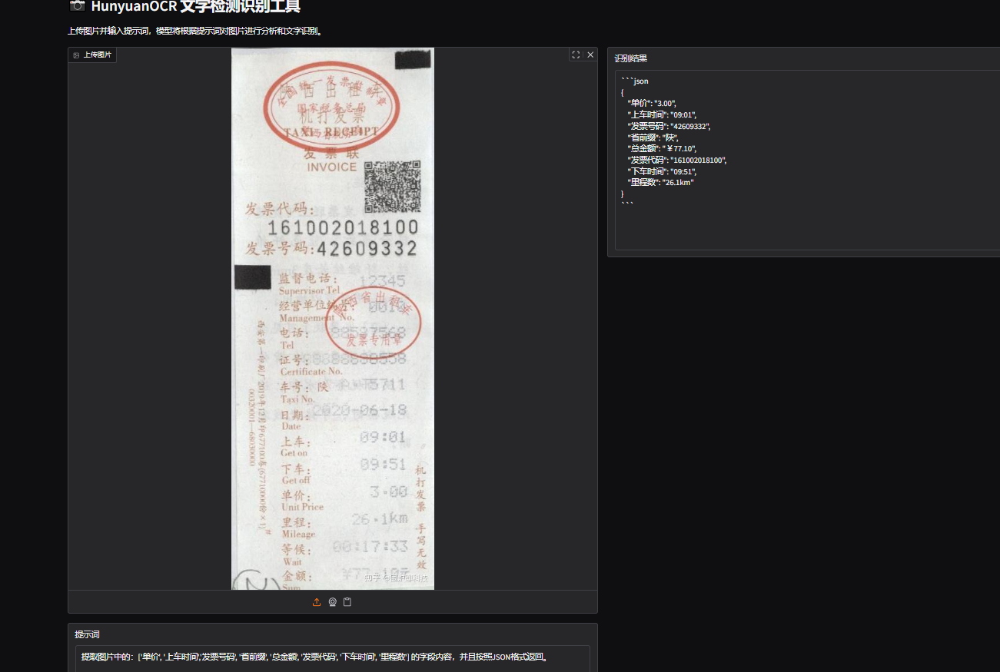
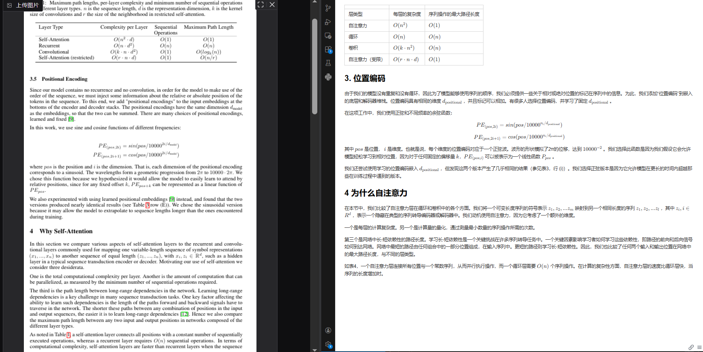
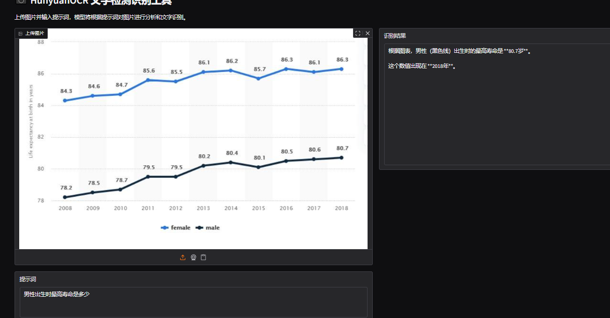
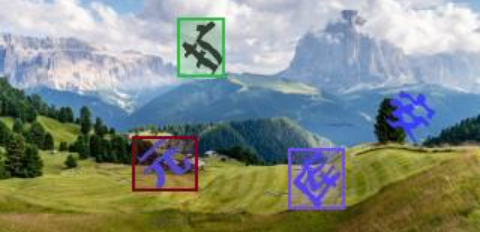
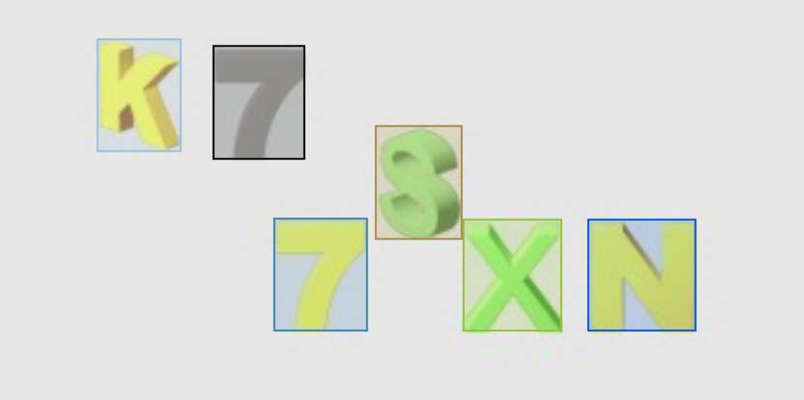

# 前言

在网络安全实践中，大量关键线索以图像形式存在，如钓鱼页面截图、日志截图、恶意广告、凭证凭证等。传统OCR工具虽能提取文字，但面对低质量截图、变形字体、多语言混排或对抗干扰时识别率低，且缺乏语义理解能力——无法结构化提取“伪造发件人”“C2地址”等安全要素。

本文围绕腾讯开源的轻量级视觉语言模型 **HunyuanOCR**，评估其在安全场景下的实用性。该模型通过提示词驱动，支持端到端的文字检测、信息抽取、表格/公式解析与视觉问答，在卡证票据、带噪截图、多语种文档等复杂图像中表现出优于主流OCR的识别准确率。

调研表明，HunyuanOCR 能有效支持安全运营中的自动化情报提取，但仍存在局限：当前版本仅能识别文字区域，**无法直接定位图形、颜色或非文本元素**，未来需结合行为上下文或辅助模型，进一步提升在对抗性网络环境中的可用性。



# 一、部署

模型地址：[tencent/HunyuanOCR ](https://huggingface.co/tencent/HunyuanOCR)

参数量：1B

模型大小：2.5G

环境：Python 3.12 + CUDA 12.8 +  + PyTorch 2.7.1 + vLLM nightly

部署设备：RTX 3090(24GB) * 1

使用huggingface部署模型需要先更新transformers（Transformers相比vLLM框架存在一定的性能下滑）

```bash
pip install git+https://github.com/huggingface/transformers@82a06db03535c49aa987719ed0746a76093b1ec4
```

使用gradio构建可视化测试界面

# 二、提示词

| 任务         | 中文提示词                                                   | 英文提示词                                                   |
| ------------ | ------------------------------------------------------------ | ------------------------------------------------------------ |
| 文字检测识别 | 检测并识别图片中的文字，将文本坐标格式化输出。               | Detect and recognize text in the image, and output the text coordinates in a formatted manner. |
| 文档解析     | • 识别图片中的公式，用 LaTeX 格式表示。<br>• 把图中的表格解析为 HTML。 <br>• 解析图中的图表，对于流程图使用 Mermaid 格式表示，其他图表使用 Markdown 格式表示。<br>• 提取文档图片中正文的所有信息用 markdown 格式表示，其中页眉、页脚部分忽略，表格用 html 格式表达，文档中公式用 latex 格式表示，按照阅读顺序组织进行解析。 | • Identify the formula in the image and represent it using LaTeX format.<br>• Parse the table in the image into HTML.<br>• Parse the chart in the image; use Mermaid format for flowcharts and Markdown for other charts.<br>• Extract all information from the main body of the document image and represent it in markdown format, ignoring headers and footers. Tables should be expressed in HTML format, formulas in the document should be represented using LaTeX format, and the parsing should be organized according to the reading order. |
| 通用文字提取 | • 提取图中的文字。                                           | • Extract the text in the image.                             |
| 信息抽取     | • 输出 Key 的值。<br>• 提取图片中的: ['key1','key2', ...] 的字段内容，并按照 JSON 格式返回。<br>• 提取图片中的字幕。 | • Output the value of Key.<br>• Extract the content of the fields: ['key1','key2', ...] from the image and return it in JSON format.<br>• Extract the subtitles from the image. |
| 翻译         | 先提取文字，再将文字内容翻译为英文。若是文档，则其中页眉、页脚忽略。公式用 latex 格式表示，表格用 html 格式表示。 | First extract the text, then translate the text content into English. If it is a document, ignore the header and footer. Formulas should be represented in LaTeX format, and tables should be represented in HTML format. |

# 三、核心功能

下面示例全部使用同一模型、同一接口，仅换提示词。

## 3.1 文字检测识别

### 3.1.1 拍照识别

**效果:**



**提示**：`识别图片中的文字并将文本坐标格式化输出`

**耗时：**0.5s

**场景**：随手拍街边招牌，做数据库更新。

### 3.1.2 艺术字

**效果：**



**提示**：`识别图片中的文字并将文本坐标格式化输出`

**耗时：**0.5s

**场景**：不规则字体的检测、手写体识别。

### 3.1.3 带干扰元素

**效果**：



**提示**：`识别图片中的文字并将文本坐标格式化输出`

**耗时：**1s

**场景**：更真实的现实拍摄场景。

## 3.2  文档解析（含表格 + 公式）

### 3.2.1 手写体识别

**效果：**



**提示**：`提取文档图片中正文的所有信息用markdown 格式表示，其中页眉、页脚部分忽略，表格用html 格式表达，文档中公式用latex 格式表示，按照阅读顺序组织进行解析。`

**耗时：**5.7s

**场景**：把手写文档扔进去，直接得到可编辑的 Markdown + 可复制的 LaTeX 公式。

## 3.3 卡证票据信息抽取



**提示**：`提取图片中的：['单价', '上车时间','发票号码', '省前缀', '总金额', '发票代码', '下车时间', '里程数'] 的字段内容，并且按照JSON格式返回。`

**耗时**：3.6s

**场景**：财务报销系统自动填单。

## 3.4 对照翻译

### 3.4.1 论文对照翻译

**效果：**



**提示**：`提取论文图片中正文的所有信息用markdown 格式表示，其中页眉、页脚部分忽略，表格用html 格式表达，文档中公式用latex 格式表示，按照阅读顺序组织进行解析。`

**耗时：**25.7s

**场景**：对输入的英文（或其他语言）文章对照翻译为中文且保留公式和图表

## 3.5 图表解析



**提示**：`男性出生时最高寿命是多少`

**耗时**：2.7s

**场景**：工厂巡检员拍仪表盘，模型直接回答“Fort Morgan”，无需 OCR+搜索两步。

# 四、定位功能（只能识别到文字，识别图形或者其他元素失败）

## 4.1 文字识别



## 4.2 寻找黄色数字7（模型无法单独框出黄色7，需要后续再进行筛选）



# 五、性能

| 任务         | 数据集        | HunyuanOCR 得分 | 同级最大对手         | 差距  |
| :----------- | :------------ | :-------------- | :------------------- | :---- |
| 文字检测识别 | 自建 900 图   | 70.92           | BaiduOCR 61.90       | +9.0  |
| 文档解析     | OmniDocBench  | 94.10           | PaddleOCR-VL 92.86   | +1.24 |
| 多语种解析   | DocML-14 语言 | 91.03           | dots.ocr 77.50       | +13.5 |
| 信息抽取     | 768 张卡证    | 92.29           | Gemini-2.5-Pro 80.59 | +11.7 |
| 视频字幕     | 1000 帧       | 92.87           | Seed-1.6-VL 60.45    | +32.4 |
| 拍照翻译     | DoTA-en2zh    | 83.48           | Qwen3-VL-235B 80.01  | +3.47 |

# 六、应用前景

- 腾讯开源HunyuanOCR有望显著推动OCR技术的发展与行业应用，通过开放模型促进开发者生态建设，加速技术在教育、医疗、数字人文等非传统领域的渗透；其**轻量化（1B参数）和端到端架构**降低了中小企业使用门槛，同时可能引发行业竞争格局变化，推动轻量化、高性能OCR成为新标准。

- HunyuanOCR未来将在模型性能、多模态融合和垂直场景拓展等方面持续演进，开源生态也将日益成熟，但同时也面临数**据隐私安全、多语言覆盖不足**以及企业系统集成等现实挑战，需在技术与落地之间寻求平衡。

- HunyuanOCR凭借端到端架构、轻量化设计与多模态能力，不仅标志着腾讯在OCR领域的技术领先，更成为推动OCR普惠化与行业数字化转型的关键力量，其开源将激发更广泛的创新应用，引领OCR技术迈向新阶段。

HunyuanOCR支持**14种**高频小语种翻译成中文或英文，关于多语言覆盖不足的问题可以联合 MT （机器翻译）模型，解析结果已按段输出，方便二次翻译。


