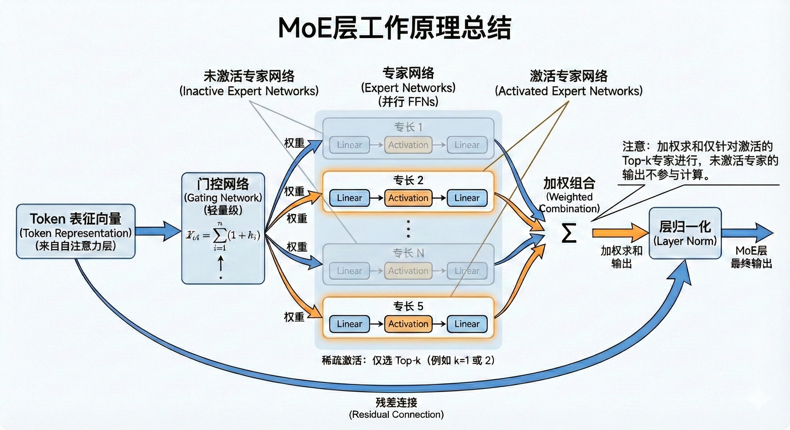
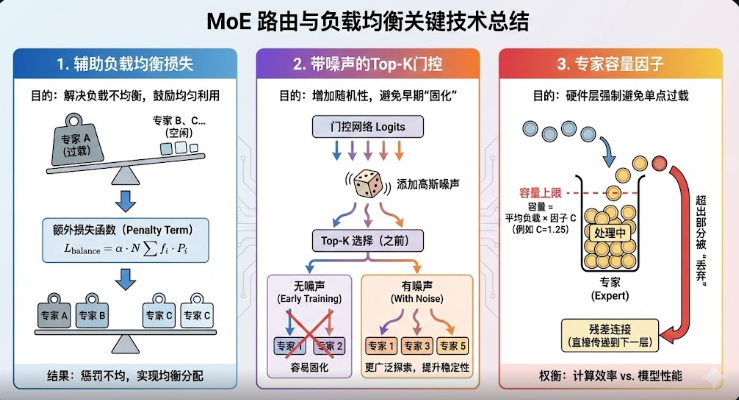
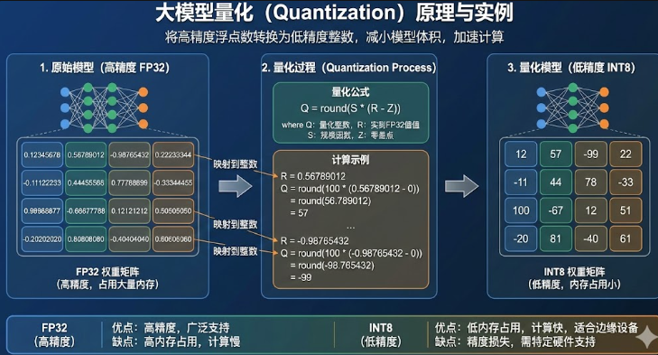
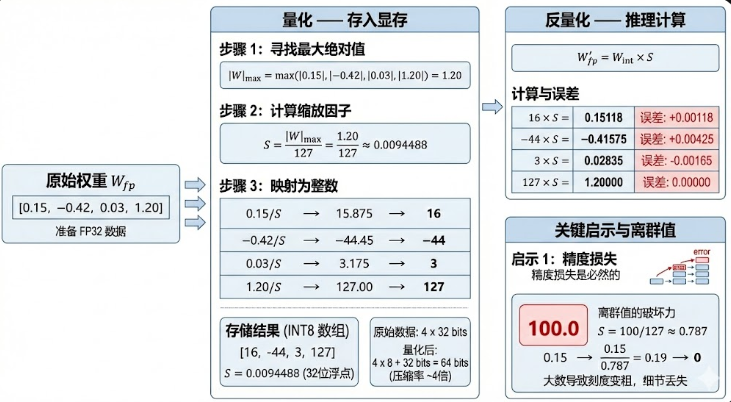

# MOE（混合专家架构）

## 传统模型架构的问题

在传统的 **Dense（稠密）模型** 中，参数量增加一倍，训练和推理所需的算力几乎也要增加一倍，即**每次推理都需要动用模型全部参数**，正面临着计算成本和能耗的巨大瓶颈。

## MoE架构的核心思想

MoE 架构通过稀疏激活机制，让模型在拥有巨量参数（高容量）的同时，**每次计算只调用极少数专家模块**，从而以极低的算力成本将一个复杂的任务分解为多个子任务，每个子任务由一个专门的专家来处理。

## MoE结构

一个典型的MoE层通常嵌入在Transformer架构中，用于**替代其中的前馈网络（Feed-Forward Network, FFN）层。**

| **阶段**        | **核心组件**           | **输入来源**               | **主要操作与逻辑**                                           | **输出结果**                   |
| --------------- | ---------------------- | -------------------------- | ------------------------------------------------------------ | ------------------------------ |
| **1. 输入接收** | **Token 表征**         | 前一层 (如 Self-Attention) | 接收序列中每个 Token 的高维向量表示。                        | 待处理的 Token 向量            |
| **2. 路由分发** | **门控网络 **          | Token 表征                 | **轻量级计算**：通过线性层和 Softmax 计算权重，决定 Token 该去哪个“专家”那里。 | 专家分配权重 (Routing Weights) |
| **3. 专家计算** | **专家网络 **          | 选定的 Token               | **并行处理**：由多个结构相同但参数不同的 FFN（Feed-Forward Networks）组成，各司其职。 | 各专家的独立输出               |
| **4. 聚合输出** | **稀疏激活与加权组合** | Top-k 专家输出 + 门控权重  | **稀疏触发**：仅激活得分最高的 k 个专家（如 Top-1 或 Top-2），并按权重进行加权求和。 | MoE 层初步处理结果             |
| **5. 最终处理** | **残差连接与归一化**   | MoE 输出 + 原始输入        | **稳定训练**：执行 Output = LayerNorm(Input + MoE\_Result)。 | 传给下一层 Transformer         |

## 核心挑战与解决方案

在训练过程中，一个常见的棘手问题是**负载不均衡（Load Imbalance）**：门控网络可能倾向于频繁选择少数几个“热门”专家，而其他专家则很少被激活，成为“冷门”专家。这会导致模型训练效率低下，部分参数得不到充分训练，最终损害模型性能 。

# 量化

大模型量化是将模型参数和计算从高精度（如 FP32、BF16）转换为低精度（如 INT8、INT4）的技术。核心目的是**“用更少的比特数（Bits）表示同一个数，同时尽量保持精度不变”**。

## 目前主流的两种量化路线

- 训练后量化（PTQ）：在模型完成训练后对权重及激活值进行低精度转换，成本低，见效快
- 量化感知训练(QAT)：通过在模型训练过程中嵌入伪量化运算模块，使得网络权重在高精度更新的同时能够适应低比特数值表示。通俗来讲就是在模型还在学习阶段时，我们就故意让它提前‘体验’量化后的模糊感。**虽然模型内部还是用最高精度的逻辑在思考，但它已经学会了如何在模糊的数据环境下做出准确的判断**

------

## 一个例子

# 蒸馏

简单来说，就是让一个庞大、笨重但性能强大的“教师模型”（Teacher Model），去教导一个轻量、快速但初始能力较弱的“学生模型”（Student Model），使学生模型在尽量保持轻量化的同时，也能拥有接近教师模型的性能。

## 白盒/黑盒蒸馏（★）

| **核心维度**           | **白盒蒸馏**                                                 | **黑盒蒸馏 **                                                |
| ---------------------- | ------------------------------------------------------------ | ------------------------------------------------------------ |
| **对教师模型的可见性** | **完全可见**。需要访问教师模型的内部参数、权重、中间层特征图，或者至少是最终输出层未经过滤的概率分布 (Logits)。 | **不可见/无需可见**。只把教师模型当做一个 API，输入提示词，获取它输出的文本结果即可。 |
| **传递的“知识”载体**   | **概率分布 (Soft Labels) 或 中间特征**。学生模仿的是教师对所有可能答案的打分情况（包括那些可能性很小的答案里的“暗知识”）。 | **具体的文本数据 (Hard Labels/Text)**。学生模仿的是教师生成的高质量**问答对、指令回复或思维链 (CoT)**。 |
| **学生模型的训练方式** | **匹配分布**。通常使用 **KL 散度 (KL Divergence)** 损失函数，强迫学生的概率分布趋近于教师的概率分布。 | **标准监督微调 (SFT)**。使用标准的 **交叉熵 (Cross-Entropy)** 损失函数，把教师生成的数据当做“真值”来训练。 |
| **形象比喻**           | **“手把手教思考”**。老师不仅告诉你答案是A，还告诉你为什么B有点像A，而C完全不像A。 | **“给编好的教材自学”**。老师写了一本极其完美的教科书（习题集），学生拿去背诵和练习。 |
| **典型应用场景**       | **开源模型间的压缩**。例如：用 Llama-3-70B 的 Logits 去教 Llama-3-8B；或者 BERT 模型压缩。 | **利用闭源超大模型赋能小模型**。例如：用 GPT-4 生成数据微调各类开源小模型（如 Alpaca, Vicuna）；或者**用推理模型生成数据训练 Embedding 模型。** |
| **主要优势**           | 能传递更丰富、更细腻的信息（暗知识），理论上上限更高。       | **门槛极低**，适用范围广，是目前提升小模型能力最快、最主流的途径。 |

应用 Prompt 工程通过大语言模型来进行数据增强，不仅能够提升现有数据集 的质量，还能够生成新的高质量数据。这些数据可以用于训练和优化其它模型，以 将大语言模型的能力以合成数据的方法“蒸馏”到其他模型上。例如，我们可以引 导 ChatGPT 模型生成包含丰富推理步骤的数据集，用于增强金融领域 Text-to-SQL 模型的推理能力

# 剪枝

实际是在**保持模型能力尽可能不变的前提下，将贡献不大的参数置零或者直接移除模型中不重要的神经元**

## 一个例子

