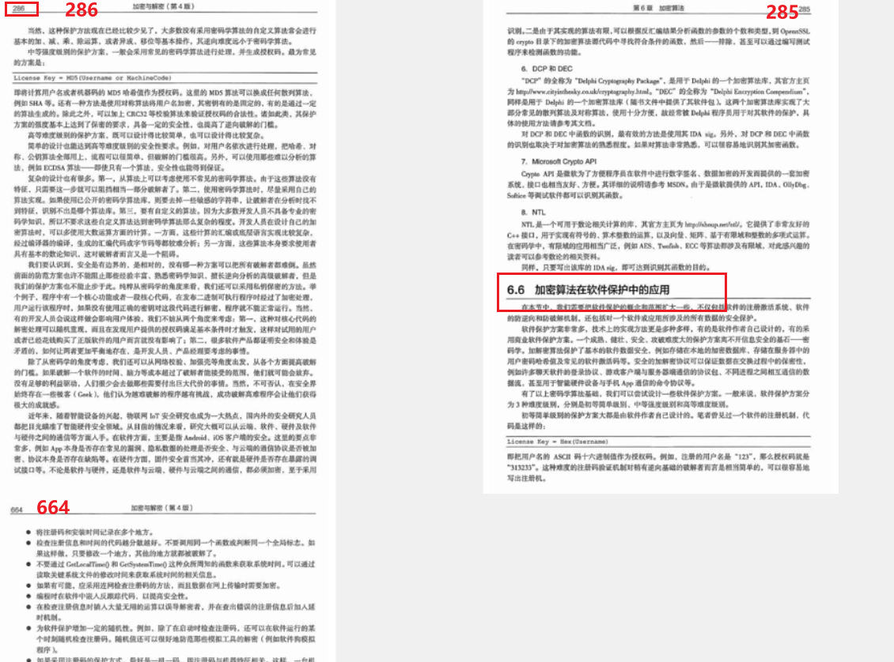
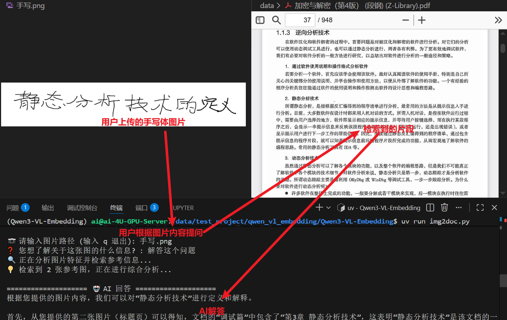
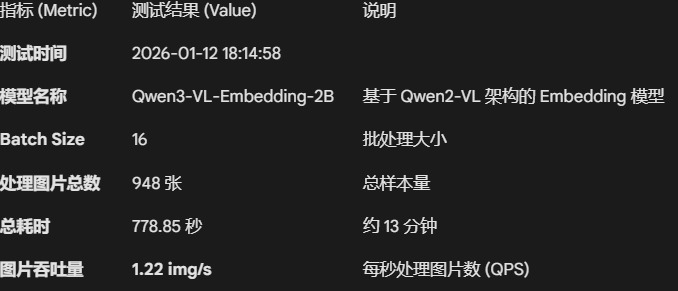

# 一、前言

在网络安全场景，多模态数据：恶意邮件截图、钓鱼网站 UI、C2 服务器仪表盘、入侵视频监控、流量可视化图表、漏洞 PoC 界面等。传统 RAG 常因视觉信息丢失而失效（如无法识别“这个登录页 logo 高度相似于某银行”或“这个图表显示的 DNS 隧道流量模式”）。

传统RAG嵌入主要依赖纯文本向量，在多模态场景下存在严重信息丢失（需OCR转换视觉内容，导致布局、颜色、空间关系等细节缺失）、文本查询难召回图像/视频、语义对齐不足等问题，Qwen3-VL-Embedding通过文本、图像、视频直接映射到同一向量空间，语义相似的内容自然“聚类”。文本查询可直接召回相关图像/视频，从而显著降低安全场景中的漏报风险、增强自动化分析能力，并助力构建更可靠的多模态RAG系统。

# 二、部署（官方推荐uv，也可以自定义conda）

项目地址：/data/test_project/qwen_vl_embedding/Qwen3-VL-Embedding

依次执行下面指令

开启代理

```bash
export http_proxy=http://127.0.0.1:10808
```

抓项目

```bash
git clone https://github.com/QwenLM/Qwen3-VL-Embedding.git
cd Qwen3-VL-Embedding
```

关闭代理，抓取依赖（如果没有uv需要下载：pip install uv）

```bash
unset http_proxy
unset https_proxy
unset all_proxy
bash scripts/setup_environment.sh
```

设置脚本会自动：

- 如果还没安装，安装`uv`
- 安装所有项目依赖

设置完成后，激活环境：

```bash
source .venv/bin/activate
```

下载模型，这里Embedding和Reranker有2B（**维度：2048**）和8B（**维度：4096**）两种配套方案可选

```bash
uv pip install modelscope

modelscope download --model qwen/Qwen3-VL-Embedding-2B --local_dir ./models/Qwen3-VL-Embedding-2B

modelscope download --model qwen/Qwen3-VL-Embedding-2B --local_dir ./models/Qwen3-VL-Reranker-2B
```

# 三、基础功能评测

## 3.1 **文本任务 **

基础的文本分类，文本问答，文本检索 都能做，这里主要是测试图像任务

## 3.2 图像任务

### 3.2.1 图像问答

**用户提问**：加密算法在软件保护中有哪些应用

**COSINE相似度**：

[1] Score: **0.5932** -> data/image/page_286.png
[2] Score: **0.5920** -> data/image/page_285.png
[3] Score: **0.5436** -> data/image/page_664.png

**检索结果**：



### 3.2.2 图像综合检索 




# 四、量化评测

## 4.1 嵌入速度



## 4.1 内存占用

（多模态每张图片对应一个向量，单文档切片一个文档普遍有多个切片向量）

| **评估维度** | **多模态 (A)** | **文档切片 (B)** | **量化差异 (B/A)** |
| ------------ | -------------- | ---------------- | ------------------ |
| **实体规模** | 948 条         | 4,728 条         | **4.99x**          |
| **向量存储** | 7.41 MB        | 36.94 MB         | **4.98x**          |
| **文本存储** | 0.09 MB        | 0.45 MB          | **5.00x**          |
| **索引开销** | ~2.25 MB       | ~11.21 MB        | **4.98x**          |

## 4.2 检索精度

评测核心思路是**通过自动化比对检索结果与标准答案（Ground Truth）来量化 RAG 系统的性能**：它利用 Qwen3-VL 模型将测试集中的问题向量化，并在 Milvus 数据库中进行 Top-K 检索，通过 **Recall（召回率）**和 **Precision（准确率）** 指标来评估向量模型在文档定位与关键信息获取上的准确性。

**文件名一致性**：如果你想找的文段的文件名就在这top_k个返回里，判定为**命中**。

**文本内容包含证据**：或者，虽然文件名不对，但其中一个文件和标准答案（**Evidence**）一模一样，也判定为**命中**。

- 数据集生成：每页选一个问题，若选不出来有意义的问题就跳过
- 数据集规模：930条
- 数据集示例

```json
{
    "source_file": "加密与解密（第4版） (段钢) (Z-Library)_645.md",
    "question": "在处理不连续的IAT时，如何获取除第一份IAT外的其他IAT的地址和大小？",
    "ground_truth": "必须依次将其他各块IAT的地址和大小填进“RVA”和“Size”域。",
    "evidence": "遇到这种情况时，Import REC 的“IAT AutoSearch”功能只能自动检测第1 份IAT 的偏移量和大小。要想得到正确的结果，必须依次将其他各块IAT 的地址和大小填进“RVA”和“Size”域，单"
},
```

## 文本切片：

| **集合名称 (Collection)**    | **检索深度 (K)** | **召回率 (Recall)** | **准确率 (Precision)** |
| ---------------------------- | ---------------- | ------------------- | ---------------------- |
| **文档集合 (doc_embedding)** | Top-1            | 64.19%              | 64.19%                 |
| **文档集合 (doc_embedding)** | Top-3            | 80.32%              | 41.36%                 |
| **文档集合 (doc_embedding)** | Top-5            | 83.98%              | 31.57%                 |

## 多模态：

用本地部署的qwen3-vl-30b-awq做Judging模型，判断检索的图片是否正确

| **Collection** | **K** | **Recall** | **Precision** |
| -------------- | ----- | ---------- | ------------- |
| 多模态语义评测 | Top-1 | 71.00%     | 71.00%        |
| 多模态语义评测 | Top-3 | 84.00%     | 44.00%        |
| 多模态语义评测 | Top-5 | 88.00%     | 32.60%        |

