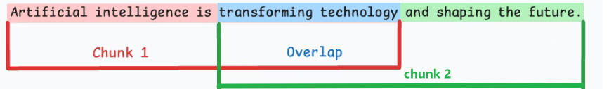
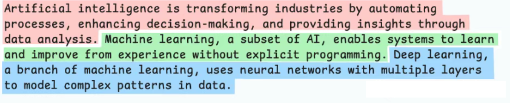
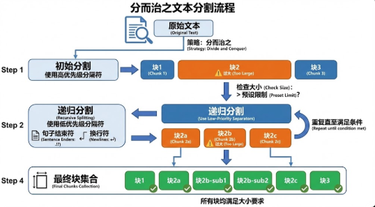
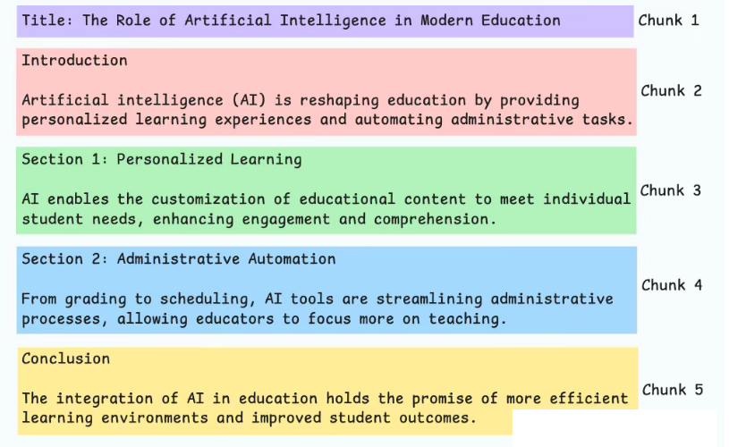
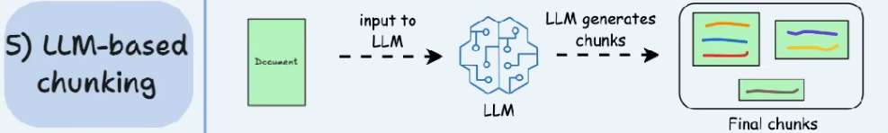

# 数据层——chunks策略优化

经典RAG系统面临接受文档长度有限的问题，当私有数据量过大时，传入所有context信息可能导致提示词过长，从而影响模型的处理效率或达到长度上限。在这个流程中，要实现高质量的检索，需要对原始知识文档进行有效的预处理，这也就引出了 RAG 流程中一个至关重要的准备工作——**文档分块** (Chunking)。

## 固定大小分块

按照预先设定的固定长度（ 最大 token 数）将文本进行切割。为了尽量减少信息损失，通常会在相邻的块之间保留一部分重叠内容（**Overlap**）。

## 语义分块

将语义关联紧密的句子或段落聚合在一起。

先**将文本分成基础单元**（如句子），然后计算相邻单元的语义相似度（例如通过嵌入向量的余弦相似度），如果相似度高于某个阈值，则合并这些单元，**直到相似度显著下降时才创建一个新的块**。

## 递归分块

优先按段落等大语义标识切割，对超限部分逐级降维、递归细化（如换行、句点），直至全部分块达标，实现“大块优先、语义保护、按需精分。

## 基于文档结构的分块

直接利用文档本身固有的、明确的结构元素（如标题层级、章节、列表项、表格、代码块、Markdown 标记等）来定义块的边界。目标是使每个块尽可能对应文档中的一个逻辑组成部分。

## 基于大模型的分块

利用大型语言模型 (LLM) 自身的理解能力来判断文本的最佳分割点。可以通过设计合适的提示 (Prompt)，让 LLM 将文本分割成语义上内聚且与其他部分相对独立的块。

# 检索层——检索增强策略

之前写的：https://kukudelin.top/2025/09/06/RAG%E7%9A%84%E8%AF%84%E4%BC%B0%EF%BC%88RAGAS%EF%BC%89%E5%92%8C%E6%A3%80%E7%B4%A2%E4%BC%98%E5%8C%96/
