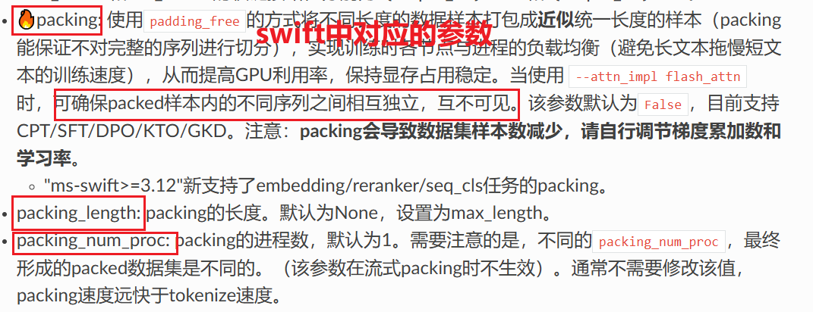
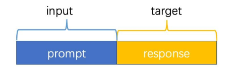
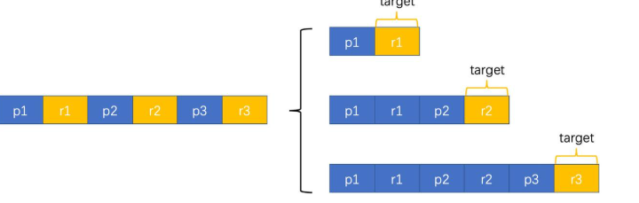
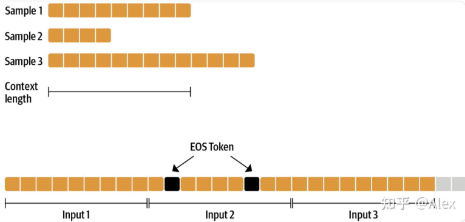
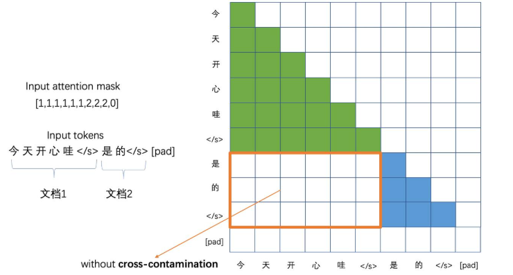
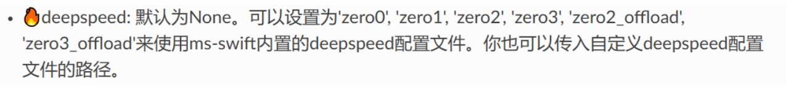
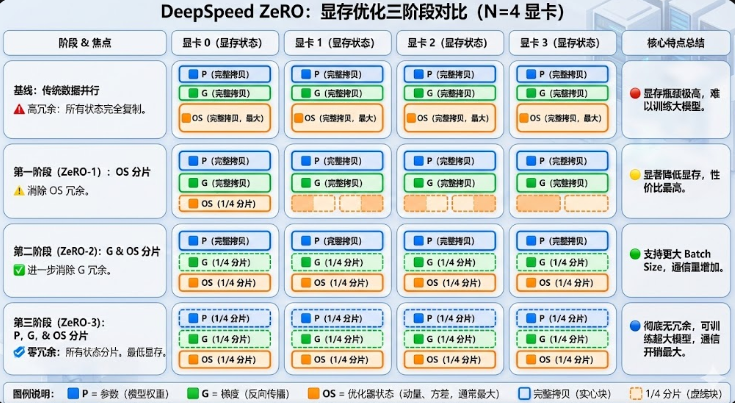
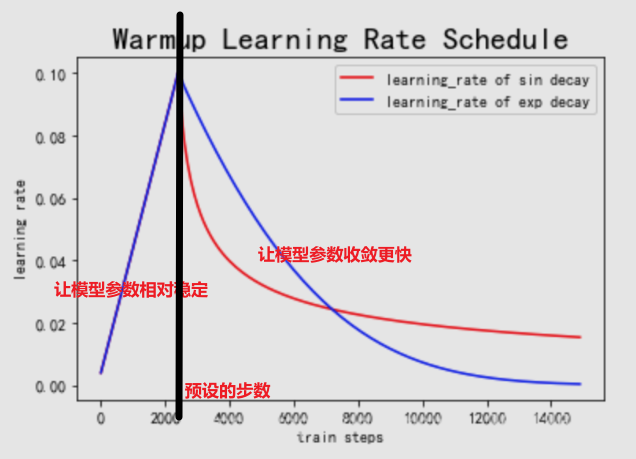
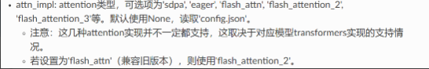
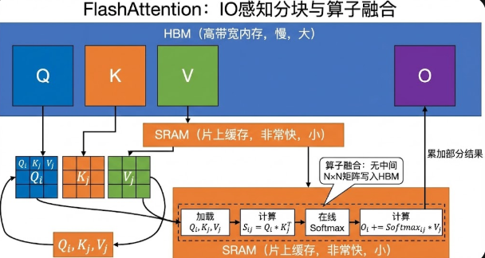

# Packing

[SFT Packing详解 ](https://zhuanlan.zhihu.com/p/707329908)

## 传统数据集构建方式

大语言模型（LLM）微调中两种常见的数据构建与训练方式：**单轮对话数据**和**多轮对话数据**

### 单轮：prompt+response

端到端的：模型接受的输入是prompt，需要预测的结果是response，最后计算response上token的loss。

如果输入文本的 Token 数量未达到 `--max_length (4096)`，系统会根据 `--padding_free false` 参数的设置，**自动在序列末尾填充（Padding）占位符**，以保证 Batch 内所有序列长度一致。

### 多轮：为了让模型在对话的任何阶段都能正确回答，会将一条长对话拆分成多个训练样本

- **第一阶段**：只看 p1，预测 r1。
- **第二阶段**：将第一轮作为上下文，看 [p1, r1, p2]，预测 r2。
- **第三阶段**：看整个历史 [p1, r1, p2, r2, p3]，预测 r3。

这样数据层面没有损失，但是数据量大了N倍，训练的效率比较低

## 什么是Packing？

### 核心定义

**Packing** 是指将**多条不同的文本序列**（短样本）合并、打包到**同一个样本序列**（固定长度的容器）中的过程。

### 解决的问题：减少 Padding 浪费

- **传统做法：** 通常训练时为了对齐长度，需要将短文本填充（Padding）大量无效的 `[PAD]` token，使其达到 batch 中的最大长度或模型的截断长度。
- **痛点：** 模型在处理这些无效的 Padding token 时依然会消耗计算资源，造成算力的浪费。

### 主要优势

- **减少冗余：** 通过把多个短样本挤进同一个序列，大幅减少了序列中 `[PAD]` token 的数量。
- **加速训练：** 提高了每个训练批次（Batch）中有效数据的占比，从而显著提升训练速度和吞吐量。

### 实现方式

**串联：** 将所有训练数据（Token IDs）连成一整条超长的序列。

**插入分隔符：** 在每两个原本独立的样本之间插入终止符（如 `<|EOS|>`），告诉模型这里是句子的结束。

**等长切分：** 按照模型的最大长度（如 2048 或 4096）将长序列切割成若干个等长的“包（Pack）”。

### 存在的问题：模型在计算 Attention 时，会导致模型错误地吸收了跨样本的背景信息，也就是说，第二句的开头会把第一句的结尾当成自己的背景

###  如何解决？—— 分块掩码

在一个标准的 Self-Attention 矩阵中，如果是一个长序列，Mask 通常是一个三角形（最后输入到注意力中呈现下三角矩阵）。但在 Packing 模式下，因为里面塞了好几个独立的小句子，Mask 矩阵会呈现出**沿着对角线分布的“小方块”**。

**如果没有这个掩码，模型就会把原本不相关的句子强行联系在一起，导致生成的回答逻辑破碎。**

# DeepSpeed

DeepSpeed 是由 Microsoft 开发的一个开源深度学习优化库，旨在让训练超大规模模型变得**更简单、更高效且更经济**。

## swift框架对应参数：

## 传统DDP数据并行方式：每个卡都存模型，把整块数据切片分到各个卡计算梯度，将最终的梯度平均值来作为最终的更新梯度

特点：数据并行，模型冗余。每张卡都要拿出一部分空间来进行模型存储，只能用剩下的空间来存放数据和参数

- **模型复制**：在训练开始前，将同一个模型完整地拷贝到 N 张 GPU 上。
- **数据切分**：将一个巨大的 Batch（批次）切分成 N 个小份，每张 GPU 分到一份不同的数据。
- **独立前向计算**：每张 GPU 各自运行模型，计算出自己的 Loss（损失）。
- **梯度同步（关键点）**：每张 GPU 计算出自己的梯度后，通过网络通信，取所有卡梯度的**平均值。**
- **同步更新**：每张卡拿到了完全一样的平均梯度，各自更新自己的参数。

# **ZeRO**

是 DeepSpeed 的核心创新。它的核心思想是：**消除冗余，把内存用在刀刃上。**

**在训练过程中，占用显存的主要是模型状态**：这是 ZeRO 解决的核心。包括：

- **参数 (P)**：模型权重。
- **梯度 (G)**：反向传播产生的梯度。
- **优化器状态 (OS)**：如 Adam 的一阶和二阶矩。

## 第一阶段（**ZeRO1**）：将**优化器状态 (OS)**进行切片

以 **Adam 优化器**为例**，**OS 包含两个部分：

1. **Momentum (一阶矩/动量)**：记录梯度过去的方向，类似于物体的惯性。
2. **Variance (二阶矩/自适应项)**：记录梯度波动的幅度，用于自动调整每个参数的学习率。

流程：每张卡算完梯度，将梯度发送给负责该分片 OS 的“主管 GPU”，主管 GPU 更新 OS 后，再将更新后的参数传回来。

## 第二阶段（**ZeRo2**）：梯度分片

在上面基础上，每张 GPU 在计算出完整梯度后，立刻将不属于自己负责的那部分梯度通过 `Reduce` 操作发送出去并**从显存中释放**。

## 第三阶段（ZeRo3）：**模型参数**切片

在上面基础上，每张卡只存 1/N 的模型权重，彻底消除模型冗余

## 对比

| **阶段**          | **通信开销** | **适用场景**         |
| ----------------- | ------------ | -------------------- |
| **ZeRO-0（DDP）** | 1.0x         | 小模型，显存极多     |
| **ZeRO-1**        | 1.0x         | 显存中等，追求速度   |
| **ZeRO-2**        | 1.0x         | **大多数场景的首选** |
| **ZeRO-3**        | 1.5x         | 超大规模模型 (LLM)   |

# Warmup

由于刚开始训练时,模型的权重(weights)是**随机初始化**的，此时若选择一个较大的学习率,可能带来模型的**不稳定(振荡)**，选择Warmup预热学习率的方式，可以使得开始训练的几个epoches或者一些steps内学习率较小,**在预热的小学习率下，模型可以慢慢趋于稳定,**等模型**相对稳定后再选择预先设置的学习率进行训练,使得模型收敛速度变得更快**，模型效果更佳。

## 大致曲线：从0上升到设定的steps后下降到0

# LoRa，QLoRa

之前写的：[基于AutoDL云服务器的大模型LoRA微调原理及实战 | 小牛壮士](https://kukudelin.top/2025/08/21/LoRA，QLoRA大模型微调/)

# FlashAttention

## swift框架下对应参数

注意：Flash Attention已经集成到了pytorch2.0+中，可以很便捷的调用，尽量避免去自己编译（pip install Flash Attention），**耗时长且容易把服务器搞崩**

## 原理

**实际由原来的直接在HBM上计算，变成了从HBM上加载到SRAM计算，然后将结果传到HBM**

在 GPU 上，内存主要分为两种：

- **HBM (High Bandwidth Memory)**：主显存，容量大（如 80GB），但读写速度慢。
- **SRAM**：片上缓存，读写极快，但容量极小（每核仅几百 KB）。

FlashAttention的核心原理是将输入QKV分块，并保证每个块能够在SRAM（一级缓存）上完成注意力操作，并将结果更新回HBM，从而降低对高带宽内存（HBM）的读写操作。总之，FlashAttention从GPU的内存读写入手，减少了内存读写量，从而实现2~4倍的速度提升。

| **特性**       | **标准 Attention**            | **FlashAttention**              |
| -------------- | ----------------------------- | ------------------------------- |
| **内存复杂度** | $O(N^2)$ (随序列长度平方增长) | **$O(N)$ (随序列长度线性增长)** |
| **计算精度**   | 精确计算                      | **精确计算 (与标准一致)**       |
| **IO 读写**    | 频繁读写大型中间矩阵          | 极少读写，主要在 SRAM 内部完成  |
| **适用场景**   | 短文本                        | **长文本 (16k, 32k 甚至更高)**  |
