在网络安全领域微调 Embedding 的意义在于**实现通用语义向专业安全语境的映射**：它能让模型理解具有特定安全含义的术语（如将 Spring 识别为框架漏洞而非季节），通过对比学习显著提升对**硬负样本**（如区分极度相似的攻击 Payload 与正常修复代码）的分辨能力，从而直接优化安全 RAG 系统的检索精度。

# Qwen3-embedding0.6B微调

## 前言

Embedding 模型的核心是将文本转化为一组低维稠密向量，在数学空间中实现“**语义相似的样本距离更近，语义相异的更远**”。

在网络安全 RAG（检索增强生成）架构中，Embedding 微调起着**“语义校准”**的关键作用。通用模型往往难以区分高度相似的安全术语，微调使模型能精准识别 CVE 漏洞名词、APT 组织特征及复杂的攻击逻辑。通过大幅提升检索环节的**召回准确率**与**排序质量**，微调确保了输入给大模型的上下文是高度相关的威胁情报或处置预案，从而为生成提供可靠的事实依据。

其核心训练逻辑如下：

- **轻量化训练：** 冻结模型大部分主干参数，仅通过训练轻量化的适配器来注入网络安全领域知识。这既保留了模型原有的通用理解能力，又极大降低了算力成本。
- **对比学习优化：** 利用 InfoNCE 损失函数，通过构建**“查询句 - 正样本 - 负样本”**的三元组数据进行训练。模型在学习过程中会不断拉近查询句与正样本的向量距离，并重点推开那些字面相似但含义错误的“难负样本”（如编号相近的不同漏洞），从而构建出更精准的安全语义空间。

## 一、数据集构建

### 1.1 训练集

训练集构建基于对比学习微调思路：**拉近语义相似样本（Positive）的距离，推远语义不相似样本（Negative）的距离。**核心逻辑不仅仅是“学会什么是对的”，更重要的是“学会区分什么是**看起来对但实际是错**的”。

#### 三元组的构建逻辑

在向量空间中，训练的目标是优化三者之间的距离关系：
$$
D(Anchor, Positive) + margin < D(Anchor, Negative)
$$
**Anchor (锚点):** 用户输入的查询（Query）。

**Positive (正例):** 正确的文档或答案。模型应将其拉近 Anchor。

**Negative (负例):** 错误的文档。模型应将其推远。不应该是完全随机的样本，而是**字面上包含很多相同关键词，但语义不符**。

示例：

```json
  {
    "messages": [
      {
        "role": "user",
        "content": "这是一本 Linux 应急响应参考书籍，自 2020 年 5 月 3 日开始编写，并于 2021 年 5 月 13 日在 NOP Team 公众号上发布第一版，内容主要包括 Linux 中常见应急响应事件的解决方案、应对几十种常见权限维持手段的常规安全检查方法、应急响应过程中的知识点以及小技巧等。基于以上内容，请问《Linux 应急响应手册》第一版发布于何时？"
      }
    ],
    "positive_messages": [
      [
        {
          "role": "user",
          "content": "《Linux 应急响应手册》第一版发布于 2021 年 5 月 13 日。"
        }
      ]
    ],
    "negative_messages": [
      [
        {
          "role": "assistant",
          "content": "该手册的第一版发布于 2022 年 10 月 1 日。"
        }
      ],
      [
        {
          "role": "assistant",
          "content": "根据文档内容，第一版发布于 2020 年 12 月 25 日。"
        }
      ]
    ]
  },
```

### 1.2 验证集

用于验证训练过程中模型在新样本下的损失情况，设置swift参数划分，数据格式和训练集一样

### 1.3 测试集

#### **微调评估逻辑**

首先依据真实标签的relationship字段将样本划分为**“不相关、弱相关、强相关”**三类，并设定 相似度0.5 和 0.75作为分界线；随后通过计算模型输出向量的余弦相似度，判断基座模型与微调模型的预测结果落入哪个区间，以此统计两者在各类别上的**正确归类数量（命中率）**，从而直观量化微调前后的性能差异。

示例：

```json
"query1": "《Linux 应急响应手册》是什么时候发布的？", 
"query2": "《Linux 应急响应手册》第一版发布于什么时间？", 
"relationship": 4
```

## 二、基于swift框架微调Qwen3-embedding-0.6B

**微调指令：**

```bash
nproc_per_node=1
CUDA_VISIBLE_DEVICES=0 \
INFONCE_TEMPERATURE=0.1 \
NPROC_PER_NODE=$nproc_per_node \
swift sft \
    --model model \
    --task_type embedding \
    --model_type qwen3_emb \
    --train_type full \
    --dataset /root/autodl-tmp/dataset/train_new.json \
    --load_from_cache_file true \
    --split_dataset_ratio 0.05 \
    --eval_strategy steps \
    --output_dir output \
    --save_steps 500 \
    --eval_steps 200 \
    --num_train_epochs 5 \
    --per_device_train_batch_size 8 \
    --per_device_eval_batch_size 4 \
    --gradient_accumulation_steps 4 \
    --learning_rate 6e-6 \
    --loss_type infonce \
    --dataloader_drop_last true \
```

#### 评估指标：

**采用InfoNCE Loss**：通过将**正样本对的嵌入向量拉近**、同时将同一batch内其他**负样本对推远**，来**最大化正样本与负样本间的互信息**，从而学习更好的语义表示

**训练集损失：**

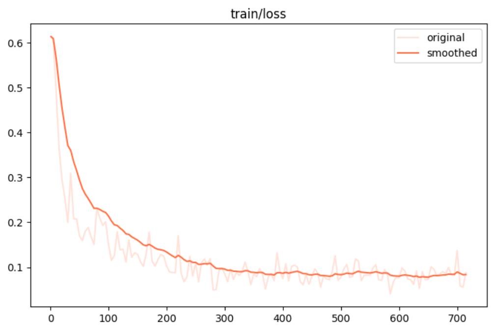

​		评估结果：模型损失随训练过程下降最终在上述数据集上达到收敛，说明根据微调，模型从通用预训练知识基础上，进一步学习到了该领域特有的术语、表达习惯、上下文逻辑和语义关系，**微调有效**

**验证集损失：**

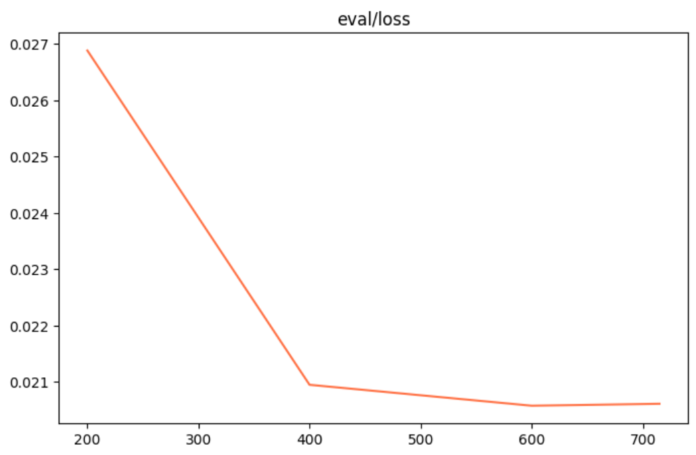

​		评估结果：验证集是模型训练时未见过的数据。验证集损失同步下降，说明模型不是单纯死记硬背训练样本，而是真实捕捉到了垂直领域数据中可泛化的语义模式、术语关联和上下文逻辑。

| positive_messages                                            | negative_messages                                            |
| ------------------------------------------------------------ | ------------------------------------------------------------ |
| 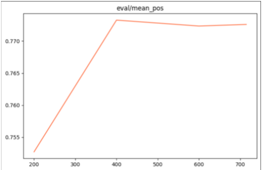 | 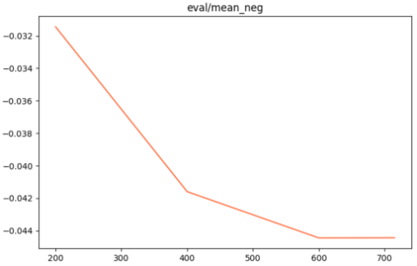 |
| 正样本损失上升：正样本相似度在增加（分子变大），在softmax-like的交叉熵结构中，这会暂时增加正样本的“分类难度”贡献，模型在强化正样本对的紧致性。 | 负样本损失下降：模型成功地将负样本推远，负样本对的相似度降低，分母中的负样本贡献减小，整体损失更容易下降。 |

**测试集：**

使用垂直领域语料（domain-specific corpus）微调embedding模型后，计算两个句子相似度时，**相似度分数普遍降低**

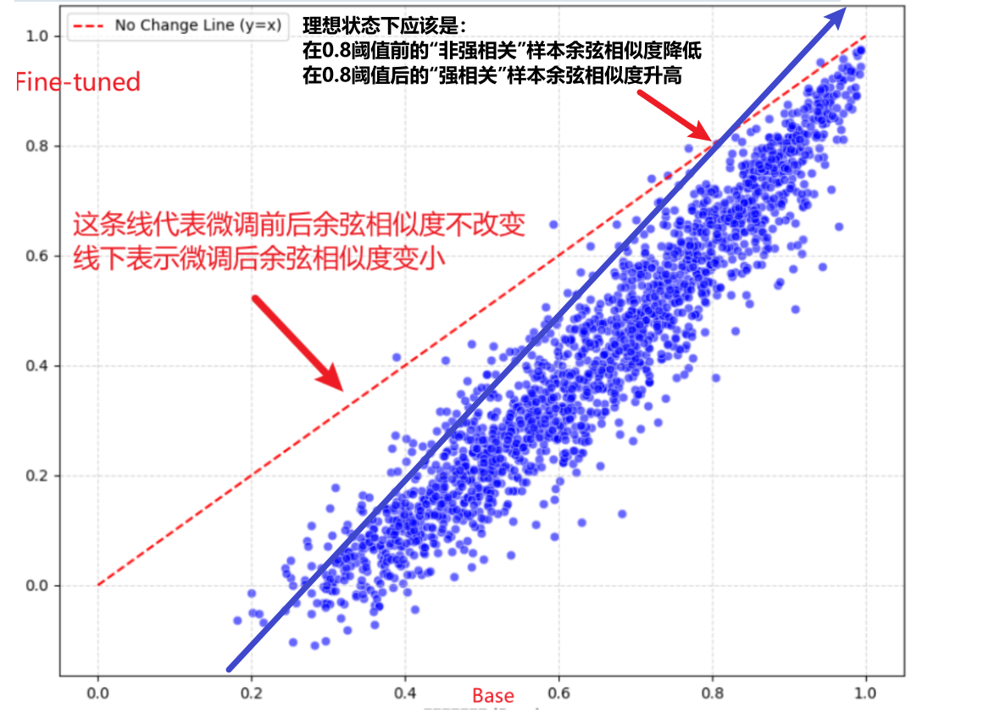

# Qwen3-reranker0.6B微调

## 一、前言

为了进一步提升检索精度，在Embedding粗召回的基础上引入了Reranker模型作为二级精排组件。Reranker采用跨编码器（cross-encoder）架构，能够将查询和候选文档拼接后进行深度双向注意力交互，从而捕捉到更细粒度的语义关联、逻辑一致性和领域专属模式。这使得它特别适合处理网络安全场景中那些“看起来很像、实际大不同”的难例。

本次测试的重点，是在网络安全专有数据集上对Reranker模型进行参数高效微调（主要采用LoRA技术），并系统评估微调前后在真实威胁情报检索任务上的表现提升。我们构造了包含CVE漏洞、APT组织特征、攻击链条、应急预案等多样化场景的测试集，特别关注了“难负样本”的区分能力——这些样本往往是导致通用模型翻车的关键痛点。

微调指令

```bash
CUDA_VISIBLE_DEVICES=0 \
swift sft \
    --model /root/autodl-tmp/model \
    --model_type qwen3_reranker \
    --task_type reranker \
    --loss_type reranker \
    --train_type full \
    --dataset /root/autodl-tmp/dataset/train_chat_fixed.jsonl \
    --load_from_cache_file true \
    --split_dataset_ratio 0.05 \
    --eval_strategy steps \
    --output_dir output \
    --eval_steps 100 \
    --num_train_epochs 3 \
    --save_steps 500 \
    --per_device_train_batch_size 8 \
    --per_device_eval_batch_size 4 \
    --gradient_accumulation_steps 1 \
    --dataset_num_proc 8 \
    --learning_rate 6e-6 \
    --label_names labels \
    --dataloader_drop_last true
```


## 二、数据集构建

数据集和embedding微调数据集格式是一样的，都是使用对比学习的方法来进行微调

Qwen3-Reranker的高级功能允许通过**自定义Instruction**（优先级就近覆盖）灵活调整判断标准，在不微调模型的情况下显著提升特定领域（如网络安全）的重排序精度，默认使用通用搜索指令并支持正负样本独立覆盖。

默认：

```txt
给定一个网页搜索查询，检索出能够回答该查询的相关段落。
```

## 三、基于swift框架微调Qwen3-reranker-0.6B

### 3.1 训练集损失

loss 计算模型对“正样本（相关文档）得分高于负样本（无关文档）”这一排序关系的预测正确程度——**正样本得分越高、负样本得分越低，loss 就越小**

它本质上是让模型学会区分相关和无关，从而提升重排序质量。

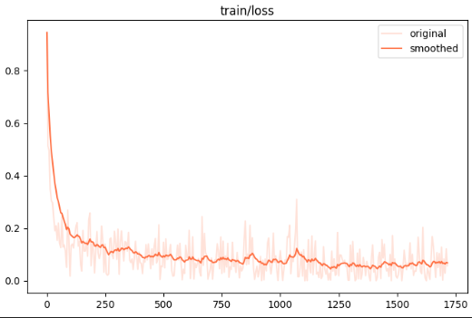

### 3.2 验证集损失

**评估指标：**

**MRR：是计算所有查询中第一个相关结果排名倒数（1/rank）的平均值，强调第一个正确结果的位置，**越高越好**

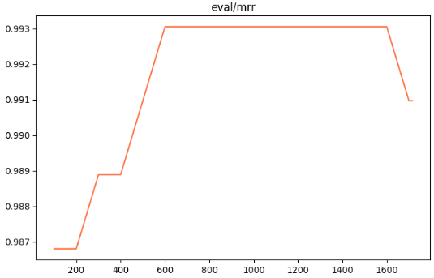

NDCG：则综合评估整个排序列表的质量，对高相关结果给予更高权重并对靠后位置打折，**越接近1越好。**

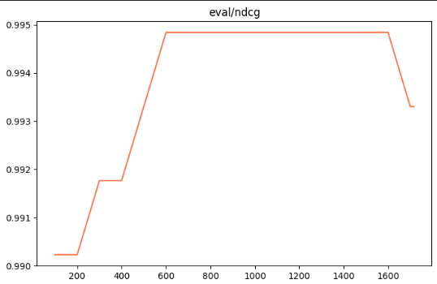

Accuracy： reranker 模型在验证集上将正样本排序高于负样本的比例（即二分类正确的比率），反映模型区分相关与无关文档的基本能力，**越高越好**。

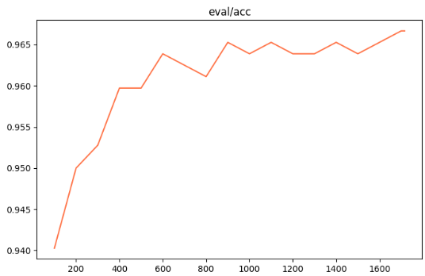

### 测试结果总结

通过对Qwen3-embedding-0.6B模型的微调测试，结果显示模型在网络安全领域数据集上实现了有效优化：

1. 训练集和验证集的InfoNCE损失均呈现下降趋势并趋于收敛，正样本相似度逐步增强（损失上升反映了强化紧致性），负样本相似度显著降低（损失下降），表明模型不仅保留了通用语义理解能力，还成功注入领域专有知识，提升了语义区分精度，尤其在处理CVE漏洞、APT组织等“难负样本”时表现更精确；
2. 测试集相似度分数普遍降低，进一步证实微调后向量空间更具领域针对性，避免了泛化偏差。

Qwen3-reranker-0.6B模型的微调结果显式：训练集损失下降体现了模型对正负样本排序关系的更好把握，验证集损失同步优化避免过拟合；评估指标如MRR（强调首结果位置）、NDCG（综合排序质量）和Accuracy（区分相关性比例）均显示出提升趋势，证明reranker在二级精排中显著提高了检索精度。

# 补充

# conda环境：swift_lora

# 一、测试流程

## 1.1 构建数据

### 1.1.1 损失函数

微调使用对比学习，采用**InfoNCE** 损失函数，核心思想是将任务建模为一个判别问题：区分出一个“正样本”与若干个“负样本”。

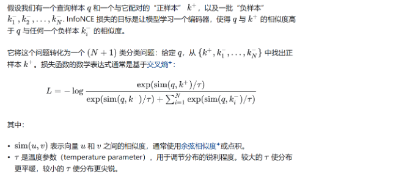

### 1.1.2 数据结构

**查询** (Query)：

这是信息需求的表示，可以是一个用户提出的问题、一个检索关键词，或任何需要模型为其寻找相关信息的文本。

**正例 (Positive Sample, `pos`)**:

这是与给定查询（Query）高度相关或语义一致的文本。在训练过程中，模型会学习拉近查询向量与正例向量之间的距离。

**负例 (Negative Sample, `neg`)**:

这是与给定查询（Query）不相关、相关性低或语义不一致的文本。在训练过程中，模型会学习推远查询向量与负例向量之间的距离。负样本的质量和选择策略对模型学习区分细微语义差异至关重要。

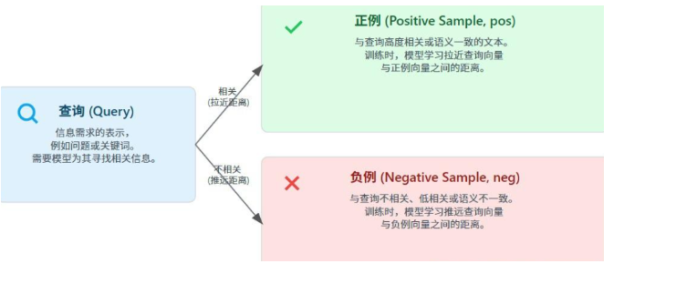

### 1.1.3 示例数据

**训练集（标准swift微调框架）**

```
  {    "messages": [      {        "role": "user",        "content": "在分析Telegram Mac客户端RCE漏洞时，发现该漏洞利用路径绕过了客户端对特定文件后缀的限制，且下载的文件未被标记为Quarantine属性，直接点击即可触发远程代码执行。该漏洞在最新版本的Telegram Mac客户端中依然可复现，且利用过程无需用户交互确认。结合该特性，如何通过静态分析和动态调试手段，定位并验证该文件后缀绕过机制的具体实现位置？"      }    ],    "positive_messages": [      [        {          "role": "assistant",          "content": "通过静态分析，可定位到Telegram Mac客户端中处理文件后缀验证的函数逻辑，重点检查文件类型判断与后缀过滤的代码路径，确认是否存在对特定后缀的白名单或黑名单逻辑被绕过。结合动态调试，可在运行时监控文件下载与打开流程，观察文件在未被标记为Quarantine的情况下被直接执行的调用栈，追踪文件处理函数的调用链，确认文件后缀绕过机制的具体实现位置。"        }      ]    ],    "negative_messages": [      [        {          "role": "assistant",          "content": "在分析PHP应用中的XXE漏洞时，可通过利用PHP内置的expect模块实现远程代码执行，具体方法是使用expect://包装器执行系统命令，例如通过&exec;触发whoami命令。此外，PHP filter wrapper可用于读取本地文件内容，如将文件以base64编码形式输出，实现信息泄露。其他可用的包装器包括php://filter、phar://、zip://、data://、gopher://、ftp://和dict://，它们分别支持数据过滤、PHAR文件读取、压缩包解析及网络协议交互。这些技术可被组合用于提升初始XXE漏洞的利用能力，但与Telegram Mac客户端文件后缀绕过机制或Quarantine属性绕过无关，也不涉及静态分析或动态调试定位RCE漏洞的具体实现位置。"        }      ]    ]  },
```


## 1.2 基座选型

微调框架：swift：https://swift.readthedocs.io/zh-cn/latest/BestPractices/Embedding.html

嵌入：Qwen/Qwen3-Embedding-0.6B：[Qwen/Qwen3-Embedding-0.6B · Hugging Face](https://huggingface.co/Qwen/Qwen3-Embedding-0.6B)

重排：Qwen/Qwen3-Reranker-0.6B：[Qwen/Qwen3-Reranker-0.6B · Hugging Face](https://huggingface.co/Qwen/Qwen3-Reranker-0.6B)

## 1.3 LoRa微调

### 1.3.1 微调指令

run.sh

```
nproc_per_node=1 # 关键环境变量设置 export CUDA_VISIBLE_DEVICES=0 export INFONCE_TEMPERATURE=0.05 export INFONCE_USE_BATCH=true NPROC_PER_NODE=$nproc_per_node \ swift sft \    --model model \    --task_type embedding \    --model_type qwen3_emb \    --train_type lora \    --dataset data/train.json \    --split_dataset_ratio 0.1 \    --eval_strategy steps \    --output_dir result \    --save_steps 1000 \    --eval_steps 100 \    --num_train_epochs 3 \    --per_device_train_batch_size 16 \    --gradient_accumulation_steps 4 \    --gradient_accumulation_steps 1 \    --learning_rate 1e-4 \    --lr_scheduler_type cosine \    --warmup_ratio 0.1 \    --loss_type infonce \    --max_length 1024 \    --dataloader_drop_last true \    --lora_rank 32 \    --gradient_checkpointing true \    --weight_decay 0.1
```

### 1.3.2 微调后合并参数

```
from peft import PeftModel from transformers import AutoModel, AutoTokenizer base_model_path = ""微调前 adapter_path = ""微调后 model = AutoModel.from_pretrained(base_model_path) model = PeftModel.from_pretrained(model, adapter_path) tokenizer = AutoTokenizer.from_pretrained(base_model_path) # 合并并保存 merged_path = ""合并后 model = model.merge_and_unload()  # 关键：合并 LoRA model.save_pretrained(merged_path) tokenizer.save_pretrained(merged_path)
```

### 1.3.3 train_loss数据拟合情况

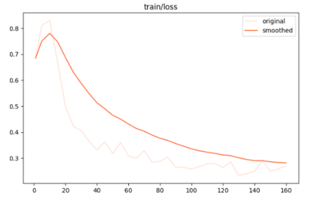

## 二、评估结果

### 核心评估流程

1. **向量化**：将 Query、Positive、Negatives 全部转为 L2 归一化的特征向量。
2. **算分**：计算 Query 与所有候选答案的余弦相似度。
3. **排序**：按得分降序排列，记录 Positive 的真实排名（Rank）。
4. **汇总**：统计前 K 名的覆盖率（Recall）和平均排名倒数（MRR）。

------

### 具体实例展示

假设你的测试数据如下：

- **Query**: “如何缓解失眠？”
- **Positive**: “建立规律的作息时间，减少咖啡因摄入。”
- **Negatives**:
  1. “今天天气不错。” (无关干扰)
  2. “如何修理电脑主板？” (领域无关)
  3. “喝咖啡可以提神。” (语义冲突/硬负样本)

#### 1. 评估基座模型 (Base)

模型计算出的相似度排名：

1. `Neg 3` (得分 0.85) —— **模型误判了！**
2. `Pos` (得分 0.80)
3. `Neg 1` (得分 0.30)

- **Rank**: 2
- **Recall@1**: 0
- **MRR**: 1/2 = 0.5

#### 2. 评估微调模型 (Finetuned)

微调后，模型更好地理解了医学建议与提神的区别：

1. `Pos` (得分 0.92) —— **正确排在首位**
2. `Neg 3` (得分 0.60)
3. `Neg 2` (得分 0.10)

- **Rank**: 1
- **Recall@1**: 1
- **MRR**: 1/1 = 1.0


数据量

| 训练数据 | 测试数据 |
| :------: | :------: |
|  75842   |   5000   |


| 指标                   | 含义                                                         | 原生模型 | 微调后  | 变化（原生 → 微调后） | 幅度     |
| ---------------------- | ------------------------------------------------------------ | -------- | ------- | --------------------- | -------- |
| Main score (Recall@10) | 主指标：查询在搜索结果前10条中至少命中一个相关文档的比例，是检索任务最常用的整体性能指标 | 0.68797  | 0.77400 | +0.08603              | ⬆️ 12.51% |
| Recall@1               | 前1条结果命中相关文档的比例，反映模型“第一猜就对”的能力，对用户体验影响最大 | 0.42726  | 0.48920 | +0.06194              | ⬆️ 14.50% |
| Recall@3               | 前3条结果中至少命中一个相关文档的比例，衡量头部结果的准确性  | 0.61149  | 0.69210 | +0.08061              | ⬆️ 13.18% |
| Recall@5               | 前5条结果中至少命中一个相关文档的比例                        | 0.68797  | 0.76910 | +0.08113              | ⬆️ 11.79% |
| Recall@10              | 前10条结果中至少命中一个相关文档的比例（本任务主指标）       | 0.68797  | 0.77400 | +0.08603              | ⬆️ 12.51% |
| MAP@10                 | 平均精度均值，综合考虑相关文档的排名位置，越靠前分数越高，衡量排序质量 | 0.52611  | 0.59870 | +0.07259              | ⬆️ 13.80% |
| MRR@10                 | 平均倒数排名，第一个相关文档排名的倒数取平均，对头部排序非常敏感 | 0.52651  | 0.60130 | +0.07479              | ⬆️ 14.21% |
| NDCG@10                | 归一化折损累积增益，综合考虑相关性和排名位置的排序指标，常用于多相关度等级场景 | 0.56653  | 0.63450 | +0.06797              | ⬆️ 12.00% |

# 环境部署流程

[ms-swift](https://github.com/modelscope/ms-swift)框架的eval能力使用了魔搭社区[评测框架EvalScope](https://github.com/modelscope/eval-scope)，并进行了高级封装以支持各类模型的评测需求。目前支持了**标准评测集**的评测流程，以及**用户自定义**评测集的评测流程。

标准评测集详情：https://evalscope.readthedocs.io/zh-cn/latest/get_started/supported_dataset/index.html，支持LLM，VLM，Agent，AIGC评测

## swift微调框架部署：

https://swift.readthedocs.io/zh-cn/latest/Megatron-SWIFT/Quick-start.html

```
pip install ms-swift -U
```

python依赖版本

| 条目               | 版本         |
| ------------------ | ------------ |
| python             | >=3.9        |
| cuda               |              |
| torch              | >=2.0        |
| transformer_engine | >=2.3        |
| apex               |              |
| megatron_core      | >=0.12,<0.16 |
| flash_attn         |              |
| transformers       | >=4.33       |
| modelscope         | >=1.23       |
| peft               | >=0.11,<0.19 |

准备好数据后使用上述指令微调，lora微调后必须合并原模型参数否则会导致评估失败

# 数据集扩充：

数据地址（开源+生成）：/data/test_project/embedding_lora/embedding_plus/data

qa_dataset.jsonl：34709，带有思考过程的问答，query，reasoning_chain，answer
security_data_final_merged.jsonl：生成中，16000条，纯问题不带上下文，正例和负例，instruction_en，instruction_zh，positive_answer，negative_answer，负例质量一般
query_positive_negative.jsonl：4520，带上下文的提问，正例和负例，category，query，positive_answer，negative_answer
security_data_with_cot.jsonl：3000，带思维链，instruction，input，CoT，output
qa_master_2023_2024.jsonl：11000，纯问题不带上下文，英文QA，question，answer
Security-QnA.jsonl：4500，针对漏洞类型的纯问题不带上下文，英文QA，Question，Vulnerability Type（漏洞类型），Answer
