# 前言

​		在网络安全领域，大模型需要处理很多和安全有关的文字、图片、视频、音频等信息，比如日志片段、流量特征、威胁情报、攻击链图谱等。为了更准确地找到相关内容和匹配威胁，这些数据通常会被转成向量存入向量数据库。

不过，向量数据库虽然在语义检索方面表现出色，但并不适合管理那些需要频繁更新、覆盖或按照时间顺序维护的安全内容，比如策略变更、最新的 IOC（入侵指标）、用户行为画像等。于是，引入了 Memory，为安全领域的大模型代理提供了一个**智能记忆层**。它可以**持续记住特定用户或团队的操作习惯、威胁偏好、常用的分析路径，并且会随着时间自动更新**。这样一来，安全助手就能更好地理解分析者的工作方式，快速关联历史情报，从而提供更有针对性、更高效的安全分析和响应支持。

最关键的是，Memory 还解决了传统 RAG 的一些痛点。**传统 RAG 只能检索静态的内容，它没办法理解用户上下文，也处理不了那些频繁变动的数据，甚至是跨会话记忆用户的推理方式和历史判断。**而加入了可持续演化的 Memory 层后，大模型在检索事实的同时，还能保留长期经验，让安全助手真正具备了“持续学习、持续适应”的能力。本文会介绍两种 Memory 部署方案：**mem0**、**MemMachine** 。

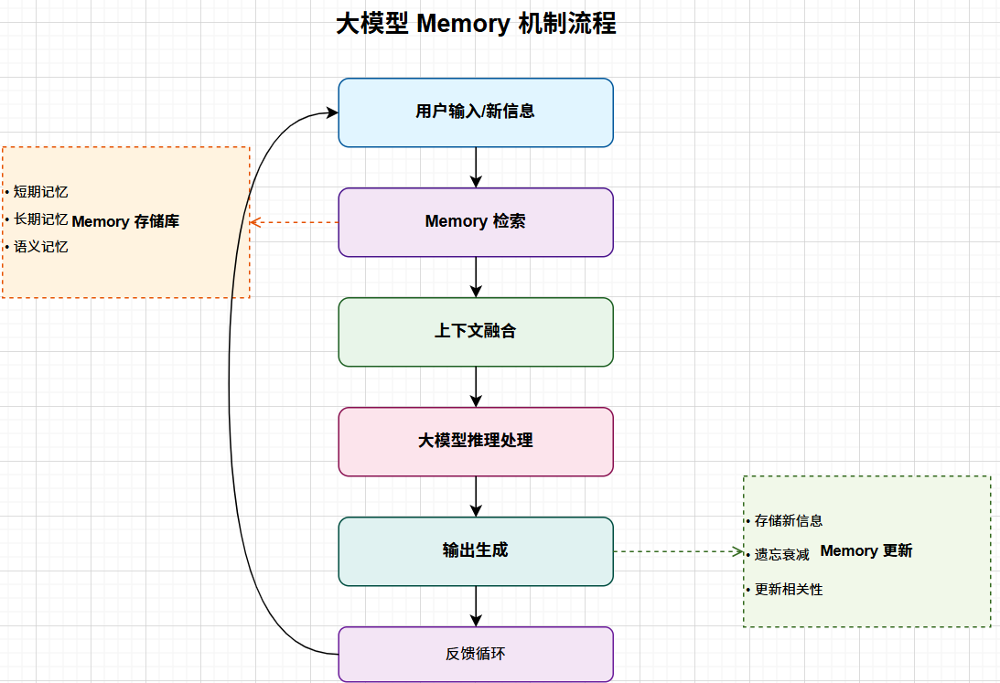

**下面是一个应用记忆层的简单案例：**

分析员 Alice 经常处理 **Cobalt Strike** 入侵事件，也经常关注 **关键服务器 10.120.8.21** 的可疑行为。Memory会持续记录这些偏好。

当她输入一句：

> “帮我看看最近的可疑活动。”

系统会基于记忆自动给出更贴合的结果：

> “检测到 10.120.8.21 出现异常横向移动行为，特征与 Cobalt Strike 相似。已按你常用的 ATT&CK 技术视角整理关键信息。需要继续查看持久化迹象吗？”

**借助 Memory，安全助手无需用户重复说明偏好，即可自动提供更精准、个性化的威胁分析体验。**

# 一、mem0

## 1.1 部署

Mem0支持两种部署模式：**基于平台**（完全只需要调用平台API进行memory的检索和存储，更方便）和**基于本地**（将数据存储到本地数据库中，更安全），下面是两种模式的简单部署示例，主要进行memory的检索和存储的演示

### 1.1.1 基于平台的Dify部署

**工作流示例：**

使用前需要先去[官网| Mem0](https://app.mem0.ai/dashboard/api-keys)申请一个api_key

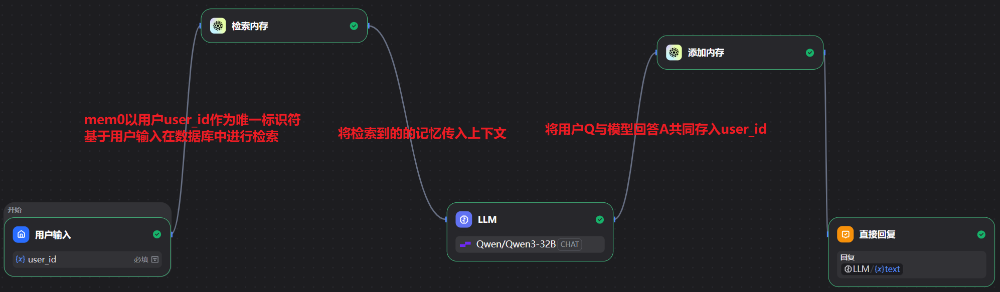

**模拟用户历史提问，存储memory**

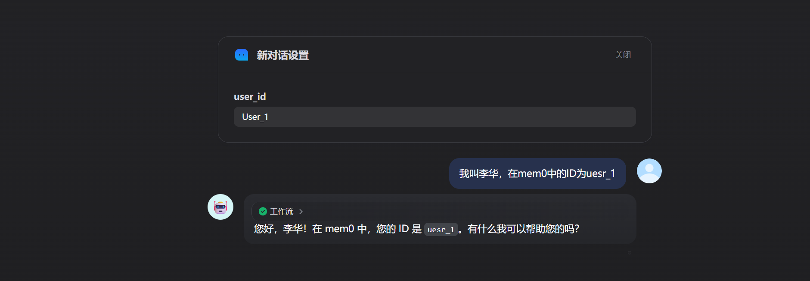

**可以看到平台已经存储了对话**

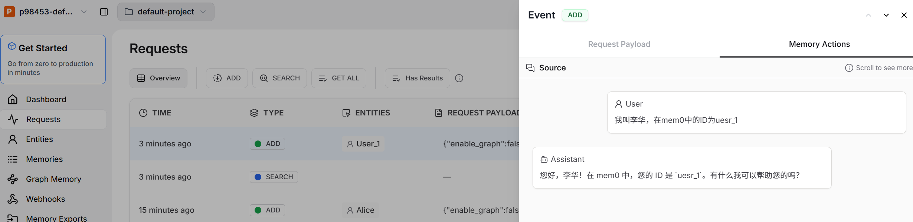

**新建对话后进行新一轮对话**

检索输出，会将用户的历史对话翻译成英文并进行总结，当用户进行新一轮的检索时计算得分

```JSON
{
  "files": [],
  "json": [
    {
      "query": "我是谁",
      "results": [
        {
          "categories": [
            "personal_details"
          ],
          "created_at": "2025-12-07T06:33:16.888759-08:00",
          "id": "399794fc-5f39-4f14-aa7e-0d5189ccbb0f",
          "memory": "User name is Li Hua",
          "score": 0.47124816331384345
        },
        {
          "categories": [
            "personal_details"
          ],
          "created_at": "2025-12-07T06:33:17.152339-08:00",
          "id": "7bbefbf7-4691-4f7e-a1f4-c4d1cf6b1045",
          "memory": "User ID in mem0 is uesr_1",
          "score": 0.417694462684997
        }
      ]
    }
  ],
  "text": "Query: 我是谁\n\nResults:\n\n1. Memory: User name is Li Hua\n   Score: 0.47\n   Categories: personal_details\n2. Memory: User ID in mem0 is uesr_1\n   Score: 0.42\n   Categories: personal_details"
}
```

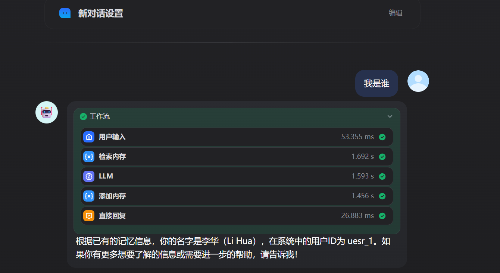

### 1.1.2 基于mem0ai的Python SDK部署

依赖包安装指令

```powershell
pip install mem0ai
```

Mem0默认使用openAI的LLM和embedding服务，但是也可以自己进行配置，主要的配置项为LLM，embedding，向量数据库，Reranker(可选)，下面是使用使用 vLLM 作为 LLM，Milvus 作为向量数据库，huggingface 作为嵌入模型的一个示例

```python 
import os
from mem0 import Memory


# 自定义配置，这里使用 vLLM 作为 LLM，Milvus 作为向量数据库，huggingface 作为嵌入模型
config = {
    "llm": {
        "provider": "vllm",
        "config": {
            "model": "Qwen/Qwen2.5-32B-Instruct",
            "vllm_base_url": "http://localhost:8000/v1",
            "temperature": 0.1,
            "max_tokens": 2000,
        }
    },
        "vector_store": {
        "provider": "milvus",
        "config": {
            "collection_name": "test",
            "embedding_model_dims": 1024,
            "url": "127.0.0.1",
        }
    },
    "embedder": {
        "provider": "huggingface",
        "config": {
            "model": "multi-qa-MiniLM-L6-cos-v1"
        }
    }
}

m = Memory.from_config(config)
messages = [
    {"role": "user", "content": "我打算今晚看电影，有什么推荐吗？"},
    {"role": "assistant", "content": "要不要试试惊悚片？通常都很有代入感。"},
    {"role": "user", "content": "我不太喜欢惊悚片，不过我很喜欢科幻片。"},
    {"role": "assistant", "content": "明白啦！那我就不推荐惊悚片了，改推荐科幻片。"}
]

# 添加对话记录到记忆库，并附加用户 ID 和元数据
m.add(messages, user_id="alice", metadata={"category": "movies"})
# 检索与新问题相关的对话记录
retrieved = m.search(query="今晚看什么电影")
print(retrieved)
```

## 1.2 Mem0 如何实现长期记忆

Mem0 的长期记忆系统基于以下核心机制：

- 采用向量嵌入技术，将语义信息高效存储与检索，确保记忆内容的可扩展性与相关性。
- 支持跨会话、跨应用维护用户特定的上下文，实现真正的"记忆不丢失"。
- 内置高效的检索机制，能够快速定位并返回与当前查询最相关的历史互动内容。

#### 核心操作接口

Mem0 对外提供了两大核心 接口：

- **add**：用于提取对话内容并将其存储为结构化记忆单元。
- **search**：根据用户查询，检索并返回最相关的历史记忆内容。

# 1.3 mem0作为记忆层的优势（这是相较于MemMachine比较好的一点，MemMachine只涉及查询和添加）

### 1.3.1 支持图数据库的检索

除开上述简单的将用户对话按照user_id存入向量数据库外，mem0还支持图数据库的检索

#### 示例用法

以下示例展示了如何使用 Mem0 的图形操作：

1. 首先，为名为 Alice 的用户添加一些记忆。
2. 随着记忆的不断添加，图结构会自动演化，**实体和关系被自动提取和连接。**
3. **用户可以直观地看到记忆网络的变化。**

##### 添加记忆

**（1）添加记忆"我喜欢去远足"**

Python 代码： `m.add("I like going to hikes", user_id="alice123")`


按照这个示例再添加一下记忆....

**（2）添加记忆"我的朋友彼得是蜘蛛侠"**

Python 代码： `m.add("My friend peter is the spiderman", user_id="alice123")`

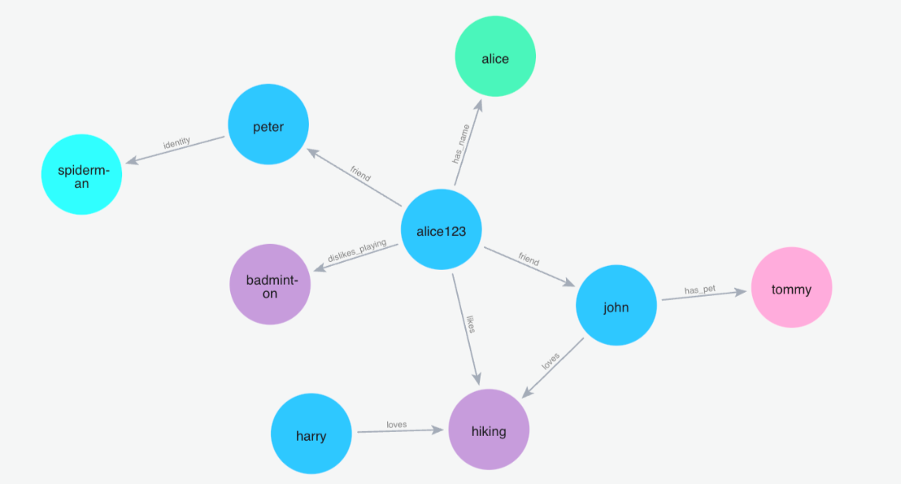

**查询记忆**

**（1）搜索：蜘蛛侠**

Python 代码： `m.search("Who is spiderman?", user_id="alice123")`

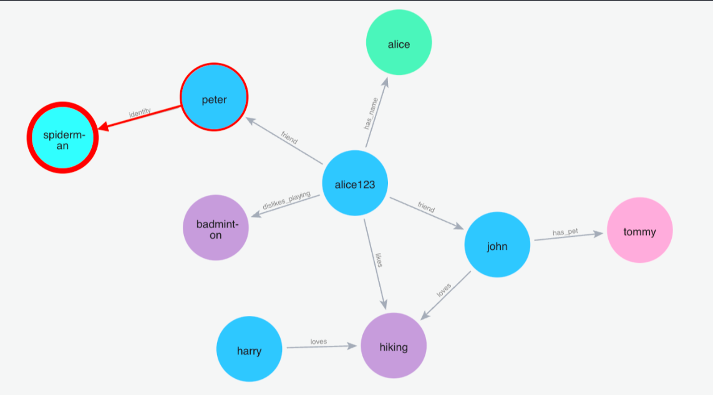

### 1.3.2 支持复杂的分类检索与批量记忆的导入与导出

```Python
# 按标签和类别检索
memories = m.search(
    query="深度学习",
    user_id="alice",
    filter={
        "category": "ml",
        "tags": ["neural-network", "research"]
    },
    limit=10
)

# 按重要性检索
memories = m.search(
    query="紧急事项",
    user_id="alice",
    filter={"importance": "high"}
)

# 批量导出所有记忆（适合备份/迁移）
all_memories = m.get_all(user_id="alice")
with open("alice_memories.json", "w") as f:
    import json
    json.dump(all_memories, f, ensure_ascii=False, indent=2)

# 批量导入记忆
with open("alice_memories.json", "r") as f:
    memories_data = json.load(f)
for memory in memories_data:
    m.add([memory["source_messages"]], user_id="alice", metadata=memory.get("metadata"))
```

### 1.3.3 可以作为mcp工具

OpenMemory MCP是 Mem0 的核心协议层，旨在为 AI 交互提供本地化的"记忆背包"。所有数据均在本地存储，确保用户对数据的绝对隐私和控制权。

**MCP 提供了四个核心 API：**

1. `add_memories`：存储新的记忆对象
2. `search_memory`：基于相关性和上下文检索记忆
3. `list_memories`：查看所有存储的记忆
4. `delete_all_memories`：清除所有记忆

# 二、MemMachine

## 2.1 基于Docker部署

可通过Python SDK、RESTful接口及MCP服务器实现便捷集成，下面将MemMachine部署在mcp服务器上进行调用

`add_memory`：将关于用户或对话的重要新信息存储到记忆中。

`search_memory`：检索用户相关的上下文、记忆或个人资料信息。

首先创建一个新的文件夹MemMachine，在这里打开powershell，输入以下指令

```powershell
$latestRelease = Invoke-RestMethod -Uri "https://api.github.com/repos/MemMachine/MemMachine/releases/latest"; `
$tarballUrl = $latestRelease.tarball_url; `
$destination = "MemMachine"; `
if (Test-Path $destination) { Remove-Item $destination -Recurse -Force }; `
New-Item -ItemType Directory -Force -Path $destination; `
Invoke-WebRequest -Uri $tarballUrl -OutFile "MemMachine-latest.tar.gz"; `
tar -xzf "MemMachine-latest.tar.gz" -C $destination --strip-components=1; `
Set-Location $destination; `
```

跟随系统指引完成配置，这里需要申请一个[OpenAI](https://platform.openai.com/api-keys)的才能通过配置，否则会失败

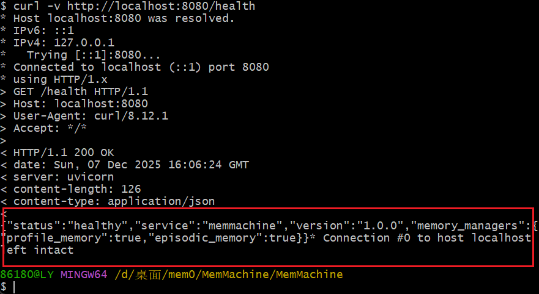

接入mcp参数

```Python
{
    "mcpServers": {
      "memmachine": {
        "command": "docker",
        "args": [
          "exec",
          "-i",
          "memmachine-app",
          "/app/.venv/bin/memmachine-mcp-stdio"
        ],
        "env": {
          "MEMORY_CONFIG": "/app/configuration.yml",
          "MM_USER_ID": "your-username",
          "PYTHONUNBUFFERED": "1"
        }
      }
    }
  }
```

显示连接成功

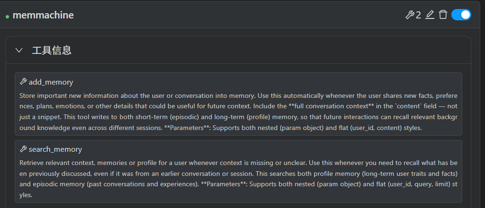

**存入记忆**

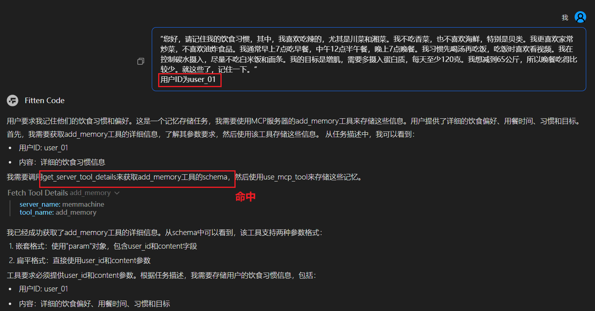

**搜索记忆**

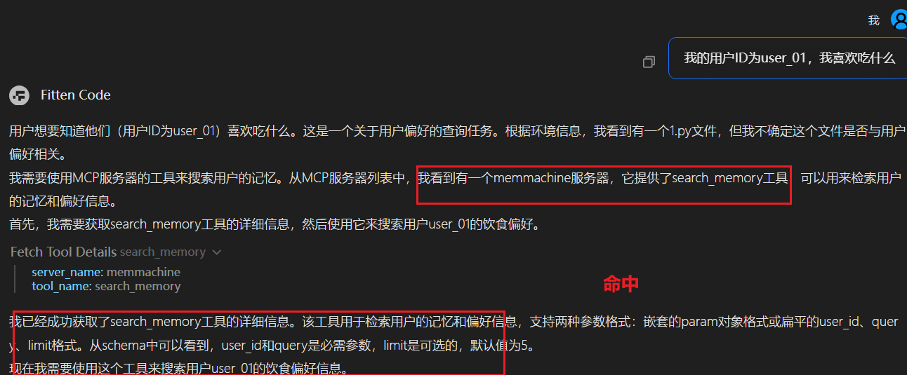

## 2.2 MemMachine的特点

MemMachine支持三类核心记忆，可满足AI智能体在不同场景下的记忆需求，实现从短期会话到长期档案的全场景覆盖：

- **工作记忆（短期）**：用于存储单次会话内的即时交互数据，如用户当前的咨询问题、AI的临时应答草稿等，会话结束后可按需清理，适配实时性强的短时交互场景。
- **持久记忆（长期）**：用于留存跨会话的核心信息，如用户过往的重要咨询记录、AI执行任务的历史结果等，数据会持久化存储，支持智能体跨时间维度调取信息。
- **个性化记忆（档案）**：用于构建专属用户档案，整合用户的偏好、身份信息、历史行为特征等，例如记录用户的医疗史、财务风险偏好、内容写作风格等，让AI助手的服务具备强个性化属性。


# 三、总结

​		本文深入探讨了网络安全领域中大模型的Memory机制，重点介绍了两种部署方案：Memo和MemMachine。Memo通过向量嵌入技术实现长期记忆的高效存储与检索，支持跨会话、跨应用的上下文维护，并提供图数据库检索、复杂分类检索以及批量记忆导入导出等功能，其核心操作接口包括`add`和`search`，可作为OpenMemoryMCP工具，为AI交互提供本地化的“记忆背包”。MemMachine则基于Docker部署，通过Python SDK、RESTful接口及MCP服务器实现集成，支持工作记忆（短期）、持久记忆（长期）和个性化记忆（档案）三类核心记忆，满足AI智能体在不同场景下的记忆需求，实现从短期会话到长期档案的全场景覆盖。这两种Memory机制的引入，有效解决了传统RAG在处理动态数据和跨会话记忆方面的痛点，使安全助手能够更好地理解分析者的工作方式，快速关联历史情报，提供更有针对性、更高效的安全分析和响应支持，推动网络安全领域的智能化发展。
