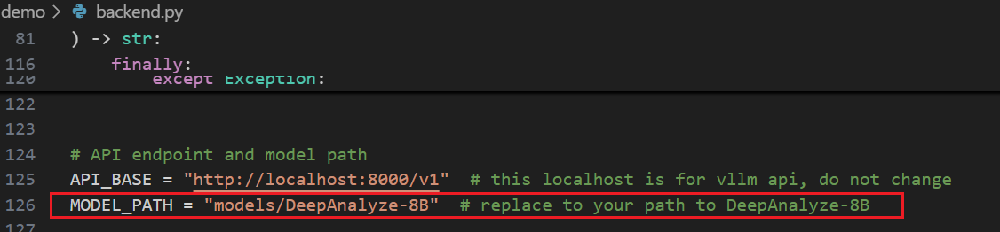
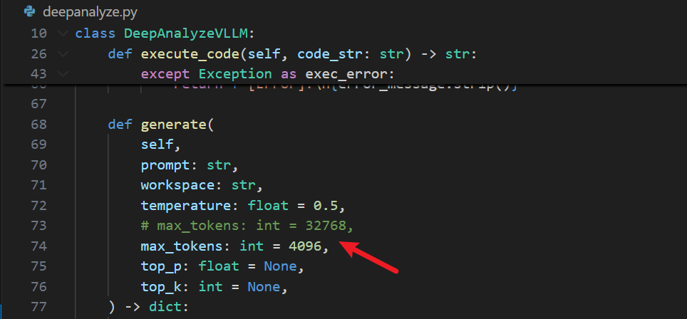
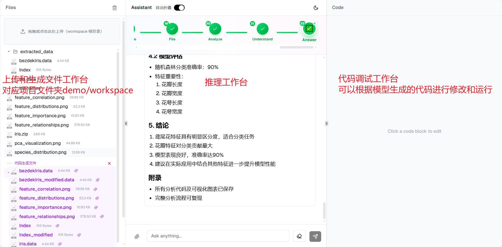
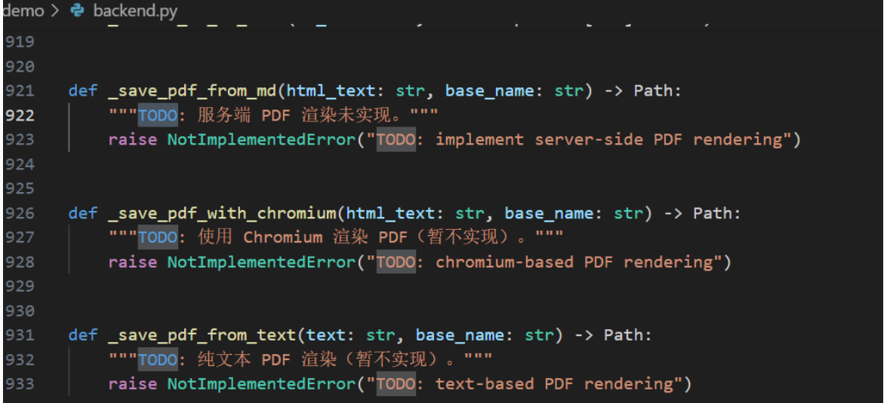
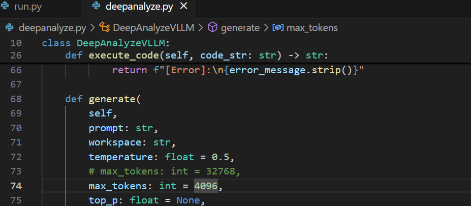
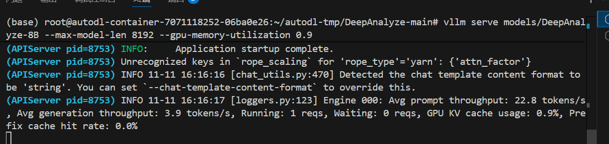
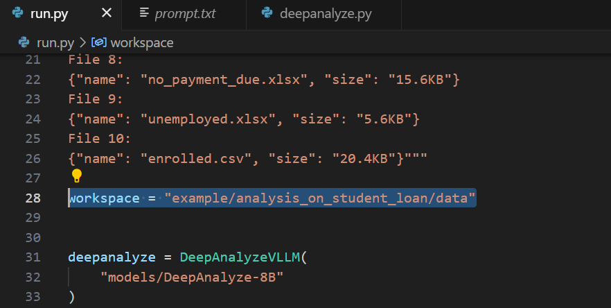
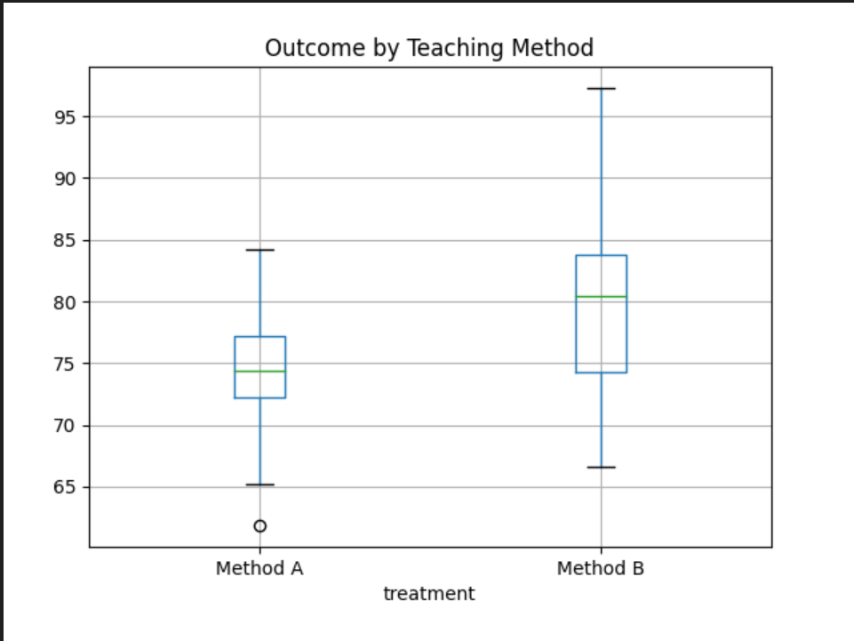
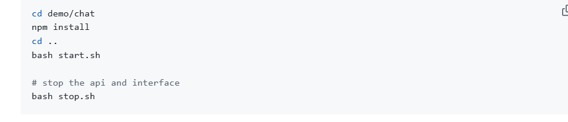
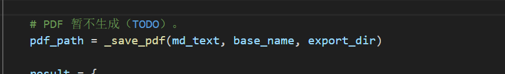

# 前言

DeepAnalyze 是由中国人民大学数据与智能实验室推出的首个面向自主数据科学的智能体大语言模型（Agentic LLM），能够无需人工干预，端到端自动完成包括数据准备、分析、建模、可视化和报告生成在内的完整数据科学流程，支持结构化、半结构化和非结构化等多种数据源，并完全开源模型、代码、训练数据与演示系统，便于本地部署和二次开发。

# 本地部署配置

**GPU**：RTX 3090(24GB) * 1

**CPU**：12 vCPU Intel(R) Xeon(R) Platinum 8255C CPU @ 2.50GHz

**内存**：43GB

**硬盘**：系统盘:30 GB

# 部署步骤

1，将[DeepAnalyze-8B](https://huggingface.co/RUC-DataLab/DeepAnalyze-8B)下载到DeepAnalyze-main/models文件夹

2，更改max_tokens（降低模型性能，视情况）


3，下载依赖包（**可以把数据分析常用的依赖包也加进去，因为webUI运行代码时可能不会自动下载依赖包，会导致运行失败，后续也需要手动pip**）

```
pip install -r requirements.txt
```

4，如果需要构建 OpenAI 风格的 API，那么修改demo/backend.py的模型路径后运行该文件，后面webUI需要使用，否则跳过



5，依次运行下面指令，访问4000端口

```
vllm serve models/DeepAnalyze-8B --max-model-len 20480 --gpu-memory-utilization 0.9

cd demo/

bash start.sh
```

6，终止指令

```
bash stop.sh
```

Tips:也可以使用docker部署


# 五大核心推理步骤COT

• <Analyze>：进行文本分析，包括规划、推理、反思和自我验证。
• <Understand>：理解数据源的内容，如数据库、表格和文档。
• <Code>：生成用于与数据环境交互的Python代码。
• <Execute>：执行生成的代码，并从环境中收集反馈。
• <Finish>：产出最终的答案或报告。

# 优势：

- 不依赖人工预设流程，能够像人类数据科学家一样**自主编排、自适应优化**整个数据科学流程（从数据准备到报告生成）。

- 支持结构化（CSV、数据库）、半结构化（JSON）、非结构化（Markdown、TXT）等多种数据类型。

# 改进点：

- 可能存在稳定性、错误处理或复杂业务逻辑支持不足的问题。（可以根据该大模型在[DataScience-Instruct-500K ](https://huggingface.co/datasets/RUC-DataLab/DataScience-Instruct-500K)上进行微调）
- 数学建模能力有限，只能进行简单的数据分析（可能是本地硬件配置有所限制）
- 目前还不支持PDF格式导出

# 前言

DeepAnalyze 是由中国人民大学数据与智能实验室推出的首个面向自主数据科学的智能体大语言模型（Agentic LLM），能够无需人工干预，端到端自动完成包括数据准备、分析、建模、可视化和报告生成在内的完整数据科学流程，支持结构化、半结构化和非结构化等多种数据源，并完全开源模型、代码、训练数据与演示系统，便于本地部署和二次开发。

# 本地部署配置

**GPU**：RTX 3090(24GB) * 1

**CPU**：12 vCPU Intel(R) Xeon(R) Platinum 8255C CPU @ 2.50GHz

**内存**：43GB

**硬盘**：系统盘:30 GB

# 部署步骤

1，将[DeepAnalyze-8B](https://huggingface.co/RUC-DataLab/DeepAnalyze-8B)下载到DeepAnalyze-main/models文件夹

2，更改max_tokens（降低模型性能，视情况）



3，下载依赖包（**可以把数据分析常用的依赖包也加进去，因为webUI运行代码时可能不会自动下载依赖包，会导致运行失败，后续也需要手动pip**）

```
pip install -r requirements.txt
```

4，如果需要构建 OpenAI 风格的 API，那么修改demo/backend.py的模型路径后运行该文件，后面webUI需要使用，否则跳过


5，依次运行下面指令，访问4000端口

```
vllm serve models/DeepAnalyze-8B --max-model-len 20480 --gpu-memory-utilization 0.9

cd demo/

bash start.sh
```

6，终止指令

```
bash stop.sh
```

Tips:也可以使用docker部署



# 五大核心推理步骤COT

• <Analyze>：进行文本分析，包括规划、推理、反思和自我验证。
• <Understand>：理解数据源的内容，如数据库、表格和文档。
• <Code>：生成用于与数据环境交互的Python代码。
• <Execute>：执行生成的代码，并从环境中收集反馈。
• <Finish>：产出最终的答案或报告。

# 优势：

- 不依赖人工预设流程，能够像人类数据科学家一样**自主编排、自适应优化**整个数据科学流程（从数据准备到报告生成）。

- 支持结构化（CSV、数据库）、半结构化（JSON）、非结构化（Markdown、TXT）等多种数据类型。

# 改进点：

- 可能存在稳定性、错误处理或复杂业务逻辑支持不足的问题。（可以根据该大模型在[DataScience-Instruct-500K ](https://huggingface.co/datasets/RUC-DataLab/DataScience-Instruct-500K)上进行微调）
- 数学建模能力有限，只能进行简单的数据分析（可能是本地硬件配置有所限制）
- 目前还不支持PDF格式导出



运行方式：

项目文件下

vllm serve models/DeepAnalyze-8B --max-model-len 8192 --gpu-memory-utilization 0.9

cd demo/

bash start.sh

端口4000

# 显存爆了，2080ti架构太老，不支持FlashAttention-2，换3090的24G

这个错误的**根本原因**很清楚：
 👉 **你的 GPU（RTX 2080 Ti, 11GB VRAM）在加载 `DeepAnalyze-8B` 模型时显存不足。**
 vLLM 尝试分配额外的 192MB 时失败，因为模型本身几乎吃满了 GPU 全部 10.5GB 显存。

------

## 🔍 一、错误核心点

```
torch.OutOfMemoryError: CUDA out of memory. Tried to allocate 192.00 MiB.
GPU 0 has total capacity 10.57 GiB of which 121.06 MiB is free.
```

而且日志还提到：

```
Compute Capability < 8.0 is not supported by the V1 Engine. Falling back to V0.
Cannot use FlashAttention-2 backend for Volta and Turing GPUs.
```

也就是说：

- 你的显卡架构较老（Turing, Compute 7.5），无法使用高效的 `FlashAttention-2`。
- vLLM 只能用旧版内核，显存占用更高。

------

## 💡 二、解决方向汇总（从简单到彻底）

### ✅ 方法 1：启用 CPU offload（部分权重放 CPU）

在启动命令中添加：

```bash
vllm serve models/DeepAnalyze-8B --enable-cpu-offload
```

或旧版本参数：

```bash
vllm serve models/DeepAnalyze-8B --offload-folder /tmp/offload
```

⚠️ 会牺牲推理速度，但显存占用可降低约 30~50%。

------

### ✅ 方法 2：使用更小的模型（推荐）

如果你是自行训练或微调的模型，可尝试使用：

- `DeepAnalyze-1.5B`
- `DeepAnalyze-3B`
- `Qwen2.5-3B-Instruct`
  这些模型在 10GB 显卡上更稳定。

命令示例：

```bash
vllm serve models/DeepAnalyze-3B
```

------

### ✅ 方法 3：启用量化加载（减少显存占用）

vLLM 支持多种量化策略，比如 `AWQ`、`GPTQ`、`fp8`、`int8`。

如果你有量化版本模型（如 `DeepAnalyze-8B-AWQ` 或 `DeepAnalyze-8B-GPTQ`），可这样加载：

```bash
vllm serve models/DeepAnalyze-8B-AWQ --quantization awq
```

或：

```bash
vllm serve models/DeepAnalyze-8B --quantization int8
```

（注意：模型必须支持该量化格式）

------

### ✅ 方法 4：减小最大上下文长度（节省 KV Cache 显存）

当前日志显示：

```
Using max model len 131072
```

也就是模型支持 128K 上下文，这会导致显存占用巨大。

你可以强制降低：

```bash
vllm serve models/DeepAnalyze-8B --max-model-len 4096
```

此举可显著降低内存需求（通常节省 60% 以上显存）。

------

### ✅ 方法 5：禁用 Chunked prefill（有时会触发额外显存分配）

在启动时加上：

```bash
--enable-chunked-prefill=False
```

完整命令示例：

```bash
vllm serve models/DeepAnalyze-8B --max-model-len 4096 --enable-cpu-offload --enable-chunked-prefill=False
```

------

### ✅ 方法 6：设置 PyTorch 内存配置（减少碎片）

在运行前导出以下环境变量：

```bash
export PYTORCH_CUDA_ALLOC_CONF=expandable_segments:True
```

再启动 vllm：

```bash
vllm serve models/DeepAnalyze-8B
```

------

### ✅ 方法 7：确保显存干净

在启动前执行：

```bash
sudo fuser -v /dev/nvidia*   # 查看占用 GPU 的进程
sudo kill -9 <pid>           # 逐个清理
nvidia-smi                   # 确认显存清空
```

------

## 🧭 三、推荐启动命令（适合 RTX 2080 Ti）

```bash
export PYTORCH_CUDA_ALLOC_CONF=expandable_segments:True

vllm serve models/DeepAnalyze-8B \
  --max-model-len 4096 \
  --enable-cpu-offload \
  --enable-chunked-prefill=False
```

如果仍然爆显存，尝试再加：

```bash
--quantization int8
```

------

## ⚠️ 四、附加说明

- `DeepAnalyze-8B` 模型本身对显存要求 ≈ 16GB（FP16）以上。
- RTX 2080 Ti（11GB）显然不够，必须依赖 **CPU offload / 量化 / 降 context**。
- 如果模型用的是 `Qwen2.5` 或 `Qwen3` 架构，vLLM 加载时内存膨胀也会更明显。

------

是否希望我帮你**根据显存大小自动生成最优启动命令**（结合 offload、量化、context 动态平衡）？
 我可以检测你的显存容量（11GB）并输出一个稳定版本的 `vllm serve` 命令。

## 显存又爆了，上下文太长，重新设置参数

非常好 👍 你贴的这个 `config.json` 明确揭示了问题根源。
 我们来精确地分析一下为什么会显存爆炸，以及如何修改配置或启动参数让它跑起来。

------

## 🧩 一、模型关键信息

从配置可见：

```json
"hidden_size": 4096,
"num_hidden_layers": 36,
"num_attention_heads": 32,
"num_key_value_heads": 8,
"max_position_embeddings": 131072,
"rope_scaling": {
    "factor": 4.0,
    "original_max_position_embeddings": 32768,
    "rope_type": "yarn"
}
```

也就是说：

- 原始 Qwen3 模型最大 context 是 **32768 tokens**。
- 通过 `rope_scaling.factor = 4.0` 把最大长度扩展到了 **131072 tokens**。
- 这是“长上下文增强版本（YARN RoPE）”。

------

## ⚠️ 二、为什么显存爆炸

vLLM 启动时自动读取 `max_position_embeddings` 值（131072），
 于是分配 KV cache 大小 =

> hidden_size × num_layers × sequence_length × batch_size × dtype_size

粗略估算：

```
4096 × 36 × 131072 × 2 bytes ≈ 38GB（单精度一半即 bfloat16）
```

即使 vLLM 优化后，仍需 **约 18 GiB KV cache**（日志里已说明）。

你的 GPU 只有约 4.5 GiB 可用显存 → 直接溢出。

------

## 🧠 三、解决方法

你现在有两种修复方式：**修改配置文件** 或 **修改启动参数**。

------

### ✅ 方案 1：修改启动参数（推荐）

启动时强制覆盖最大长度：

```bash
vllm serve models/DeepAnalyze-8B --max-model-len 32768 --gpu-memory-utilization 0.95
```

> 💡 原因：你 config 中 `rope_scaling.original_max_position_embeddings` = 32768，
> 这其实是模型**原生支持的最大上下文长度**。
> 用 32768 能完全兼容，不影响 RoPE 机制。

如显存仍不够，可继续降：

```bash
vllm serve models/DeepAnalyze-8B --max-model-len 8192 --gpu-memory-utilization 0.95
```

------

### ✅ 方案 2：修改 `config.json`

如果你想让模型文件本身默认使用较短上下文（比如供别人调用时不改命令），可以直接改：

```json
"max_position_embeddings": 32768,
"rope_scaling": {
    "attn_factor": 0.8782488562869419,
    "factor": 1.0,
    "original_max_position_embeddings": 32768,
    "rope_type": "yarn"
}
```

> 改完保存即可，无需重新训练。

------

### ✅ 方案 3：使用分块加载或量化（可选）

如果你的机器显存实在有限（<8GB），建议尝试：

```bash
vllm serve models/DeepAnalyze-8B --max-model-len 8192 --gpu-memory-utilization 0.95 --quantization awq
```

或使用现成的 INT4 量化模型。

------

## 🔧 四、实测经验总结（8B 模型显存占用参考）

| 序列长度 | 显存占用 | 推荐 GPU               |
| -------- | -------- | ---------------------- |
| 131072   | 18+ GB   | ≥ RTX 4090 / A100      |
| 32768    | ~6 GB    | RTX 3060 / 4060        |
| 8192     | ~3 GB    | RTX 3050 / T4          |
| 4096     | ~2 GB    | MX550 / 集显测试可运行 |

------

## ✅ 推荐命令（适合你当前显存环境）

请运行这个版本：

```bash
vllm serve models/DeepAnalyze-8B --max-model-len 8192 --gpu-memory-utilization 0.9
```

------

如果你告诉我你的 **GPU型号（例如 RTX 4060、A100、T4、3050等）**，
 我可以帮你算出一个「**最优 max-model-len**」，既不OOM又能发挥最大性能。
 要不要我帮你算一下？

# 成功部署vllm：vllm serve models/DeepAnalyze-8B --max-model-len 8192 --gpu-memory-utilization 0.95



运行run.py,命中



这两行日志同样不是错误，而是 **vLLM 正常运行时的 API 调用记录与性能状态**。我帮你解释一下每一部分的含义👇

------

### ✅ 第一行（HTTP 请求日志）

```
(APIServer pid=8753) INFO:     127.0.0.1:38644 - "POST /v1/chat/completions HTTP/1.1" 200 OK
```

| 字段                          | 含义                                            |
| ----------------------------- | ----------------------------------------------- |
| **APIServer pid=8753**        | 当前 vLLM API 服务进程 ID                       |
| **127.0.0.1:38644**           | 发起请求的客户端（本地）地址                    |
| **POST /v1/chat/completions** | 调用了兼容 OpenAI 的接口 `/v1/chat/completions` |
| **HTTP/1.1" 200 OK**          | HTTP 状态码 200 → 表示请求成功、响应正常返回    |

✅ 意思是：

> 你的应用成功请求了本地 vLLM 接口，模型正常返回结果，没有出错。

------

### ⚙️ 第二行（性能统计）

```
(APIServer pid=8753) INFO 11-11 16:16:37 [loggers.py:123]
Engine 000: Avg prompt throughput: 94.3 tokens/s, Avg generation throughput: 44.2 tokens/s, Running: 1 reqs, Waiting: 0 reqs, GPU KV cache usage: 3.7%, Prefix cache hit rate: 77.4%
```

| 参数                                         | 含义                                  |
| -------------------------------------------- | ------------------------------------- |
| **Avg prompt throughput: 94.3 tokens/s**     | 输入阶段（prompt embedding）处理速度  |
| **Avg generation throughput: 44.2 tokens/s** | 输出阶段（生成）速度                  |
| **Running: 1 reqs**                          | 当前正在执行 1 个请求                 |
| **Waiting: 0 reqs**                          | 没有排队请求                          |
| **GPU KV cache usage: 3.7%**                 | KV 缓存占用的显存比例（显存压力很小） |
| **Prefix cache hit rate: 77.4%**             | 缓存命中率（提高生成效率）            |

✅ 意思是：

> 模型响应速度正常、GPU 负载轻、缓存工作良好，一切健康运行。

------

### 🚫 如果你预期“出错”但没有生成结果

那可能的情况有三种：

1. **前端/调用端未正确读取返回内容**（例如 `requests.post` 没有调用 `.json()`）
2. **响应时间过长导致客户端超时**
3. **返回内容为空或被过滤**

如果你愿意，把调用 vLLM 的 **Python 请求代码** 发我（比如 `requests.post()` 这部分），我可以帮你判断是不是请求或解析层的问题。

是否要我帮你确认模型推理是否真的返回文本内容？

**输入 token + 输出 token ≤ 最大 context 长度**

# mcp找不到目录下的数据

更改workspace



# 读取不了数据

缺openpyxl，pip他

# 1、测试实例：

# 教学方法对比分析报告

## 执行摘要  

在本次分析中，**方法B**的教学效果显著优于**方法A**（p < 0.0001，Cohen’s d = 0.79，属中等效应量）。

## 主要发现

### 各组对比结果

| 指标     | 方法A | 方法B | 差值 |
| -------- | ----- | ----- | ---- |
| 平均得分 | 75.1  | 80.3  | +5.2 |
| 标准差   | 4.9   | 6.8   | —    |
| 样本量   | 95    | 95    | —    |

### 统计显著性检验

- 独立样本 t 检验：t(188) = -6.47，p < 0.0001  
- 效应量（Cohen’s d）：0.79（中等）

## 可视化证据  



## 结果解读

1. **实际意义**：5分的平均分差异在教育实践中具有实质性影响。  
2. **实践建议**：方法B值得在真实课堂环境中进一步验证和推广。  
3. **局限性**：当前结论基于合成数据，真实数据可能有所不同，建议后续使用实际观测数据复现分析。

## 建议

1. 进行功效分析（power analysis），为未来研究确定合适的样本量。  
2. 开展成本–效益评估，判断方法B的实施可行性。  
3. 探索方法B成功背后的质性因素（如教学互动、学生参与度等）。

## 后续步骤

1. 使用真实教学数据验证当前结论。  
2. 深入研究方法B起效的具体机制。  
3. 考虑融合两种方法优势的混合式教学策略。

# webUI



PDF渲染失败，作者还没写这部分



