# 前言：

在网络安全与情报分析工作中，自动化抓取互联网信息成为关键手段。然而，越来越多网站为防范爬虫和批量操作，部署了多样化、高难度的人工验证机制，包括滑块拼图、汉字点选、障碍躲避等类型。这些验证码不仅包含图形干扰，还融入语义理解（如“点击包含交通标志的图片”）、逻辑判断（如“按成语顺序点选汉字”）甚至动态行为分析，使得传统的自动化绕过方法（如基于 **OpenCV 的模板匹配、OCR 识别**）难以应对——前者在面对旋转、变形、动态干扰时失效，后者在复杂背景或非标准字体下识别率骤降。

为突破这一瓶颈，本文聚焦于**滑块验证（含旋转干扰）、文字点选（成语/顺序类）与障碍躲避**三类典型验证码，调研基于视觉语言大模型的智能识别与交互新方法。通过结合Playwright与多模态大模型的语义理解能力，构建了一套能理解验证任务语义、定位目标元素、模拟人类操作的自动化流程。

对于高度动态、行为特征强绑定（如鼠标轨迹分析）或需上下文记忆的验证形式，当前方法仍存在局限，需进一步融合行为模拟与上下文推理能力。

**一个自动化登录的demo**

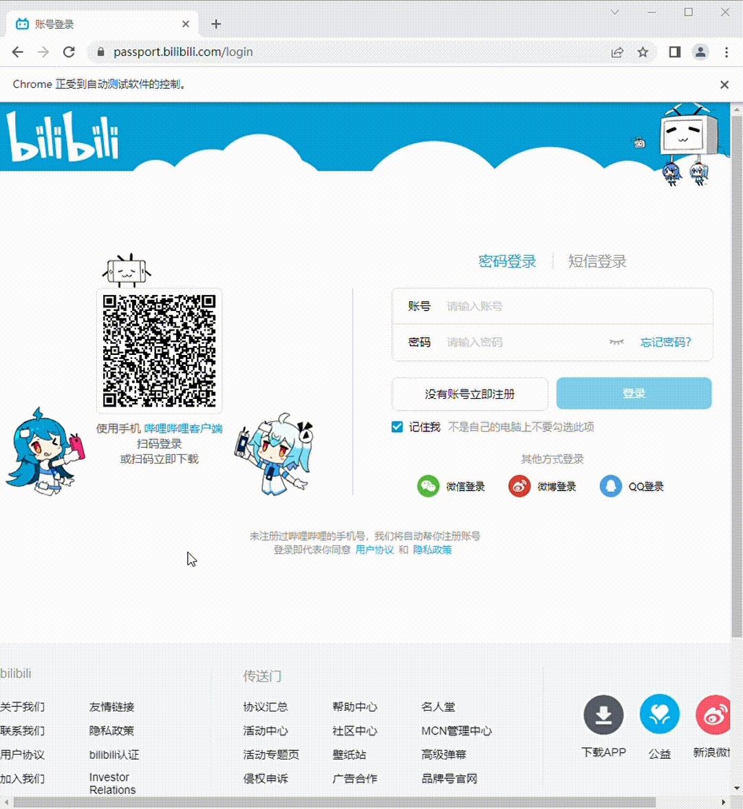

# 一、VL大模型

## 1.1 定义

**视觉-语言大模型**（Vision-Language Models, VLMs）从本质上来说就是给大语言模型（LLM）加上了一双眼睛，让LLM能有感知视觉的能力，是结合视觉（图像/视频）和语言（文本）处理能力的多模态人工智能模型，能够理解并生成与视觉内容相关的自然语言。

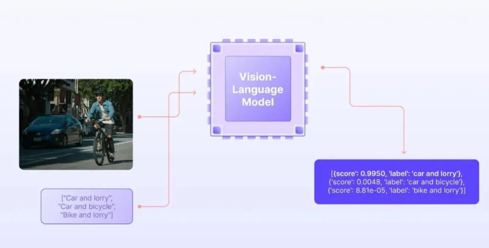

## 1.2 核心组件

- **视觉编码器**：负责提取图像特征
- **语言编码器/解码器**：处理文本信息
- **跨模态融合模块**：实现视觉和语言特征的深度融合

VL模型作为视觉模型和自然语言模型的融合，它接收图像及其相应的文本描述作为输入。 这类模型不仅能够解释视觉内容，还能生成相关的自然语言描述，实现真正的多模态交互。

## 1.3 大模型理解图像的流程

其实VLM的原理和LLM是一样的，都是把用户的输入通过embedding转换成tokens输入到模型进行计算

VL大模型之所以能理解图片，本质上是通过**深度神经网络提取视觉特征**，**投影层实现跨模态对齐**，**大语言模型进行语义融合和推理**的三步走策略。它不是真的"看"图片，而是通过数学向量在高维空间中建立视觉和语言的对应关系，从而实现对图像内容的理解和描述。

### 1.3.1 图像预处理阶段

当一张图片输入到VL大模型时，首先会经过标准化处理：

- 调整尺寸（通常为224×224或448×448像素）
- 归一化像素值
- 分割成固定大小的图像块（patches）

### 1.3.2 特征提取阶段

视觉编码器对预处理后的图像进行深度特征提取：

- **低层特征**：边缘、纹理、颜色等基础视觉信息
- **中层特征**：物体部件、简单形状等
- **高层特征**：语义信息、物体类别、场景理解等
- **空间关系**：通过自注意力机制捕捉图像中不同区域之间的关系 

### 1.3.3 跨模态对齐阶段

这是VL大模型理解图像的核心机制：

**特征空间对齐**：

- 视觉特征和文本特征被映射到同一个语义空间
- 例如，当看到"狗"这个词和一张狗的图片时，它们的向量表示在空间中会很接近
- 这种对齐是通过对比学习等训练方法实现的 

**语义理解融合**：

- 投影后的视觉token和文本token一起输入到大语言模型
- LLM通过自注意力机制同时处理视觉和语言信息
- 模型能够建立"图像区域-文本描述"之间的细粒度对应关系 

## 1.4 图解各个部分处理流程

### 1.4.1 图像预处理阶段

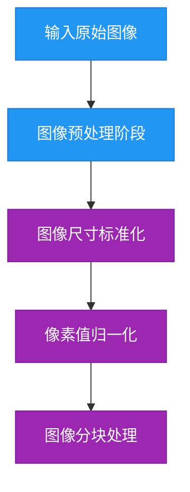

### **1.4.2视觉特征提取阶段**

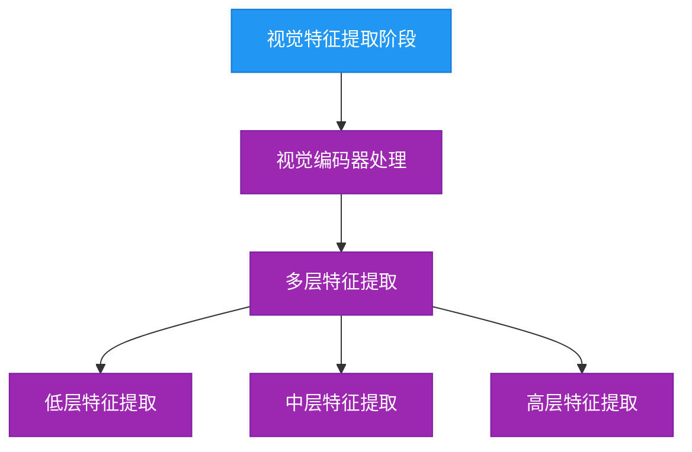

### 1.4.3 **跨模态对齐阶段**

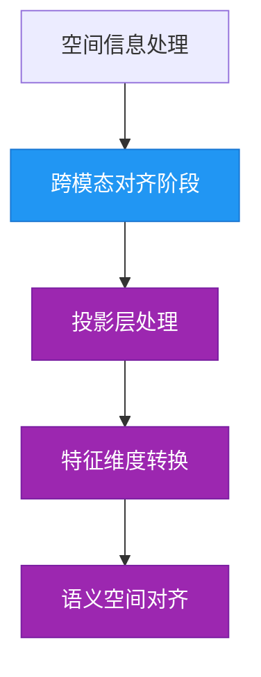

### 1.4.4  **多模态融合与输入构建阶段**

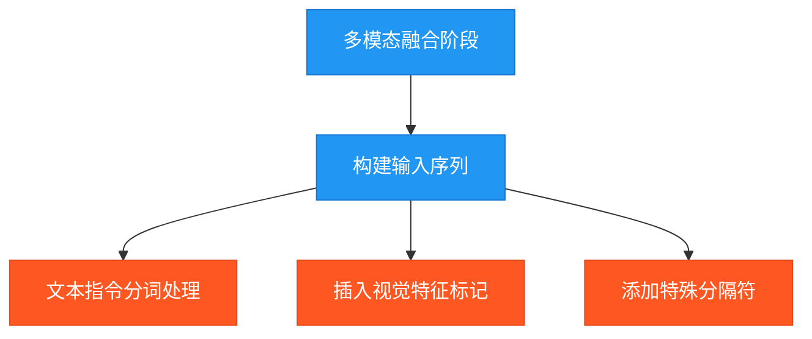

### 1.4.5**大语言模型处理与推理阶段**

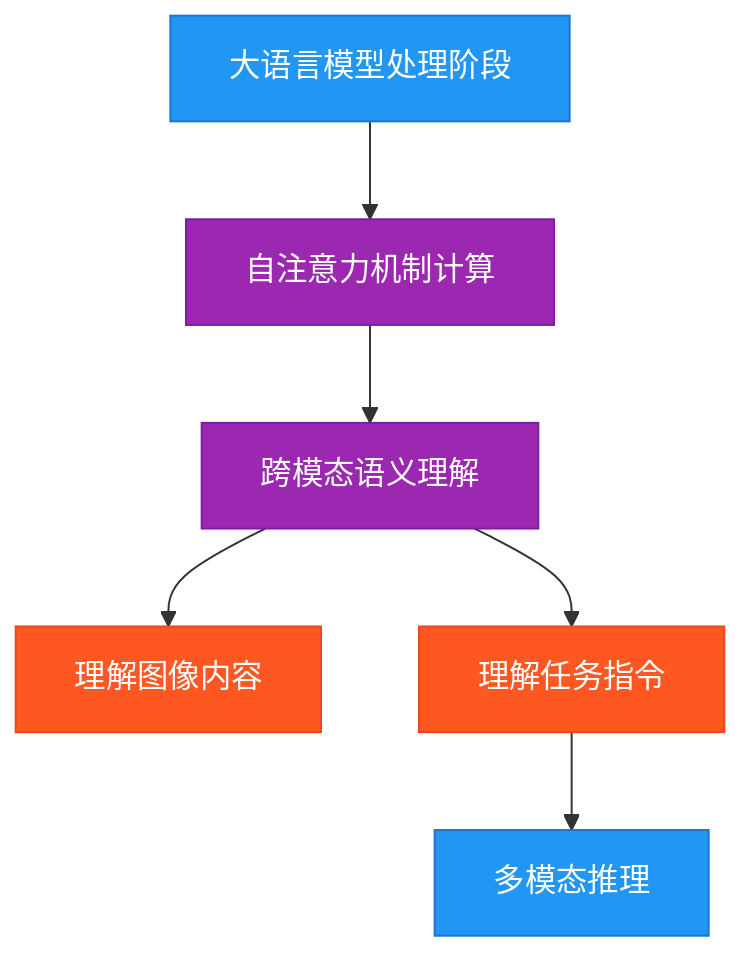

在此基础上，可以使用VLM来帮助程序判断识别，例如应该将滑块移动到移动到哪个位置，或者在进行汉字点选时应该按照什么顺序，点击什么位置

## 1.5 常见人工验证方式

### 1.5.1 简单点击验证

没有其他的验证操作，直接点击对应区域即可，可以直接交由PlayWright来操作

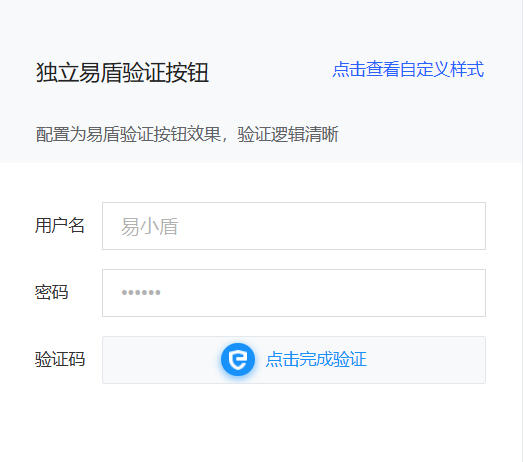

### 1.5.2 拖动滑块验证

平移拼图

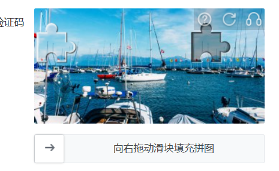

拖动滑块后拼图会转动

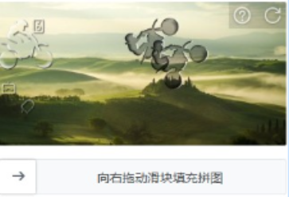

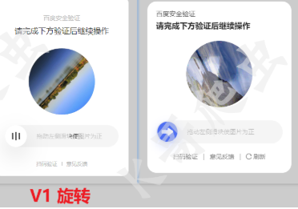

#### 两个思路：OpenCV，VLM

第一个思路：**使用OpenCV进行模式识别，可以直接按照滑块的形状和缺口中的形状来进行匹配，从而判断滑块应该移动多少像素位置**

实现方法：从网页HTML中找到构成滑块验证的两个部分：滑块和带缺口的背景图，使用下面代码**进行模版匹配并逐像素比较每个位置的相似度**（offset = 背景中最匹配滑块缺口的左上角横坐标），匹配位置的 **x 坐标（max_loc[0]）** 就是滑块验证码所需的 **移动像素偏移量**。

```python
import cv2
import numpy as np

def find_slide_offset(background_path, slide_path, visualize=True):
    # 读取图像
    background = cv2.imread(background_path, cv2.IMREAD_GRAYSCALE)
    slide = cv2.imread(slide_path, cv2.IMREAD_UNCHANGED)  # 保留透明通道

    if background is None:
        raise FileNotFoundError(f"背景图 {background_path} 无法读取！")
    if slide is None:
        raise FileNotFoundError(f"滑块图 {slide_path} 无法读取！")

    # 如果滑块图有 Alpha 通道，提取前景部分
    if slide.shape[2] == 4:
        bgr = slide[:, :, :3]
        alpha = slide[:, :, 3]
        _, mask = cv2.threshold(alpha, 1, 255, cv2.THRESH_BINARY)
        slide_gray = cv2.cvtColor(bgr, cv2.COLOR_BGR2GRAY)
    else:
        slide_gray = cv2.cvtColor(slide, cv2.COLOR_BGR2GRAY)
        mask = np.ones_like(slide_gray) * 255

    # 转灰度
    bg_gray = background

    # 二值化并裁剪滑块右侧空白部分
    slide_binary = cv2.threshold(slide_gray, 0, 255, cv2.THRESH_BINARY + cv2.THRESH_OTSU)[1]
    cols = np.any(slide_binary, axis=0)
    if np.any(cols):
        rightmost = np.max(np.where(cols))
        crop_width = max(5, rightmost)
        slide_cropped = slide_gray[:, :crop_width]
        mask_cropped = mask[:, :crop_width]
    else:
        slide_cropped = slide_gray
        mask_cropped = mask

    # 边缘检测
    bg_edge = cv2.Canny(bg_gray, 100, 200)
    slide_edge = cv2.Canny(slide_cropped, 100, 200)

    # 模板匹配
    result = cv2.matchTemplate(bg_edge, slide_edge, cv2.TM_CCOEFF_NORMED)
    _, max_val, _, max_loc = cv2.minMaxLoc(result)
    offset = max_loc[0]

    # ====== 可视化结果 ======
    if visualize:
        bg_color = cv2.imread(background_path)  # 用彩色背景做显示
        slide_rgb = cv2.imread(slide_path, cv2.IMREAD_UNCHANGED)
        if slide_rgb.shape[2] == 4:
            # 分离通道
            slide_bgr = slide_rgb[:, :, :3]
            alpha = slide_rgb[:, :, 3] / 255.0
            h, w = slide_bgr.shape[:2]
            y, x = max_loc[1], max_loc[0]

            # 将滑块叠加到背景上
            overlay = bg_color.copy()
            for c in range(3):
                overlay[y:y+h, x:x+w, c] = (
                    alpha * slide_bgr[:, :, c] +
                    (1 - alpha) * overlay[y:y+h, x:x+w, c]
                )
        else:
            overlay = bg_color.copy()
            h, w = slide_rgb.shape[:2]
            y, x = max_loc[1], max_loc[0]
            overlay[y:y+h, x:x+w] = slide_rgb

        # 绘制矩形框显示匹配位置
        cv2.rectangle(overlay, max_loc, (max_loc[0] + slide_cropped.shape[1],
                                         max_loc[1] + slide_cropped.shape[0]),
                      (0, 255, 0), 2)
        cv2.imshow("show", overlay)
        cv2.waitKey(0)
        cv2.destroyAllWindows()

    return offset, max_val, slide_cropped.shape[1]


# ===== 使用你的文件 =====
try:
    offset, confidence, used_width = find_slide_offset("cv_1.png", "cv_2.png")
    print(f"✅ 滑动像素（偏移量）: {offset}")
    print(f"🔍 匹配置信度: {confidence:.3f}")
    print(f"✂️ 滑块实际匹配宽度: {used_width} 像素")

except Exception as e:
    print(f"❌ 错误: {e}")

```

缺陷：对于**带旋转的滑块验证，这种逐一比对的方法就不适用了**，因为此方法只能固定从左到右去平移来匹配（当然可以考虑在平移过程中加上旋转，但是这样如果后面有其他情况有需要考虑代码修改），因此下面提出第二种方法：使用大模型来判断滑块是否滑动到位

第二个思路：**使用VLM+提示词，当用户每次滑动一段距离，进行页面截图传回给VLM，由VLM来判断是否到位，针对性的进行微调**，这样能够适应大部分滑块验证场景，不用考虑旋转等问题

简单在[Qwen](https://chat.qwen.ai/)中示例：

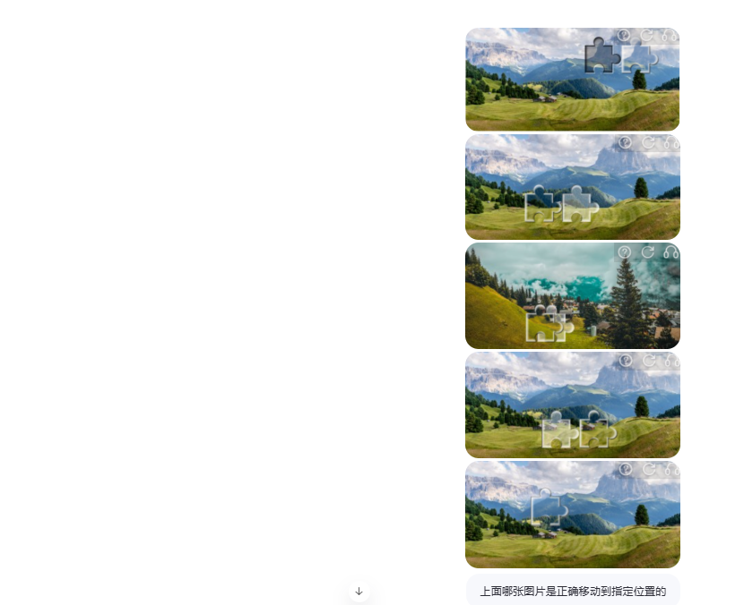

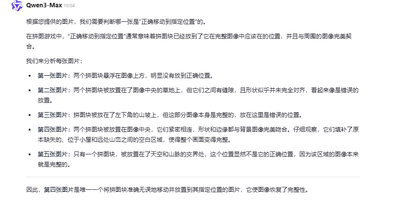

### 1.5.3 点选文字验证

按照顺序点选

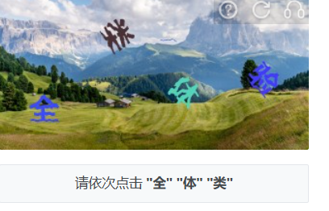

按照能否组成四字成语点选

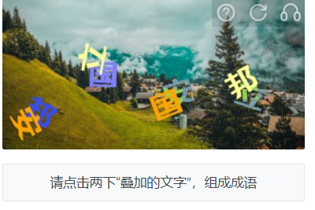

**对于点选式验证码的问题，我们可以将其拆解为两个小问题：**

**1、确定需要点击的字的数量和位置：** 对于点选式验证码，准确识别和定位需要点击的字的数量和位置是解决问题的关键。   其中，一种常见的目标检测算法是 YOLO，通过标注数据集和训练模型，可以实现对需要点击的字进行准确识别和定位。

**2、对点击的字进行排序：** 在确定出需要点击的字的位置后，需要按照一定的规则对这些字进行排序。采用传统的方案是通过识别图片中的文字，然后按照文字位置进行排序，但这种方法训练困难。因此，本项目采用了图片匹配模型，使用 Siamese 孪生网络对需要点击的字与预先准备好的字库中的字进行匹配，找到最佳匹配的字，并按照一定的规则进行排序。Siamese 孪生网络在图像匹配方面表现优异，能够有效地提高排序的准确性和稳定性。

#### **尝试用三种方案来实现：OCR、VLM、YOLO**+Siamese孪生网络

**OCR（失败）：**

OCR能识别文字，是因为它通过图像预处理提升文字清晰度，再利用文本检测定位图像中的文字区域，接着通过字符分割（或端到端深度学习模型）将图像中的字符转化为机器可理解的特征，最后借助分类器或神经网络识别出对应的文字，并结合语言模型进行后处理纠错，从而实现从图像到可编辑文本的转换。

由于复杂的背景和颜色融合综合程度较深，OCR无法有效提取到文本进行后续操作，导致识别失败

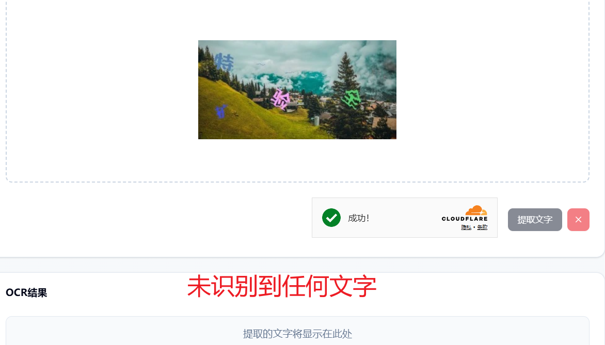

**VLM（成功，但是仍然会存在识别不出来或者坐标偏差大的情况）：**

使用VLM＋提示词，将识别目标坐标以json格式输出，再后续操作进行解析即可操作

调整  "temperature": 0,"top_k": 1两个参数，保障每次输出结果稳定

优化方案：通过修改提示词可以优化识别效果，但是不同场景下同一套提示词可能效果偏差会比较大

```python
import base64
import json
import re
import requests
from PIL import Image, ImageDraw, ImageFont
import matplotlib.pyplot as plt
import os

# === 配置区 ===
API_KEY = "sk---qyjg"
MODEL_NAME = "Qwen/Qwen2.5-VL-32B-Instruct"
API_URL = "https://api.siliconflow.cn/v1/chat/completions"  # 修正：删除末尾空格

def image_to_base64(image_path):
    with open(image_path, "rb") as f:
        return base64.b64encode(f.read()).decode("utf-8")

def parse_json_fallback(text):
    try:
        return json.loads(text)
    except json.JSONDecodeError:
        pass

    pattern = r'\{\s*"text"\s*:\s*"([^"]*)"\s*,\s*"x"\s*:\s*(\d+\.?\d*)\s*,\s*"y"\s*:\s*(\d+\.?\d*)\s*\}'
    matches = re.findall(pattern, text)
    if matches:
        return [
            {"text": m[0], "x": float(m[1]), "y": float(m[2])}
            for m in matches
        ]
    return []

def recognize_click_captcha(image_path):
    base64_image = image_to_base64(image_path)

    headers = {
        "Authorization": f"Bearer {API_KEY}",
        "Content-Type": "application/json"
    }

    prompt = (
        "你是一个验证码识别系统。请仔细阅读图像下方的文字指令，并严格按照指令中要求的顺序，识别并返回对应文字的中心像素坐标（以图像左上角为原点）。\n"
        # "当前指令你需要自己在图中找寻找"
        "先确定上面图片的尺寸，然后用一个方框定位图片里所有中文字的位置，最后依次输出全 验 扩 三个字的位置。"
        "要求：\n"
        "1. 只输出 JSON 列表，不要任何解释。\n"
        "2. 每个元素包含 'text'（文字内容）、'x'（中心x坐标）、'y'（中心y坐标）。\n"
        "3. 坐标必须是数字，不要单位。\n"
        "4. 输出列表的顺序必须与指令中文字出现的顺序完全一致。\n"
        "示例输出：[{\"text\": \"全\", \"x\": 573.0, \"y\": 621.0}, {\"text\": \"来\", \"x\": 94.0, \"y\": 554.0}, {\"text\": \"库\", \"x\": 308.0, \"y\": 223.0}]"

    )

    payload = {
        "model": MODEL_NAME,
        "messages": [
            {
                "role": "user",
                "content": [
                    {"type": "text", "text": prompt},
                    {"type": "image_url", "image_url": {"url": f"data:image/png;base64,{base64_image}"}}
                ]
            }
        ],
        "temperature": 0,
        "top_k": 1
    }

    try:
        response = requests.post(API_URL, headers=headers, json=payload, timeout=30)
        response.raise_for_status()
        data = response.json()
        content = data["choices"][0]["message"]["content"].strip()
        result = parse_json_fallback(content)
        return result
    except Exception as e:
        print(f"[Error] Recognition failed: {e}")
        return []

def visualize_detections(image_path, detections):
    """
    在原图上绘制文字和坐标点，并弹窗显示（不保存）
    """
    image = Image.open(image_path).convert("RGB")
    draw = ImageDraw.Draw(image)

    # 尝试加载系统中文字体（避免乱码），若失败则用默认字体
    try:
        # 常见中文字体路径（按优先级尝试）
        font_paths = [
            "/System/Library/Fonts/PingFang.ttc",   # macOS
            "/usr/share/fonts/truetype/wqy/wqy-zenhei.ttc",  # Linux
            "C:/Windows/Fonts/msyh.ttc",            # Windows 微软雅黑
            "C:/Windows/Fonts/simsun.ttc",          # 宋体
        ]
        font = None
        for fp in font_paths:
            if os.path.exists(fp):
                font = ImageFont.truetype(fp, size=24)
                break
        if font is None:
            font = ImageFont.load_default()
    except:
        font = ImageFont.load_default()

    # 绘制每个检测结果
    for item in detections:
        x, y = item["x"], item["y"]
        text = item["text"]

        # 画一个红色圆点（半径5）
        draw.ellipse((x - 5, y - 5, x + 5, y + 5), fill="red", outline="red")

        # 在坐标上方绘制文字（白色带黑边，增强可读性）
        bbox = draw.textbbox((x, y - 30), text, font=font)
        # 黑边
        draw.text((x - 1, y - 31), text, fill="black", font=font)
        draw.text((x + 1, y - 31), text, fill="black", font=font)
        draw.text((x, y - 32), text, fill="black", font=font)
        draw.text((x, y - 30), text, fill="black", font=font)
        # 白色文字
        draw.text((x, y - 31), text, fill="white", font=font)

    # 使用 matplotlib 显示（避免 Pillow show() 在某些环境不弹窗）
    plt.figure(figsize=(10, 8))
    plt.imshow(image)
    plt.axis("off")
    plt.title("文字点选识别结果", fontsize=14)
    plt.tight_layout()
    plt.show()

# === 主程序 ===
if __name__ == "__main__":
    image_path = "world_1.png"
    if not os.path.exists(image_path):
        print(f"错误：图像文件 {image_path} 不存在！")
    else:
        detections = recognize_click_captcha(image_path)
        print("识别结果:")
        for item in detections:
            print(f"文字: {item['text']}, 坐标: ({item['x']:.1f}, {item['y']:.1f})")

        # 可视化（不保存）
        visualize_detections(image_path, detections)
```

可以看到虽然效果会比OCR提升很多，但是仍然存在偏差，考录还是背景太复杂的原因

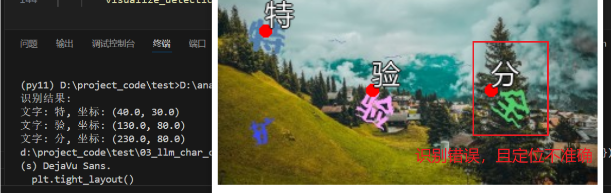

**YOLO+Siamese孪生网络（成功，且对一般目标效果较好）**

项目地址：[Text_select_captcha](https://github.com/MgArcher/Text_select_captcha)

**yolov5训练过程：**
训练流程一般包括如下几个步骤：获取训练数据集、数据预处理、模型选择、设置损失函数、反向传播和更新权值等。

**使用lambeling标注char和target**

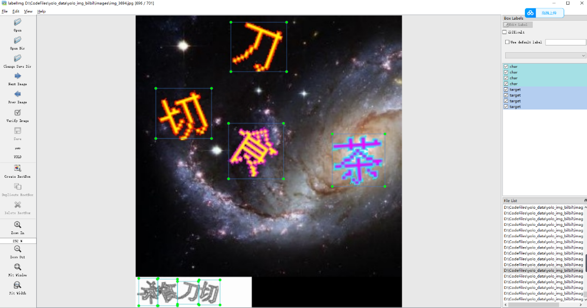

接下来是选择合适的模型。YOLO 系列模型有多个版本，可以根据不同的需求选择适合的版本。选择好模型后，需要设置损失函数和训练参数，进行模型训练。

**YOLO检测结果**

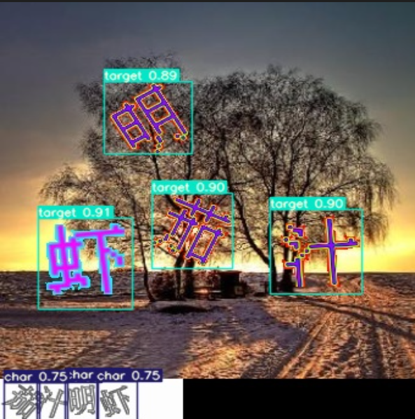

使用**孪生网络**进行图像检索任务的训练前，需要对数据集进行准备。与其他模型不同，**孪生网络的训练需要用到正负样本对，因此需要对数据集中的每张图像都生成一些与之匹配和不匹配的样本对。**

具体实现时，一般采用已经训练好的检测模型来生成样本对。

具体操作流程如下：首先，使用检测模型对数据集中的图像进行检测，截取出每个目标的图像片段；然后，把该图像片段分别与数据集中的其他目标进行匹配和不匹配的组合，形成匹配和不匹配的样本对；最后，根据样本对的匹配情况对其进行标注，将匹配和不匹配的样本对分别放到不同的文件夹中，按照类别和顺序标注好，方便后续使用。

**如下图所示，每张图像都会对应一个匹配和不匹配的样本对，每个样本对包含两张图像，分别作为孪生网络的输入。**

**孪生网络标注结果**

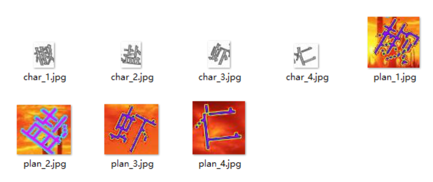

**孪生网络识别结果：**

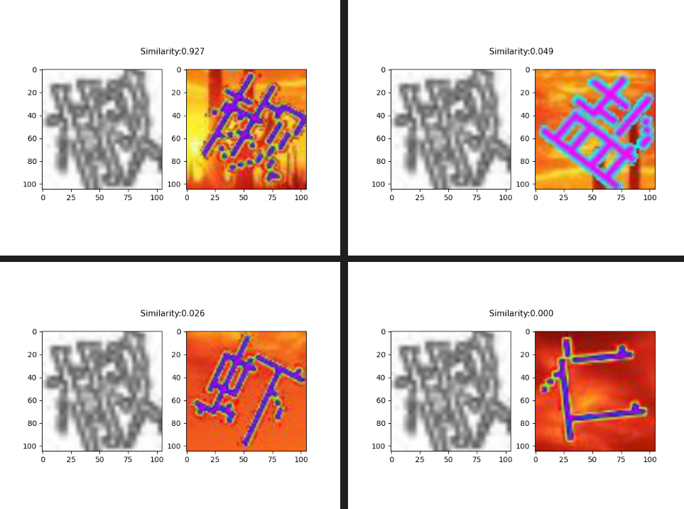

如图所示，**孪生网络输出的结果可以给出背景图中的目标与右下角的目标最相似的结果，而左下角的目标则可以通过按照左坐标进行排序来得到。由此，可以方便地得到背景图中所有目标的顺序。**

识别效果：

根据页面截图降低分辨率后仍然可以检测到目标，并且判断点击顺序

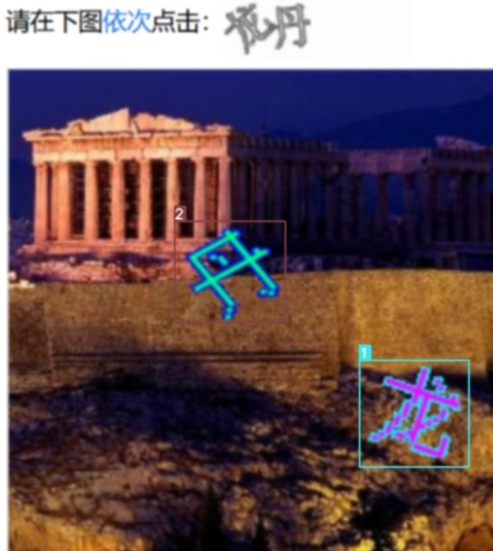

### 1.5.4 躲避障碍

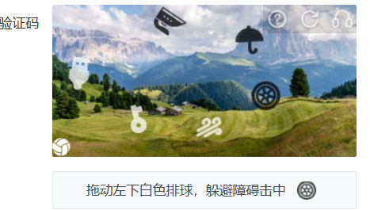

#### 实现方案：将图片转灰度+VLM+路径设计算法

首先调用多模态大模型对输入图像进行分析，**自动识别出其中所有与背景明显区分的漂浮图标**，并**输出每个图标的相对坐标、中心点和大小**；随后将识别结果转换为像素坐标，在图像上绘制标注。接着，程**序以左下角为起点、指定图标为目标点，利用人工势场法模拟小球运动，通过计算目标的吸引力和图标的排斥力，使小球在避开障碍物的同时逐步接近目标点，当到达目标区域后停止运动，最终生成带有路径轨迹的图像输出。**

```python
import requests
import base64
import json
import re
from PIL import Image, ImageDraw
import sys
import math


# ====================== 配置 ======================
API_KEY = "sk-mclrnhhztfcdhkjejcasedatzlxwadgcwodfhdsypzftqyjg"
BASE_URL = "https://api.siliconflow.cn/v1/chat/completions"
MODEL_NAME = "Qwen/Qwen2.5-VL-72B-Instruct"


# ====================== 工具函数 ======================
def image_to_base64(image_path):
    """读取图片并转为Base64"""
    with open(image_path, "rb") as f:
        return base64.b64encode(f.read()).decode("utf-8")


def ratio_to_pixel_coords(bbox_ratio, center_ratio, width, height):
    """
    严格按比例将 bbox_ratio 转换为像素坐标，
    同时返回中心点和包围框宽高。
    """
    x1 = int(round(bbox_ratio[0] * width))
    y1 = int(round(bbox_ratio[1] * height))
    x2 = int(round(bbox_ratio[2] * width))
    y2 = int(round(bbox_ratio[3] * height))
    cx = int(round(center_ratio[0] * width))
    cy = int(round(center_ratio[1] * height))
    w_px = x2 - x1
    h_px = y2 - y1
    return (x1, y1, x2, y2, cx, cy, w_px, h_px)


# ====================== 核心提示词 ======================
prompt_text = """
你是一名专业的图像分析专家。你的任务是识别图片中所有**漂浮的图标（与背景明显区分的封闭形状）**，并输出它们的相对位置与大小。

请严格按照以下步骤执行：

1. **识别所有图标：**
   - 扫描整张图片，检测出所有独立的、边界清晰的漂浮图标。
   - 图标颜色可能是白色或者黑色，必须与背景有显著的对比（如亮度或颜色差异）。
   - 图标必须是封闭形状，且与背景在纹理或色彩上明显区分。
   - 排除非独立对象。背景中的非图标元素，尤其是结构性元素，任何其他可能与图标混淆的区域。
   - 为每个有效图标生成唯一标识符（icon_1, icon_2, …），按从左到右、从上到下的顺序排序。

2. **计算每个图标的比例坐标与大小：**
   - bbox_ratio: [x1, y1, x2, y2]   # 图标包围盒左上角与右下角的比例坐标（范围 0~1）
   - center_ratio: [cx, cy]         # 图标中心点的准确比例坐标（范围 0~1）
   - size_ratio: [w, h]             # 包围盒的宽高比例（w = x2 - x1，h = y2 - y1）
   - 坐标的精度必须准确到小数点后至少四位。
   - 所有坐标与尺寸都应基于整张图片的宽高计算。

3. **排除干扰因素：**
   - 请确保仅识别漂浮的图标，排除背景中的非图标元素，尤其是结构性元素，如树木、建筑或任何其他可能与图标混淆的区域。

4. **输出要求：**
   - 仅输出标准 JSON 格式。
   - 不要输出任何说明、注释或多余文字。
   - 输出格式必须严格如下：

{
  "icons": [
    {
      "id": "icon_1",
      "bbox_ratio": [x1, y1, x2, y2],
      "center_ratio": [cx, cy],
      "size_ratio": [w, h]
    },
    {
      "id": "icon_2",
      "bbox_ratio": [x1, y1, x2, y2],
      "center_ratio": [cx, cy],
      "size_ratio": [w, h]
    }
  ]
}
"""


# ====================== 主执行逻辑 ======================
if __name__ == "__main__":
    # 1️⃣ 获取输入图片路径
    IMAGE_PATH = sys.argv[1] if len(sys.argv) > 1 else "preprocessed.png"

    # 2️⃣ 加载原图
    original_img = Image.open(IMAGE_PATH).convert("RGB")
    width, height = original_img.size
    print(f"✅ 已加载原图，尺寸为: {original_img.size}")

    # 3️⃣ 构造请求
    messages = [{
        "role": "user",
        "content": [
            {"type": "text", "text": prompt_text},
            {"type": "image_url", "image_url": {"url": f"data:image/png;base64,{image_to_base64(IMAGE_PATH)}"}}
        ]
    }]
    headers = {"Authorization": f"Bearer {API_KEY}", "Content-Type": "application/json"}
    payload = {"model": MODEL_NAME, "messages": messages, "temperature": 0.0, "top_k": 1}

    # 4️⃣ 发送请求
    response = requests.post(BASE_URL, headers=headers, json=payload)
    if response.status_code != 200:
        print(f"❌ 请求失败：{response.status_code} - {response.text}")
        sys.exit(1)

    # 5️⃣ 解析响应
    raw_answer = response.json()["choices"][0]["message"]["content"]
    print("模型原始输出：\n", raw_answer)

    match = re.search(r"\{.*\}", raw_answer, re.S)
    if not match:
        print("❌ 未检测到有效的JSON内容。")
        sys.exit(1)
    answer = match.group(0)

    try:
        data = json.loads(answer)
    except json.JSONDecodeError as e:
        print("❌ JSON解析失败:", e)
        print("清理后内容:", repr(answer))
        sys.exit(1)

    # 6️⃣ 提取关键数据
    icons = data.get("icons", [])
    if not icons:
        print("❌ 未检测到任何图标。")
        sys.exit(1)

    print(f"✅ 检测到 {len(icons)} 个图标。")

    # 7️⃣ 绘制检测结果
    draw = ImageDraw.Draw(original_img)
    results = []

    for icon in icons:
        bbox_ratio = icon.get("bbox_ratio")
        center_ratio = icon.get("center_ratio")
        if not bbox_ratio or not center_ratio:
            continue

        # 转换为像素坐标
        x1, y1, x2, y2, cx, cy, w_px, h_px = ratio_to_pixel_coords(bbox_ratio, center_ratio, width, height)

        # 绘制矩形与中心点
        draw.rectangle([(x1, y1), (x2, y2)], outline="lime", width=3)
        draw.ellipse([(cx - 4, cy - 4), (cx + 4, cy + 4)], fill="blue", outline="white", width=1)

        # 保存结果
        results.append({
            "id": icon.get("id"),
            "center_pixel": [cx, cy],
            "bbox_pixel": [x1, y1, x2, y2],
            "size_pixel": [w_px, h_px]
        })

    # 8️⃣ 输出最终结果
    print("\n================= 最终结果 =================")
    print(json.dumps(results, ensure_ascii=False, indent=2))

    # 9️⃣ 保存标注图
    output_path = "annotated_" + IMAGE_PATH
    original_img.save(output_path)
    print(f"✅ 标注完成！结果已保存为: {output_path}")
    original_img.show()


# ====================== 避障路线模拟 ======================
def simulate_safe_path(img, icons, step_size=8, max_steps=2000):
    """
    模拟小球从左下角移动到第三个目标点，尽可能避开障碍物。
    使用人工势场法（Potential Field）。
    """
    width, height = img.size
    draw = ImageDraw.Draw(img)

    if len(icons) < 3:
        print("❌ 无法获取第三个目标点！")
        return

    # === 定义起点与目标 ===
    sx, sy = width * 0.05, height * 0.95   # 左下角起点
    gx, gy = icons[2]["center_pixel"]       # 目标点
    path = [(sx, sy)]

    # === 势场参数 ===
    K_att = 1.2e-3         # 吸引力系数
    K_rep = 5e2            # 排斥力系数
    influence_radius = 80  # 障碍物影响半径

    # === 设置到达判定阈值（越小越精确）===
    goal_threshold = 2    # 小球与目标距离小于此值时认为到达

    for step in range(max_steps):
        # 吸引力
        dx = gx - sx
        dy = gy - sy
        dist_goal = math.hypot(dx, dy)

        # ✅ 如果小球到达目标附近，立即停止
        if dist_goal <= goal_threshold:
            print(f"✅ 已到达目标区域（步数 {step}，剩余距离 {dist_goal:.2f} 像素）！")
            break

        fx = K_att * dx
        fy = K_att * dy

        # 排斥力（避障）
        for icon in icons:
            x1, y1, x2, y2 = icon["bbox_pixel"]
            cx = (x1 + x2) / 2
            cy = (y1 + y2) / 2
            dist = math.hypot(sx - cx, sy - cy)
            if dist < influence_radius and dist > 1:  # 避免除0
                rep = K_rep * (1.0 / dist - 1.0 / influence_radius) / (dist ** 2)
                fx += rep * (sx - cx)
                fy += rep * (sy - cy)

        # 更新位置
        norm = math.hypot(fx, fy)
        if norm == 0:
            print("⚠️ 力场平衡，停止移动。")
            break

        sx += step_size * fx / norm
        sy += step_size * fy / norm

        # 防止越界
        sx = max(0, min(width - 1, sx))
        sy = max(0, min(height - 1, sy))
        path.append((sx, sy))

    # === 绘制轨迹 ===
    for i in range(len(path) - 1):
        draw.line([path[i], path[i + 1]], fill="cyan", width=3)

    # 起点终点标注
    draw.ellipse([(path[0][0] - 6, path[0][1] - 6), (path[0][0] + 6, path[0][1] + 6)], fill="blue")
    draw.ellipse([(gx - 6, gy - 6), (gx + 6, gy + 6)], fill="red")

    img.save("path_simulated.png")
    img.show()
    print(f"✅ 路线模拟完成，共 {len(path)} 步，结果保存为 path_simulated.png")


# ====================== 执行避障路线模拟 ======================
simulate_safe_path(original_img, results)

```

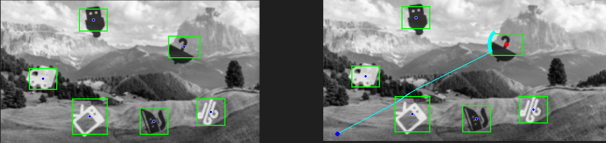

