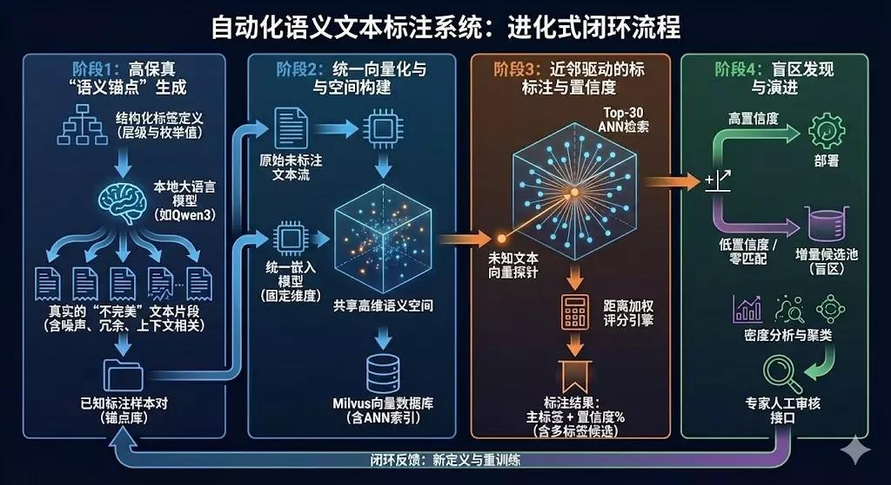
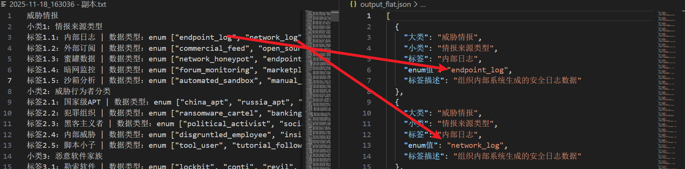
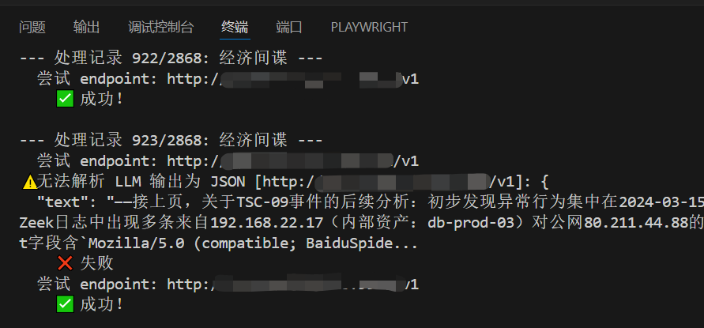
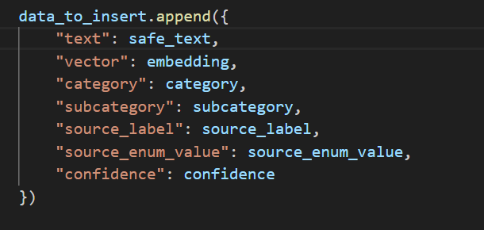
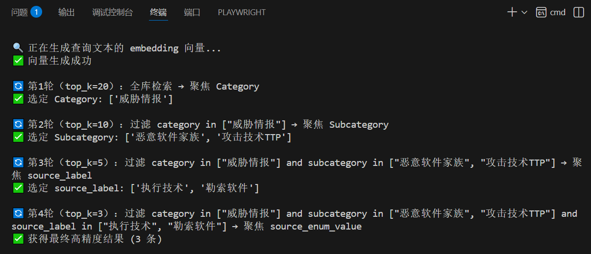
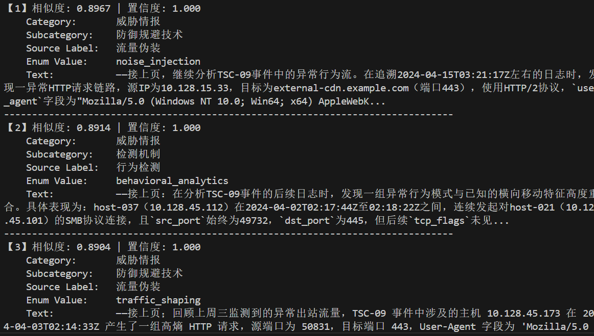
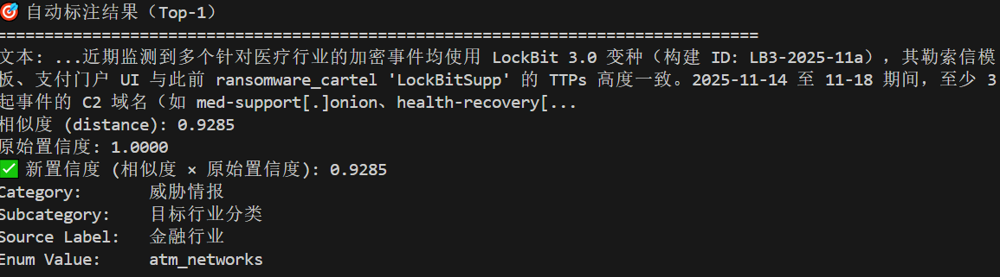
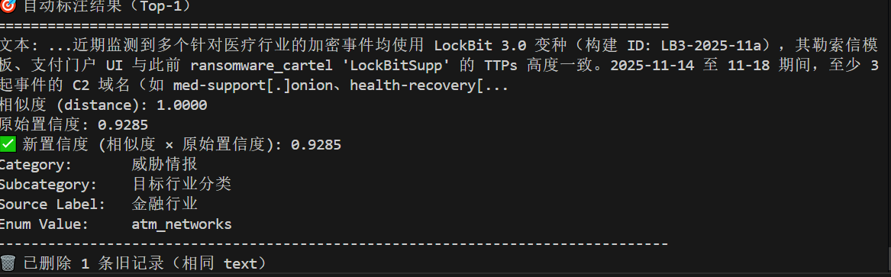

# 前言

在网络安全运营中，安全团队每天要处理大量非结构化的文本信息，包括告警日志、威胁情报、工单描述等，这些内容往往语言表达多样、标签层级复杂，传统依赖规则或监督学习的方法难以高效应对。本系统聚焦于解决实际运营中几类典型问题：例如自动识别一段文本是否来自外部研究机构的情报，判断其中是否描述了特定攻击手法，并能将其准确归入“威胁情报 → 情报来源类型 → 外部订阅 → research_feed”这样的嵌套标签路径中，从而支撑后续研判、归因与响应。

目前系统仍有不少问题尚未覆盖：

- 生成样本的质量受限于大模型提示词的单一性，可能存在事实错误或语义偏差；
- 置信度评估机制较为简化，对边界模糊或语义接近但标签不同的情况缺乏可靠的不确定性判断能力。

该系统的设计遵循以下流程，总的概括为几个步骤：

- 调用大模型接口**生成初始文本切片以及标注数据**
- 将切片数据**embedding**后连同原文本和标签一同存入Milvus数据库
- **基于ANN**对用户输入的结构化标签进行**四层分层检索策略**
- 将检索后返回的**最相似的文本标签作为输入切片的标签**
- 计算新标签的置信度**confidence**
- 将新数据存入数据库



# 一、原始向量数据库制作

## 1.1 解析

将原始标签分类数据结构化解析成json文件，方便后续批量对大模型组织用户请求



## 1.2 生成

调用大模型接口，结合修改后的提示词，为每个标签下的数据类型生成文本切片（由于这里一共需要对2868条enum各生成10条文本切片，耗费时间较长，这里只做了第一个大类【威胁情报】的enum生成切片数据，后续可继续添加）



## 1.3 清洗

对生成过程中错误提取的乱码进行清洗整理，切片数据示例（清洗后）：

```json
  {
    "text": "...research_feed（来自 Mandiant 博客 'Observed in the Wild: FIN7 Evolution Q4 2025'）指出，新变种 FIN7.4 使用合法 CI/CD 工具链作为初始载体，通过污染公共示例仓库诱导开发者复制恶意 curl 命令——这直接呼应了我们 GitLab pipeline #8872 事件。文中特别提到 payload.sh 会检查 /proc/cpuinfo 中的 'hypervisor' 字段以规避沙箱，与我们沙箱执行无网络行为的现象一致。此外，research_feed 提供了 JA3 指纹（76e6c7a8d0f8...）用于识别 C2，但我们 network_log 中因连接被防火墙 RST 未能提取完整 TLS Client Hello。另，文中称攻击者偏好使用实习转正过渡期员工账号（因其权限审查宽松），而 intern_dev 正处于该状态。然而，Mandiant 未披露 payload.sh 的完整 C2 IP 或域名，仅给出模糊描述 'abuse of public CDNs'。是否可据此确认归因？暂时不能——但 research_feed 提供的 TTPs（T1195.002 - Supply Chain Compromise via Code Repo）极大提升了事件严重性。建议：1）扫描所有 .gitlab-ci.yml 中的外部 curl；2）强制所有实习生账号启用 MFA。需与王工确认 intern_dev 是否访问过 Mandiant 文中提及的 GitHub 组织（'devsecops-demos'）。",
    "category": "威胁情报",
    "subcategory": "情报来源类型",
    "source": {
      "label": "外部订阅",
      "enum_value": "research_feed"
    },
    "confidence": 1
  },
```

## 1.4 Embedding

对text进行1024维的embedding，为方便存取，存入的元数据字段如下所示



# 二、对输入的文本切片进行检索

## 2.1 ANN（近似最近邻） 原理

### 2.1.1**检索目标**

*在海量高维向量库 {*v*_1,...,*v_n*} 中，快速找出与查询向量 *q* 最相似的 Top-K 向量。

常用下面三种距离进行相似性度量

- **欧氏距离（L2）**：适合归一化后的物理距离比较。
- **内积（Dot Product）**：常见于深度学习 Embedding。
- **余弦相似度**：方向相似性，常通过 **L2归一化 + 内积** 实现。

### 2.1.2 代表算法

| 类别               | 简述                                         | 代表算法              |
| ------------------ | -------------------------------------------- | --------------------- |
| 空间划分法         | 将向量空间划分为子区域，只在相关区域中搜索   | IVF、Annoy            |
| 量化法             | 将向量压缩为紧凑码字，通过查表近似计算距离   | PQ、OPQ               |
| 图索引法           | 构建近邻图，通过图遍历快速导航至最近邻       | HNSW、NSG             |
| 局部敏感哈希 (LSH) | 使用特殊哈希函数使相似向量落入相同或相近桶中 | LSH（如随机投影哈希） |
| 混合方法           | 结合多种技术优势，提升整体性能               | IVF-PQ、HNSW+PQ       |

### 2.1.3 HNSW

Milvus支持使用HNSW检索，这是一种基于图索引的方法，HNSW 的查询过程**采用自上而下的分层贪心搜索**策略：从最顶层（稀疏图）的入口点开始，利用小世界图的短路径特性**快速定位查询向量 q 的粗略近邻**；随后逐层向下，**在每一层以当前层找到的最近邻作为起点，继续在更密集的下一层图中执行贪心搜索**；整个过程中维护一个大小为 efSearch 的动态候选集，确保搜索广度与精度的平衡；最终在最底层（包含所有数据点）返回与 q 最相似的 Top-K 个向量。

关键参数：

- **M**：每个节点的最大邻居数（影响图密度与内存）。
- **efConstruction**：构建时的动态候选集大小（影响构建质量和索引精度）。
- **m_L**：层间衰减因子（控制高层稀疏程度）。


## 2.2 **分层（Hierarchical）检索策略**

整个 `hierarchical_search` 函数分为 **4轮检索**，每一轮聚焦一个字段（元数据维度）：

1. **Category（类别）**
2. **Subcategory（子类）**
3. **source_label（来源标签）**
4. **source_enum_value（来源枚举值）**

每轮都基于前一轮选出的高置信度值构建过滤条件，实现“聚焦”。

### 2.2.1 加权策略：

1. **取置信度**：从每条检索结果中提取 `confidence` 字段作为原始权重。
2. **归一化**：使用 Min-Max 方法将置信度缩放到 [0, 1] 区间（若所有值相同则设为等权重）。
3. **按字段累加**：对同一字段值（如相同的 `category`）对应的所有归一化权重求和。
4. **排序选优**：按总权重从高到低排序，取**前2个**作为下一轮的过滤条件。

### 2.2.2 **第1轮：Category 聚焦（全局粗筛）**

- **检索范围**：全库（无过滤）
- **目标字段**：`category`

### 2.2.3 **第2轮：Subcategory 聚焦（Category 内细化）**

- **检索范围**：仅限第1轮选出的 category
- **目标字段**：`subcategory`

### 2.2.4 **第3轮：source_label 聚焦（来源标签筛选）**

- **检索范围**：限定 category + subcategory
- **目标字段**：`source_label`

### 2.2.5 **第4轮：source_enum_value 聚焦（最终精准匹配）**

- **检索范围**：限定前三层所有字段
- **目标字段**：`source_enum_value`（通常为具体值或ID）



### 2.2.6 检索结果示例



# 三、对输入切片进行标注和存储

## 3.1 取检索到的top_1确定最终标签作为最终结果

```python
# 从参考样本中直接提取标签
metadata = {
    "category": ent.get('category', 'N/A'),
    "subcategory": ent.get('subcategory', 'N/A'),
    "source_label": ent.get('source_label', 'N/A'),
    "source_enum_value": ent.get('source_enum_value', 'N/A'),
    "confidence": new_confidence 
}
```

## 3.2 计算最终置信度

**新置信度 = 语义相似度 × 参考样本原始置信度** 

## 3.3 将新数据写入 Milvus

**写入前先删除已存在的相同 `text` 记录**（防止重复）

### **结果示例：**

第一次检索



第二次检索（与第一次输入相同文本）

**注意：第二次输入相同文本，不会对原始置信度产生影响，因为这里语义相似度为1**



# 五、场景和应用

该系统主要应用于**标签体系复杂、标注数据稀缺且需快速响应的场景**，可自动识别并结构化标注情报来源类型（如 `research_feed`）、攻击手法（TTPs）、数据可信度等多层级标签；其基于大模型生成示例、结合 HNSW 向量检索与四层分层过滤策略，无需训练即可实现语义鲁棒的零样本标注，并支持通过更新向量库动态扩展知识，适用于安全运营、情报归因、工单分类等需要嵌套标签和持续迭代的智能标注任务。

# **六、优势与不足**

## **5.1 优势**

- 该系统最大优势在于**完全绕过了传统监督学习所需的模型训练流程**。
- 系统设计的**四层分层检索策略**（category → subcategory → source_label → source_enum_value）能够适配复杂、嵌套的标签体系，避免了传统方法中因标签扁平化导致的类别爆炸或级联分类带来的误差累积问题。
- 由于标注逻辑完全由数据库内容驱动，系统支持**动态增量更新**：只需增删或修正库中样本，即可即时影响后续预测结果，无需重新训练模型，极大提升了维护灵活性与响应速度。在语义层面，HNSW 图索引系统对同义表达、句式变换、术语替换等语言多样性具备良好的鲁棒性，显著优于基于关键词匹配或浅层特征的传统检索或分类方法。

## **5.2 不足**

- 其标注质量**高度依赖大语言模型的生成能力**。当前仅针对“威胁情报”这一大类完成了文本切片生成（共 2868 个 enum 值，仅覆盖部分）
- 且生成过程使用相对固定的提示词模板，可能导致样本多样性不足、语义偏差甚至事实性错误（如幻觉内容），进而影响后续检索的准确性。
- 当前的置信度计算逻辑较为简化——仅将语义相似度与参考样本原始置信度相乘，未引入多结果融合、上下文一致性校验或不确定性量化等更精细的评估机制，在边界案例或低质量参考样本存在时，可能给出误导性的高置信度预测。
