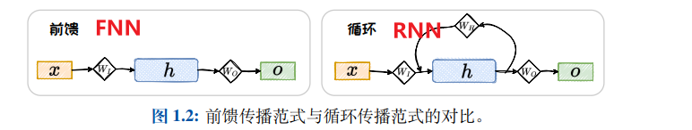
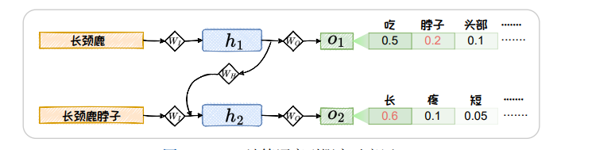
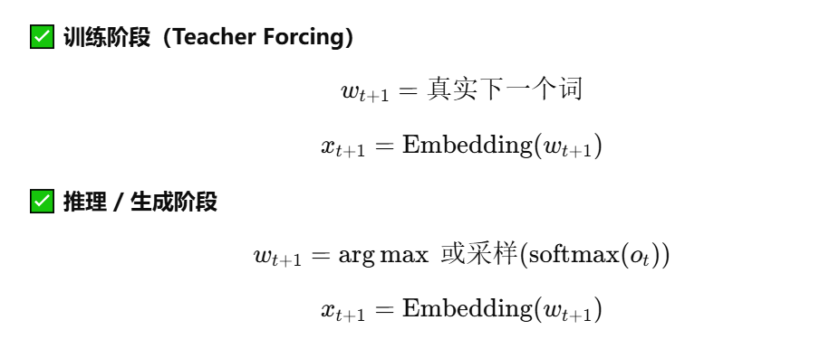
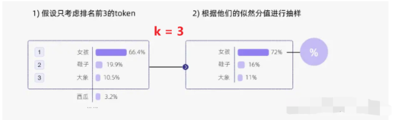
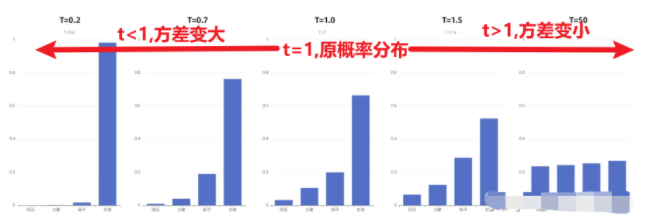

# 前言

语言是由音韵、词法和句法构成的复杂符号系统，其核心特征是具有不确定性，因此**语言模型（LMs）的本质在于准确预测符号的概率**。从技术演进来看，语言模型经历了从基于规则（如ELIZA）、统计模型到神经网络模型（如GPT-4）的跨越，实现了从机械化程序到具备强大泛化能力的智能模型的转变

## 一、基于规则

通过人工编写的词法、句法和语义规则来描述和生成语言

下面给出**基于规则的语言模型**的典型例子，便于理解其工作方式：

**例子：基于上下文无关文法（CFG）的简单语言模型**

**设定一组人工规则：**

- 句子规则：
  S → 主语 谓语
- 主语规则：
  主语 → 名词
- 谓语规则：
  谓语 → 动词 名词

**词汇表规则：**

- 名词 → {“我”，“你”，“苹果”}
- 动词 → {“吃”，“喜欢”}

根据这些规则，模型可以生成或判断合法句子，如：

- “我 吃 苹果”
- “你 喜欢 苹果”

而不符合规则的句子（如“吃 我 苹果”）将被判定为不合法。

## 二、基于统计

## n-grams 语言模型如何计算语言符号出现的概率

n-grams 语言模型是在 **n 阶马尔可夫假设下**，对语料库中出现的长度为 n 的词序列出现概率的**极大似然估计**。

**马尔可夫假设**：在现实语言中，一个词的出现概率理论上取决于它之前出现的所有词。但**随着句子变长，这种计算会变得极其复杂且数据稀疏**。

- **n-grams 的做法：** 假设一个词的出现概率只与它前面的 **n-1** 个词有关，而与更早的词无关。

n=t
$$
P(w_t \mid w_{t-n+1}^{t-1}) =
\frac{\text{Count}(w_{t-n+1}^{t})}
{\text{Count}(w_{t-n+1}^{t-1})}
$$
**假设语料中有一句话：**
**“我 喜欢 吃 苹果”**

在句首加入起始符 `<s>`，句尾加入结束符 `</s>`，得到序列：
`<s> 我 喜欢 吃 苹果 </s>`

对应的 **2-grams（bigrams）** 为：

- `<s> 我`
- `我 喜欢`
- `喜欢 吃`
- `吃 苹果`
- `苹果 </s>`

Bigram 模型假设：

> 当前词只依赖于前（2-1=1）个词

因此，句子的概率可表示为：
$$
P(我, 喜欢, 吃, 苹果) =
P(我 \mid <s>) \cdot
P(喜欢 \mid 我) \cdot
P(吃 \mid 喜欢) \cdot
P(苹果 \mid 吃)
$$
这些条件概率由语料中相应 **词对的出现频率** 统计得到，因此当n过长，概率相乘后可能导致“零概率”

# 三、基于模型

## 3.1 基于RNN的语言模型

之前写的https://kukudelin.top/2025/08/10/RNN%E5%BE%AA%E7%8E%AF%E7%A5%9E%E7%BB%8F%E7%BD%91%E7%BB%9C/

基于 RNN 的语言模型，以词序列作为输入，**基于被循环编码的上文和当前词来预测下一个词出现的概率**

传统自回归语言模型将上一步输出的O经过softmax转换后传入下一步作为X,存在误差累积和串行计算效率低的问题，因此引入**Teacher Forcing**

**Teacher Forcing** 是 RNN 等序列模型中的一种训练策略，指在训练阶段**使用真实的下一个词（Ground Truth）而不是模型自身的预测结果，作为下一时间步的输入**。这种方法可以加快模型收敛、提高训练稳定性，但会导致训练阶段与推理阶段输入不一致，从而产生**曝光偏差（Exposure Bias）**问题。

流程

## 3.2 基于Transformer的语言模型

之前写的：

- https://kukudelin.top/2025/08/13/%E6%B3%A8%E6%84%8F%E5%8A%9B%E6%9C%BA%E5%88%B6/
- https://kukudelin.top/2025/08/14/Transformer%E7%BD%91%E7%BB%9C%E7%BB%93%E6%9E%84%E8%A7%A3%E6%9E%90/

# 四、语言模型的采样方法

## 概率最大化方法

| **策略**      | **核心逻辑**                                    | **优缺点**                                                   |
| ------------- | ----------------------------------------------- | ------------------------------------------------------------ |
| **贪心搜索 ** | 每一步都只选择当前概率最大的词。                | **优点：** 计算简单、速度快。  **缺点：** 当前概率大的词有可能导致后续 的词概率都很小 |
| **波束搜索 ** | 每轮保留 b 个可能性最高的候选词，维护多个路径。 | **优点：** 能考虑到后续概率，更容易找到全局概率较高的序列。  |

## 随机采样方法

| **参数名称**           | **核心逻辑**                                             | **作用效果**                                                 | 示例                                                         |
| ---------------------- | -------------------------------------------------------- | ------------------------------------------------------------ | ------------------------------------------------------------ |
| **Top-k**              | 在解码时，只从概率最高的前 **k** 个词中进行随机采样。    | 截断长尾分布中概率极低的词，防止模型“胡言乱语”。             |  |
| **Top-p (核采样)**     | 动态选择词表，直到这些词的**累计概率和**达到阈值 **p**。 | 相比 Top-k 更灵活。在模型很确定时搜索范围小，不确定时范围大。 |  |
| **Temperature (温度)** | 通过缩放概率分布，改变分布的“平滑度”（公式见下文）。     | **低温度**使强词更强，倾向确定性；**高温度**使分布变平，增加随机性。 |  |

# 五、语言模型的评测

## 5.1 内在评测

**困惑度（PPL）：**困惑度是语言模型预测下一个词不确定性的指数度量，数值越小表示模型越好。

困惑度是对整个序列（或数据集）的“**平均指标**”，不是每一次预测各有一个困惑度。

- PPL = 2：模型平均在 2 个词中“猜”下一个词
- PPL = 100：模型每一步相当于在 100 个词中随机选择

## 5.2 外在评测

**重叠词数 = 模型生成的词组（N-gram）在标准答案中出现的次数**

| **指标**  | **关注点**             | **核心公式 (简化)**         | **比喻**                                 |
| --------- | ---------------------- | --------------------------- | ---------------------------------------- |
| **BLEU**  | **准确率** (Precision) | **重叠词数/生成的词总数**   | 射箭：看射出去的箭里有几支中了靶心。     |
| **ROUGE** | **召回率** (Recall)    | **重叠词数/参考答案词总数** | 查漏：看参考答案里的考点，你覆盖了几个。 |

# 六、大模型的涌现能力

**大模型的涌现能力**是指模型在参数规模或数据规模达到一定阈值后，**未被显式训练的复杂能力会突然出现**的现象。

