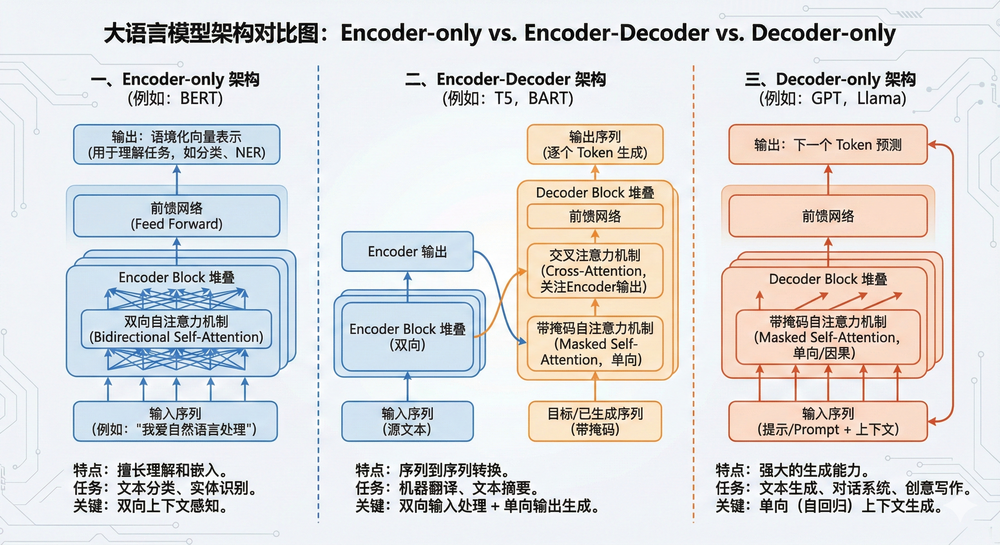
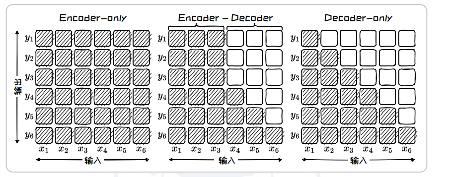

# 前言

# 一、 Encoder-only架构

Encoder-only 架构模型的预训练阶段和推理阶段在输入编码和特征编码部分是一致的

# 二、 Encoder-Decoder 架构

Encoder-Decoder架构是标准的transformer架构，融合了自注意力机制、掩码注意力机制和交叉注意力机制

# 三、 Decoder-only架构

Decoder-only 架构中的注意力矩阵来自于掩码自注意力模块，其特点是呈现 出“下三角”的注意力模式。这意味着在预测当前 Token 时，模型只能依赖于已经 生成的历史 Token 信息，体现了单向注意力机制。

# 四、注意力矩阵

| **架构类型**        | **注意力模式**       | **注意力方向** | **主要应用场景**   |
| ------------------- | -------------------- | -------------- | ------------------ |
| **Encoder-only**    | 完全（矩阵全满）     | 双向           | 文本理解、情感分析 |
| **Encoder-Decoder** | 混合（含交叉注意力） | 双向 + 单向    | 机器翻译、摘要生成 |
| **Decoder-only**    | 下三角（掩码）       | 单向           | 文本生成、对话系统 |

# 五、适配

| **架构类型**                      | **擅长的核心领域**       | **典型任务示例**                                          | **对应你的观点**               |
| --------------------------------- | ------------------------ | --------------------------------------------------------- | ------------------------------ |
| **Encoder-only** (如 BERT)        | **NLU** (自然语言理解)   | 文本分类、命名实体识别、情感分析、**NLI**（自然语言推理） | **对**（它是理解之王）         |
| **Encoder-Decoder** (如 T5, BART) | **Seq2Seq** (序列到序列) | 机器翻译、文本摘要、问答系统                              | **部分对**（它兼顾理解与生成） |
| **Decoder-only** (如 GPT, Llama)  | **NLG** (自然语言生成)   | 对话生成、故事创作、代码生成                              | **对**（它是生成之王）         |
